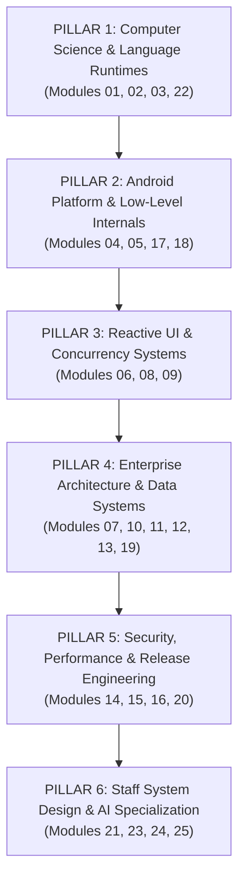

# MASTER CURRICULUM: SENIOR & STAFF ANDROID TECHNICAL ARCHITECT

**Target Candidate:** Satdev Kumar | 8 Years Experience (Senior Android Developer, IBM Consulting)  
**Track:** Senior Android Engineer / Lead Android Developer / Staff Mobile Architect / AI-Integrated Mobile Architect  
**Methodology:** Engineering-first, framework internals, bytecode disassembly, production-grade compilable architectures.

---

## 🏛️ CURRICULUM ARCHITECTURE OVERVIEW

The curriculum is structured across 6 Core Pillars, comprising 25 Deep Modules. Every module is tailored for an engineer with 8 years of experience, emphasizing internal mechanics, runtime behaviors, memory overhead, and architecture trade-offs.

---

## 📚 THE 25 MASTER MODULES

### PILLAR 1: COMPUTER SCIENCE & LANGUAGE RUNTIMES

#### Module 01: Programming Fundamentals & Computer Science for Architects
- **Core Topics:** OOP paradigms vs Functional programming, Encapsulation boundaries, Abstraction leaks, SOLID at architecture scale, Composition vs Inheritance at scale.
- **Runtimes & Memory:** Stack frame allocation, Heap memory fragmentation, Pointers & References, Generational Garbage Collection.
- **Concurrency Primitives:** Process vs Thread OS scheduling, Atomic operations (CAS), Mutex, Semaphore, Monitor locks, Deadlock detection (Coffman conditions), Race condition mitigation.
- **Engineering Rigor:** Clean Code principles, Code Review SLAs, Static analysis rulesets, ADR (Architecture Decision Records).

#### Module 02: Kotlin Language Mastery & Bytecode Internals
- **Type System:** Null safety semantics, Smart casting contracts, Type inference algorithms, Platform types (`T!`).
- **Functions & Inlining:** Lambdas, Function objects (`FunctionN`), `inline`, `noinline`, `crossinline`, Non-local returns, Reified generics, Bytecode bloat thresholds.
- **Advanced Types:** Sealed classes vs Sealed interfaces, Data classes (equals/hashCode/copy pitfall with arrays), Value classes (`@JvmInline`), Mangling, Boxing costs.
- **Delegation:** Class delegation (`by`), Property delegates (`by lazy`, `vetoable`, `observable`), Custom delegates, `LazyThreadSafetyMode` (SYNCHRONIZED, PUBLICATION, NONE).
- **Collections & Sequences:** Eager evaluation vs Lazy evaluation (`Sequence`), Intermediate vs Terminal operations, In-place mutation vs Persistent data structures.
- **Compiler Internals:** Kotlin 2.0 K2 compiler frontend, FIR (Frontend Intermediate Representation), IR (Intermediate Representation) backend transformations, Bytecode disassembly analysis using `javap` and ASM.

#### Module 03: Java Internals & Interoperability for Android Architects
- **Java Memory Model (JMM):** Shared memory architecture, CPU cache lines, Store buffers, Memory barriers, `volatile` visibility & reordering constraints, Happens-before relationships.
- **Concurrency Frameworks:** `java.util.concurrent`, `ThreadPoolExecutor` tuning, Work-stealing pool (`ForkJoinPool`), Synchronizers (`CountDownLatch`, `CyclicBarrier`, `CompletableFuture`).
- **JVM Internals:** Class loading phases (Loading, Linking, Initialization), ClassLoaders (`BootClassLoader`, `PathClassLoader`), JIT compilation (C1, C2), Bytecode verification.
- **Java/Kotlin Interop:** `@JvmStatic`, `@JvmOverloads`, `@JvmField`, Name mangling for `internal`, Exception handling (`@Throws`), SAM conversions.
- **Modernization:** Refactoring legacy Java monolithic applications to idiomatic Kotlin without downtime or breaking APIs.

#### Module 22: High-Yield Data Structures & Algorithms in Idiomatic Kotlin
- **Linear Data Structures:** Array vs ArrayList amortized resizing, LinkedList cache locality penalties, ArrayDeque as Stack/Queue, PriorityQueue binary heap.
- **Hashing Systems:** HashMap collision resolution (Separate chaining vs Open addressing, TreeBins in Java 8+), hashCode contract, Custom Key immutability.
- **Algorithmic Patterns:** Two Pointers, Sliding Window, Fast & Slow Pointers, Monotonic Stack/Queue, Binary Search over search space, Tree BFS/DFS, Graph Topological Sort, Union-Find.
- **Dynamic Programming & Caching:** Memoization, Tabulation, LRU Cache implementation with `LinkedHashMap` and custom DoublyLinkedList.

---

### PILLAR 2: ANDROID PLATFORM & LOW-LEVEL INTERNALS

#### Module 04: Android OS Architecture & Process Model
- **OS Plumbing:** Linux kernel primitives, Android init process, Zygote process initialization, Forking model, Copy-on-Write (CoW) memory sharing.
- **System Services:** SystemServer, ServiceManager, ActivityTaskManagerService (ATMS), WindowManagerService (WMS), PowerManagerService.
- **Process Creation & Lifecycle:** App launch sequence from Launcher tap to `Application.onCreate()`, `ActivityThread`, `LoadedApk`, Context hierarchy (`ContextImpl` vs `ContextWrapper`).
- **Binder IPC Architecture:** Linux kernel Binder driver (`/dev/binder`), `ioctl` system calls, 1MB transaction buffer limitation, AIDL, Parcel marshaling, Binder thread pool exhaustion (16-thread ceiling).
- **Process Prioritization:** Low Memory Killer (LMK), `oom_adj_score`, Process priority buckets (Foreground, Visible, Service, Cached), Handling Process Death (`SavedStateRegistry`, `SavedStateHandle`).

#### Module 05: Modern Views, Custom Layouts & Touch Dispatch Pipeline
- **View Hierarchy Internals:** `ViewRootImpl`, `DecorView`, Measure, Layout, and Draw passes, `requestLayout()` vs `invalidate()`.
- **Rendering Pipeline:** Hardware acceleration, DisplayList generation, OpenGL ES/Vulkan commands, `Choreographer` VSYNC signal synchronization, Triple buffering.
- **Touch Event Pipeline:** `MotionEvent` distribution, `dispatchTouchEvent`, `onInterceptTouchEvent`, `onTouchEvent`, Multi-touch tracking, VelocityTracker, NestedScrolling.
- **Edge-to-Edge & Modern View Systems:** `WindowInsetsCompat`, Display cutouts, Modern ConstraintLayout 2.x virtual layouts, ViewBinding vs DataBinding memory footprints.

#### Module 17: ART Memory Architecture, Garbage Collection & Profiling
- **ART Memory Layout:** Image space, Zygote space, Allocation space, Large Object Space (LOS), Non-moving space.
- **Garbage Collection Algorithms:** Generational Concurrent Copying (CC) GC, Mark-Sweep, Compaction phases, GC ergonomics, Pauses minimization.
- **Reference Types:** Strong, Soft, Weak, Phantom references, Reference queues, Cleaner mechanism.
- **Memory Leaks Triage:** Root causes (Static references, Unregistered listeners, Coroutine scope leaks, Inner class references), Heap dump analysis using Android Studio Memory Profiler and LeakCanary internals.

#### Module 18: Gradle Build Engineering, Version Catalogs & Convention Plugins
- **Build Lifecycle:** Initialization, Configuration, Execution phases, Task graph calculation.
- **Performance Optimizations:** Gradle Configuration Cache, Build Cache (local and remote), Incremental compilation, Worker API for parallel execution.
- **Modern Build Architecture:** Version Catalogs (`libs.versions.toml`), Standalone Convention Plugins (`build-logic`), Multi-project dependency coordination, Dynamic Feature Modules (DFMs).

---

### PILLAR 3: REACTIVE UI & CONCURRENCY SYSTEMS

#### Module 06: Jetpack Compose Deep Internals
- **Compiler Plugin:** Compose AST transformation, `@Composable` synthetic parameters (`$composer`, `$changed`, `$default`), Slot Table architecture (Gap Buffer).
- **Runtime Mechanics:** Positional memoization, Composer execution, Composition, Recomposition skipping, Stability System (`@Immutable`, `@Stable`, Stability configuration files).
- **Snapshot State System:** Multi-Version Concurrency Control (MVCC) in UI state, `Snapshot.takeMutableSnapshot()`, `derivedStateOf` optimization, Snapshot mutation observers.
- **Side-Effects System:** `LaunchedEffect`, `rememberCoroutineScope`, `DisposableEffect`, `SideEffect`, `produceState`, `derivedStateOf`.
- **Custom Layouts & Graphics:** `Layout` composable, `SubcomposeLayout` performance pitfalls, `Modifier.Node` migration, Vector graphics & Canvas rendering.
- **Compose Navigation:** Type-safe Navigation Compose (Kotlin Serialization routes), Transition animations, Shared element transitions.

#### Module 08: Coroutines Deep Internals & Structured Concurrency
- **Compiler Transformations:** Continuation-Passing Style (CPS), State machine generation, `$continuation` bytecode, `invokeSuspend` label jumping.
- **Structured Concurrency:** `CoroutineScope`, `CoroutineContext`, Elements & Keys, `CombinedContext` linked list, `Job` hierarchy, `SupervisorJob` fault isolation.
- **Cancellation & Exception Handling:** Cooperative cancellation, `ensureActive()`, `yield()`, CancellationException mechanics, Exception propagation rules, `coroutineExceptionHandler`.
- **Dispatchers:** `Dispatchers.Default` (Work-stealing pool), `Dispatchers.IO` (Elastic thread pool), `Dispatchers.Main` (Handler dispatcher), Custom thread pools.
- **Flow Reactive Streams:** Cold Flow, Hot Streams (`StateFlow`, `SharedFlow`), Backpressure strategies (`buffer`, `conflate`, `DROP_OLDEST`), High-frequency operators (`debounce`, `distinctUntilChanged`, `flatMapLatest`).

#### Module 09: Jetpack Architecture Components
- **ViewModel Internals:** `ViewModelStore`, `ViewModelProvider.Factory`, Retaining instances across configuration changes via `NonConfigurationInstances`.
- **Lifecycle System:** `LifecycleOwner`, `LifecycleObserver`, `Lifecycle.State` transitions, `repeatOnLifecycle` vs `flowWithLifecycle` for safe Flow collection.
- **SavedState System:** `SavedStateRegistryOwner`, `SavedStateHandle`, Bundle serialization limits, Automated restoration after process death.

---

### PILLAR 4: ENTERPRISE ARCHITECTURE & DATA SYSTEMS

#### Module 07: Enterprise Mobile Architecture (Clean, MVI, State Machines)
- **Architectural Paradigms:** Clean Architecture layer boundaries (Presentation, Domain, Data), Hexagonal / Ports & Adapters, Unidirectional Data Flow (UDF).
- **MVI Architecture:** Immutable UI State, User Intent/Event, State Reducer, Single-time UI Effects (Channels vs Events).
- **Domain-Driven Design (DDD) Fundamentals:** Entities, Value Objects, Aggregates, Domain Repositories, Use Cases / Interactors.
- **Pragmatic Architecture:** Knowing when NOT to use Clean Architecture (avoiding premature abstraction and redundant mapper overhead).

#### Module 10: Dependency Injection at Scale (Dagger 2 & Hilt)
- **DI Core Principles:** Inversion of Control, Dependency Inversion, Constructor Injection vs Service Locator.
- **Dagger Internals:** Annotation processing / KSP, Generated code analysis (`_Factory`, `_MembersInjector`, `DoubleCheck` provider), Component tree lifecycle.
- **Hilt Architecture:** Predefined component hierarchy (`SingletonComponent`, `ActivityRetainedComponent`, `ViewModelComponent`, `ActivityComponent`), Scoping rules, EntryPoints, `@AssistedInject`.
- **Multi-Module DI:** Isolated component dependencies, Feature module provisioning, Hilt vs Koin vs Manual DI architectural trade-offs.

#### Module 11: Resilient Networking & Banking-Grade API Integration
- **Transport Security:** HTTP/2 multiplexing, TLS 1.3 handshakes, Certificate Pinning (`CertificatePinner`), Public Key Pinning, Certificate Transparency.
- **Network Pipeline:** OkHttp connection pooling, Socket timeouts, Interceptors chain (`RealInterceptorChain`), Authenticator.
- **Concurrent Token Refresh:** Mutex-synchronized token refresh, Eliminating the "Thundering Herd" problem when access tokens expire across simultaneous requests.
- **Resilience & Caching:** Exponential backoff retry policies, Idempotency keys (`X-Idempotency-Key`), ETags, Offline caching policies.

#### Module 12: Offline-First Persistence, Room & Database Performance
- **Room Architecture:** SQLite abstraction, SQLite WAL (Write-Ahead Logging) mode, Room compile-time query verification (KSP), Generated DAO implementations.
- **Database Migrations:** Schema hashing, Automated migrations (`AutoMigration`), Manual migrations, Data integrity testing with `MigrationTestHelper`.
- **Security & Performance:** SQLCipher integration, In-memory encryption overhead, Database indexing strategies, Query optimization (EXPLAIN QUERY PLAN).
- **Key-Value Storage:** `DataStore` (Preferences & Proto) vs SharedPreferences, Atomic disk writes, Kotlin Serialization.

#### Module 13: Background Processing & WorkManager Execution Limits
- **OS Constraints:** Doze Mode, App Standby Buckets, Battery Saver, Android 14/15/16 Foreground Service restrictions & explicit types.
- **WorkManager Architecture:** SQLite-backed job persistence, `WorkRequest`, Constraints (Network, Battery, Storage), Chaining jobs, Unique work policies.
- **Advanced Work:** `CoroutineWorker`, Expedited work, Retry & Exponential backoff policies, Custom Worker injection via Hilt `WorkerFactory`.

#### Module 19: Multi-Module Architecture & Feature Isolation
- **Modularization Strategies:** Feature-by-layer vs Feature-by-feature, Core module design (`:core:network`, `:core:database`, `:core:designsystem`).
- **Encapsulation & Dependency Inversion:** API vs Implementation modules (`:feature:auth:api` and `:feature:auth:impl`), Preventing classpath leaks.
- **Navigation Across Modules:** Decoupled cross-feature navigation without circular dependencies (Deep links, Service providers, Feature navigators).
- **Dynamic Feature Modules:** On-demand delivery, Play Feature Delivery, SplitCompat initialization.

---

### PILLAR 5: SECURITY, PERFORMANCE & RELEASE ENGINEERING

#### Module 14: Mobile Security, Cryptography & Banking Compliance
- **Hardware-Backed Security:** Android Keystore provider, Trusted Execution Environment (TEE), StrongBox Keymaster, Key attestation.
- **Cryptographic Operations:** AES-256 GCM authenticated encryption, RSA key-pair generation, IV (Initialization Vector) randomization, Key derivation (PBKDF2, Argon2).
- **Biometric Authentication:** `BiometricPrompt` crypto-object binding, FIDO2 / Passkeys integration, Revocation on new biometric enrollment.
- **App Hardening & Integrity:** Google Play Integrity API (Device integrity, App licensing, Account details), Root detection limitations, Anti-tampering, Anti-hooking (Frida/Xposed mitigation).
- **Compliance & Privacy:** OWASP Mobile Application Security Verification Standard (MASVS v2), PCI-DSS compliance in mobile banking, Zeroization of sensitive data in RAM.

#### Module 15: Enterprise Testing Strategy, Test Doubles & Flakiness Elimination
- **Testing Pyramid:** Unit tests (70%), Integration tests (20%), End-to-End UI tests (10%).
- **Unit Testing Tooling:** JUnit 5, MockK (spies, relaxed mocks, coEvery), Turbine for testing Kotlin Flows, StandardTestDispatcher vs UnconfinedTestDispatcher.
- **Integration & Network Testing:** `MockWebServer`, Room in-memory database testing, Robolectric for fast local Android tests.
- **UI & Snapshot Testing:** Compose testing APIs (`composeTestRule`, Semantics tree assertions), Snapshot testing using Paparazzi / Roborazzi.
- **Test Quality:** Mutation testing (Pitest), Flaky test quarantine workflows, Architecture boundary enforcement using ArchUnit.

#### Module 16: Performance Engineering, Startup Profiling & Jank Elimination
- **App Startup Optimization:** Cold, Warm, Hot startup definitions, Time To Initial Display (TTID) vs Time To Full Display (TTFD), AndroidX App Startup initializer graph.
- **Frame Rendering & Jank:** 60Hz/90Hz/120Hz display refresh deadlines (16.6ms / 11.1ms / 8.33ms), Choreographer frame drop analysis, SurfaceView vs TextureView.
- **Benchmarking & Profiling:** Jetpack Macrobenchmark, Baseline Profiles compilation (eliminating JIT warmup), Perfetto system tracing, Custom trace sections (`Trace.beginSection`).
- **APK/AAB Size Optimization:** R8 full mode, Dead code elimination, ProGuard rule optimization, Resource shrinking, WebP / SVG conversion, Dynamic delivery.

#### Module 20: CI/CD Automation, Release Management & App Distribution
- **Version Control & Workflows:** GitFlow vs Trunk-Based Development, Branch protection policies, Conventional Commits.
- **CI/CD Pipelines:** GitHub Actions matrix workflows, Fastlane automation (gym, match, supply), Automated linting (Ktlint, Detekt, Android Lint).
- **Release Strategy:** Google Play Console phased rollouts (1%, 5%, 20%, 50%, 100%), Crash rate thresholds, Automated rollbacks, In-App Updates API.

---

### PILLAR 6: STAFF SYSTEM DESIGN & AI SPECIALIZATION

#### Module 21: Staff-Level Android System Design (12 Industry Case Studies)
1. **Real-Time Messaging System (WhatsApp/Signal):** WebSocket connection management, SQLite message store, Offline outbox, Delivery ACK protocol, End-to-End Encryption (E2EE) session architecture.
2. **Infinite Social Feed (Instagram/TikTok):** Prefetching algorithms, Disk/Memory image and video caching (LRU), Dynamic view recycling, Cursor-based pagination.
3. **Adaptive Video Streaming (YouTube/Netflix):** Media3 ExoPlayer session lifecycle, Adaptive Bitrate (ABR) switching, Chunked pre-caching, Background audio playback.
4. **Mobile Banking & Card-Free ATM (PNC-Style):** Zero-trust architecture, Dynamic device attestation, TOTP tokenization, NFC/QR handshake with ATM hardware, RAM zeroization.
5. **Real-Time Ride-Hailing (Uber/Lyft):** Battery-efficient high-frequency GPS tracking, Kalman filter location smoothing, WebSocket driver location streaming, Map tile vector cache.
6. **Food Delivery & Real-Time Order Tracking (DoorDash/Swiggy):** Multi-state order tracking machine, Polling fallback vs Server-Sent Events (SSE), Geofencing alerts.
7. **Offline-First Synchronization Engine:** Resilient sync queue, Conflict resolution (Vector clocks / Last-Write-Wins), Dynamic network state adaptation.
8. **E-Commerce Checkout & Flash Sale System:** Cart state synchronization, Race condition prevention in stock reservation, Payment gateway SDK orchestrator.
9. **Global Push Notification Delivery System:** FCM message prioritization, Collapsible notifications, Notification channels, In-app banner routing.
10. **Enterprise Modular Authentication SDK:** Single Sign-On (SSO), OAuth 2.0 with PKCE, Biometric Keystore binding, Inter-app token sharing.
11. **High-Frequency Financial Ticker (Robinhood/Bloomberg):** WebSocket price streams, UI batch throttling (conflation to 60fps), Low-allocation memory buffers.
12. **Modular Enterprise Mobile Platform:** Micro-frontends on mobile, Dynamic feature modules, Remote feature flagging, Plugin runtime architecture.

#### Module 23: Production Design Patterns & Anti-Pattern Triage
- **Architectural Patterns:** Repository, Decorator, Facade, Adapter, Strategy, Observer, Command, State, Visitor.
- **Android Anti-Patterns:** God Activity/ViewModel, Service Locator disguised as DI, Primitive obsession, Unbounded thread allocation, Leaky abstractions, Over-engineering Clean Architecture.

#### Module 24: Kotlin Multiplatform (KMP) Architecture for Enterprise
- **KMP Core:** Shared business logic, `expect`/`actual` declarations, Source set hierarchies (`commonMain`, `androidMain`, `iosMain`).
- **Shared Architecture Stack:** Ktor Client, SQLDelight / Room KMP, Multiplatform Coroutines & Flow, Koin / Kotlin-Inject.
- **Swift / iOS Interoperability:** Memory management under Swift/Kotlin, ObjC export limitations, Swift friendly APIs (`@ObjCName`), Compose Multiplatform considerations.

#### Module 25: AI-Integrated Mobile Architecture (On-Device LiteRT, AICore & Agents)
- **On-Device Inference:** Google LiteRT (TensorFlow Lite), MediaPipe GenAI SDK, Running local LLMs (Gemma 2B, Gemini Nano) via Android AICore.
- **Model Optimization:** Post-training quantization (INT8, INT4, FP16), Memory mapping (`ByteBuffer`), NPU / GPU delegate acceleration.
- **Agentic Mobile Architecture:** Client-side tool calling, Structured JSON outputs, RAG (Retrieval-Augmented Generation) on mobile with local vector databases (ObjectBox / sqlite-vec).
- **Secure AI Backend Gateway:** Zero-leak token management, WebSocket streaming generation, Integration with Enterprise AI platforms (watsonx, Azure OpenAI, AWS Bedrock).

---
*Next: See [30_DAY_PREPARATION_PLAN.md](file:///Users/satdevkumar/Desktop/Android%20Pre%20Main/00_CURRICULUM_AND_ROADMAP/30_DAY_PREPARATION_PLAN.md) for the daily execution syllabus.*
