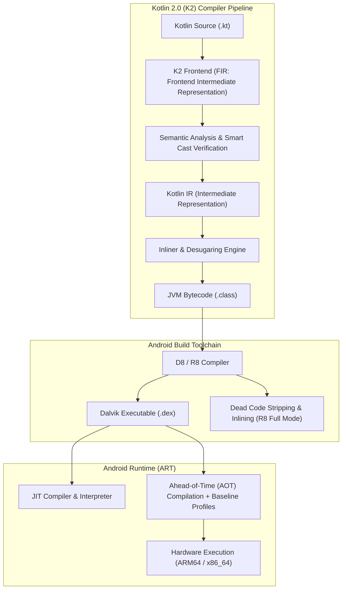
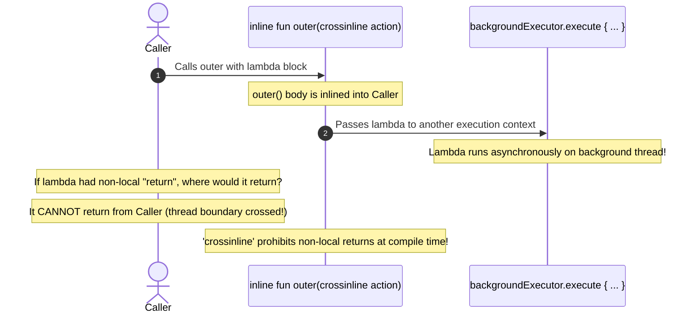

# MODULE 02: KOTLIN LANGUAGE MASTERY & BYTECODE INTERNALS
## CHAPTER 01: KOTLIN 2.0 COMPILER, BYTECODE DISASSEMBLY & MEMORY ARCHITECTURE

---

### A. FUNDAMENTALS

#### 1. What is the Concept?
Kotlin code compiles to JVM bytecode (targeting Java 8+ or 17/21 bytecode levels) or DEX bytecode when processed by the D8/R8 Android compiler toolchain. While Kotlin provides expressive high-level abstractions—such as higher-order functions, lambdas, scope functions, property delegates, and value classes—every language construct is desugared by the Kotlin compiler (K2 in Kotlin 2.0+) into standard JVM bytecode instructions and classes.

Understanding this transformation means knowing:
- How closures and lambdas translate into anonymous inner class instances (`FunctionN` objects) or static singletons.
- How the `inline`, `noinline`, and `crossinline` modifiers alter bytecode emission, stack frames, and non-local control flow.
- How Value classes (`@JvmInline value class`) eliminate heap allocations at compile time through type erasure and method mangling, and where unintended autoboxing traps occur.

#### 2. Why Does It Exist?
The JVM has historically lacked native primitives for first-class functions and zero-cost user-defined value wrappers (prior to Project Valhalla). To give developers modern functional programming ergonomics without waiting for underlying JVM platform changes, JetBrains engineered a sophisticated compiler pipeline that transforms modern idioms into standard, backward-compatible bytecode.

#### 3. What Problem Does It Solve?
- **Heap Allocation Overhead:** In tight loops or high-frequency operations (e.g., audio processing, 120Hz frame rendering, biometric cryptographic verification), creating temporary objects for every function call triggers frequent Garbage Collection (GC) pauses, causing frame drops (jank) and battery drain.
- **Abstraction Penalties:** Developers often have to choose between clean architecture (strong typing, small functions, functional pipelines) and raw performance. The compiler's inlining and inlining-optimization mechanics eliminate this penalty.
- **Type Safety Without Overhead:** Primitive types (like raw `Long` for a banking `AccountId`) are error-prone because any Long can be passed anywhere. Value classes provide strict compile-time type boundaries without the cost of heap-allocated wrapper objects.

#### 4. Where is It Used?
- **High-Performance Android Subsystems:** Jetpack Compose (where `Modifier` and layout measurables run on every frame).
- **Reactive Streaming & Concurrency:** Kotlin Coroutines and Flows (suspension state machines, channel buffers).
- **FinTech & Banking Architectures:** Domain-Driven Design (DDD) Value Objects where account numbers, monetary amounts, and cryptographic hashes require strict type safety without memory bloat.

#### 5. What Happens If We Do Not Use / Understand It?
- **Severe Memory Churn:** Uncontrolled lambda allocations in UI loops trigger ART Generational Concurrent Copying (CC) GC pauses, leading to jank and ANRs.
- **Code Bloat:** Blindly applying `inline` to massive functions duplicated across dozens of call sites causes bytecode bloat, expanding APK/DEX size and exceeding CPU instruction cache (L1/L2 i-cache) limits, which degrades execution speed.
- **Unintended Boxing:** Misusing Value classes with generic interfaces or nullable types forces the runtime to box them back into `java.lang.Object`, defeating their primary purpose.

---

### B. TECHNICAL DEFINITION

> **Kotlin Bytecode Desugaring & Inlining:**
> A compile-time code synthesis process wherein the Kotlin frontend compiler (FIR in K2) lowers high-level language structures into Kotlin Intermediate Representation (IR). The backend then emits standard Java Virtual Machine bytecode. In the case of `inline` functions, the compiler physically duplicates the function's bytecode instructions directly into the caller's call site, substituting lambda parameters with their actual block bodies, thereby eliminating `FunctionN` heap allocations, virtual call dispatch (`invokevirtual`), and stack frame creation.

---

### C. INTERNAL WORKING & ARCHITECTURE



#### 1. Anatomy of Lambda Bytecode Without Inlining
When you declare a non-inlined higher-order function:
```kotlin
fun executeOperation(action: () -> Unit) {
    action()
}
```
The Kotlin compiler generates an invocation of the SAM interface `kotlin.jvm.functions.Function0`:
```java
// Decompiled Java equivalent of non-inlined execution
public static final void executeOperation(@NotNull Function0 action) {
    Intrinsics.checkNotNullParameter(action, "action");
    action.invoke(); // Virtual call dispatch: INVOKEINTERFACE kotlin/jvm/functions/Function0.invoke
}
```
If the lambda captures a variable from its enclosing scope (a closure):
```kotlin
val token = sessionToken
executeOperation {
    sendTelemetry(token) // Captures 'token'
}
```
The compiler allocates a new heap instance of an anonymous class implementing `Function0` on **every single execution**:
```bytecode
NEW com/example/telemetry/TelemetryManager$track$1
DUP
ALOAD 0 // loads captured reference
INVOKESPECIAL com/example/telemetry/TelemetryManager$track$1.<init> (Ljava/lang/String;)V
INVOKESTATIC com/example/telemetry/TelemetryManager.executeOperation (Lkotlin/jvm/functions/Function0;)V
```
*Memory Impact:* If called 60 times a second inside a scroll listener or animation frame, 60 `Function0` instances are allocated per second on the heap.

#### 2. The `inline` Transformation
When marked with `inline`:
```kotlin
inline fun executeOperation(action: () -> Unit) {
    action()
}
```
The compiler eliminates the `Function0` class entirely. It copies the body of `executeOperation` and the body of the passed lambda directly into the call site:
```bytecode
// Bytecode at call site directly inlines the instructions:
ALOAD 1 // loads token directly onto stack
INVOKESTATIC com/example/telemetry/TelemetryManager.sendTelemetry (Ljava/lang/String;)V
```
*Zero object allocations. Zero virtual method dispatches.*

#### 3. `noinline` vs `crossinline` Mechanics



- **`noinline`:** Used when an inline function takes multiple lambda arguments, but one of the lambdas must be retained, stored in a variable, or passed to a non-inlined function.
- **`crossinline`:** Used when an inline function executes the lambda not directly in its own body, but inside an execution context that cannot allow non-local returns (e.g., inside an object expression, a nested local runnable, or a different thread/coroutine context). It tells the compiler: *Inline the code, but disallow non-local `return` statements inside the lambda.*

#### 4. Value Classes (`@JvmInline value class`) & Name Mangling
Consider a banking domain value object:
```kotlin
@JvmInline
value class AccountNumber(val raw: String) {
    fun formatMasked(): String = "****" + raw.takeLast(4)
}
```
- **At Compile Time:** Everywhere `AccountNumber` is used as a concrete type, the compiler replaces it with the underlying primitive or reference (`String`).
- **Name Mangling:** To avoid signature collisions with functions accepting raw `String`, the compiler appends a hash of the type to the method name in JVM bytecode:
```java
// Decompiled bytecode signature:
public static final String formatMasked-xxxxxxx(String raw) { ... }
```
- **The Autoboxing Trap:** If you pass `AccountNumber` to a function expecting a generic type `T` or an interface (e.g., `Comparable<AccountNumber>`), or if it is declared nullable (`AccountNumber?`), the compiler **must box** the value into a heap-allocated wrapper object.

---

### D. PRODUCTION IMPLEMENTATION

#### High-Performance Cryptographic Audit Logger (Banking Context)
Below is a compilable, production-grade example demonstrating:
1. `inline` with `crossinline` for zero-allocation execution tracking.
2. Value classes for zero-overhead type safety.
3. Proper exception boundaries and defensive zeroization.

```kotlin
package com.ibm.banking.security.audit

import java.security.SecureRandom
import java.util.concurrent.Executor
import java.util.concurrent.Executors

// 1. Strongly typed Domain Value Objects (Zero-Allocation on Heap)
@JvmInline
value class TransactionId(val value: String) {
    init {
        require(value.isNotEmpty()) { "TransactionId cannot be empty" }
    }
}

@JvmInline
value class AccountHash(val hash: String)

sealed interface AuditEvent {
    val transactionId: TransactionId
    val timestamp: Long

    data class AuthorizationSuccess(
        override val transactionId: TransactionId,
        val account: AccountHash,
        override val timestamp: Long = System.currentTimeMillis()
    ) : AuditEvent

    data class AuthorizationFailure(
        override val transactionId: TransactionId,
        val reason: String,
        override val timestamp: Long = System.currentTimeMillis()
    ) : AuditEvent
}

// 2. High-Performance Audit Engine
object SecurityAuditEngine {

    private val auditExecutor: Executor = Executors.newSingleThreadExecutor { r ->
        Thread(r, "security-audit-worker").apply { isDaemon = true }
    }

    /**
     * Executes security-sensitive operations with zero lambda allocation overhead.
     * Demonstrates:
     * - inline: Eliminates function object allocation.
     * - crossinline: Allows dispatching the audit completion block to a background thread
     *   without allowing caller to perform invalid non-local returns.
     */
    inline fun <T> executeSecuredTransaction(
        txId: TransactionId,
        crossinline onSecurityAudited: (AuditEvent) -> Unit,
        block: () -> T
    ): Result<T> {
        val startTime = System.nanoTime()
        return try {
            val result = block()
            val durationNs = System.nanoTime() - startTime

            // Background audit dispatch
            auditExecutor.execute {
                onSecurityAudited(
                    AuditEvent.AuthorizationSuccess(transactionId = txId, account = AccountHash("sha256_mock_hash"))
                )
            }

            Result.success(result)
        } catch (t: Throwable) {
            auditExecutor.execute {
                onSecurityAudited(
                    AuditEvent.AuthorizationFailure(
                        transactionId = txId,
                        reason = t.message ?: "Unknown security violation"
                    )
                )
            }
            Result.failure(t)
        }
    }
}
```

#### Unit Testing Verification with Mockito/MockK
```kotlin
package com.ibm.banking.security.audit

import org.junit.Assert.assertEquals
import org.junit.Assert.assertTrue
import org.junit.Test
import java.util.concurrent.CountDownLatch
import java.util.concurrent.TimeUnit

class SecurityAuditEngineTest {

    @Test
    fun executeSecuredTransaction_success_returnsResultAndDispatchesAudit() {
        val txId = TransactionId("TX-998822")
        val latch = CountDownLatch(1)
        var receivedEvent: AuditEvent? = null

        val result = SecurityAuditEngine.executeSecuredTransaction(
            txId = txId,
            onSecurityAudited = { event ->
                receivedEvent = event
                latch.countDown()
            }
        ) {
            // Simulated transaction body
            "SUCCESS_PAYLOAD"
        }

        assertTrue(result.isSuccess)
        assertEquals("SUCCESS_PAYLOAD", result.getOrNull())
        
        // Wait for background worker execution
        val completed = latch.await(2, TimeUnit.SECONDS)
        assertTrue("Audit event must be dispatched to worker thread", completed)
        assertTrue(receivedEvent is AuditEvent.AuthorizationSuccess)
        assertEquals(txId, receivedEvent?.transactionId)
    }
}
```

---

### E. REAL-WORLD SCENARIOS

1. **Banking & FinTech (ATM Card-Free Tokenization):**
   When passing an authorization code, account token, and cryptographic signature to an ATM handshake service, wrapping primitives in Value classes (`AccountToken`, `TerminalSessionId`) guarantees that an engineer cannot accidentally swap parameters of the same raw type (`String`), preventing catastrophic fund routing errors without adding object allocation overhead in cryptographic loops.
2. **E-Commerce (Flash Sale Stock Deductions):**
   In shopping cart price recalculations handling hundreds of items simultaneously, using `inline` higher-order functions for tax, discount, and coupon calculations eliminates hundreds of transient `Function1` object allocations per frame.
3. **High-Frequency Sensor / Telematics (Connected Automotive):**
   In an IoT or connected automotive Android app processing vehicle telemetry packets at 100Hz, non-inlined closures cause rapid heap churn, triggering GC compaction pauses that drop telemetry packets. Inlining critical packet-parsing pipelines drops allocations to zero.

---

### F. ARCHITECTURE AND TRADE-OFFS

| Dimension | Standard Function | `inline` Function | `@JvmInline value class` |
| :--- | :--- | :--- | :--- |
| **Bytecode Size** | Minimal (One method definition) | Expands with every call site (Duplicated bytecode) | Minimal (Underlying primitive used) |
| **Heap Allocations** | Allocates `FunctionN` if closing over variables | **Zero** lambda allocations | **Zero** (unless boxed to generic or nullable) |
| **Stack Frames** | Creates new stack frame (`invokevirtual`) | Reuses existing caller stack frame | Normal method dispatch |
| **Non-Local Returns** | Not allowed | Supported (caller function returns directly) | N/A |
| **Private Access** | Normal access | Cannot access `private` members of enclosing class unless `internal`/`published` | Encapsulates single primitive field |
| **When to Use** | General business logic; large functions (>15 lines) | Short functions taking lambdas (<10 lines); high-frequency loops | Domain primitives requiring type safety (ID, Hash, Money) |
| **When NOT to Use** | High-frequency rendering or tight mathematical loops | Massive functions; functions without lambda parameters | Complex entities requiring multiple mutable state variables |

---

### G. COMMON MISTAKES & ANTI-PATTERNS

#### Anti-Pattern 1: Inlining Functions Without Lambda Parameters
```kotlin
// BAD: Compiler warning & bytecode waste
inline fun calculateFee(amount: Double): Double {
    return amount * 0.025
}
```
*Why it fails:* Inlining a function that does **not** take a lambda offers almost zero performance gain because the JVM JIT compiler already inlines small methods at runtime. It only increases DEX bytecode size.

#### Anti-Pattern 2: The Value Class Inadvertent Autoboxing Trap
```kotlin
interface Identifiable<T> { val id: T }

@JvmInline
value class UserId(val raw: String) : Identifiable<String> {
    override val id: String get() = raw
}

fun printId(entity: Identifiable<*>) {
    println(entity.id)
}

// AT CALL SITE:
val user = UserId("usr_123")
printId(user) // CRITICAL: 'user' is forced to box into a heap-allocated UserId object!
```
*Correction:* Keep value classes unboxed by accepting the concrete Value Class type directly in function parameters rather than generic interfaces:
```kotlin
fun printUserId(user: UserId) { // Unboxed: compiles to (String user)
    println(user.raw)
}
```

---

### H. INTERVIEW PREPARATION (BASIC TO STAFF LEVEL)

#### Q1 (Basic): What is the difference between `inline`, `noinline`, and `crossinline`?
**Answer:**
- `inline` instructs the compiler to copy the function body and the lambda body directly into each call site, eliminating lambda object instantiation.
- `noinline` prevents a specific lambda parameter within an inline function from being inlined, allowing it to be stored as a reference or passed to a non-inlined function.
- `crossinline` permits inlining the lambda but forbids non-local `return` statements, which is mandatory when the lambda is executed inside a nested local object, coroutine, or thread pool.

#### Q2 (Intermediate): What is a non-local return, and why does Kotlin allow it only in inline functions?
**Answer:**
A non-local return is when a `return` statement inside a lambda terminates the *enclosing outer function* rather than just the lambda itself.
In standard (non-inlined) functions, the lambda executes inside an instance of `Function0.invoke()`. A `return` cannot unwind the caller's stack frame from another object's method call. But in an `inline` function, because the lambda code is physically copied into the outer function's stack frame, a raw `return` statement is valid bytecode that directly returns from the enclosing function.

#### Q3 (Advanced): How does `@JvmInline value class` differ from a `data class` with a single property at runtime?
**Answer:**
A `data class` is a full heap-allocated `java.lang.Object` with an object header (typically 12–16 bytes on 64-bit ART), field references, and synthetic methods (`copy`, `component1`, `equals`, `hashCode`).
A `value class` has **no object header and no heap allocation** when used as a concrete type; the compiler unwraps the single property and passes it directly as a primitive or underlying reference in CPU registers or stack slots. It uses synthetic name mangling to guarantee signature uniqueness on the JVM.

#### Q4 (Senior Scenario): You are profiling a banking app and notice severe GC pauses during a high-frequency payment verification screen. You suspect lambda allocations in a custom DSL. How do you verify and fix it?
**Answer:**
1. **Diagnosis:** Run Android Studio Profiler -> Memory Profiler -> Record Java/Kotlin Allocations. Filter allocations by package and inspect class instances of `Function0`, `Function1`, or synthetic lambda classes (`$$Lambda$`). Look for rapid allocations coinciding with GC saw-tooth patterns.
2. **Bytecode Verification:** Inspect the generated bytecode via `Tools -> Kotlin -> Show Kotlin Bytecode` -> `Decompile`. Check if `new FunctionX` is invoked on every iteration.
3. **Remediation:** Mark the high-frequency DSL extension functions with `inline`. Ensure any state capturing inside the lambda uses local variables rather than mutable outer fields. Re-profile to confirm allocation drops to zero.

#### Q5 (Staff Architecture): Explain the architectural dangers of over-inlining in a 100-module Android codebase.
**Answer:**
1. **Bytecode Expansion (DEX Limits):** Inlining a 50-line utility function at 1,000 call sites duplicates 50,000 lines of bytecode across DEX files, increasing APK size and potentially crossing multidex boundary limits.
2. **CPU Instruction Cache (i-Cache) Thrashing:** Modern mobile CPUs rely heavily on L1/L2 instruction caches. Duplicating code across multiple call sites bloats the execution footprint, reducing cache hits and paradoxically making execution *slower* than a single shared method call.
3. **Compilation Cascade:** An inline function change in a low-level `:core:common` module invalidates the ABI hash, forcing Gradle to recompile all downstream consumer modules, destroying build caching and configuration cache efficiency.

---

### I. CODING PRACTICE

#### Problem: Implement a High-Performance, Zero-Allocation Circuit Breaker
**Requirement:** Build a `CircuitBreaker` utility for resilient network calls that tracks consecutive failures. It must take an `execute` lambda, inline the happy path for zero heap allocation, and transition across `CLOSED`, `OPEN`, and `HALF_OPEN` states thread-safely without lock contention.

```kotlin
package com.ibm.banking.resilience

import java.util.concurrent.atomic.AtomicInteger
import java.util.concurrent.atomic.AtomicLong

enum class CircuitState { CLOSED, OPEN, HALF_OPEN }

class CircuitBreaker(
    private val failureThreshold: Int = 3,
    private val resetTimeoutMs: Long = 10_000L
) {
    private val failureCount = AtomicInteger(0)
    private val lastFailureTime = AtomicLong(0L)
    private val state = AtomicInteger(CircuitState.CLOSED.ordinal)

    fun currentState(): CircuitState = CircuitState.values()[state.get()]

    /**
     * Inlined invocation: Zero lambda object creation on the hot path.
     */
    inline fun <T> run(block: () -> T): Result<T> {
        val now = System.currentTimeMillis()
        val currentOrdinal = state.get()

        if (currentOrdinal == CircuitState.OPEN.ordinal) {
            if (now - lastFailureTime.get() > resetTimeoutMs) {
                // Attempt transition to HALF_OPEN via CAS
                state.compareAndSet(CircuitState.OPEN.ordinal, CircuitState.HALF_OPEN.ordinal)
            } else {
                return Result.failure(IllegalStateException("Circuit is OPEN. Requests blocked."))
            }
        }

        return try {
            val result = block()
            onSuccess()
            Result.success(result)
        } catch (t: Throwable) {
            onFailure(now)
            Result.failure(t)
        }
    }

    @PublishedApi
    internal fun onSuccess() {
        failureCount.set(0)
        state.set(CircuitState.CLOSED.ordinal)
    }

    @PublishedApi
    internal fun onFailure(timestamp: Long) {
        lastFailureTime.set(timestamp)
        val failures = failureCount.incrementAndGet()
        if (failures >= failureThreshold) {
            state.set(CircuitState.OPEN.ordinal)
        }
    }
}
```

*Complexity Analysis:*
- **Time Complexity:** $O(1)$ state evaluation using atomic instructions.
- **Space Complexity:** $O(1)$ memory overhead. Zero heap allocations during execution thanks to `inline`.

---

### J. SENIOR ENGINEER INTERVIEW SCRIPTS

#### 60-Second Explanation (Executive Summary)
> *"In Kotlin, high-level functional idioms can inadvertently trigger heap allocations because lambdas compile to `FunctionN` interface instances on the JVM. The `inline` keyword instructs the compiler to eliminate this abstraction penalty by copying the function body directly into the call site. We use `noinline` when a lambda must be preserved as a reference, and `crossinline` when the lambda is executed inside another execution context, such as a worker thread, to forbid non-local returns. Complementing this, `@JvmInline value class` gives us domain-driven type safety with zero heap allocations, as the compiler unwraps the value into a raw primitive at runtime while using name-mangling to ensure JVM signature safety."*

#### 3-Minute Deep Dive (Staff Architecture Level)
> *"When designing high-throughput or 120-fps Android systems—like Jetpack Compose layouts or banking cryptographic pipelines—memory churn on the heap directly translates into ART Garbage Collection pauses and dropped frames.
>
> At the bytecode level, non-inlined lambdas that capture state allocate an anonymous class instance every time they are reached. Marking small, hot-path functions as `inline` causes the K2 compiler's IR backend to substitute the lambda body directly into the caller's stack frame. This eliminates both the `FunctionN` heap allocation and the `invokevirtual` dispatch overhead.
>
> However, an architect must guard against over-inlining. Duplicating large functions across hundreds of call sites causes bytecode explosion, bloats DEX files, and degrades CPU instruction-cache (L1/L2) hit rates. Furthermore, if the lambda must be handed off to a thread pool or coroutine dispatcher, raw inlining would allow invalid non-local returns that break the stack; `crossinline` enforces compile-time safety by preventing non-local control flow while retaining inlining.
>
> Finally, in our banking domain models, we replace primitive obsession using `@JvmInline value class`. At runtime, the JVM manipulates raw strings or primitives directly, eliminating object headers and pointer dereferencing. We enforce strict architectural boundaries to avoid passing value classes into generic interfaces or nullable references, which would otherwise trigger silent autoboxing and negate our memory optimization."*

---

### K. KNOWLEDGE VALIDATION & SELF-ASSESSMENT

#### 10 Senior Interview Questions
1. How does the K2 compiler frontend (FIR) differ from the legacy K1 compiler in resolving inline functions?
2. Under what precise bytecode conditions does a Kotlin lambda avoid creating a new heap instance even when NOT marked `inline`? *(Answer: When it captures no outer scope variables, compiling to a static singleton `INSTANCE`)*.
3. Why can an `inline` function not access `private` properties of its declaring class?
4. What is `@PublishedApi` and why is it necessary?
5. How does Java call a Kotlin function that takes a Value Class as a parameter?
6. What happens if two Value Classes wrap the same primitive type and overload the same function? How does the compiler resolve the JVM signature collision?
7. How does R8 full mode optimize Kotlin inline functions differently from the Kotlin compiler itself?
8. What is the impact of inline functions on stack traces during crash debugging?
9. Why does `inline` support reified generics (`reified T`) while standard functions cannot?
10. Can you use `inline` with recursive functions? Why or why not?

#### Practical Self-Assessment Checklist
- [ ] Decompiled a Kotlin `.class` file using `javap -c` and verified the presence/absence of `Function0`.
- [ ] Identified a non-local return in production code and explained stack frame unwinding.
- [ ] Created a Value Class and verified that its method names were mangled with a suffix hash in the bytecode.
- [ ] Built an inlined higher-order function using `crossinline` and tested thread dispatch safety.
- [ ] Ran a microbenchmark measuring allocation differences between a standard data class and a value class.
