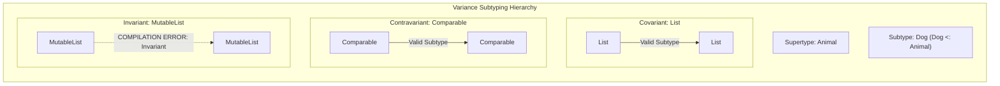
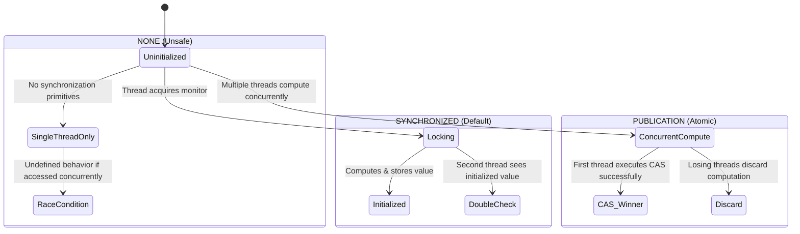

# MODULE 02: KOTLIN LANGUAGE MASTERY & BYTECODE INTERNALS
## CHAPTER 02: GENERICS, VARIANCE & PROPERTY DELEGATION INTERNALS

---

### A. FUNDAMENTALS

#### 1. What is the Concept?
Generics enable parameterizing types, allowing developers to create type-safe, reusable data structures and algorithms without sacrificing compile-time checks. Variance specifies how subtyping between more complex types (e.g., `List<Dog>`) relates to subtyping between their component types (e.g., `Dog` is a subtype of `Animal`).
- **Declaration-site variance:** Annotating type parameters directly at the class definition (`out` for producers/covariance, `in` for consumers/contravariance).
- **Use-site variance (Type Projections):** Specifying variance at the site where the type is used (equivalent to Java wildcards `? extends T` and `? super T`).
- **Property Delegation:** Delegating the getter and setter evaluation of a property to an external handler using the `by` keyword, desugared into synthetic delegate instance fields (`$$delegate_0`).

#### 2. Why Does It Exist?
Java only supports use-site variance (wildcards like `List<? extends Number>`), which forces developers to scatter complex wildcard annotations across every method parameter in their codebase. Kotlin introduced declaration-site variance to eliminate this boilerplate, ensuring a `List<T>` is naturally covariant (`List<out E>`) throughout the entire application.
Property delegation solves the problem of cross-cutting property logic—such as lazy initialization, caching, change notifications, and thread-safe encrypted storage—without repeating boilerplate getter/setter code.

#### 3. What Problem Does It Solve?
- **Type Erasure Limitations:** At runtime, the JVM erases generic type parameters (`List<String>` becomes raw `List`). Reified type parameters (`reified T`) in inline functions bypass type erasure by embedding the exact `Class<T>` bytecode directly into the call site.
- **Unsafe Array Mutations:** Java arrays are covariant (`String[]` is an `Object[]`), allowing runtime `ArrayStoreException` if you write an `Integer` into a `String[]`. Kotlin makes `Array<T>` invariant by default, preventing this entire class of bugs at compile time.
- **Thread Safety in Lazy Initialization:** Unsynchronized lazy properties in multi-threaded Android environments can lead to race conditions and multiple initializations of heavy resources (e.g., database clients or cryptographic keys).

#### 4. Where is It Used?
- **Domain & Repository Layers:** Generic Result wrappers (`Result<out T>`), State models, and Repository contracts.
- **Dependency Injection & ViewModels:** `by viewModels()`, `by activityViewModels()`, Hilt entry point lookups.
- **Banking Storage & Security:** Property delegates providing automatic transparent AES-GCM encryption/decryption on disk writes/reads.

#### 5. What Happens If We Do Not Use It?
- Endless unsafe casting (`as T`) triggering runtime `ClassCastException`.
- Rigid APIs that reject valid subtypes (e.g., passing `List<ProductionAccount>` to a function accepting `List<Account>` fails if not covariant).
- Memory races and multi-threaded corruption when lazy properties are incorrectly declared with `LazyThreadSafetyMode.NONE`.

---

### B. TECHNICAL DEFINITION

> **Declaration-Site Variance & Property Delegation:**
> **Variance** defines the subtyping rules for parameterized types $F(T)$. If $A$ is a subtype of $B$:
> - **Covariant ($out$):** $F(A)$ is a subtype of $F(B)$. The type parameter only appears in the output/producer position.
> - **Contravariant ($in$):** $F(B)$ is a subtype of $F(A)$. The type parameter only appears in the input/consumer position.
> - **Invariant:** No subtyping relationship exists between $F(A)$ and $F(B)$.
>
> **Property Delegation** is a compiler transformation where a property `var p: T by Delegate()` is lowered into a private synthetic backing field `private final Delegate p$delegate = new Delegate();`, routing `p.get()` to `p$delegate.getValue(this, $$property[0])` and `p.set(v)` to `p$delegate.setValue(this, $$property[0], v)`.

---

### C. INTERNAL WORKING & ARCHITECTURE



#### 1. PECS (Producer Extends, Consumer Super) in Kotlin
- **`out` (Covariance):** Used when the class only **produces** $T$. It can only be returned from methods, never taken as a method argument:
```kotlin
interface ReadOnlyRepository<out T> {
    fun getById(id: String): T // Legal: T is in 'out' position
    // fun save(item: T)       // ILLEGAL: Type parameter T is declared as 'out' but occurs in 'in' position
}
```
- **`in` (Contravariance):** Used when the class only **consumes** $T$. It can only be passed as a method argument, never returned:
```kotlin
interface Consumer<in T> {
    fun consume(item: T) // Legal: T is in 'in' position
    // fun produce(): T   // ILLEGAL: Type parameter T is declared as 'in' but occurs in 'out' position
}
```

#### 2. Reified Generics & Type Erasure Bypass
Normally, generic types are erased at runtime:
```kotlin
// Won't compile normally: Cannot check for erased type T
fun <T> isType(value: Any): Boolean = value is T 
```
Using `inline` + `reified`:
```kotlin
inline fun <reified T> isType(value: Any): Boolean = value is T
```
*How it works in bytecode:*
Because the function is inlined, the compiler knows the exact type at the call site. If called with `isType<String>(x)`, the compiler emits:
```bytecode
INSTANCEOF java/lang/String
```
It completely bypasses type erasure without requiring a manual `Class<T>` parameter.

#### 3. Property Delegation Disassembly & Bytecode Lowering
When you write:
```kotlin
class UserSession {
    val token: String by lazy { fetchToken() }
}
```
The Kotlin compiler synthesizes the following Java equivalent:
```java
public final class UserSession {
    // 1. Synthetic backing field for the delegate instance
    @NotNull
    private final Lazy token$delegate;

    public UserSession() {
        // 2. Initialized with LazyThreadSafetyMode.SYNCHRONIZED by default
        this.token$delegate = LazyKt.lazy((Function0)new Function0() {
            public final Object invoke() {
                return UserSession.this.fetchToken();
            }
        });
    }

    // 3. Getter forwards call to delegate's getValue()
    @NotNull
    public final String getToken() {
        return (String)this.token$delegate.getValue();
    }
}
```

#### 4. The 3 `LazyThreadSafetyMode` Modes



1. **`LazyThreadSafetyMode.SYNCHRONIZED` (Default):**
   - Uses double-checked locking with an internal `@Volatile` state variable and a synchronization lock (`this` or dedicated lock object).
   - Guarantees exactly **one execution** of the initializer lambda, even under heavy concurrent thread access.
2. **`LazyThreadSafetyMode.PUBLICATION`:**
   - Uses `AtomicReferenceFieldUpdater` or CAS loops.
   - Multiple threads can call the initializer lambda simultaneously, but only the first thread to complete publishes the value. Losing threads discard their computed results. Ideal for cheap computations where avoiding lock contention is critical.
3. **`LazyThreadSafetyMode.NONE`:**
   - Zero locks, zero atomics, zero thread checks.
   - **Never use in multi-threaded code.** Only suitable for UI-bound properties accessed exclusively from the Main Looper thread.

---

### D. PRODUCTION IMPLEMENTATION

#### Production-Grade AES-GCM Encrypted Property Delegate (FinTech Context)
Below is a thread-safe, production-grade custom property delegate that encrypts and decrypts sensitive banking preferences on the fly using Android Keystore and AES-256 GCM.

```kotlin
package com.ibm.banking.security.storage

import android.content.SharedPreferences
import android.util.Base64
import java.nio.ByteBuffer
import java.security.KeyStore
import java.security.SecureRandom
import javax.crypto.Cipher
import javax.crypto.KeyGenerator
import javax.crypto.SecretKey
import javax.crypto.spec.GCMParameterSpec
import kotlin.properties.ReadWriteProperty
import kotlin.reflect.KProperty

/**
 * Production-grade Encrypted Preference Property Delegate.
 * Transparently encrypts values with AES-GCM before writing to disk,
 * and decrypts on read.
 */
class EncryptedPreferenceDelegate(
    private val preferences: SharedPreferences,
    private val keyAlias: String,
    private val defaultValue: String = ""
) : ReadWriteProperty<Any?, String> {

    private val masterKey: SecretKey by lazy(LazyThreadSafetyMode.SYNCHRONIZED) {
        getOrCreateMasterKey(keyAlias)
    }

    override fun getValue(thisRef: Any?, property: KProperty<*>): String {
        val encryptedBase64 = preferences.getString(property.name, null) ?: return defaultValue
        return try {
            decrypt(encryptedBase64, masterKey)
        } catch (e: Exception) {
            // Defensive recovery on decryption failure (e.g. key invalidated by new biometric enrollment)
            defaultValue
        }
    }

    override fun setValue(thisRef: Any?, property: KProperty<*>, value: String) {
        val encryptedBase64 = encrypt(value, masterKey)
        preferences.edit().putString(property.name, encryptedBase64).apply()
    }

    private fun encrypt(plainText: String, secretKey: SecretKey): String {
        val cipher = Cipher.getInstance(AES_GCM_NO_PADDING)
        val iv = ByteArray(GCM_IV_LENGTH_BYTES).apply {
            SecureRandom().nextBytes(this)
        }
        val spec = GCMParameterSpec(GCM_TAG_LENGTH_BITS, iv)
        cipher.init(Cipher.ENCRYPT_MODE, secretKey, spec)

        val cipherText = cipher.doFinal(plainText.toByteArray(Charsets.UTF_8))
        
        // Pack IV (12 bytes) + CipherText into single storage array
        val buffer = ByteBuffer.allocate(iv.size + cipherText.size)
        buffer.put(iv)
        buffer.put(cipherText)

        return Base64.encodeToString(buffer.array(), Base64.NO_WRAP)
    }

    private fun decrypt(encryptedBase64: String, secretKey: SecretKey): String {
        val combined = Base64.decode(encryptedBase64, Base64.NO_WRAP)
        val buffer = ByteBuffer.wrap(combined)

        val iv = ByteArray(GCM_IV_LENGTH_BYTES)
        buffer.get(iv)

        val cipherText = ByteArray(buffer.remaining())
        buffer.get(cipherText)

        val cipher = Cipher.getInstance(AES_GCM_NO_PADDING)
        val spec = GCMParameterSpec(GCM_TAG_LENGTH_BITS, iv)
        cipher.init(Cipher.DECRYPT_MODE, secretKey, spec)

        val plainBytes = cipher.doFinal(cipherText)
        return String(plainBytes, Charsets.UTF_8)
    }

    private fun getOrCreateMasterKey(alias: String): SecretKey {
        val keyStore = KeyStore.getInstance(ANDROID_KEYSTORE).apply { load(null) }
        if (!keyStore.containsAlias(alias)) {
            val keyGenerator = KeyGenerator.getInstance(KEY_ALGORITHM_AES, ANDROID_KEYSTORE)
            val spec = android.security.keystore.KeyGenParameterSpec.Builder(
                alias,
                android.security.keystore.KeyProperties.PURPOSE_ENCRYPT or 
                android.security.keystore.KeyProperties.PURPOSE_DECRYPT
            )
                .setBlockModes(android.security.keystore.KeyProperties.BLOCK_MODE_GCM)
                .setEncryptionPaddings(android.security.keystore.KeyProperties.ENCRYPTION_PADDING_NONE)
                .setKeySize(256)
                .build()
            keyGenerator.init(spec)
            keyGenerator.generateKey()
        }
        return (keyStore.getEntry(alias, null) as KeyStore.SecretKeyEntry).secretKey
    }

    companion object {
        private const val ANDROID_KEYSTORE = "AndroidKeyStore"
        private const val KEY_ALGORITHM_AES = "AES"
        private const val AES_GCM_NO_PADDING = "AES/GCM/NoPadding"
        private const val GCM_IV_LENGTH_BYTES = 12
        private const val GCM_TAG_LENGTH_BITS = 128
    }
}

// 2. Convenience extension for idiomatic property delegation
fun encryptedPreference(
    preferences: SharedPreferences,
    keyAlias: String,
    defaultValue: String = ""
): ReadWriteProperty<Any?, String> = EncryptedPreferenceDelegate(preferences, keyAlias, defaultValue)
```

#### Consumer Usage in Banking Profile Manager
```kotlin
class BankingProfileManager(sharedPreferences: SharedPreferences) {
    // Transparently encrypted in SharedPreferences under key "cardFreeAtmPin"
    var cardFreeAtmPin: String by encryptedPreference(
        preferences = sharedPreferences,
        keyAlias = "banking_atm_master_key",
        defaultValue = ""
    )
}
```

---

### E. REAL-WORLD SCENARIOS

1. **FinTech (Covariant Banking Results):**
   In a banking app handling payments, a `Result<out T>` must be covariant. If `GoldAccount` inherits from `Account`, then a `Result<GoldAccount>` must be assignable to a variable of type `Result<Account>`. Declaring `class Result<out T>` enables seamless polymorphism across use cases and presentation layers without unsafe casting.
2. **Healthcare (German ePA Patient Data Filtering):**
   When consuming FHIR medical records (immunizations, prescriptions, doctor notes) that implement a common interface `MedicalRecord`, a generic validator `Validator<in MedicalRecord>` must be contravariant (`in`). This allows a single `Validator<MedicalRecord>` to validate specific collections like `List<ImmunizationRecord>`.
3. **Enterprise UI Architecture (Custom ViewModels Delegation):**
   Using property delegation (`by viewModels()`) allows Activities and Fragments to decouple ViewModel lifecycle resolution from the calling class, ensuring that configuration changes seamlessly rebind to the active `ViewModelStore` without manual factory invocation.

---

### F. ARCHITECTURE AND TRADE-OFFS

| Concept | Architectural Advantage | Disadvantage / Cost | When to Use |
| :--- | :--- | :--- | :--- |
| **Declaration-Site Variance (`out T`)** | Eliminates wildcard boilerplate across consuming code | Restricts type parameter to output position only | Read-only data producers, collections, domain Result types |
| **Contravariance (`in T`)** | Enables polymorphic consumers to accept broader types | Restricts type parameter to input position only | Listeners, Comparators, Serializers, Validators |
| **Reified Generics (`reified T`)** | Eliminates reflection overhead and `Class<T>` passing | Requires function to be `inline` (bytecode duplication) | Type-checking (`is T`), JSON parsing, Intent extras parsing |
| **Property Delegates (`by`)** | Encapsulates cross-cutting property access cleanly | Synthesizes extra delegate instance field and virtual calls | Thread-safe caching, SharedPreferences, ViewBinding |

---

### G. COMMON MISTAKES & ANTI-PATTERNS

#### Anti-Pattern 1: Leaking `out` Type in Mutating Methods
```kotlin
// COMPILATION ERROR:
class Storage<out T> {
    private val items = mutableListOf<T>()
    fun add(item: T) { items.add(item) } // Error: Type parameter T is declared as 'out' but occurs in 'in' position
}
```
*Why it fails:* If `Storage<Dog>` could be cast to `Storage<Animal>`, calling `add(Cat())` would insert a `Cat` into a `Dog` list, corrupting heap type safety.

#### Anti-Pattern 2: Defaulting to `LazyThreadSafetyMode.NONE` for Micro-Optimization
```kotlin
// DANGEROUS:
val cryptoKey by lazy(LazyThreadSafetyMode.NONE) {
    generateHardwareKey()
}
```
*Production bug:* If two background threads (e.g., biometrics and network refresh) access `cryptoKey` concurrently, both execute `generateHardwareKey()`, causing duplicate key generation, memory corruption, and unpredictable runtime failures. Only use `NONE` when access is strictly guaranteed to be single-threaded (e.g., UI main thread).

---

### H. INTERVIEW PREPARATION (BASIC TO STAFF LEVEL)

#### Q1 (Basic): What is the difference between `out` and `in` in Kotlin?
**Answer:**
`out` represents covariance: the class can only produce $T$ (return it), and $F(Subtype)$ is a subtype of $F(Supertype)$.
`in` represents contravariance: the class can only consume $T$ (take it as a parameter), and $F(Supertype)$ is a subtype of $F(Subtype)$.

#### Q2 (Intermediate): Why can `Array<T>` not be covariant in Kotlin?
**Answer:**
An `Array<T>` supports both read (`get`) and write (`set`) operations. If `Array<String>` were a subtype of `Array<Any>`, you could assign an `Array<String>` to an `Array<Any>` reference and call `array[0] = 123` (an Integer). This would cause a heap corruption / `ArrayStoreException` at runtime. Therefore, Kotlin enforces invariance on `Array<T>`.

#### Q3 (Advanced): How does the Kotlin compiler implement `by lazy` under the hood?
**Answer:**
The compiler synthesizes a private `Lazy<T>` backing property (`p$delegate = LazyKt.lazy(...)`). When the property getter is called, it forwards the call to `p$delegate.getValue()`. Under `LazyThreadSafetyMode.SYNCHRONIZED`, the `SynchronizedLazyImpl` holds a `@Volatile` reference to an internal uninitialized sentinel object. On first access, it enters a `synchronized(lock)` block, checks if the value is still the sentinel (double-checked locking), invokes the initializer lambda, stores the result, and nulls out the initializer lambda to allow it to be garbage collected.

#### Q4 (Senior Scenario): How would you write an extension function to safely retrieve parcelable extra data from an Android `Intent` using reified types across Android API versions?
**Answer:**
```kotlin
inline fun <reified T : Parcelable> Intent.getParcelableExtraCompat(key: String): T? {
    return if (Build.VERSION.SDK_INT >= Build.VERSION_CODES.TIRAMISU) {
        getParcelableExtra(key, T::class.java)
    } else {
        @Suppress("DEPRECATION")
        getParcelableExtra(key) as? T
    }
}
```
*Explanation:* Because `T` is `reified`, `T::class.java` is accessible directly at runtime, satisfying Android 13+ (API 33) type-safe `Intent.getParcelableExtra(key, Class<T>)` requirements while gracefully falling back for older APIs.

#### Q5 (Staff Architecture): Explain how Star-Projection (`List<*>`) differs from `List<Any>` and `List<Any?>`.
**Answer:**
- `List<Any>` can only accept lists of non-nullable objects and can produce `Any`.
- `List<Any?>` accepts lists of anything and can produce `Any?`.
- Star-projection (`List<*>`) represents a list of a *specific, but unknown* type.
  - If reading from `List<*>`, it is safe to read as `Any?` (because every type is a subtype of `Any?`).
  - If writing to a type projected with `*` (like `MutableList<*>`), it is completely prohibited to write anything (except `null` if nullable) because the actual required subtype is unknown at compile time.

---

### I. CODING PRACTICE

#### Problem: Type-Safe Heterogeneous Dependency Container with Reified Retrieval
**Requirement:** Build a lightweight, thread-safe Service Locator / DI container that allows registering and retrieving singletons and factory instances using reified types, without reflection at the call site.

```kotlin
package com.ibm.banking.di

import java.util.concurrent.ConcurrentHashMap
import kotlin.reflect.KClass

class DependencyContainer {

    private val singletons = ConcurrentHashMap<KClass<*>, Any>()
    private val factories = ConcurrentHashMap<KClass<*>, () -> Any>()

    fun <T : Any> registerSingleton(clazz: KClass<T>, instance: T) {
        singletons[clazz] = instance
    }

    fun <T : Any> registerFactory(clazz: KClass<T>, factory: () -> T) {
        factories[clazz] = factory
    }

    inline fun <reified T : Any> resolve(): T {
        return resolveInstance(T::class)
    }

    @Suppress("UNCHECKED_CAST")
    @PublishedApi
    internal fun <T : Any> resolveInstance(clazz: KClass<T>): T {
        singletons[clazz]?.let { return it as T }
        factories[clazz]?.let { return (it() as T) }
        throw IllegalArgumentException("No binding registered for ${clazz.qualifiedName}")
    }
}
```

*Complexity Analysis:*
- **Time Complexity:** $O(1)$ concurrent retrieval via `ConcurrentHashMap`.
- **Space Complexity:** $O(N)$ where $N$ is the number of registered service bindings.

---

### J. SENIOR ENGINEER INTERVIEW SCRIPTS

#### 60-Second Explanation (Executive Summary)
> *"Kotlin generics build upon Java's type system by introducing declaration-site variance. By marking type parameters as `out`, we declare covariance—meaning the class is a producer of that type and can safely participate in polymorphic subtyping without call-site wildcards. Conversely, `in` denotes contravariance for consumers. To overcome JVM type erasure, Kotlin combines inlining with reified generics, embedding the actual class metadata at compile time. Finally, property delegation (`by`) lowers property getters and setters into synthetic delegate objects, giving us reusable, thread-safe patterns like `lazy` initialization and encrypted storage with zero repeated boilerplate."*

#### 3-Minute Deep Dive (Staff Architecture Level)
> *"In enterprise Android architecture, variance and delegation govern how cleanly our domain boundaries interact with data and presentation layers.
>
> In Java, the lack of declaration-site variance led to verbose, error-prone wildcard signatures like `Collection<? extends T>`. Kotlin's declaration-site variance solves this fundamentally: declaring `interface Repository<out T>` communicates that `T` is strictly in the out-position, allowing a `Repository<CheckingAccount>` to seamlessly satisfy a dependency expecting `Repository<Account>`.
>
> When designing custom property delegates, understanding compiler lowering is crucial. The compiler synthesizes a private backing field `$$delegate_0` and redirects getter and setter calls to `getValue()` and `setValue()`. In our banking applications, we leverage this to build transparent hardware-backed cryptographic delegates. Instead of manually calling keystore encryption routines throughout our repositories, properties are simply declared `var pin: String by encryptedPreference(...)`.
>
> However, an architect must pay strict attention to multi-threaded memory safety. In Kotlin, `by lazy` defaults to `LazyThreadSafetyMode.SYNCHRONIZED`, which executes double-checked locking over a volatile state variable. While safe, if an engineer mistakenly uses `LazyThreadSafetyMode.NONE` in a multi-threaded background repository, race conditions will cause multiple initializations or state corruption. In contrast, `PUBLICATION` mode uses CAS loops to avoid monitor lock contention where multiple idempotent evaluations are acceptable. Choosing the correct mode is an essential trade-off between lock contention and redundant computation."*

---

### K. KNOWLEDGE VALIDATION & SELF-ASSESSMENT

#### 10 Senior Interview Questions
1. How does Kotlin's declaration-site variance compile into JVM bytecode for Java consumers?
2. What is `@UnsafeVariance` and when is it architecturally permissible to use?
3. Why does `List<out T>` allow `contains(element: @UnsafeVariance T): Boolean`?
4. What are the memory implications of `LazyThreadSafetyMode.SYNCHRONIZED` versus `PUBLICATION`?
5. How does the compiler prevent infinite loops when a property delegate accesses the property it delegates?
6. Can a property delegate be used with local variables inside a function?
7. What is the difference between `KProperty<*>` and `KProperty1<T, R>` in custom delegates?
8. Why can you not create an array of a generic type like `Array<T>(10)` without `inline` and `reified`?
9. What bytecode is generated when you access an unboxed Value Class through a generic interface?
10. How does Kotlin's `Nothing` type interact with covariant classes like `List<out T>`? *(Answer: Because `Nothing` is a subtype of all types, `List<Nothing>` is an empty list that is a subtype of `List<T>` for any `T`)*.

#### Practical Self-Assessment Checklist
- [ ] Created a generic class with `out` and verified that compiler prevents methods from taking `T` as an argument.
- [ ] Implemented a custom read-write property delegate and inspected its synthesized `$$delegate_0` Java code.
- [ ] Built an `Intent` or `Bundle` parsing helper using `inline fun <reified T>`.
- [ ] Replaced an error-prone manual lock with `lazy(LazyThreadSafetyMode.SYNCHRONIZED)`.
- [ ] Validated that `MutableList<T>` is invariant and explained why covariance would be unsafe.
