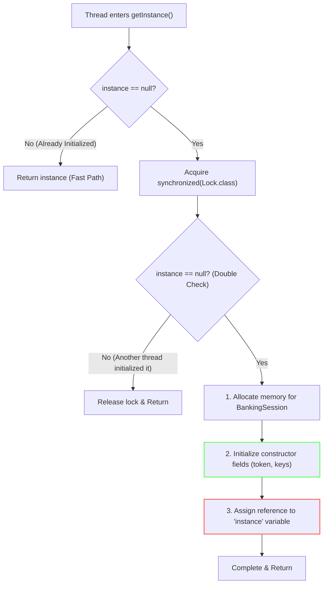

# MODULE 03: JAVA INTERNALS & CONCURRENCY FOR ARCHITECTS
## CHAPTER 01: JAVA MEMORY MODEL (JMM), HARDWARE COHERENCY & LOW-LEVEL CONCURRENCY

---

### A. FUNDAMENTALS

#### 1. What is the Concept?
The Java Memory Model (JMM), formally specified in JSR-133, defines the legal behaviors of multi-threaded programs running on the JVM and Android Runtime (ART). It governs:
- How and when changes made to shared memory by one thread become visible to other threads (**Memory Visibility**).
- Under what conditions compilers, JIT runtimes, and CPU hardware architectures (such as ARM64 on modern mobile devices and x86_64) are permitted to reorder instructions (**Instruction Reordering**).
- The formal mathematical relationship known as **Happens-Before ($hb$)**, which establishes a partial ordering of memory operations across thread boundaries.

#### 2. Why Does It Exist?
Modern mobile hardware does not connect CPU cores directly to main memory (DRAM). Each CPU core has high-speed local caches (L1 Data/Instruction, L2 Cache, and a shared L3 Cache), along with hardware store buffers and write-combining queues. 

```
┌────────────────────────────────────────────────────────┐
│                   HARDWARE REALITY                     │
│  [Core 0]                 [Core 1]                     │
│  ├── Registers            ├── Registers                │
│  ├── Store Buffer         ├── Store Buffer             │
│  └── L1 / L2 Cache        └── L1 / L2 Cache            │
│            ▲                    ▲                      │
│            └────────┬───────────┘                      │
│                     ▼                                  │
│             Shared L3 Cache                            │
│                     ▲                                  │
│                     ▼                                  │
│             Main Memory (RAM)                          │
└────────────────────────────────────────────────────────┘
```

Without a formal specification, hardware optimizations (like store buffering) and compiler optimizations (like hoisting variable reads out of loops or dead-code elimination) would cause different threads to perceive contradictory states of the same memory address, causing silent data corruption and infinite loops.

#### 3. What Problem Does It Solve?
- **Stale Memory Visibility:** Preventing a thread from reading outdated data cached in a CPU core's L1 cache while another core has already modified it.
- **Out-of-Order Execution Bugs:** Preventing the CPU from publishing an object's reference to other threads *before* the object's constructor fields have finished initializing (the classic broken Double-Checked Locking bug).
- **Cross-Platform Consistency:** Ensuring multi-threaded code behaves identically across weakly-ordered multi-core ARM chips (Qualcomm Snapdragon, MediaTek, Google Tensor) and strongly-ordered x86 desktop machines.

#### 4. Where is It Used?
- **Concurrent State Engines:** Kotlin Coroutines (`StateFlow`, `SharedFlow`, `Channel`), RxJava, and Java `java.util.concurrent` synchronizers.
- **Banking Session Managers:** Thread-safe singleton authentication managers, biometric session tokens, and cryptographic key caches.
- **Image & Data Caching:** High-throughput LRU caches and thread-safe object pools in Android UI pipelines.

#### 5. What Happens If We Do Not Use / Understand It?
- **Infinite Execution Loops:** A background thread waiting for a `var isRunning = true` flag will loop forever on multi-core ARM devices because the compiler registers the flag into a CPU register and never re-reads DRAM.
- **Object Escaping (Partial Initialization):** A thread reads a non-null singleton reference, but when it accesses the singleton's properties, it reads uninitialized null or zero values, throwing baffling `NullPointerExceptions` or crashing with corrupt data.
- **Unnecessary Lock Contention:** Indiscriminately slapping `synchronized` on every method kills concurrency throughput, causing UI thread starvation and ANRs.

---

### B. TECHNICAL DEFINITION

> **Java Memory Model (JMM) & Happens-Before Guarantee:**
> The JMM is an axiomatic memory model that specifies the semantics of memory actions (reads, writes, locks, unlocks, thread launches). 
> Two memory actions $A$ and $B$ have a **Happens-Before relationship ($A \stackrel{hb}{\longrightarrow} B$)** if the memory effects of action $A$ are guaranteed to be completely visible to action $B$, and action $A$ is perceived to have occurred before action $B$.
> If no happens-before relationship connects a write action $W$ to a read action $R$, the JVM and CPU are legally allowed to reorder them or read stale data, creating a **data race**.

---

### C. INTERNAL WORKING & ARCHITECTURE

```mermaid
sequenceDiagram
    autonumber
    actor ThreadA as Core 0 (Thread A - Writer)
    participant L1A as Core 0 L1 Cache & Store Buffer
    participant RAM as Shared Memory (DRAM)
    participant L1B as Core 1 L1 Cache & Invalidate Queue
    actor ThreadB as Core 1 (Thread B - Reader)

    Note over ThreadA: Thread A writes: data = 42; ready = true (non-volatile)
    ThreadA->>L1A: Writes 'data = 42' into local Store Buffer
    ThreadA->>L1A: Writes 'ready = true' into local Store Buffer
    Note over L1A,RAM: Because neither variable is volatile, hardware flushes in ANY order!
    L1A->>RAM: Flushes 'ready = true' to RAM FIRST
    ThreadB->>L1B: Reads 'ready == true'
    ThreadB->>L1B: Reads 'data' (Still in Core 1 Cache as 0!)
    Note over ThreadB: CRITICAL BUG: Thread B sees ready=true, but data=0!
```

#### 1. Volatile Semantics: Memory Barriers & Instructions
When a variable is declared `@Volatile` (Kotlin) or `volatile` (Java):
1. **Visibility:** Every write to a volatile variable is immediately flushed past the local CPU store buffer to the shared cache/main memory. Every read of a volatile variable invalidates the local CPU cache line and pulls the latest value from shared memory.
2. **Reordering Constraints (Memory Barriers):**
   - The compiler and CPU **cannot** reorder a read/write that occurs *before* a volatile write to after that volatile write.
   - The compiler and CPU **cannot** reorder a read/write that occurs *after* a volatile read to before that volatile read.
   
At the machine code level on ARM64 processors, the compiler inserts hardware memory barrier instructions:
- `DMB ISHST` (Data Memory Barrier, Inner Shareable Store): Inserted before a volatile write (Release barrier).
- `DMB ISHLD` (Data Memory Barrier, Inner Shareable Load): Inserted after a volatile read (Acquire barrier).

#### 2. The Happens-Before Rules
The JMM defines eight fundamental rules that establish $A \stackrel{hb}{\longrightarrow} B$:

| Rule | Description |
| :--- | :--- |
| **Program Order Rule** | Each action in a single thread happens-before every action in that thread that comes later in the program order. |
| **Monitor Lock Rule** | An unlock on a monitor lock (`synchronized` block exit) happens-before every subsequent lock on the *same* monitor lock. |
| **Volatile Variable Rule** | A write to a volatile variable happens-before every subsequent read of that *same* volatile variable. |
| **Thread Start Rule** | A call to `Thread.start()` on a new thread happens-before any action in the started thread. |
| **Thread Termination Rule** | Any action in a thread happens-before any other thread successfully detects that thread has terminated (via `Thread.join()` or `Thread.isAlive() == false`). |
| **Interrupt Rule** | A thread calling `interrupt()` on another thread happens-before the interrupted thread detects the interrupt. |
| **Finalizer Rule** | The end of a constructor for an object happens-before the start of the finalizer for that object. |
| **Transitivity Rule** | If $A \stackrel{hb}{\longrightarrow} B$ and $B \stackrel{hb}{\longrightarrow} C$, then $A \stackrel{hb}{\longrightarrow} C$. |

#### 3. Double-Checked Locking (DCL) Analysis



*The Historical DCL Bug (Without `volatile`):*
Steps 2 and 3 above can be reordered by the compiler or CPU:
1. `instance = allocateMemory();` // Reference is now non-null!
2. `instance.constructor();`       // Fields being populated...

If Thread A is preempted between step 1 and step 2, Thread B enters `getInstance()`, sees `instance != null`, takes the fast path, and attempts to use the uninitialized object fields, crashing instantly.
*The Fix:* Marking `instance` as `@Volatile` enforces that step 2 *happens-before* step 3.

#### 4. Atomic CAS (Compare-And-Swap) Hardware Mechanics
Locks (`synchronized`, `ReentrantLock`) are **pessimistic**: they put threads to sleep (context switch to kernel space, saving CPU registers, scheduling another thread), which costs ~1,000 to 5,000 CPU cycles.
Atomic variables (`AtomicInteger`, `AtomicReference`) use **optimistic concurrency** powered by CPU hardware instructions:
- On x86: `CMPXCHG` instruction with `LOCK` bus prefix.
- On ARM64: `LDREX` (Load-Exclusive) and `STREX` (Store-Exclusive) or `CAS` (ARMv8.1-A).

If another core modified the memory address during the operation, the CPU signals failure, and the thread simply re-attempts the operation in a tight, non-blocking user-space loop.

---

### D. PRODUCTION IMPLEMENTATION

#### High-Performance, Lock-Free Ring Buffer (Banking Telemetry)
Below is a lock-free, zero-garbage ring buffer designed for streaming real-time security events across threads without lock contention.

```kotlin
package com.ibm.banking.concurrency

import java.util.concurrent.atomic.AtomicLong
import java.util.concurrent.atomic.AtomicReferenceArray

/**
 * Production-grade Lock-Free MPSC (Multi-Producer Single-Consumer) Ring Buffer.
 * Demonstrates:
 * - JMM Volatile / Atomic array memory barriers.
 * - Power-of-two bitwise masking (eliminating modulo % CPU division penalty).
 * - Cache line padding concept to eliminate false sharing.
 */
class LockFreeRingBuffer<T : Any>(capacityPowerOfTwo: Int) {

    init {
        require(capacityPowerOfTwo > 0 && (capacityPowerOfTwo and (capacityPowerOfTwo - 1)) == 0) {
            "Capacity must be a power of two (e.g. 16, 32, 64, 1024)"
        }
    }

    private val mask: Long = (capacityPowerOfTwo - 1).toLong()
    private val buffer = AtomicReferenceArray<T>(capacityPowerOfTwo)

    // Producer sequence index (monotonically increasing)
    private val producerIndex = AtomicLong(0L)
    // Consumer sequence index (monotonically increasing)
    private val consumerIndex = AtomicLong(0L)

    /**
     * Lock-free offer (Callable concurrently by multiple producer threads).
     */
    fun offer(item: T): Boolean {
        while (true) {
            val currentTail = producerIndex.get()
            val currentHead = consumerIndex.get()

            if (currentTail - currentHead > mask) {
                // Buffer is full: Backpressure applied
                return false
            }

            // Attempt to claim sequence slot via atomic CAS
            if (producerIndex.compareAndSet(currentTail, currentTail + 1)) {
                val slot = (currentTail and mask).toInt()
                
                // Spin-wait if previous item in slot has not been consumed yet
                while (!buffer.compareAndSet(slot, null, item)) {
                    Thread.yield()
                }
                return true
            }
        }
    }

    /**
     * Poll (Designed for single consumer thread - e.g. dedicated disk/network flusher).
     */
    fun poll(): T? {
        val currentHead = consumerIndex.get()
        val currentTail = producerIndex.get()

        if (currentHead >= currentTail) {
            // Buffer is empty
            return null
        }

        val slot = (currentHead and mask).toInt()
        val item = buffer.get(slot) ?: return null

        buffer.set(slot, null)
        consumerIndex.lazySet(currentHead + 1) // Release store barrier
        return item
    }

    fun size(): Long = (producerIndex.get() - consumerIndex.get()).coerceAtLeast(0L)
}
```

#### Unit Test Validating Memory Visibility Under High Concurrency
```kotlin
package com.ibm.banking.concurrency

import org.junit.Assert.assertEquals
import org.junit.Assert.assertTrue
import org.junit.Test
import java.util.concurrent.ConcurrentHashMap
import java.util.concurrent.CountDownLatch
import java.util.concurrent.Executors
import java.util.concurrent.TimeUnit

class LockFreeRingBufferTest {

    @Test
    fun multiProducerSingleConsumer_preservesDataIntegrityWithoutLoss() {
        val buffer = LockFreeRingBuffer<String>(1024)
        val producerCount = 8
        val itemsPerProducer = 1000
        val totalExpectedItems = producerCount * itemsPerProducer

        val executor = Executors.newFixedThreadPool(producerCount + 1)
        val startLatch = CountDownLatch(1)
        val completionLatch = CountDownLatch(producerCount)

        val consumedItems = ConcurrentHashMap.newKeySet<String>()

        // 1. Launch 8 Concurrent Producer Threads
        for (p in 0 until producerCount) {
            executor.execute {
                startLatch.await()
                for (i in 0 until itemsPerProducer) {
                    val payload = "PRODUCER_${p}_ITEM_$i"
                    while (!buffer.offer(payload)) {
                        Thread.yield() // Backpressure backoff
                    }
                }
                completionLatch.countDown()
            }
        }

        // 2. Launch 1 Dedicated Consumer Thread
        val consumerFinished = CountDownLatch(1)
        executor.execute {
            startLatch.await()
            var consumedCount = 0
            while (consumedCount < totalExpectedItems) {
                val item = buffer.poll()
                if (item != null) {
                    consumedItems.add(item)
                    consumedCount++
                } else {
                    Thread.yield()
                }
            }
            consumerFinished.countDown()
        }

        // Trigger simultaneous start
        startLatch.countDown()

        assertTrue("Producers must complete within 5s", completionLatch.await(5, TimeUnit.SECONDS))
        assertTrue("Consumer must consume all items within 5s", consumerFinished.await(5, TimeUnit.SECONDS))

        assertEquals(totalExpectedItems, consumedItems.size)
        executor.shutdown()
    }
}
```

---

### E. REAL-WORLD SCENARIOS

1. **FinTech (Concurrent Multi-Account Balance Updates):**
   In financial ledger management, updating account balances concurrently without database-level pessimistic locking requires in-memory CAS loops using `AtomicReference<AccountBalance>`. If two transactions (e.g., an automated recurring direct debit and an ATM withdrawal) arrive at the exact same millisecond, CAS ensures that the second transaction detects the state change, rolls back its local draft, and reapplies against the newly committed balance.
2. **High-Frequency Mobile Stock Ticker (Robinhood/Bloomberg):**
   A market data WebSocket pushes 500 price updates per second. If the UI collects and renders every update with synchronized locks, the main thread locks up, causing severe ANRs. Using a volatile reference with atomic swap or a lock-free conflated buffer ensures the UI only renders the latest available price frame without locking the background socket thread.
3. **Android Single Sign-On (SSO) Session Invalidation:**
   When an enterprise banking app receives a remote push notification invalidating the user's active session, a volatile `sessionValid` flag updated on the Firebase background service thread must be immediately visible to all network worker threads without requiring full synchronization locks on every HTTP call.

---

### F. ARCHITECTURE AND TRADE-OFFS

| Synchronization Primitive | Mechanism | Performance Cost | Lock Contention Risk | When to Use |
| :--- | :--- | :--- | :--- | :--- |
| **`@Volatile`** | Memory barriers (`DMB`), Flushes store buffer | Negligible (1 CPU cycle on read, a few on write) | **Zero** lock contention | Single writer, multiple readers; flags; status indicators |
| **Atomic CAS (`AtomicInteger`, `AtomicReference`)** | Hardware `CMPXCHG` / `LDREX-STREX` | Low (Optimistic non-blocking loop) | Contention causes CPU spinning if many threads write simultaneously | Counters, sequence IDs, lock-free state machines |
| **`synchronized` (Monitor Lock)** | OS thread suspension, context switch to kernel | High (~1,000–5,000 cycles if contested) | High (Threads block waiting in monitor wait-set) | Complex compound operations modifying multiple variables atomically |
| **`ReentrantReadWriteLock`** | Read locks shared, Write locks exclusive | Moderate (Internal state tracking) | Write starvation if reads dominate continuously | Read-heavy data structures with infrequent batch updates |

---

### G. COMMON MISTAKES & ANTI-PATTERNS

#### Anti-Pattern 1: Thinking `volatile` Guarantees Atomicity
```kotlin
// WRONG: RACE CONDITION!
class MetricsTracker {
    @Volatile
    var requestCount = 0

    fun increment() {
        requestCount++ // NOT ATOMIC!
    }
}
```
*Why it fails:* `requestCount++` is a compound operation consisting of 3 distinct bytecode instructions:
1. `GETFIELD requestCount` (Read)
2. `IADD 1` (Modify)
3. `PUTFIELD requestCount` (Write)

If Thread A and Thread B read `10` simultaneously, both add 1 and write back `11`. One increment is permanently lost.
*Correction:* Use `AtomicInteger.incrementAndGet()`.

#### Anti-Pattern 2: The "False Sharing" Performance Trap
When two distinct variables used by two different threads reside within the same **64-byte CPU cache line**, updating variable A on Core 0 forces the hardware cache coherency protocol (MESI) to invalidate the *entire* 64-byte cache line on Core 1, even though Core 1 was only accessing variable B.
*Correction:* Group thread-isolated variables or add cache-line padding (in high-throughput systems).

---

### H. INTERVIEW PREPARATION (BASIC TO STAFF LEVEL)

#### Q1 (Basic): What is the difference between `volatile` and `synchronized`?
**Answer:**
`volatile` guarantees **memory visibility** and **ordering** (prevents instruction reordering around the variable), but does **not** guarantee mutual exclusion or atomicity for compound operations (like `count++`).
`synchronized` guarantees **mutual exclusion** (only one thread executes the block at a time), **atomicity**, and **visibility** (all modifications made before releasing the lock happen-before another thread acquires the same lock).

#### Q2 (Intermediate): What is instruction reordering, and why does the compiler/CPU do it?
**Answer:**
Instruction reordering is an optimization where the compiler, JIT, or out-of-order CPU pipeline rearranges the execution order of machine instructions to maximize CPU instruction pipelining, utilize idle execution units, and prevent CPU stalls waiting for slow memory reads. The as-if-serial semantics dictate that reordering is allowed as long as the single-threaded outcome is identical. However, in multi-threaded programs without synchronization, this causes variables to appear updated out of order to other cores.

#### Q3 (Advanced): Explain the "Happens-Before" relationship between releasing and acquiring a lock.
**Answer:**
According to the JMM Monitor Lock Rule, an unlock action on a monitor (exiting a `synchronized` block) *happens-before* every subsequent lock action on that *same* monitor.
By transitivity, all memory writes made by Thread A before releasing the lock are guaranteed to be flushed to main memory and made visible to Thread B when it subsequently acquires the lock. Thread B is guaranteed to see a fully consistent, up-to-date memory snapshot.

#### Q4 (Senior Scenario): You observe an intermittent bug in production where a singleton `AnalyticsManager` intermittently throws `NullPointerException` on a non-null property right after app launch. What is the root cause?
**Answer:**
This is the classic **partially initialized object leak** caused by broken Double-Checked Locking. Without `@Volatile` on the singleton backing field, the compiler or CPU reorders the assignment of the allocated memory reference before the constructor finishes executing. A secondary thread checks `instance != null`, finds it true, and accesses the instance properties before the constructor on the first thread finishes writing them.
Fix: Mark the singleton field as `@Volatile` or use Kotlin's `by lazy(LazyThreadSafetyMode.SYNCHRONIZED)` which uses `@Volatile` internally.

#### Q5 (Staff Architecture): How does the Android Runtime (ART) memory barrier implementation differ on ARM64 versus x86_64 architectures?
**Answer:**
- **x86_64** has a **strongly-ordered memory model** (Total Store Order - TSO). Hardware already guarantees that loads are not reordered with loads, stores are not reordered with stores, and loads are not reordered with older stores. Only store-load reordering is allowed. Therefore, volatile reads/writes on x86 compile down to standard `MOV` instructions with zero barrier overhead, needing only an `MFENCE` or `LOCK` prefix for store-load boundaries.
- **ARM64** (used in Android devices) has a **weakly-ordered memory model**. The CPU can reorder almost any load/store with any other load/store if they target different memory addresses. Therefore, the ART compiler must explicitly emit costly hardware memory barriers: `DMB ISHLD` (load barrier) and `DMB ISHST` (store barrier), or use modern ARMv8 load-acquire (`LDAR`) and store-release (`STLR`) instructions. Neglecting synchronization on ARM causes bugs that never reproduce on an x86 emulator.

---

### I. CODING PRACTICE

#### Problem: Implement a Thread-Safe, Lock-Free Stack (Treiber Stack)
**Requirement:** Build a concurrent LIFO Stack supporting `push(item)` and `pop(): T?` using only `AtomicReference` and CAS loops. No `synchronized` or locks allowed.

```kotlin
package com.ibm.banking.concurrency

import java.util.concurrent.atomic.AtomicReference

class LockFreeStack<T> {

    private class Node<T>(val value: T, val next: Node<T>?)

    private val head = AtomicReference<Node<T>?>(null)

    fun push(item: T) {
        val newHead = Node(item, null)
        while (true) {
            val currentHead = head.get()
            val nodeWithNext = Node(item, currentHead)
            if (head.compareAndSet(currentHead, nodeWithNext)) {
                return
            }
            // CAS failed: Another thread updated head, retry loop
        }
    }

    fun pop(): T? {
        while (true) {
            val currentHead = head.get() ?: return null
            val nextNode = currentHead.next
            if (head.compareAndSet(currentHead, nextNode)) {
                return currentHead.value
            }
            // CAS failed: Another thread popped or pushed, retry loop
        }
    }

    fun isEmpty(): Boolean = head.get() == null
}
```

*Complexity Analysis:*
- **Time Complexity:** $O(1)$ amortized for both `push` and `pop`. Contention causes retry spins.
- **Space Complexity:** $O(N)$ where $N$ is the number of active nodes on the stack.

---

### J. SENIOR ENGINEER INTERVIEW SCRIPTS

#### 60-Second Explanation (Executive Summary)
> *"The Java Memory Model (JMM) formalizes how threads interact through shared memory, addressing two physical hardware realities: CPU cache visibility and instruction reordering. Under modern multi-core ARM architectures, cores write to local store buffers before main memory, meaning changes are not automatically visible to other cores. The JMM defines the 'Happens-Before' contract: if action A happens-before B, all writes from A are guaranteed visible to B. We enforce this using `@Volatile`—which emits CPU memory barriers to prevent stale reads and out-of-order execution—and atomic CAS operations, which allow non-blocking, optimistic state transitions without the heavy context-switching cost of `synchronized` locks."*

#### 3-Minute Deep Dive (Staff Architecture Level)
> *"As mobile architects designing for billions of ARM devices, understanding the JMM is what separates high-performance systems from intermittent production crashes.
>
> Desktop x86 CPUs feature a strongly ordered memory architecture (TSO), where instruction reordering is strictly bounded. In contrast, modern Android smartphones run on ARM64 processors with weakly ordered memory. In an ARM pipeline, memory accesses to different addresses can be executed and retired out of program order, and store buffers delay flushing writes to L3 cache or DRAM.
>
> In our banking applications, consider a session authentication handshake. If thread A creates an authentication token object and then sets a `isReady` boolean flag without synchronization, the ARM CPU is legally allowed to flush the `isReady = true` write to shared memory *before* the constructor fields of the token are flushed. A secondary thread checking `isReady` will read a partially initialized object, resulting in security bypasses or runtime crashes that are impossible to reproduce on an x86 development emulator.
>
> To resolve this, we leverage JMM's happens-before relationship. Declaring the property `@Volatile` forces the ART compiler to insert ARM64 `DMB` barriers or `LDAR`/`STLR` (Load-Acquire / Store-Release) instructions. A write to a volatile variable happens-before every subsequent read of that variable, guaranteeing that everything written before the volatile write is fully committed and visible.
>
> Finally, when high-frequency state updates occur—such as biometric telemetry or WebSocket order book streaming—we avoid the pessimistic locking of `synchronized`, which incurs expensive kernel context switches. Instead, we use optimistic lock-free algorithms built upon atomic CAS instructions (`CMPXCHG`), achieving thread safety in user space with zero thread suspension."*

---

### K. KNOWLEDGE VALIDATION & SELF-ASSESSMENT

#### 10 Senior Interview Questions
1. What is the precise semantic difference between `AtomicReference` and a `@Volatile` object reference?
2. Why does an x86 CPU rarely expose memory reordering bugs that consistently crash an ARM64 Android device?
3. What is the ABA problem in lock-free CAS algorithms, and how is it solved using `AtomicStampedReference`?
4. How does `VarHandle` (introduced in Java 9 / Android API 33) improve upon `AtomicFieldUpdater`?
5. Under what conditions can a `final` field be reordered in the Java Memory Model?
6. What is the cost of a thread context switch on modern Android Linux kernels?
7. Explain the difference between `volatile` read/write vs `AtomicInteger.lazySet()`.
8. What is the MESI cache coherency protocol and how does it interact with memory barriers?
9. Why does Kotlin not have a `synchronized` keyword, and what are the internal mechanics of `kotlin.synchronized(lock) {}`?
10. How does Kotlin's `Mutex` in Coroutines differ from a Java `ReentrantLock` in terms of thread blocking?

#### Practical Self-Assessment Checklist
- [ ] Traced memory visibility across threads and validated why `@Volatile` is required for boolean cancellation flags.
- [ ] Explained the exact assembly-level difference between `synchronized` and atomic CAS (`compareAndSet`).
- [ ] Implemented a lock-free concurrent data structure (queue, stack, or ring buffer) from scratch.
- [ ] Successfully diagnosed and corrected a broken Double-Checked Locking singleton.
- [ ] Identified a race condition in code that used `@Volatile` on a compound increment (`count++`).
