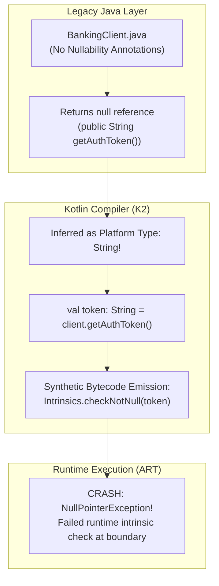

# MODULE 03: JAVA INTERNALS & CONCURRENCY FOR ARCHITECTS
## CHAPTER 02: JAVA-KOTLIN INTEROPERABILITY TRAPS & ENTERPRISE CODEBASE MODERNIZATION

---

### A. FUNDAMENTALS

#### 1. What is the Concept?
In enterprise Android development, teams rarely write greenfield code in 100% Kotlin from day one. Enterprise codebases (especially in regulated sectors like banking and healthcare) contain legacy Java modules, third-party Java SDKs, and mixed-language feature modules.
Java-Kotlin interoperability refers to the bidirectional binary and source compatibility between Java and Kotlin running on the JVM/ART. While JetBrains designed Kotlin to interoperate 100% smoothly with Java, significant impedance mismatches exist in:
- **Nullability contracts:** Java's untyped nulls vs Kotlin's strict nullable type system (resulting in **Platform Types** `T!`).
- **Exception models:** Java's checked exceptions (`throws IOException`) vs Kotlin's 100% unchecked exception model.
- **Method overloading & default parameters:** Kotlin default arguments vs Java overloaded constructors (`@JvmOverloads`).
- **Static members & properties:** Companion objects vs true Java static methods (`@JvmStatic`, `@JvmField`).
- **Asynchronous boundaries:** Calling Kotlin suspending functions from legacy Java classes via synthetic `Continuation` callbacks.

#### 2. Why Does It Exist?
Kotlin was deliberately engineered for seamless adoption inside existing Java enterprise ecosystems. Instead of requiring a complete rewrite, Kotlin compiles into standard `.class` files that standard Java code can call, and vice-versa. To facilitate idiomatic consumption on both sides, Kotlin provides interop annotations (`@JvmStatic`, `@JvmOverloads`, `@JvmField`, `@JvmName`, `@Throws`).

#### 3. What Problem Does It Solve?
- **Incremental Modernization:** Enables migrating an 8-year-old monolithic Java banking app file-by-file or module-by-module without halting feature development.
- **API Cleanliness for Java Callers:** Prevents Java callers from having to write awkward syntax like `BankingService.Companion.getInstance().format()` or passing 8 default arguments manually.
- **Runtime Crash Prevention:** Eliminates the silent NPEs caused by platform types when consuming legacy Java APIs in modern Kotlin domain layers.

#### 4. Where is It Used?
- **Enterprise SDK Development:** Building shared mobile SDKs (e.g., authentication, biometric, or card-free ATM SDKs) consumed by both legacy Java and modern Kotlin client apps.
- **Multi-Module Refactoring:** Boundary layers between a modern Kotlin `:feature:dashboard` and a legacy Java `:core:legacy-network` module.

#### 5. What Happens If We Do Not Use / Understand It?
- **Platform Type NPE Disasters:** Assuming a Java method returning `String` is non-null (`String`) in Kotlin without defensive checks leads to runtime `NullPointerException` at the boundary.
- **Binary Incompatibility:** Refactoring an internal method in Kotlin breaks Java consumers because the Kotlin compiler mangles the method name (`doWork$feature_module`).
- **Hidden Coroutine Deadlocks:** Attempting to block a thread while awaiting a Kotlin suspending function from Java using `runBlocking` or raw callbacks can trigger main thread deadlocks.

---

### B. TECHNICAL DEFINITION

> **Java-Kotlin Interoperability & Platform Types:**
> Kotlin handles Java types through **Platform Types** (denoted as `T!`), where the compiler does not know if the value is nullable or non-null, completely disabling compile-time null safety checks for that reference. 
> To bridge ABI discrepancies, the Kotlin compiler provides **JVM Interop Annotations** that alter the emitted bytecode metadata, generating static proxies, overloaded method signatures, public direct fields, and Java `throws` attributes.

---

### C. INTERNAL WORKING & ARCHITECTURE



#### 1. The Platform Type (`T!`) Trap
When Kotlin consumes a Java method signature without nullability annotations (`@Nullable` / `@NonNull`):
```java
// Java Class
public class LegacyUserSession {
    public String getSessionToken() {
        return null; // Legal in Java
    }
}
```
The Kotlin compiler treats the return type as `String!`.
- If you assign it to `val token: String`, the compiler permits it without warning!
- However, the compiler generates a synthetic null check at the assignment site:
```bytecode
INVOKEVIRTUAL com/ibm/legacy/LegacyUserSession.getSessionToken ()Ljava/lang/String;
DUP
LDC "getSessionToken() must not be null"
INVOKESTATIC kotlin/jvm/internal/Intrinsics.checkNotNull (Ljava/lang/Object;Ljava/lang/String;)V
```
*The Crash:* The moment `getSessionToken()` returns `null`, the app crashes immediately with an `IllegalStateException` or `NullPointerException`, completely bypassing Kotlin's compile-time null safety guarantees.
*The Rule for 8 YOE:* **Always treat Platform Types as nullable (`String?`) or map them at the boundary DTO layer before passing into domain logic.**

#### 2. Bytecode Analysis of Interop Annotations

##### `@JvmStatic`
```kotlin
class PaymentUtils {
    companion object {
        @JvmStatic
        fun validateCard(number: String): Boolean = number.length == 16
    }
}
```
*Without `@JvmStatic`:* Java must call: `PaymentUtils.Companion.validateCard("1234...");`  
*With `@JvmStatic`:* The compiler generates **two** methods in bytecode:
1. An instance method on the synthetic `PaymentUtils$Companion` class.
2. A **true public static method** on the outer `PaymentUtils` class that delegates directly to `Companion`:
```bytecode
public static final boolean validateCard(java.lang.String);
    Code:
       0: getstatic     #12  // Field Companion:Lcom/ibm/PaymentUtils$Companion;
       3: aload_0
       4: invokevirtual #16  // Method PaymentUtils$Companion.validateCard:(Ljava/lang/String;)Z
       7: ireturn
```

##### `@JvmOverloads`
```kotlin
class AuthConfig @JvmOverloads constructor(
    val timeoutMs: Long = 30_000L,
    val retryCount: Int = 3,
    val enableMtls: Boolean = true
)
```
*Bytecode Generation:* The compiler synthesizes $N$ overloaded constructors for Java callers:
- `AuthConfig(long timeoutMs, int retryCount, boolean enableMtls)`
- `AuthConfig(long timeoutMs, int retryCount)` (defaulting enableMtls)
- `AuthConfig(long timeoutMs)` (defaulting retryCount & enableMtls)
- `AuthConfig()` (defaulting all 3)

##### Name Mangling for `internal`
When a Kotlin function or class is declared `internal`, to prevent Java classes in the same package (outside the module) from calling it, the compiler mangles the JVM method name:
```kotlin
internal fun processInternalToken() { ... }
```
Compiles to bytecode as:
```
public final void processInternalToken$module_release()
```

#### 3. Calling Kotlin Coroutines from Java (Continuation-Passing Style)
A suspending function:
```kotlin
suspend fun fetchAccountBalance(id: String): AccountBalance
```
Is lowered by the compiler to standard Java bytecode accepting a `kotlin.coroutines.Continuation`:
```java
// Java-visible signature:
public Object fetchAccountBalance(String id, Continuation<? super AccountBalance> continuation);
```
To invoke this safely from legacy Java without blocking the thread, you pass a callback or wrap it in a `CompletableFuture` / RxJava `Single`.

---

### D. PRODUCTION IMPLEMENTATION

#### Enterprise Dual-Language Bridge (Legacy Java Monolith to Modern Kotlin)
Below is a compilable, production-grade interop bridge demonstrating:
1. Safe consumption of un-annotated Java APIs.
2. Full annotation coverage for Java consumers (`@JvmStatic`, `@JvmOverloads`, `@Throws`, `@JvmField`).
3. Executing Kotlin Coroutines from Java via a `CompletableFuture` adapter.

```kotlin
package com.ibm.banking.interop

import com.ibm.banking.model.AccountId
import com.ibm.banking.model.AmountCents
import kotlinx.coroutines.CoroutineScope
import kotlinx.coroutines.Dispatchers
import kotlinx.coroutines.SupervisorJob
import kotlinx.coroutines.future.future
import java.io.IOException
import java.util.concurrent.CompletableFuture

// 1. Modern Kotlin Service Designed for Clean Java & Kotlin Consumption
class BankingSecurityBridge @JvmOverloads constructor(
    @JvmField val environment: String = "PRODUCTION",
    val timeoutSeconds: Int = 30
) {

    private val bridgeScope = CoroutineScope(SupervisorJob() + Dispatchers.IO)

    companion object {
        @JvmField
        val DEFAULT_CURRENCY = "USD"

        @JvmStatic
        fun createDefaultBridge(): BankingSecurityBridge = BankingSecurityBridge()
    }

    /**
     * Declares @Throws so Java consumers are forced to handle the checked exception at compile time.
     * In Kotlin, exceptions are always unchecked.
     */
    @Throws(IOException::class, IllegalArgumentException::class)
    fun validateTransactionLimits(amount: AmountCents) {
        if (amount.cents <= 0) {
            throw IllegalArgumentException("Amount must be positive")
        }
        if (amount.cents > 500_000_00L) { // $500,000 limit
            throw IOException("Transaction exceeds regulatory threshold")
        }
    }

    /**
     * Suspending function for modern Kotlin callers.
     */
    suspend fun verifyAccountStatus(accountId: AccountId): Boolean {
        // Simulated network/crypto verification
        return accountId.value.startsWith("ACC_")
    }

    /**
     * Java-Friendly Adapter: Returns CompletableFuture instead of requiring Continuation callback.
     * Can be consumed cleanly in Java:
     * bridge.verifyAccountStatusAsync(accountId).thenAccept(isValid -> { ... });
     */
    fun verifyAccountStatusAsync(accountId: AccountId): CompletableFuture<Boolean> {
        return bridgeScope.future {
            verifyAccountStatus(accountId)
        }
    }

    /**
     * Defensive Boundary Mapper: Consumes raw, un-annotated Java platform types safely.
     */
    fun sanitizeLegacyJavaPayload(rawJavaToken: String?): String {
        // Defensive Elvis operator eliminates runtime Intrinsics.checkNotNull crash
        val cleanToken = rawJavaToken?.trim() ?: ""
        require(cleanToken.isNotEmpty()) { "Token from legacy Java source was null or blank" }
        return cleanToken
    }
}
```

#### Verification with Unit Tests (Validating Java-friendly Exception Handling)
```kotlin
package com.ibm.banking.interop

import com.ibm.banking.model.AccountId
import com.ibm.banking.model.AmountCents
import org.junit.Assert.assertEquals
import org.junit.Assert.assertTrue
import org.junit.Test
import java.io.IOException
import java.util.concurrent.TimeUnit

class BankingSecurityBridgeTest {

    private val bridge = BankingSecurityBridge.createDefaultBridge()

    @Test
    fun validateTransactionLimits_validAmount_succeeds() {
        bridge.validateTransactionLimits(AmountCents(100_00L)) // $100
    }

    @Test(expected = IOException::class)
    fun validateTransactionLimits_exceedsLimit_throwsCheckedException() {
        bridge.validateTransactionLimits(AmountCents(1_000_000_00L)) // $1,000,000
    }

    @Test
    fun verifyAccountStatusAsync_executesAsyncCompletableFutureCleanly() {
        val future = bridge.verifyAccountStatusAsync(AccountId("ACC_9988"))
        val result = future.get(2, TimeUnit.SECONDS)
        assertTrue(result)
    }

    @Test
    fun sanitizeLegacyJavaPayload_nullInput_handledDefensively() {
        try {
            bridge.sanitizeLegacyJavaPayload(null)
        } catch (e: IllegalArgumentException) {
            assertEquals("Token from legacy Java source was null or blank", e.message)
        }
    }
}
```

---

### E. REAL-WORLD SCENARIOS

1. **Banking SDK Distribution (Enterprise B2B):**
   When building a shared Biometric & Card-Free ATM library consumed by multiple independent client banks (some of whose apps are still written in Java), failing to annotate Kotlin classes with `@JvmOverloads` forces the client bank's Java engineers to provide 10 boilerplate parameters for every constructor, causing friction and adoption resistance.
2. **Healthcare (German ePA FHIR Legacy Interop):**
   In German healthcare applications, certified encryption smartcards (eGK) and legacy cryptographic hardware drivers are distributed as compiled Java `.jar` binaries with zero nullability annotations. Treating the returned patient record pointers as platform types (`PatientRecord!`) without immediate boundary sanitization leads to intermittent production crashes during medical emergency record lookups.
3. **Monolith Modernization (Strangler Fig Pattern):**
   When migrating an Android monolith with 400,000 lines of Java, rewriting the data layer in Kotlin while keeping the UI in Java requires exposing Kotlin `StateFlow` as `LiveData` or RxJava observables using `flow.asLiveData()` to prevent rewriting the entire UI layer simultaneously.

---

### F. ARCHITECTURE AND TRADE-OFFS

| Interop Feature | Benefit to Java Consumers | Benefit to Kotlin Consumers | Overhead / Cost |
| :--- | :--- | :--- | :--- |
| **`@JvmStatic`** | Standard `Class.method()` syntax | No impact (idiomatic companion call) | Generates synthetic proxy method in bytecode |
| **`@JvmOverloads`** | Multiple convenient constructor overloads | No impact (uses default parameters) | Generates $N$ overloaded method stubs in bytecode |
| **`@JvmField`** | Direct public field access (no getter/setter) | Exposes backing field directly | Bypasses property encapsulation & custom getters |
| **`@Throws`** | Enforces Java `try/catch` checked exception handling | No impact (exceptions remain unchecked) | Adds `Exceptions` attribute to method metadata |
| **`@JvmName`** | Resolves JVM signature collisions | Allows idiomatic naming in Kotlin | Renames method in JVM bytecode |

---

### G. COMMON MISTAKES & ANTI-PATTERNS

#### Anti-Pattern 1: Trusting Java Platform Types Directly in Domain Models
```kotlin
// DANGEROUS:
class UserSessionRepository(private val legacyAuth: LegacyJavaAuthClient) {
    fun getSession(): String {
        // legacyAuth.getToken() returns String! (Platform Type)
        val token: String = legacyAuth.getToken() // CRASHES HERE with NPE if null!
        return token
    }
}
```
*Why it fails:* The Kotlin compiler emits `Intrinsics.checkNotNull(token)`. If the legacy Java code returns `null`, the app crashes at the assignment site instead of allowing you to handle the missing token gracefully.
*Correction:* Always make platform types explicit: `val token: String? = legacyAuth.getToken()`.

#### Anti-Pattern 2: Forgetting `@Throws` on Kotlin Methods Consumed by Java
```kotlin
// In Kotlin:
fun loadConfigFile() {
    throw IOException("Disk error")
}
```
```java
// In Java:
try {
    ConfigKt.loadConfigFile();
} catch (IOException e) { // COMPILATION ERROR IN JAVA!
    // Java compiler says: "IOException is never thrown in body of corresponding try statement"
}
```
*Why it fails:* Kotlin does not emit `throws IOException` in the `.class` method signature unless explicitly annotated with `@Throws(IOException::class)`. Java's compiler will refuse to compile a `catch (IOException)` block.

---

### H. INTERVIEW PREPARATION (BASIC TO STAFF LEVEL)

#### Q1 (Basic): What is a Platform Type in Kotlin, and how is it represented in compiler diagnostics?
**Answer:**
A Platform Type is a type originating from Java that lacks nullability annotations (`@Nullable` / `@NonNull`). The Kotlin compiler cannot determine whether it is nullable or non-null. It is represented in compiler diagnostics and IDE tooltips with an exclamation mark (e.g., `String!`). The compiler relaxes compile-time null checks, allowing you to treat it as either `String` or `String?`, but inserts synthetic runtime `checkNotNull` assertions if treated as non-null.

#### Q2 (Intermediate): What does `@JvmOverloads` do at the bytecode level?
**Answer:**
`@JvmOverloads` instructs the Kotlin compiler to generate overloaded constructors or methods for Java consumers. If a function has $N$ parameters with default values, the compiler generates $N$ overloaded methods in the `.class` file. The overloads with fewer parameters forward their execution to the full-signature method, passing default values for the omitted arguments.

#### Q3 (Advanced): How does Java handle Kotlin properties declared in an interface?
**Answer:**
In Kotlin, properties in interfaces cannot have backing fields. When compiled, the Kotlin compiler generates abstract getter (`getPropertyName()`) and setter (`setPropertyName()`) methods on the Java interface. If the property has a default implementation (getter body), the compiler generates a static inner class `InterfaceName$DefaultImpls` (or uses Java 8 `default` interface methods if `-Xjvm-default=all` is enabled).

#### Q4 (Senior Scenario): You are leading the migration of a legacy Java banking app to Kotlin. A junior developer migrates an internal utility class to Kotlin, and suddenly existing Java tests in the same package fail to compile. Why?
**Answer:**
The junior developer declared the Kotlin class or methods as `internal`.
In Kotlin, `internal` means visible within the same compilation module. To enforce this on the JVM (which has no concept of Kotlin modules), the Kotlin compiler mangles the method name in bytecode by appending `$module_name` (e.g., `validate$app_debug()`).
Java code residing in the same package cannot call the original unmangled method name `validate()`, breaking compilation.
Fix: If the utility must be consumed by legacy Java code during migration, declare it `public` or add `@JvmName("validate")`.

#### Q5 (Staff Architecture): How do you architect a large-scale migration from Java to Kotlin using the Strangler Fig pattern without introducing regressions?
**Answer:**
1. **Dependency Direction Rule:** High-level modules can depend on low-level modules, but never the reverse. Start migration at the bottom of the dependency graph (pure leaf data models, entities, and utility classes).
2. **Boundary Defensiveness:** Ensure all Java APIs consumed by Kotlin are annotated with `@Nullable` / `@NonNull` (or use JSR-305 `@ParametersAreNonnullByDefault`). Map all Java DTOs to pure Kotlin data classes at the repository boundary to eliminate platform types.
3. **Bridge Adapters:** Wrap Kotlin Coroutines with `CompletableFuture` or `RxJava` Single/Observable adapters for legacy Java ViewModels or Services.
4. **Automated Interop Validation:** Include test suites written in both Java and Kotlin to verify that refactored Kotlin APIs retain seamless ABI compatibility for remaining Java callers.

---

### I. CODING PRACTICE

#### Problem: Type-Safe Legacy Java Config Parser with Nullable Fallback
**Requirement:** Build a Kotlin configuration loader that parses properties from a legacy Java `java.util.Properties` object (which returns raw `Object!` platform types). It must safely parse Strings, Integers, and Booleans with defensive defaults, without throwing `ClassCastException` or `NullPointerException`.

```kotlin
package com.ibm.banking.interop

import java.util.Properties

class LegacyConfigReader(private val properties: Properties) {

    fun getString(key: String, defaultValue: String): String {
        val rawValue: Any? = properties.get(key) // Explicitly safe Any?
        return rawValue?.toString()?.trim()?.takeIf { it.isNotEmpty() } ?: defaultValue
    }

    fun getInt(key: String, defaultValue: Int): Int {
        val rawValue: Any? = properties.get(key)
        return when (rawValue) {
            is Number -> rawValue.toInt()
            is String -> rawValue.trim().toIntOrNull() ?: defaultValue
            else -> defaultValue
        }
    }

    fun getBoolean(key: String, defaultValue: Boolean): Boolean {
        val rawValue: Any? = properties.get(key)
        return when (rawValue) {
            is Boolean -> rawValue
            is String -> rawValue.trim().toBooleanStrictOrNull() ?: defaultValue
            else -> defaultValue
        }
    }
}
```

*Complexity Analysis:*
- **Time Complexity:** $O(1)$ property lookup and parsing.
- **Space Complexity:** $O(1)$ memory overhead. Zero risk of platform type NPE crashes.

---

### J. SENIOR ENGINEER INTERVIEW SCRIPTS

#### 60-Second Explanation (Executive Summary)
> *"While Kotlin and Java share 100% bytecode compatibility on the JVM and ART, subtle impedance mismatches can cause production bugs if not managed architecturally. The most dangerous is the Platform Type (`T!`), where the Kotlin compiler disables compile-time null checking for un-annotated Java returns, inserting synthetic runtime assertions that crash if null is returned. To bridge this cleanly, we enforce boundary mapping at the repository layer. Furthermore, when exposing Kotlin APIs to legacy Java code, we use annotations like `@JvmStatic`, `@JvmOverloads`, and `@Throws` to ensure the generated bytecode provides idiomatic, backward-compatible signatures for Java callers."*

#### 3-Minute Deep Dive (Staff Architecture Level)
> *"In enterprise environments—such as the financial platforms I worked on at IBM—refactoring from Java to Kotlin is an evolutionary process governed by strict backward compatibility.
>
> When designing boundary layers between legacy Java and modern Kotlin, the primary architectural vulnerability is the Platform Type. If a Java method signature lacks JSR-305 `@NonNull` annotations, Kotlin infers it as `T!`. If a developer assigns this to a non-nullable `val`, the compiler doesn't warn them, but emits a synthetic `Intrinsics.checkNotNull` instruction. If legacy Java code returns null under an edge case, the app crashes instantly with a runtime NPE at the boundary. Our architectural guideline is strict: all data crossing from Java into Kotlin domain layers must be treated as nullable (`T?`) or mapped through a defensive DTO sanitizer.
>
> On the outgoing side, when Kotlin modules are consumed by legacy Java code, we must actively design the ABI. For example, Kotlin eliminates checked exceptions, but Java requires them. If a Kotlin function throws an `IOException` during a biometric cryptographic operation, Java callers cannot catch it unless the Kotlin function is annotated with `@Throws(IOException::class)`. Without it, the Java compiler refuses to allow a catch block for that checked exception.
>
> Finally, when exposing Kotlin Coroutines to Java, we avoid using `runBlocking`, which blocks the caller thread and risks deadlocks if called from the Android Main thread. Instead, we implement an adapter pattern using `kotlinx-coroutines-jdk8`, converting suspending functions into `CompletableFuture` or RxJava streams, providing non-blocking, callback-safe APIs for legacy Java components while keeping our core architecture purely reactive."*

---

### K. KNOWLEDGE VALIDATION & SELF-ASSESSMENT

#### 10 Senior Interview Questions
1. How does the Kotlin compiler treat Java methods annotated with AndroidX `@NonNull` vs `@Nullable`?
2. What bytecode is generated when Java calls a Kotlin package-level function in a file named `CryptoUtils.kt`?
3. How can you customize the generated Java class name for a Kotlin file containing top-level functions? *(Answer: `@file:JvmName("CustomClassName")`)*.
4. Why does `@JvmField` eliminate getters and setters in bytecode?
5. What happens if a Kotlin class has a property named `isAuthorized` and Java attempts to call its getter?
6. How does Kotlin handle Java SAM (Single Abstract Method) conversions compared to Kotlin functional interfaces (`fun interface`)?
7. What is the impact of `-Xjvm-default=all` on Kotlin interface compilation?
8. How can a Java caller access a Kotlin `lateinit var` property?
9. Can a Java class extend a Kotlin `sealed class`? Why or why not?
10. How does R8/ProGuard handle Kotlin metadata (`@Metadata`) when shrinking mixed Java-Kotlin applications?

#### Practical Self-Assessment Checklist
- [ ] Inspected a decompiled Kotlin class and identified synthetic `Intrinsics.checkNotNullParameter` instructions.
- [ ] Created a Kotlin class with default parameters and verified that Java could access overloaded constructors via `@JvmOverloads`.
- [ ] Exposed a Kotlin suspending function to Java using `CompletableFuture`.
- [ ] Added `@Throws` to a Kotlin method and caught the checked exception in Java.
- [ ] Mapped a Java platform type (`T!`) into a safe domain model using the Elvis operator.
