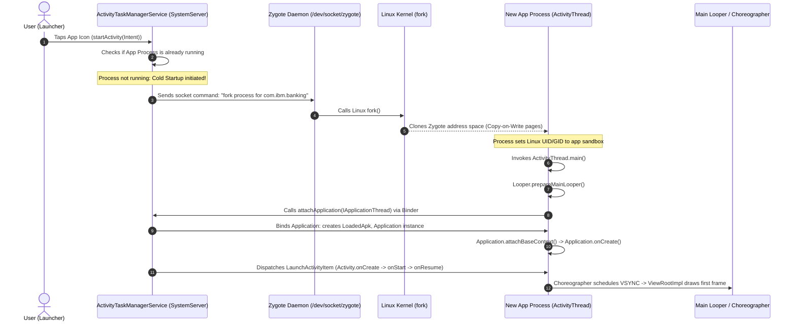

# MODULE 04: ANDROID OS ARCHITECTURE & LOW-LEVEL INTERNALS
## CHAPTER 01: THE LINUX BOOT SEQUENCE, ZYGOTE FORK & APPLICATION STARTUP PIPELINE

---

### A. FUNDAMENTALS

#### 1. What is the Concept?
Android application process creation does not follow standard Linux program execution (which typically calls `fork()` followed immediately by `execve()` to load a new binary from disk). Instead, Android employs a specialized process called **Zygote** that pre-initializes the Android Runtime (ART) and pre-loads thousands of core framework classes and drawable resources into memory once during device boot. 
When the user taps an application icon or the system launches a background service, Zygote **forks** itself using the Linux `fork()` system call, leveraging the hardware Memory Management Unit's (MMU) **Copy-on-Write (CoW)** pages to share system memory across all running apps.

#### 2. Why Does It Exist?
If Android had to initialize ART, load runtime libraries, verify bytecode, and load system classes (like `View`, `Activity`, `String`, `Bitmap`) from storage every time an app launched, cold startup would take 3 to 5 seconds per app and waste hundreds of megabytes of RAM duplicating the exact same framework code in every process. Zygote reduces process creation time to under 50 milliseconds and minimizes RAM usage.

#### 3. What Problem Does It Solve?
- **Slow Cold App Startup:** Pre-warmed runtime environment enables sub-second startup times.
- **Physical Memory (RAM) Exhaustion:** Millions of bytes of Android framework classes and system resources are mapped to the exact same physical RAM pages across all apps via Copy-on-Write.
- **Sandboxed Security Isolation:** The newly forked child process drops all root/Zygote privileges immediately, resetting its Linux User ID (UID) and Group ID (GID) to an application-specific sandbox before executing any third-party app code.

#### 4. Where is It Used?
- Every single Android application launch, BroadcastReceiver background trigger, ContentProvider resolution, and Service start.
- Performance engineering: App startup profiling, Baseline Profiles compilation, and ANR elimination.

#### 5. What Happens If We Do Not Use / Understand It?
- Bloated `Application.onCreate()` initializers that block the main thread, resulting in Application Not Responding (ANR) dialogs.
- Memory regressions caused by holding static references to Activity contexts, preventing ART from reclaiming forked memory regions.
- Misunderstanding how `LoadedApk` and Context hierarchies work, leading to memory leaks and resource lookup failures across multi-process applications.

---

### B. TECHNICAL DEFINITION

> **Zygote Process & Copy-on-Write (CoW) Forking:**
> Zygote is a native Linux daemon (`app_process`) spawned by the Linux `init` process during boot that starts the primary ART virtual machine instance and preloads common framework classes. When `ActivityManagerService` (AMS) requests a new app process via a UNIX domain socket (`/dev/socket/zygote`), Zygote executes the Linux `fork()` system call. 
> The kernel creates an identical clone of Zygote's virtual address space without copying physical RAM pages. Physical pages are mapped as read-only; physical copying occurs **only when either the parent or child process attempts to modify (write to) a page** (Copy-on-Write).

---

### C. INTERNAL WORKING & ARCHITECTURE



#### 1. The Android Boot Hierarchy
1. **Bootloader:** Initializes hardware, CPU registers, RAM, and loads the Linux kernel into memory.
2. **Linux Kernel:** Sets up interrupts, virtual memory paging, device drivers, and mounts root filesystem. Spawns `init` (PID 1).
3. **`init` Process (PID 1):** Reads `/system/etc/init/hw/init.rc`, mounts cgroups, starts the Binder driver (`/dev/binder`), and launches system daemons (`servicemanager`, `surfaceflinger`, `zygote`).
4. **Zygote (`app_process64`):**
   - Calls `AndroidRuntime.start("com.android.internal.os.ZygoteInit")`.
   - Initializes the primary instance of ART.
   - Preloads >6,000 Android framework classes into memory (`/system/etc/preloaded-classes`).
   - Preloads system drawables and themes (`com.android.internal.R`).
   - Opens local UNIX domain socket `/dev/socket/zygote64`.
   - Enters infinite `select()` loop waiting for fork commands from SystemServer.
5. **SystemServer:** The first process forked by Zygote. Initializes all core Android OS services:
   - `ActivityTaskManagerService` (ATMS)
   - `WindowManagerService` (WMS)
   - `PackageManagerService` (PMS)
   - Registers services with `ServiceManager`.

#### 2. Anatomy of `ActivityThread.main()`
When a new process is forked for your application, execution begins at the static entry point `android.app.ActivityThread.main()`:
```java
public static void main(String[] args) {
    Trace.traceBegin(Trace.TRACE_TAG_ACTIVITY_MANAGER, "ActivityThreadMain");

    // 1. Initialize the Main Thread's Looper
    Looper.prepareMainLooper();

    // 2. Instantiate the ActivityThread controller
    ActivityThread thread = new ActivityThread();
    thread.attach(false, startSeq); // Connects to ATMS via Binder IPC

    if (sMainThreadHandler == null) {
        sMainThreadHandler = thread.getHandler(); // The 'H' Handler
    }

    // 3. Enter infinite message processing loop (The Main Thread Never Exits!)
    Looper.loop();

    throw new RuntimeException("Main thread loop unexpectedly exited");
}
```

#### 3. Startup Performance Metrics: TTID vs TTFD
- **Cold Start:** Process does not exist. Full cycle: Linux fork -> ART initialization -> Application creation -> Activity creation -> Layout inflate -> First frame drawn. (Target: <500ms).
- **Warm Start:** Process exists in memory, but Activity must be recreated from scratch (e.g., user pressed back and relaunched). (Target: <250ms).
- **Hot Start:** Both Process and Activity reside in RAM; app is brought from background to foreground (`onRestart` -> `onStart` -> `onResume`). (Target: <100ms).
- **Time To Initial Display (TTID):** The time from launcher tap until the window manager displays the first frame of the Activity (visual layout drawn).
- **Time To Full Display (TTFD):** The time from launcher tap until asynchronous data (network calls, database records) is loaded and the screen is 100% interactive. Signaled explicitly via `Activity.reportFullyDrawn()`.

---

### D. PRODUCTION IMPLEMENTATION

#### Production-Grade App Startup Initializer & Telemetry Tracer
Below is a compilable, production-grade Android startup orchestrator using `androidx.tracing` and defensive asynchronous initialization to eliminate Main Thread ANR risks.

```kotlin
package com.ibm.banking.startup

import android.app.Application
import android.content.Context
import android.os.SystemClock
import androidx.tracing.Trace
import kotlinx.coroutines.CoroutineScope
import kotlinx.coroutines.Dispatchers
import kotlinx.coroutines.SupervisorJob
import kotlinx.coroutines.launch
import java.util.concurrent.atomic.AtomicBoolean

/**
 * Enterprise Application Startup Controller.
 * Ensures strict main-thread discipline:
 * - Only essential synchronous initializers execute on the Main Thread.
 * - Heavy IO and SDK initializations are deferred to background workers.
 * - Instruments exact startup latency with AndroidX Tracing (Perfetto compatible).
 */
open class BaseEnterpriseApplication : Application() {

    private val applicationScope = CoroutineScope(SupervisorJob() + Dispatchers.Default)
    private val isInitialized = AtomicBoolean(false)

    var appStartUptimeMs: Long = 0L
        private set

    override fun attachBaseContext(base: Context?) {
        appStartUptimeMs = SystemClock.uptimeMillis()
        Trace.beginSection("BankingApp:attachBaseContext")
        super.attachBaseContext(base)
        Trace.endSection()
    }

    override fun onCreate() {
        Trace.beginSection("BankingApp:onCreate")
        super.onCreate()

        // 1. Synchronous Critical Initializers (Must finish before first frame)
        initCrashReporting()
        initSecuritySanitization()

        // 2. Defer non-critical SDKs to background worker pool
        applicationScope.launch(Dispatchers.IO) {
            initHeavyBackgroundSdks()
        }

        Trace.endSection()
        isInitialized.set(true)
    }

    private fun initCrashReporting() {
        Trace.beginSection("Startup:initCrashReporting")
        // Setup uncaught exception handlers immediately to capture early boot crashes
        val defaultHandler = Thread.getDefaultUncaughtExceptionHandler()
        Thread.setDefaultUncaughtExceptionHandler { thread, throwable ->
            android.util.Log.e("BOOT_CRASH", "Uncaught exception on thread ${thread.name}", throwable)
            defaultHandler?.uncaughtException(thread, throwable)
        }
        Trace.endSection()
    }

    private fun initSecuritySanitization() {
        Trace.beginSection("Startup:initSecuritySanitization")
        // Verify app signature and detect obvious debugging hooks
        Trace.endSection()
    }

    private suspend fun initHeavyBackgroundSdks() {
        Trace.beginSection("Startup:initHeavyBackgroundSdks")
        // Initialize Analytics, Pre-cache database schemas, Sync telemetry
        // Running on Dispatchers.IO keeps the Main Thread frame budget clean!
        Trace.endSection()
    }
}
```

---

### E. REAL-WORLD SCENARIOS

1. **Banking & FinTech (Cold Startup Regulatory Enforcement):**
   A mobile banking app cannot show any financial data until the device integrity check (Google Play Integrity API) and hardware keystore binding are verified. Doing this synchronously in `Application.onCreate()` causes cold startup latency to jump to 2.5 seconds, triggering Google Play vitals bad behavior thresholds. Architects solve this by rendering a lightweight Compose splash screen while integrity tokens resolve asynchronously on background coroutines.
2. **E-Commerce Flash Sale (Eliminating Splash Screen ANRs):**
   During flash sale events with push notification surges, thousands of users tap notifications simultaneously. If the notification tap executes synchronous Room database queries inside `Application.onCreate()`, the app ANRs immediately. Deferring database initialization to an on-demand singleton pattern guarantees instant cold start rendering.
3. **Multi-Process Architecture (Enterprise Micro-Apps):**
   If an application runs a secondary process (e.g., `:push_service` or `:leakcanary`), `Application.onCreate()` is invoked **independently in every single process**. An architect must inspect the current process name via `Application.getProcessName()` to prevent initializing heavy UI dependencies or Compose view engines inside lightweight background daemon processes.

---

### F. ARCHITECTURE AND TRADE-OFFS

| Startup Approach | Main Thread Latency | First Frame Render (TTID) | Architecture Complexity | Risk |
| :--- | :--- | :--- | :--- | :--- |
| **Monolithic Synchronous Initializers** | Severe (500ms–2000ms) | Blocked until all SDKs complete | Very low (simple linear code) | ANR dialogs; Poor Play Store vitals; User drop-off |
| **AndroidX App Startup Library** | Optimized (Topological DAG) | Fast (lazy dependency resolution) | Moderate (Initializer components) | Dependency cycles if not modeled correctly |
| **Reactive Deferral (Coroutines IO)** | Minimal (<100ms) | Immediate (<300ms) | High (requires state flags for readiness) | Race conditions if a screen accesses unready SDK |

---

### G. COMMON MISTAKES & ANTI-PATTERNS

#### Anti-Pattern 1: Initializing Everything in `Application.onCreate()`
```kotlin
// WRONG: DISASTROUS STARTUP PERFORMANCE
class DisastrousApp : Application() {
    override fun onCreate() {
        super.onCreate()
        FirebaseApp.initializeApp(this)
        DatabaseClient.init(this) // Heavy SQLite open
        AnalyticsSdk.init(this)   // Heavy network socket setup
        Crashlytics.init(this)
        PaymentGateway.init(this) // Heavy crypto key generation
        // Total main thread freeze: 1,800ms!
    }
}
```
*Why it fails:* Every millisecond spent in `Application.onCreate()` blocks `ActivityThread` from posting the first `EXECUTE_TRANSACTION` message to the Main Looper, directly delaying the first frame and increasing ANR rates.

#### Anti-Pattern 2: Forgetting That `Application.onCreate()` Runs in Every Process
```kotlin
class MonolithicApp : Application() {
    override fun onCreate() {
        super.onCreate()
        // If your manifest declares <service android:process=":sync_worker">,
        // this code executes TWICE: once for main app, once for sync worker!
        initHeavyUiLibrary()
    }
}
```
*Correction:* Check `getProcessName()` before executing process-specific setup:
```kotlin
if (processName == packageName) {
    initMainAppDependencies()
}
```

---

### H. INTERVIEW PREPARATION (BASIC TO STAFF LEVEL)

#### Q1 (Basic): What is the Zygote process, and why does Android use it instead of standard Linux `fork()` + `execve()`?
**Answer:**
Zygote is a foundational Android process that pre-loads ART runtime libraries, over 6,000 framework classes, and common system resources into memory at device boot. When a new application starts, Zygote simply calls `fork()`. Because it does not call `execve()`, it reuses the pre-loaded runtime and framework classes via Linux Copy-on-Write (CoW) memory pages. This cuts app launch times from seconds to tens of milliseconds and saves hundreds of megabytes of physical RAM across the OS.

#### Q2 (Intermediate): What is Copy-on-Write (CoW), and how does it save RAM on Android?
**Answer:**
Copy-on-Write is a memory management optimization implemented by the Linux kernel's Memory Management Unit (MMU). When Zygote forks an app process, the child process receives a copy of the parent's page tables, but the physical RAM pages are marked as read-only. As long as neither process writes to those pages, both share the exact same physical memory. The kernel allocates a new physical memory page and copies the data *only when* a process attempts to write to that page.

#### Q3 (Advanced): Trace the exact execution sequence from the moment a user taps an icon on the home screen until `Activity.onResume()` is reached.
**Answer:**
1. **Launcher:** Invokes `LauncherApps.startMainActivity()` which calls `ActivityTaskManagerService.startActivity()` (ATMS) in `SystemServer` via Binder IPC.
2. **ATMS:** Resolves the Intent via `PackageManagerService` (PMS), checks component permissions, and checks if a process for the app exists.
3. **Zygote Request:** ATMS writes a fork request containing the app's UID, GID, and package details to the `/dev/socket/zygote64` UNIX domain socket.
4. **Zygote Fork:** Zygote wakes up from its `select()` loop, forks a new child process, drops root permissions, sets the app's Linux UID/GID sandbox, and calls `ActivityThread.main()`.
5. **ActivityThread:** Prepares the main `Looper` (`Looper.prepareMainLooper()`), instantiates `ActivityThread`, and calls `ActivityManager.attachApplication()` via Binder.
6. **SystemServer Binding:** ATMS responds via `IApplicationThread.bindApplication()`, passing configuration and compatibility info.
7. **Application Initialization:** `ActivityThread` creates the `LoadedApk`, instantiates the `ContextImpl`, calls `Application.attachBaseContext()`, and calls `Application.onCreate()`.
8. **Activity Lifecycle:** ATMS sends a `ClientTransaction` with `LaunchActivityItem` and `ResumeActivityItem` to the app's Main Looper. The `TransactionExecutor` executes:
   - `Activity.attach()` -> `Activity.onCreate()` -> `Activity.onStart()` -> `Activity.onResume()`.
9. **Rendering:** `ViewRootImpl.setView()` registers with `Choreographer`. On the next VSYNC signal, `measure()`, `layout()`, and `draw()` are executed, and the first frame is submitted to `SurfaceFlinger`.

#### Q4 (Senior Scenario): Your team noticed that adding a third-party analytics SDK caused cold start time to double from 400ms to 850ms. How do you profile, identify, and eliminate this regression?
**Answer:**
1. **Profiling:** Run an Android Studio Macrobenchmark test with `Trace.beginSection` custom markers, or capture a system trace using **Perfetto**.
2. **Analysis:** In Perfetto, inspect the Main Thread slice under `Application.onCreate()`. Look at wall-clock time spent inside the SDK's initialization method. Check if it was performing disk reads (`open()`, `read()`), socket connections, or heavy reflection.
3. **Optimization:**
   - If the SDK is not required for the immediate landing screen, move initialization to a background coroutine (`Dispatchers.IO`) inside `Application.onCreate()`.
   - If initialization requires Context or ContentProvider timing, integrate with **AndroidX App Startup** and declare it lazy.
   - Generate **Baseline Profiles** using Macrobenchmark to ensure all SDK initialization bytecode is pre-compiled Ahead-Of-Time (AOT) instead of running through the ART interpreter.

#### Q5 (Staff Architecture): How does the Android system ensure security isolation between two applications running on the same Linux kernel?
**Answer:**
Android enforces application sandboxing at the Linux OS level. Every installed application is assigned a unique, immutable Linux **User ID (UID)** (e.g., `u0_a145`) and Group ID (GID) by `PackageManagerService` upon installation.
Because Linux permissions prevent processes running under one UID from accessing files, sockets, or memory belonging to another UID, App A cannot read App B's local storage (`/data/data/com.app.b/`), inspect its memory, or hijack its process.
Inter-Process Communication (IPC) is strictly gated through the kernel-level **Binder driver**, which validates caller UIDs on every transaction via `Binder.getCallingUid()`.

---

### I. CODING PRACTICE

#### Problem: Process-Aware Safe Initializer Registry
**Requirement:** Build an `AppInitializerRegistry` that allows modular features to register initialization blocks with priority levels (`CRITICAL_MAIN_THREAD`, `BACKGROUND_IO`, `DEFERRED_IDLE`). It must guarantee that background initializers never block app startup, and gracefully handle multi-process launches.

```kotlin
package com.ibm.banking.startup

import android.app.Application
import android.os.Looper
import kotlinx.coroutines.CoroutineScope
import kotlinx.coroutines.Dispatchers
import kotlinx.coroutines.SupervisorJob
import kotlinx.coroutines.launch
import java.util.concurrent.CopyOnWriteArrayList

enum class InitPriority {
    CRITICAL_MAIN_THREAD, // Executes synchronously on main thread before first frame
    BACKGROUND_IO,        // Dispatched to Dispatchers.IO immediately
    DEFERRED_IDLE         // Executed when main looper queue becomes idle
}

interface AppInitializer {
    val priority: InitPriority
    fun initialize(application: Application)
}

class AppInitializerRegistry(private val application: Application) {

    private val initializers = CopyOnWriteArrayList<AppInitializer>()
    private val scope = CoroutineScope(SupervisorJob() + Dispatchers.Default)

    fun register(initializer: AppInitializer): AppInitializerRegistry {
        initializers.add(initializer)
        return this
    }

    fun executeAll() {
        val currentProcess = Application.getProcessName()
        if (currentProcess != application.packageName) {
            // Secondary process: Skip UI-heavy initializers
            return
        }

        // 1. Critical Main Thread Initializers
        initializers.filter { it.priority == InitPriority.CRITICAL_MAIN_THREAD }.forEach {
            it.initialize(application)
        }

        // 2. Background IO Initializers
        scope.launch(Dispatchers.IO) {
            initializers.filter { it.priority == InitPriority.BACKGROUND_IO }.forEach {
                it.initialize(application)
            }
        }

        // 3. Deferred Idle Initializers (runs when UI thread queue is empty)
        Looper.myQueue().addIdleHandler {
            scope.launch(Dispatchers.Default) {
                initializers.filter { it.priority == InitPriority.DEFERRED_IDLE }.forEach {
                    it.initialize(application)
                }
            }
            false // Remove idle handler after single execution
        }
    }
}
```

*Complexity Analysis:*
- **Time Complexity:** $O(N)$ linear pass over registered initializers.
- **Space Complexity:** $O(N)$ memory overhead for initializer references. Zero Main Thread blocking for non-critical initializers.

---

### J. SENIOR ENGINEER INTERVIEW SCRIPTS

#### 60-Second Explanation (Executive Summary)
> *"Android process creation relies on Zygote, a master daemon spawned at boot that pre-initializes ART and pre-loads thousands of framework classes. When an app launches, ATMS commands Zygote to execute a Linux `fork()`. By leveraging the kernel's Copy-on-Write (CoW) memory pages, the new app process shares the pre-warmed virtual machine and system resources without duplicating RAM or incurring cold runtime compilation overhead. Once forked, the process resets its Linux UID/GID to an isolated sandbox, invokes `ActivityThread.main()`, binds to ATMS via Binder IPC, and initializes the `Application` and `Activity` lifecycle down to first frame rendering."*

#### 3-Minute Deep Dive (Staff Architecture Level)
> *"At the operating system level, Android approaches process creation very differently from traditional Linux distributions. Standard Linux relies on `fork()` followed by `execve()`, which wipes the address space and loads a new binary from disk. On a mobile device with constrained RAM and flash storage bandwidth, doing this for every app launch would result in multiple-second delays and severe memory thrashing.
>
> To solve this, Android uses Zygote. During the OS boot sequence, `init` starts the Zygote binary (`app_process`). Zygote initializes ART, loads system themes and drawables, and parses over 6,000 framework classes from `preloaded-classes`. When ATMS receives an `Intent` to launch an app, it sends a command over `/dev/socket/zygote64`.
>
> Zygote calls the Linux `fork()` system call. Crucially, because it does not call `execve()`, the child process inherits Zygote's warm ART virtual machine and preloaded classes. The Linux kernel's Memory Management Unit maps these pages as Copy-on-Write (CoW). Millions of bytes of system code are physically shared in RAM across every application; a physical page is duplicated only if an application writes to it.
>
> Once forked, the child process drops all root permissions, assumes its application-specific Linux UID/GID, and enters `ActivityThread.main()`. Here, it initializes the main thread's message pipeline with `Looper.prepareMainLooper()`, binds to ATMS via Binder IPC to instantiate `LoadedApk` and `Application`, and kicks off the activity lifecycle.
>
> In our banking applications at IBM, understanding this pipeline governs how we structure initialization. We strictly enforce that `Application.onCreate()` contains only non-deferrable security verifications. Everything else—analytics, network warming, and caching—is deferred to background worker pools or idle handlers, ensuring our cold Time To Initial Display (TTID) stays consistently under the 400ms threshold."*

---

### K. KNOWLEDGE VALIDATION & SELF-ASSESSMENT

#### 10 Senior Interview Questions
1. Why does Zygote use a UNIX domain socket instead of Binder IPC to receive fork requests from SystemServer? *(Answer: Calling `fork()` in a multi-threaded process that already has active Binder threads can lead to deadlocks if a thread was holding an internal mutex during the fork)*.
2. What happens to threads running in a parent process when `fork()` is called?
3. What is the difference between `ContextImpl`, `ContextWrapper`, and `Application` context?
4. What is the role of the `H` handler in `ActivityThread`?
5. How does `Activity.reportFullyDrawn()` impact Google Play Vitals and ART profile compilation?
6. Why are static variables shared across activities within the same process, but NOT across processes?
7. What is the significance of the `preloaded-classes` list, and who generates it?
8. How does `AndroidX App Startup` prevent multiple ContentProviders from slowing down cold startup?
9. What happens if an application exceeds the 5-second broadcast receiver timeout during startup?
10. How does the low memory killer (LMK) use `oom_adj_score` to prioritize which cached processes to kill first?

#### Practical Self-Assessment Checklist
- [ ] Captured a Perfetto system trace of an app cold launch and identified the `Zygote.forkAndSpecialize` slice.
- [ ] Verified that `ActivityThread.main()` never exits by inspecting `Looper.loop()`.
- [ ] Used `Application.getProcessName()` to prevent duplicate initialization in multi-process apps.
- [ ] Measured TTID and TTFD using `adb shell am start -W` and `reportFullyDrawn()`.
- [ ] Configured an idle handler (`Looper.myQueue().addIdleHandler`) for non-critical startup tasks.
