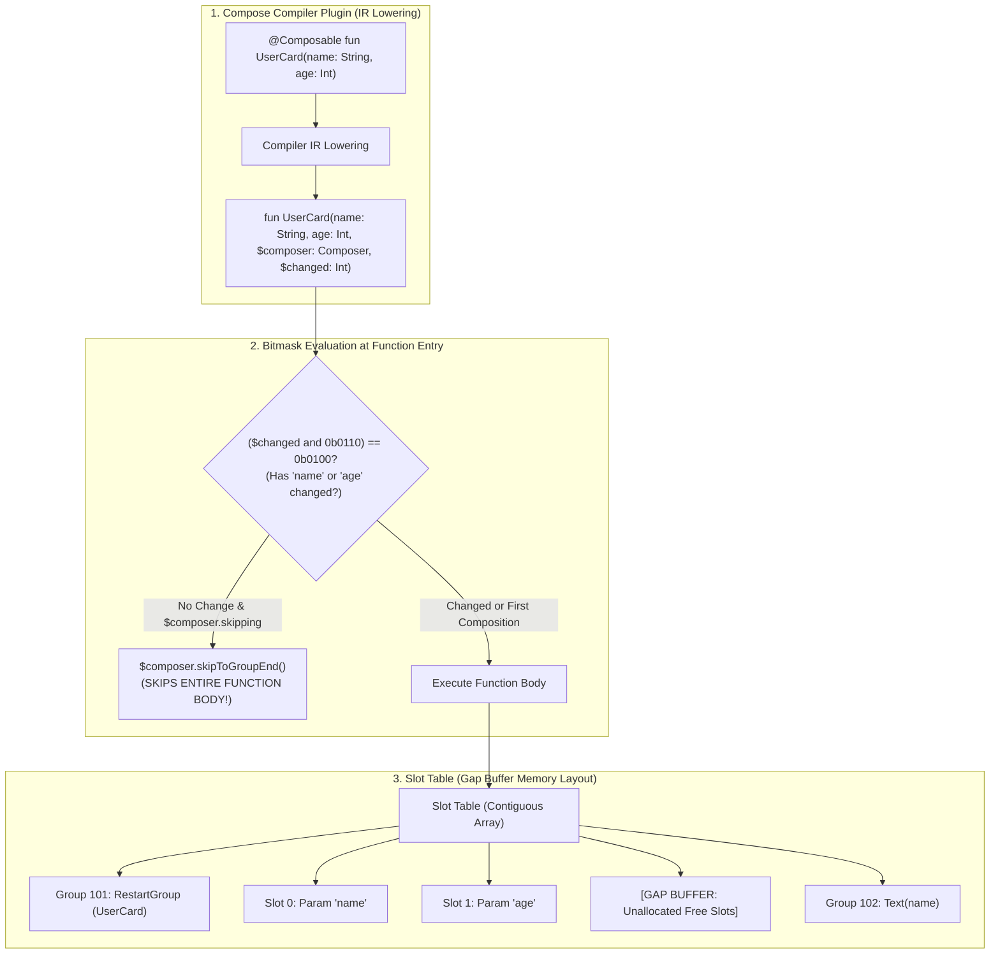

# MODULE 06: JETPACK COMPOSE DEEP INTERNALS
## CHAPTER 01: THE COMPOSE COMPILER, THE SLOT TABLE ARCHITECTURE & RECOMPOSITION SKIPPING

---

### A. FUNDAMENTALS

#### 1. What is the Concept?
Jetpack Compose is a declarative UI toolkit, but beneath its idiomatic Kotlin syntax lies a custom compiler plugin and runtime engine. Unlike Android's legacy View system (which builds and mutates a tree of stateful `View` objects on the heap), Compose transforms `@Composable` functions into a dynamic in-memory data structure known as the **Slot Table**.
Key compiler and runtime mechanics include:
- **The Compose Compiler Plugin:** An AST (Abstract Syntax Tree) transformer that alters every `@Composable` function signature by appending synthetic parameters: `$composer: Composer` and bitmask integers `$changed: Int` and `$default: Int`.
- **The Slot Table:** A flat array-based data structure backed by a **Gap Buffer**, storing positional state, composition keys, parameters, and layout nodes.
- **Recomposition Skipping:** The compiler evaluates the `$changed` bitmask at the entry point of every Composable function. If all parameters are determined to be stable and have not changed value since the last composition, the runtime skips the entire execution of the function body.

#### 2. Why Does It Exist?
In the legacy View system, keeping UI in sync with asynchronous state required continuous manual mutations (`textView.setText()`, `progressBar.setVisibility()`). This led to:
1. **State Inconsistency:** Views holding stale or contradictory state.
2. **Deep View Hierarchies:** Heavy heap-allocated objects (`View` has over 100 fields and occupies >1KB of RAM per instance).
3. **Double Invalidation Passes:** Layout passes (`measure()` and `layout()`) traversing deep tree structures recursively, causing frame drops during complex scrolling.

Compose was built to decouple state storage from the UI hierarchy, flattening state storage into a cache-friendly array (the Slot Table) and executing smart selective re-execution (recomposition) only where state inputs change.

#### 3. What Problem Does It Solve?
- **Heap Allocation Overhead:** Replacing heavy `View` objects with lightweight transient function executions.
- **Unnecessary UI Re-renders:** Smart recomposition skipping ensures that updating a single user badge on a screen does not re-render the surrounding screen layout.
- **Fine-Grained Scoping:** Recomposition scopes isolate state reads down to the narrowest possible Composable boundary.

#### 4. Where is It Used?
- All modern Android UI development, Jetpack Compose Multiplatform (Desktop, iOS, Web), and Wear OS / Android Auto interfaces.
- Performance engineering: Diagnosing recomposition loops, optimizing LazyColumn scroll jank, and generating Compose Compiler metrics reports.

#### 5. What Happens If We Do Not Use / Understand It?
- **Infinite Recomposition Loops:** Reading mutable state during composition that mutates during composition triggers runaway re-renders, causing 100% CPU usage and battery drain.
- **Unstable Parameter Cascades:** Passing unstable data types (like raw `List<T>` or unannotated multi-module DTOs) breaks smart skipping, forcing the entire screen to recompose on every state change.
- **Slot Table Fragmentation:** Misusing keys in dynamic lists causes the Gap Buffer to slide constantly across memory, degrading frame rates during list scrolling.

---

### B. TECHNICAL DEFINITION

> **Compose Compiler Lowering & The Slot Table:**
> The Compose Compiler is a Kotlin compiler plugin that operates on the Kotlin IR (Intermediate Representation). It rewrites `@Composable fun Foo(x: Int)` into:
> `fun Foo(x: Int, $composer: Composer, $changed: Int)`.
> The **Slot Table** is the runtime memory layout of a composition: a contiguous flat array managed as a **Gap Buffer**. It sequentially stores Groups (RestartGroups, MovableGroups, ReplaceGroups) and Slots containing object references, states, and memoized values. Positional memoization guarantees that `remember {}` lookups are direct array accesses based on execution order.

---

### C. INTERNAL WORKING & ARCHITECTURE



#### 1. The Synthetic `$composer` and `$changed` Bitmask
Every `@Composable` function is rewritten by the compiler to accept a `$composer` reference and a 32-bit integer `$changed`.
For each parameter, the compiler allocates **3 bits** inside `$changed`:
- `0b000` (Different): Parameter has changed value.
- `0b001` (Same): Parameter has definitely not changed value.
- `0b010` (Static): Parameter is a compile-time constant or immutable literal.
- `0b100` (Unknown): Must check with `$composer.changed(param)` at runtime.

At the very top of the generated bytecode, the compiler inserts:
```java
// Decompiled Java equivalent of a Composable function
public static final void UserBadge(String name, Composer $composer, int $changed) {
    $composer = $composer.startRestartGroup(-128491823); // Unique synthetic group key
    int $dirty = $changed;
    if (($changed & 14) == 0) {
        $dirty |= $composer.changed(name) ? 4 : 2;
    }
    // Check if parameters are unchanged AND composer is in skipping mode:
    if (($dirty & 11) == 2 && $composer.getSkipping()) {
        $composer.skipToGroupEnd(); // ZERO UI WORK DONE!
    } else {
        // Normal composition body
        Text(name, $composer, $dirty & 14);
    }
    ScopeUpdateScope $scope = $composer.endRestartGroup();
    if ($scope != null) {
        $scope.updateScope(new Function2() { ... }); // Recomposition lambda
    }
}
```

#### 2. The Slot Table Architecture (The Gap Buffer)
Why is the Slot Table implemented as a **Gap Buffer** instead of a tree of objects?
A standard tree node has multiple pointers (left, right, parent, children), causing memory fragmentation and CPU cache misses.
A Gap Buffer is an array with a movable "gap" of unused slots in the middle:

```
[Group 1][Group 2][Slot A][Slot B][  GAP: FREE MEMORY  ][Group 3][Slot C]
                                  ▲                    ▲
                               gapStart              gapEnd
```
- **Sequential Writes:** When composing from top to bottom, values are inserted at `gapStart` in $O(1)$ time with high cache locality.
- **Moving the Gap:** If an `if/else` condition changes or a dynamic list item is inserted, the gap is shifted to the modification site, and new slots are written.
- **Groups:**
  - `RestartGroup`: Marks a boundary that can be individually re-executed (most `@Composable` functions).
  - `ReplaceGroup`: Marks conditional branches (`if/else` or `when`). Replaces child slots when the branch flips.
  - `MovableGroup`: Created when using `key(...)`. Allows moving slots to a new index without re-allocating state.

#### 3. Positional Memoization (`remember {}`)
When you write:
```kotlin
val formatter = remember { CurrencyFormatter() }
```
How does Compose know to return the cached formatter on subsequent recompositions?
It does **not** use a `HashMap<String, Any>`. It uses **positional indexing** in the Slot Table:
1. On first composition, the composer advances to the current slot index. It finds an empty slot sentinel (`Composer.Empty`).
2. It executes the lambda `{ CurrencyFormatter() }`.
3. It writes the resulting object into the slot and advances the slot pointer.
4. On subsequent recompositions, the composer visits the exact same relative slot offset. It finds `slot[i] != Composer.Empty`, casts the stored object to `CurrencyFormatter`, and returns it immediately in $O(1)$ time without evaluating the lambda.

---

### D. PRODUCTION IMPLEMENTATION

#### High-Performance Recomposition-Optimized Transaction Feed
Below is a compilable, production-grade Jetpack Compose screen demonstrating:
1. Strict parameter stability compliance.
2. Recomposition-isolated item rendering using immutable state models.
3. Stable keying with `MovableGroup` (`key()` parameter).
4. `derivedStateOf` optimization to prevent scroll-state recomposition thrashing.

```kotlin
package com.ibm.banking.feature.atm.ui

import androidx.compose.foundation.background
import androidx.compose.foundation.layout.Box
import androidx.compose.foundation.layout.Column
import androidx.compose.foundation.layout.Row
import androidx.compose.foundation.layout.Spacer
import androidx.compose.foundation.layout.fillMaxSize
import androidx.compose.foundation.layout.fillMaxWidth
import androidx.compose.foundation.layout.height
import androidx.compose.foundation.layout.padding
import androidx.compose.foundation.lazy.LazyColumn
import androidx.compose.foundation.lazy.LazyListState
import androidx.compose.foundation.lazy.items
import androidx.compose.foundation.lazy.rememberLazyListState
import androidx.compose.material3.Card
import androidx.compose.material3.CardDefaults
import androidx.compose.material3.MaterialTheme
import androidx.compose.material3.Text
import androidx.compose.runtime.Composable
import androidx.compose.runtime.Immutable
import androidx.compose.runtime.derivedStateOf
import androidx.compose.runtime.getValue
import androidx.compose.runtime.remember
import androidx.compose.ui.Alignment
import androidx.compose.ui.Modifier
import androidx.compose.ui.graphics.Color
import androidx.compose.ui.unit.dp
import com.ibm.banking.model.AccountId
import com.ibm.banking.model.AmountCents
import com.ibm.banking.model.TransactionId
import com.ibm.banking.model.TransactionStatus

// 1. Explicitly Annotated Immutable UI Models (Guarantees Recomposition Skipping)
@Immutable
data class TransactionItemUiModel(
    val id: TransactionId,
    val sourceAccount: AccountId,
    val formattedAmount: String,
    val description: String,
    val status: TransactionStatus,
    val isPositive: Boolean
)

@Immutable
data class TransactionFeedUiState(
    val items: List<TransactionItemUiModel> = emptyList(),
    val totalBalanceFormatted: String = ""
)

// 2. High-Performance Screen Composable
@Composable
fun TransactionFeedScreen(
    state: TransactionFeedUiState,
    modifier: Modifier = Modifier,
    listState: LazyListState = rememberLazyListState()
) {
    // Optimization: derivedStateOf ensures only the scroll indicator recomposes when scrolling,
    // rather than the entire TransactionFeedScreen!
    val showScrollToTopButton by remember {
        derivedStateOf { listState.firstVisibleItemIndex > 5 }
    }

    Column(modifier = modifier.fillMaxSize().background(MaterialTheme.colorScheme.background)) {
        // Balance Header (Isolated Scope)
        BalanceHeader(totalBalance = state.totalBalanceFormatted)

        // Optimized Lazy Feed
        LazyColumn(
            state = listState,
            modifier = Modifier.fillMaxWidth().weight(1f)
        ) {
            items(
                items = state.items,
                key = { item -> item.id.value } // Stable Key: Prevents GapBuffer churn on item insertion!
            ) { item ->
                TransactionRow(item = item)
            }
        }

        if (showScrollToTopButton) {
            Box(
                modifier = Modifier.fillMaxWidth().padding(16.dp),
                contentAlignment = Alignment.Center
            ) {
                Text(
                    text = "Scroll to Top",
                    style = MaterialTheme.typography.labelMedium,
                    color = MaterialTheme.colorScheme.primary
                )
            }
        }
    }
}

// 3. Isolated Item Composable: Will SKIP recomposition if 'item' has not changed!
@Composable
fun TransactionRow(
    item: TransactionItemUiModel,
    modifier: Modifier = Modifier
) {
    Card(
        modifier = modifier.fillMaxWidth().padding(horizontal = 16.dp, vertical = 6.dp),
        colors = CardDefaults.cardColors(containerColor = MaterialTheme.colorScheme.surface)
    ) {
        Row(
            modifier = Modifier.fillMaxWidth().padding(16.dp),
            verticalAlignment = Alignment.CenterVertically
        ) {
            Column(modifier = Modifier.weight(1f)) {
                Text(
                    text = item.description,
                    style = MaterialTheme.typography.titleMedium,
                    color = MaterialTheme.colorScheme.onSurface
                )
                Spacer(modifier = Modifier.height(4.dp))
                Text(
                    text = "Account: ${item.sourceAccount.value}",
                    style = MaterialTheme.typography.bodySmall,
                    color = MaterialTheme.colorScheme.onSurfaceVariant
                )
            }

            Text(
                text = item.formattedAmount,
                style = MaterialTheme.typography.titleMedium,
                color = if (item.isPositive) Color(0xFF00875A) else MaterialTheme.colorScheme.error
            )
        }
    }
}

@Composable
fun BalanceHeader(
    totalBalance: String,
    modifier: Modifier = Modifier
) {
    Box(
        modifier = modifier.fillMaxWidth().padding(24.dp),
        contentAlignment = Alignment.Center
    ) {
        Column(horizontalAlignment = Alignment.CenterHorizontally) {
            Text(
                text = "Total Available Balance",
                style = MaterialTheme.typography.bodyMedium,
                color = MaterialTheme.colorScheme.onSurfaceVariant
            )
            Spacer(modifier = Modifier.height(8.dp))
            Text(
                text = totalBalance,
                style = MaterialTheme.typography.headlineLarge,
                color = MaterialTheme.colorScheme.onSurface
            )
        }
    }
}
```

---

### E. REAL-WORLD SCENARIOS

1. **FinTech (High-Frequency Stock/Crypto Order Book):**
   In a financial trading app receiving 50 order-book updates per second, if the list row Composable is not skippable (e.g., due to an unstable lambda or unannotated collection), Compose will execute 50 whole-screen recompositions per second. The main thread will miss the 16.6ms frame budget, causing severe frame drops (jank) and rapid battery drain. Enforcing `@Immutable` models and stable keys drops recomposition count to only the specific rows whose prices changed.
2. **E-Commerce (Flash Sale Cart Total Recalculation):**
   When the user checks or unchecks an item in a 50-item shopping cart, the bottom total price updates. If the cart total state read is placed at the root `CartScreen` level, the entire screen and all 50 items recompose. By hoisting the total state read inside an isolated `CartSummaryFooter` Composable, the 50 item rows skip recomposition entirely.
3. **Dynamic Forms (ATM Cash Dispense Flow):**
   In a multi-step ATM cash withdrawal wizard (Account Selection $\to$ Amount Input $\to$ Biometric Verification $\to$ Dispense Status), wrapping conditional steps in `key(session.stepId)` allows the Slot Table's `ReplaceGroup` to cleanly discard old step state and initialize new step state with zero memory leaks.

---

### F. ARCHITECTURE AND TRADE-OFFS

| Dimension | Legacy View System (`inflate`) | Jetpack Compose (`Slot Table`) |
| :--- | :--- | :--- |
| **Memory Structure** | Tree of heap-allocated `View` instances (>1KB each) | Flat contiguous array managed as a Gap Buffer |
| **State Synchronization** | Manual mutations (`view.setText()`) | Reactive re-execution (Recomposition) |
| **Invalidation Granularity** | View-tree invalidation (`requestLayout()`, `invalidate()`) | Recomposition scopes down to individual lambda blocks |
| **Skipping Mechanism** | None (traverses full view hierarchy on layout) | Bitmask `$changed` evaluation at function entry |
| **Memory Locality** | Poor (Pointers scattered across heap) | Excellent (Contiguous array traversal) |
| **Compilation Cost** | Fast (Standard Java/Kotlin compilation) | Slower (Compose Compiler IR transformations) |

---

### G. COMMON MISTAKES & ANTI-PATTERNS

#### Anti-Pattern 1: Reading State at Too High a Scope
```kotlin
// BAD ARCHITECTURE: Whole screen recomposes on every scroll offset change!
@Composable
fun BadScrollableScreen(scrollState: ScrollState) {
    val scrollOffset = scrollState.value // STATE READ AT ROOT LEVEL!
    
    Header(scrollOffset) // Needs scrollOffset
    StaticContent()      // DOES NOT NEED SCROLL OFFSET, BUT IS FORCED TO RECOMPOSE!
    Footer()             // DOES NOT NEED SCROLL OFFSET, BUT IS FORCED TO RECOMPOSE!
}
```
*Why it fails:* Reading `scrollState.value` registers the root `BadScrollableScreen` as a subscriber to the snapshot state. Every single pixel of scroll invalidates the root scope, forcing all child composables to re-evaluate their parameters.
*Correction:* Defer state reads to the lowest possible scope or pass a lambda:
```kotlin
@Composable
fun GoodScrollableScreen(scrollState: ScrollState) {
    Header(scrollProvider = { scrollState.value }) // Read inside Header!
    StaticContent() // SKIPPED!
    Footer()        // SKIPPED!
}
```

#### Anti-Pattern 2: Missing Stable Keys in Dynamic Lists
```kotlin
// BAD: GapBuffer thrashing on item insertion
LazyColumn {
    items(items) { item -> // No key parameter provided!
        TransactionRow(item)
    }
}
```
*Why it fails:* When a new item is prepended at index 0, Compose matches items by position. It thinks every existing item's parameters changed, forcing every single row in the list to recompose and causing the Slot Table's Gap Buffer to shift back and forth repeatedly.
*Correction:* Always provide a unique, stable domain key: `items(items, key = { it.id })`.

---

### H. INTERVIEW PREPARATION (BASIC TO STAFF LEVEL)

#### Q1 (Basic): What is the difference between Composition and Recomposition?
**Answer:**
**Composition** is the initial execution of Composable functions where Compose builds the Slot Table, stores state, executes layout nodes, and translates the declarative code into an active UI tree.
**Recomposition** is the re-execution of a Composable function in response to a state change, allowing Compose to update the Slot Table and patch the rendered UI with the latest data.

#### Q2 (Intermediate): What is the Slot Table, and why does Compose use a Gap Buffer instead of a Tree?
**Answer:**
The Slot Table is the in-memory array that stores all composition data (state, memoized objects, parameters, and layout nodes). It is implemented as a Gap Buffer—a contiguous flat array with a floating gap of empty space.
Compose uses a Gap Buffer because UI hierarchies are generated sequentially during composition. Sequential array access maximizes CPU L1/L2 cache locality and allows $O(1)$ writes. When conditional branches (`if/else`) change, the gap is moved to the target position, allowing localized insertions and deletions without reallocating tree nodes across the heap.

#### Q3 (Advanced): How does the Compose Compiler determine whether a Composable function can skip recomposition?
**Answer:**
The compiler evaluates the function's parameters for **Stability**:
1. All primitive types (`Int`, `Boolean`, `Float`) and `String` are immutable and stable.
2. Functional types (lambdas) are stable.
3. Classes annotated with `@Immutable` or `@Stable` are stable.
4. Classes whose all public properties are `val` and of stable types are inferred as stable.

If all parameters are stable, the compiler generates a skipping block using the `$changed` bitmask at function entry. If the bitmask indicates that no parameter values have changed since the previous composition, `$composer.skipToGroupEnd()` is called, skipping the entire function body. If even one parameter is **unstable** (e.g., standard `List<T>`), the compiler marks the function as non-skippable, forcing it to recompose every time its parent recomposes.

#### Q4 (Senior Scenario): You are debugging a LazyColumn in a banking transactions screen that stutters heavily during fast scrolling. How do you diagnose and eliminate the jank?
**Answer:**
1. **Diagnosis:** Run Layout Inspector in Android Studio with "Show Recomposition Counts" enabled. Scroll the list and observe which rows increment their recomposition counters.
2. **Compiler Metrics:** Generate Compose Compiler Metrics by adding `-Pplugin:androidx.compose.compiler.plugins.kotlin:reportsDestination=...` to `build.gradle.kts`. Inspect `app_debug-composables.txt`. Check if the item row composable is marked `restartable skippable` or `restartable unstable`.
3. **Common Root Causes & Fixes:**
   - **Missing Key:** Ensure `items(items, key = { it.id })` is specified so reordering or insertion doesn't invalidate every row.
   - **Unstable Collection:** If the item model contains a `List<Tag>`, wrap it in `@Immutable` or use Kotlinx Immutable Collections (`ImmutableList<Tag>`).
   - **Unstable Lambda:** If passing callbacks like `onItemClick = { vm.select(item) }`, remember the lambda or hoist it to avoid reallocating a new closure instance on every recomposition.

#### Q5 (Staff Architecture): Explain how the Compose runtime handles Multi-Version Concurrency Control (MVCC) in its Snapshot State System.
**Answer:**
Compose's state system (`mutableStateOf`) is modeled after database MVCC (Multi-Version Concurrency Control).
- When a `MutableState` is created, its value is stored inside a linked list of `StateRecord` instances.
- A **Snapshot** represents an isolated, consistent view of state at a specific point in time. Each snapshot has a snapshot ID and an invalidation bitmask of snapshots that were open when it was created.
- When a thread reads a state variable within a snapshot, it traverses the `StateRecord` chain to find the record version matching its snapshot ID, isolating it from concurrent modifications made on background threads.
- When modifying state, the thread writes to a new `StateRecord`. When the snapshot is **applied** (`Snapshot.apply()`), the runtime atomically verifies that no conflicting modifications occurred on the same state variables. If verified, the changes are committed globally and registered observers are notified, triggering recomposition on the main thread.

---

### I. CODING PRACTICE

#### Problem: Custom Recomposition-Safe Debounced Search Input
**Requirement:** Build a custom `DebouncedSearchBar` composable that takes a search query state, emits debounced query events after 300ms of inactivity, and prevents recomposition thrashing on rapid typing.

```kotlin
package com.ibm.banking.feature.atm.ui

import androidx.compose.foundation.layout.fillMaxWidth
import androidx.compose.foundation.layout.padding
import androidx.compose.material3.OutlinedTextField
import androidx.compose.material3.Text
import androidx.compose.runtime.Composable
import androidx.compose.runtime.LaunchedEffect
import androidx.compose.runtime.getValue
import androidx.compose.runtime.mutableStateOf
import androidx.compose.runtime.remember
import androidx.compose.runtime.setValue
import androidx.compose.ui.Modifier
import androidx.compose.ui.unit.dp
import kotlinx.coroutines.delay

@Composable
fun DebouncedSearchBar(
    onDebouncedQuery: (String) -> Unit,
    modifier: Modifier = Modifier,
    debounceTimeMs: Long = 300L
) {
    var rawText by remember { mutableStateOf("") }

    // LaunchedEffect keys on rawText: Restarts coroutine whenever user types a character
    LaunchedEffect(rawText) {
        if (rawText.isBlank()) {
            onDebouncedQuery("")
            return@LaunchedEffect
        }
        delay(debounceTimeMs) // Wait for user to stop typing
        onDebouncedQuery(rawText) // Emit debounced query
    }

    OutlinedTextField(
        value = rawText,
        onValueChange = { rawText = it },
        modifier = modifier.fillMaxWidth().padding(16.dp),
        placeholder = { Text("Search transactions...") },
        singleLine = true
    )
}
```

*Complexity Analysis:*
- **Time Complexity:** $O(1)$ state update per keystroke. Debounce coroutine cancels prior delay in $O(1)$.
- **Space Complexity:** $O(1)$ Slot Table storage for `rawText` state record.

---

### J. SENIOR ENGINEER INTERVIEW SCRIPTS

#### 60-Second Explanation (Executive Summary)
> *"Jetpack Compose transforms declarative UI into high-performance rendering through two core subsystems: the Compose Compiler plugin and the Slot Table runtime. The compiler rewrites every `@Composable` function into standard Kotlin bytecode, injecting synthetic `$composer` and `$changed` bitmask parameters. The Slot Table stores state, parameters, and layout nodes in a contiguous array backed by a Gap Buffer, ensuring $O(1)$ sequential writes and high CPU cache locality. When state changes, the compiler evaluates the `$changed` bitmask at function entry; if all parameters are stable and unchanged, `$composer.skipToGroupEnd()` is called, skipping the entire function body with zero CPU or layout overhead."*

#### 3-Minute Deep Dive (Staff Architecture Level)
> *"When transitioning from the legacy Android View hierarchy to Jetpack Compose, the fundamental paradigm shift is how state and memory are organized.
>
> In the legacy system, the UI is an explicit tree of heap-allocated `View` objects. Updating a view requires mutating properties and triggering recursive `measure()` and `layout()` tree passes. In Jetpack Compose, the UI is a transient projection of state, and state is stored in a linear, cache-friendly array called the Slot Table.
>
> At the runtime level, the Slot Table uses a Gap Buffer. When composition executes sequentially from top to bottom, values—such as `remember` states, composition keys, and layout nodes—are inserted into the gap in $O(1)$ time. When conditional branches flip or list items reorder, the gap slides to the modification index, avoiding the garbage collection churn of allocating and deallocating tree nodes.
>
> Recomposition efficiency hinges on the Compose Compiler's Stability System. During IR compilation, the compiler inspects every parameter of a `@Composable` function. If a class is primitive, annotated with `@Immutable` or `@Stable`, or contains only immutable properties of stable types, the compiler marks the Composable as skippable. At the entry point of the function's bytecode, it checks the `$changed` bitmask. If the bitmask confirms the parameters have not changed, the runtime skips the function body entirely.
>
> In our enterprise banking applications, failure to manage stability can cause massive performance degradation. For example, standard Java/Kotlin `List<T>` is treated as unstable by the compiler because it cannot guarantee the underlying implementation is not a `MutableList`. Passing raw `List<Transaction>` into a list item row forces every single item to recompose on every state emission. We enforce architectural boundaries using `@Immutable` data models or Kotlinx Immutable Collections, ensuring our LazyColumns achieve silky 120-fps scrolling on production devices."*

---

### K. KNOWLEDGE VALIDATION & SELF-ASSESSMENT

#### 10 Senior Interview Questions
1. How does the Compose Compiler handle default parameters via the synthetic `$default` integer bitmask?
2. What is the difference between `@Immutable` and `@Stable` contracts in Compose?
3. Why does standard `List<T>` cause a Composable to become unstable even if declared as `val items: List<String>`?
4. How does `derivedStateOf` prevent recomposition cascades compared to standard `remember(key)`?
5. What is the difference between a `RestartGroup`, a `ReplaceGroup`, and a `MovableGroup`?
6. Under what circumstances can a Composable function be restarted without its parent recomposing?
7. What is the role of `CompositionLocal` and what are the performance trade-offs of `staticCompositionLocalOf` vs `compositionLocalOf`?
8. How does the Compose compiler inject `Composer.startRestartGroup()` and `endRestartGroup()` around Composable bodies?
9. What happens if you call a non-Composable function from inside a Composable function? Can that non-Composable function access `$composer`?
10. How do Compose Compiler Metrics (`app_debug-composables.txt`) help an architect detect stability leaks across multi-module boundaries?

#### Practical Self-Assessment Checklist
- [ ] Enabled Compose Compiler metrics and inspected skippable vs unskippable functions.
- [ ] Wrapped an unstable collection parameter in `@Immutable` and verified that recomposition count dropped to zero.
- [ ] Used `derivedStateOf` to optimize a scroll-dependent floating action button.
- [ ] Provided stable keys to `items(key = { ... })` in a `LazyColumn` and verified smooth scroll performance.
- [ ] Identified a recomposition loop caused by mutating state inside a Composable body and moved it to a `SideEffect`.
