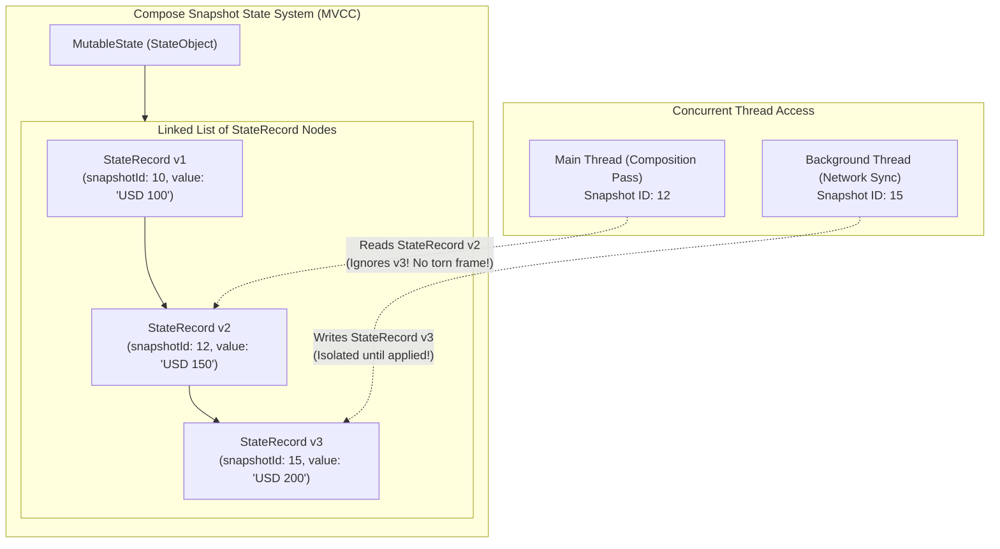

# MODULE 06: JETPACK COMPOSE DEEP INTERNALS
## CHAPTER 02: THE STABILITY SYSTEM, STABILITY CONFIGURATION & SNAPSHOT STATE MVCC

---

### A. FUNDAMENTALS

#### 1. What is the Concept?
The Jetpack Compose reactive engine relies on two interdependent systems to achieve high-performance rendering:
1. **The Stability System:** A compile-time and runtime contract that categorizes every data type as either **Stable** or **Unstable**. Stability dictates whether a Composable function can safely skip execution when its input parameters compare equal by value (`equals`).
2. **The Snapshot State System:** A runtime state management engine modeled after database **Multi-Version Concurrency Control (MVCC)**. It isolates state reads and writes within transactions (snapshots), allowing concurrent background state mutations to commit atomically without corrupting active UI composition on the main thread.

#### 2. Why Does It Exist?
In an imperative UI system, developers manually dictate what to update. In a declarative UI system, the runtime must automatically determine what *not* to update.
- If the compiler cannot guarantee that an object's properties will never change without notifying the composition, it must conservatively assume the object is unstable.
- If multiple threads mutate UI state while the main thread is halfway through measuring and laying out a frame, reading naked mutable variables would produce inconsistent, torn UI frames (e.g., displaying an updated account balance but old transaction lists). The Snapshot system guarantees atomic transactional state snapshots.

#### 3. What Problem Does It Solve?
- **Unintended Whole-Screen Recomposition:** Eliminating stability leaks where passing standard collections (`List<T>`) or DTOs from external modules forces all downstream Composables to recompose.
- **Torn Frames & State Inconsistency:** Snapshot MVCC ensures that a composition pass always observes a frozen, consistent snapshot of state, even if background coroutines are updating repository caches concurrently.
- **Micro-State Optimization:** `derivedStateOf` prevents high-frequency state updates (like scroll offsets or time tickers) from triggering recomposition unless the derived calculation crosses a specific threshold.

#### 4. Where is It Used?
- Architectural data contracts between Domain/Data layers and UI presentation layers.
- Multi-module enterprise projects using stability configuration files (`stability_configuration.txt`).
- State management primitives: `mutableStateOf`, `derivedStateOf`, `SnapshotStateList`, and `SnapshotStateMap`.

#### 5. What Happens If We Do Not Use / Understand It?
- **Silent Performance Degradation:** Passing an unstable class into a custom list item causes thousands of unnecessary recompositions during scrolling, destroying the 120-fps frame budget.
- **Stability Leaks Across Modules:** Multi-module projects that do not apply the Compose Compiler plugin to `:core:model` cause all domain models to be marked unstable by default when consumed in `:feature` UI modules.
- **State Invalidation Cascades:** Misusing `derivedStateOf` as a replacement for `remember(key)` adds unnecessary snapshot observer overhead and wastes memory.

---

### B. TECHNICAL DEFINITION

> **Stability Contract & Snapshot MVCC:**
> In Compose, a type is **Stable** if:
> 1. The result of `equals` for two instances will forever be the same for the same two instances.
> 2. If a public property of the type changes, composition is formally notified (e.g., via `MutableState`).
> 3. All public properties are themselves of stable types.
>
> The **Snapshot State System** is an in-memory MVCC storage engine where every `MutableState` points to a linked list of `StateRecord` nodes. Each node represents a value version tagged with a snapshot ID. Global commits atomically update the global snapshot counter, dispatching notifications to registered observers.

---

### C. INTERNAL WORKING & ARCHITECTURE



#### 1. `@Immutable` vs `@Stable` Contracts
The Compose compiler provides two explicit annotations:
- **`@Immutable`:** The strongest contract. Tells the compiler: *All public properties of this object will never change after construction.* The compiler assumes absolute immutability and skips recomposition if instance references or property values match.
- **`@Stable`:** A weaker, behavioral contract. Tells the compiler: *This object is mutable, but whenever any public property mutates, the Compose snapshot system will be formally notified.* Used for classes that wrap their mutable fields in `mutableStateOf`.

#### 2. The Unstable Collections Dilemma (`List<T>`)
Why is `val items: List<String>` considered **unstable** by the Compose Compiler?
Because in Kotlin, `List<T>` is an interface. At runtime, the actual concrete instance passed might be a `java.util.ArrayList` (a mutable list). If another thread or class mutates the underlying list (`(items as MutableList).add(...)`), the object reference does not change, but its contents do!
Because the compiler cannot guarantee immutability, it flags `List<T>` as unstable.
Every Composable that accepts a raw `List<T>` becomes **unskippable**.

#### 3. Modern Solution: Kotlin 2.0 Stability Configuration Files
In Kotlin 2.0+ with the new Compose Compiler plugin, you no longer need to write boilerplate wrappers around third-party or standard library types. You define a `stability_configuration.txt` file:
```txt
// Config file: stability_configuration.txt
java.time.Instant
java.time.LocalDate
kotlin.collections.List
kotlin.collections.Set
kotlin.collections.Map
com.ibm.banking.model.*
```
In `build.gradle.kts`:
```kotlin
composeCompiler {
    stabilityConfigurationFile = rootProject.file("stability_configuration.txt")
}
```
The compiler treats all matching classes as stable throughout the compilation graph.

#### 4. The Anatomy of `derivedStateOf`
Consider a calculation derived from a state:
```kotlin
val listState = rememberLazyListState()
val showButton by remember {
    derivedStateOf { listState.firstVisibleItemIndex > 0 }
}
```
- **How it works internally:** When the lambda `{ listState.firstVisibleItemIndex > 0 }` executes inside `derivedStateOf`, the Snapshot system records that this derived state depends on `listState.firstVisibleItemIndex`.
- As the user scrolls, `firstVisibleItemIndex` changes from 1 to 2, 3, 4, 5...
- **The Optimization:** Even though `firstVisibleItemIndex` changes on every frame, `(index > 0)` remains `true`. `derivedStateOf` observes that its derived output value has **not changed**.
- **Result:** It suppresses recomposition entirely! The UI recomposes **only once** when the boolean transitions from `false` to `true`.

---

### D. PRODUCTION IMPLEMENTATION

#### Production-Grade Custom Snapshot State Object (Thread-Safe FinTech State)
Below is a compilable, production-grade custom `StateObject` demonstrating how Compose's snapshot system tracks reads and writes at the lowest runtime level.

```kotlin
package com.ibm.banking.compose.state

import androidx.compose.runtime.MutableState
import androidx.compose.runtime.snapshots.AutorefCntStateRecord
import androidx.compose.runtime.snapshots.Readable
import androidx.compose.runtime.snapshots.Snapshot
import androidx.compose.runtime.snapshots.SnapshotMutableState
import androidx.compose.runtime.snapshots.StateObject
import androidx.compose.runtime.snapshots.StateRecord
import androidx.compose.runtime.snapshots.withCurrent

/**
 * Production-grade custom Snapshot-aware State wrapper for sensitive Financial Balances.
 * Demonstrates:
 * - Direct implementation of StateObject.
 * - Multi-Version Concurrency Control (MVCC) via StateRecord.
 * - Thread-safe snapshot read/write registration.
 */
class SecureFinancialBalance(initialAmountCents: Long) : StateObject {

    // 1. Internal StateRecord holding the versioned data
    private var firstStateRecord = BalanceStateRecord(initialAmountCents)

    override val firstStateRecord: StateRecord
        get() = this.firstStateRecord

    override fun prependStateRecord(value: StateRecord) {
        this.firstStateRecord = value as BalanceStateRecord
    }

    // 2. Read access: Notifies active Snapshot observer
    var amountCents: Long
        get() {
            // Readable reads the record matching the current snapshot ID
            val record = firstStateRecord.readable(this)
            return record.amountCents
        }
        set(value) {
            // Overwritable enters snapshot write pipeline
            val record = firstStateRecord.writable(this)
            if (record.amountCents != value) {
                record.amountCents = value
            }
        }

    // 3. Concrete StateRecord linked list node
    private class BalanceStateRecord(var amountCents: Long) : StateRecord() {
        override fun assign(value: StateRecord) {
            this.amountCents = (value as BalanceStateRecord).amountCents
        }

        override fun create(): StateRecord = BalanceStateRecord(amountCents)
    }
}
```

#### Unit Test Validating Snapshot Isolation
```kotlin
package com.ibm.banking.compose.state

import androidx.compose.runtime.snapshots.Snapshot
import org.junit.Assert.assertEquals
import org.junit.Test

class SecureFinancialBalanceTest {

    @Test
    fun snapshotIsolation_backgroundModification_doesNotTearActiveSnapshot() {
        val balance = SecureFinancialBalance(100_00L) // $100

        // 1. Take an isolated read-only snapshot (simulates Main Thread Composition pass)
        val readSnapshot = Snapshot.takeSnapshot()

        // 2. Modify state globally on a separate transaction (simulates background network sync)
        Snapshot.withMutableSnapshot {
            balance.amountCents = 250_00L // Updated to $250
        }

        // 3. Current global state is updated:
        assertEquals(250_00L, balance.amountCents)

        // 4. BUT the isolated snapshot still sees the original state ($100)!
        // Zero torn frames! Total transaction isolation!
        readSnapshot.enter {
            assertEquals(100_00L, balance.amountCents)
        }

        readSnapshot.dispose()
    }
}
```

---

### E. REAL-WORLD SCENARIOS

1. **FinTech (Biometric Transaction Signing Dialog):**
   In an ATM Card-Free cash withdrawal dialog, if a biometric challenge is initiated on a background coroutine while the user is viewing the authorization screen, snapshot isolation ensures the confirmation button cannot observe a half-written transaction payload. The UI state transitions atomically only when `Snapshot.apply()` commits.
2. **High-Frequency Sensor Data (Connected Automotive Gauge):**
   In Android Automotive, an engine RPM gauge receives 120 updates per second. If the speedometer composable reads raw RPM values, it recomposes 120 times a second. By using `derivedStateOf { rpm / 1000 }`, the UI updates only when the tachometer needle transitions to a new discrete unit, saving CPU cycles.
3. **Multi-Module Enterprise Architecture:**
   In an enterprise codebase where `:core:model` is a pure Kotlin module (without the Compose plugin), classes like `UserProfile` are flagged as unstable by the Compose Compiler in `:feature:profile`. Configuring `stability_configuration.txt` in the root project resolves stability across all 50+ feature modules without adding Compose dependencies to pure domain modules.

---

### F. ARCHITECTURE AND TRADE-OFFS

| Mechanism | Primary Benefit | Drawback / Overhead | When to Use |
| :--- | :--- | :--- | :--- |
| **`@Immutable` Annotation** | Guarantees recomposition skipping across modules | Developer must ensure fields are truly immutable | Domain models, DTOs, UI State wrappers |
| **Stability Config File** | Bulk-marks external types (e.g., `Instant`, `List`) as stable | False promises cause stale UI if objects mutate | Standard library and third-party multi-module models |
| **`derivedStateOf`** | Filters high-frequency state emissions | Adds snapshot observer tracking overhead | State calculation outputs change less often than inputs |
| **`remember(key)`** | Simple memoization recalculated only when keys change | Re-evaluates every time any key instance changes | Expensive object creation, formatters, filters |

---

### G. COMMON MISTAKES & ANTI-PATTERNS

#### Anti-Pattern 1: Using `derivedStateOf` When Simply Reading a State
```kotlin
// BAD: UNNECESSARY OVERHEAD
val username by remember {
    derivedStateOf { state.user.name } // Just a simple property read!
}
```
*Why it fails:* `derivedStateOf` is designed for scenarios where the derived result changes **less frequently** than the input states. If the output changes every time the input changes, `derivedStateOf` adds snapshot observer overhead without skipping any recomposition.
*Correction:* Use standard `val username = state.user.name`.

#### Anti-Pattern 2: Mutating Collections In-Place Inside `MutableState`
```kotlin
// WRONG: COMPOSE WILL NOT DETECT THIS MUTATION!
val listState = remember { mutableStateOf(mutableListOf<String>()) }

fun addItem(item: String) {
    listState.value.add(item) // In-place mutation of the same list instance!
    // Compose compares old value with new value using '=='.
    // Both point to the exact same list instance, so Compose assumes NO CHANGE!
}
```
*Correction:* Use `toMutableList()` with copy assignment, or use `mutableStateListOf<String>()`.

---

### H. INTERVIEW PREPARATION (BASIC TO STAFF LEVEL)

#### Q1 (Basic): What makes a class "unstable" according to the Compose Compiler?
**Answer:**
A class is unstable if:
1. It contains any mutable public `var` property that is not backed by `MutableState`.
2. It contains any property whose type is itself unstable (e.g., `java.util.Date`, `java.util.List`).
3. It is defined in a module that did not apply the Compose Compiler plugin (unless configured via a stability configuration file).

#### Q2 (Intermediate): What is the difference between `derivedStateOf` and `remember(key)`?
**Answer:**
- `remember(key)` recalculates its calculation block whenever the `key` instance changes (`oldKey != newKey`). It is used to cache expensive objects (like formatters or regex patterns).
- `derivedStateOf` tracks snapshot state reads dynamically inside its lambda. It recalculates whenever its dependencies change, but **notifies composition only if the output result differs from the previous result**. It is used to filter high-frequency state updates (e.g., scroll offsets) down to discrete boolean or threshold triggers.

#### Q3 (Advanced): How does the Compose Compiler determine stability across multi-module boundaries?
**Answer:**
Before Kotlin 2.0, if module `:core:model` did not apply the Compose Compiler plugin, it generated `.class` files without Compose metadata attributes. When `:feature:ui` consumed a model from `:core:model`, the Compose Compiler in `:feature:ui` could not verify stability and had to treat every external class as unstable.
In modern Compose (Kotlin 2.0+), architects use a `stability_configuration.txt` file to declare external classes or packages as stable, allowing the compiler to generate skippable bytecode across multi-module boundaries without coupling pure domain modules to Compose dependencies.

#### Q4 (Senior Scenario): You inspect Compose Compiler Metrics (`app_debug-composables.txt`) and find that `fun TransactionCard(transaction: TransactionDto)` is marked `restartable unstable`. How do you make it skippable without adding Compose annotations to the Data layer?
**Answer:**
1. Check why `TransactionDto` is unstable (e.g., contains `val tags: List<String>`).
2. **Option A (Stability Config):** Add `com.ibm.banking.model.TransactionDto` to `stability_configuration.txt` in the root project.
3. **Option B (UI Mapper):** Do not pass raw Data DTOs directly into UI Composables. Map `TransactionDto` to a dedicated UI state model (`TransactionItemUiModel`) in the presentation layer and annotate the UI model with `@Immutable`.
4. **Option C (Immutable Collections):** Use `kotlinx.collections.immutable.ImmutableList<String>` for the collection property, which the Compose compiler natively recognizes as stable.

#### Q5 (Staff Architecture): Explain how Compose's Snapshot system prevents race conditions between background coroutine updates and the Main Thread render pass.
**Answer:**
Compose uses Multi-Version Concurrency Control (MVCC):
- Each state variable maintains a linked list of `StateRecord` nodes.
- When the Main Thread begins a composition pass, it operates inside a read-only snapshot pegged to a specific snapshot ID ($S_{main}$).
- When a background coroutine updates state, it operates inside a separate mutable snapshot ($S_{bg}$). Its write creates a new `StateRecord` node tagged with $S_{bg}$.
- Because the Main Thread's snapshot only reads records $\le S_{main}$, it is physically isolated from the background write. The frame renders with total consistency, eliminating torn UI states.
- When the background snapshot calls `apply()`, the snapshot manager verifies that no write conflicts occurred. It atomically advances the global snapshot counter and dispatches a notification to the Main Looper, scheduling a new recomposition pass to render the updated state on the next VSYNC.

---

### I. CODING PRACTICE

#### Problem: Custom Recomposition-Safe Scroll-To-Top FAB
**Requirement:** Implement a Floating Action Button (FAB) that appears when a `LazyListState` scrolls past the 3rd item. It must use `derivedStateOf` to guarantee that the FAB and screen do not recompose on every single scroll pixel.

```kotlin
package com.ibm.banking.feature.atm.ui

import androidx.compose.animation.AnimatedVisibility
import androidx.compose.animation.fadeIn
import androidx.compose.animation.fadeOut
import androidx.compose.foundation.lazy.LazyListState
import androidx.compose.material3.FloatingActionButton
import androidx.compose.material3.Icon
import androidx.compose.material3.MaterialTheme
import androidx.compose.runtime.Composable
import androidx.compose.runtime.derivedStateOf
import androidx.compose.runtime.getValue
import androidx.compose.runtime.remember
import androidx.compose.runtime.rememberCoroutineScope
import androidx.compose.ui.Modifier
import kotlinx.coroutines.launch

@Composable
fun ScrollToTopFab(
    listState: LazyListState,
    modifier: Modifier = Modifier
) {
    val coroutineScope = rememberCoroutineScope()

    // Optimization: derivedStateOf ensures recomposition ONLY occurs when boolean flips!
    val isVisible by remember {
        derivedStateOf {
            listState.firstVisibleItemIndex > 3
        }
    }

    AnimatedVisibility(
        visible = isVisible,
        enter = fadeIn(),
        exit = fadeOut(),
        modifier = modifier
    ) {
        FloatingActionButton(
            onClick = {
                coroutineScope.launch {
                    listState.animateScrollToItem(0)
                }
            },
            containerColor = MaterialTheme.colorScheme.primaryContainer
        ) {
            // Icon placeholder
            androidx.compose.material3.Text("↑")
        }
    }
}
```

*Complexity Analysis:*
- **Time Complexity:** $O(1)$ state evaluation per frame. Zero recomposition overhead during continuous scrolling.
- **Space Complexity:** $O(1)$ Slot Table storage for derived state observation.

---

### J. SENIOR ENGINEER INTERVIEW SCRIPTS

#### 60-Second Explanation (Executive Summary)
> *"Jetpack Compose achieves high-performance UI updates through its Stability System and Snapshot State MVCC engine. The compiler inspects Composable parameters; if all parameters are immutable or stable, it marks the function as skippable, bypassing execution when parameter values are unchanged. To handle multi-threading safely without locking the UI, Compose uses Multi-Version Concurrency Control (MVCC) where every state variable maintains versioned `StateRecord` nodes. This ensures that the Main Thread's composition pass always reads a consistent snapshot of memory, isolating it from concurrent background state mutations and completely preventing torn UI frames."*

#### 3-Minute Deep Dive (Staff Architecture Level)
> *"In enterprise Compose architectures, understanding stability and snapshot transactions is the cornerstone of building scalable, jank-free mobile applications.
>
> The most pervasive performance bug in Compose is the 'Unstable Parameter Cascade'. The Compose Compiler cannot verify the immutability of standard interfaces like `List<T>` or classes defined in non-Compose modules. As a result, functions consuming them are marked 'unskippable'. If an unskippable Composable is at the root of a screen, any minor state update forces the entire view hierarchy to recompose from scratch. In Kotlin 2.0, we solve this architecturally by introducing root-level `stability_configuration.txt` files to classify trusted domain models and standard collections as stable, alongside enforcing pure `@Immutable` presentation UI models.
>
> Beneath stability lies the Snapshot State System, which is an in-memory MVCC database. When you declare `mutableStateOf(x)`, Compose does not store a simple pointer. It creates a `StateObject` with a linked list of `StateRecord` nodes.
>
> When the Main Thread enters a composition pass, it opens a snapshot with a specific ID. If a background repository thread completes an API sync and updates `mutableState` variables simultaneously, those writes create new `StateRecord` nodes tagged with the background snapshot ID. The Main Thread continues reading records corresponding to its open snapshot ID, completely isolated from concurrent writes. This mathematical isolation prevents 'torn frames'—where a screen renders half-new, half-old data.
>
> Once the background transaction completes, calling `Snapshot.apply()` commits the records atomically and notifies the Main Looper via snapshot mutation observers. By combining this transactional model with `derivedStateOf` to filter high-frequency sensor or scroll updates down to threshold triggers, we ensure our applications consistently maintain 120-fps frame deadlines under heavy production loads."*

---

### K. KNOWLEDGE VALIDATION & SELF-ASSESSMENT

#### 10 Senior Interview Questions
1. What is the exact difference between `Snapshot.takeSnapshot()` and `Snapshot.takeMutableSnapshot()`?
2. What happens if two concurrent mutable snapshots modify the same `MutableState` property and both call `apply()`? *(Answer: A `SnapshotApplyConflictException` is thrown unless a custom conflict merge policy is registered)*.
3. How do you pass a custom merge policy to `mutableStateOf`? *(Answer: `structuralEqualityPolicy()`, `referentialEqualityPolicy()`, or `neverEqualPolicy()`)*.
4. Why is `mutableStateListOf()` preferred over `mutableStateOf(listOf())` for dynamic list mutations?
5. What are the memory implications of creating too many `derivedStateOf` instances in a list row?
6. How does the Compose Compiler treat Kotlin `value classes` in terms of stability?
7. What is the role of `Snapshot.registerApplyObserver` in integrating Compose state with external architectures (like MVI or logging)?
8. How does Compose guarantee that `SideEffect {}` only runs after a successful composition commit?
9. What happens if a Composable reads a `MutableState` during the Layout (Measure/Place) phase instead of the Composition phase?
10. How can you verify that a Composable function is skippable using the Gradle command line?

#### Practical Self-Assessment Checklist
- [ ] Configured `stability_configuration.txt` in a multi-module project.
- [ ] Generated and analyzed `app_debug-composables.txt` metrics report.
- [ ] Validated snapshot isolation between Main Thread and a background worker thread.
- [ ] Used `derivedStateOf` to eliminate frame drops in a scrollable list.
- [ ] Replaced an unstable `List<T>` parameter with an immutable collection or `@Immutable` wrapper.
