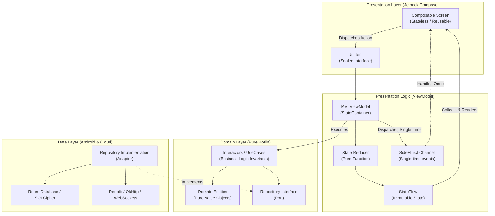

# MODULE 07: ENTERPRISE MOBILE ARCHITECTURE
## CHAPTER 01: UNIDIRECTIONAL DATA FLOW (UDF), MVI & PRAGMATIC CLEAN ARCHITECTURE

---

### A. FUNDAMENTALS

#### 1. What is the Concept?
Enterprise mobile architecture governs how code is organized across boundaries of concern (presentation, business rules, and external data storage) to maximize testability, team scalability, and defect isolation.
The modern gold standard in Android engineering combines:
- **Unidirectional Data Flow (UDF) & MVI (Model-View-Intent):** State flows down in a single immutable stream; user events/intents flow up. State transitions are mediated through deterministic state reducers.
- **Clean Architecture (Hexagonal / Ports & Adapters):** Enforcing the **Dependency Rule**: source code dependencies can only point inward toward pure domain business rules, completely shielding business logic from Android framework APIs.
- **Domain-Driven Design (DDD) Primitives:** Modeling entities, value objects, and domain repositories that encapsulate invariants.

#### 2. Why Does It Exist?
In early Android applications, developers wrote monolithic Activities containing database queries, HTTP calls, UI layout mutations, and state management in a single 2,000-line file ("The God Activity" anti-pattern). 
This led to:
1. **Zero Testability:** Code bound to Android `Context` could not be tested with fast local JVM unit tests.
2. **State Divergence:** Multiple asynchronous callbacks updating UI properties out of order, leading to broken intermediate UI states.
3. **Rigid Coupling:** Changing an API endpoint or swapping Room for another database forced rewrites of presentation and business logic.

#### 3. What Problem Does It Solve?
- **Deterministic State:** MVI eliminates race conditions by routing every user interaction through an immutable state reducer. The UI becomes a pure, predictable mathematical function of state: $UI = f(State)$.
- **Independent Testability:** Business logic (Use Cases) runs as pure Kotlin without Android SDK dependencies, allowing entire enterprise test suites to execute in seconds on local JVMs.
- **Team Scalability:** Teams can work on separate layers (data sources, business interactors, UI screens) simultaneously without merging conflicts.

#### 4. Where is It Used?
- Large-scale enterprise applications: Regulated banking, FinTech, healthcare, and e-commerce platforms.
- Independent multi-module architectures where feature modules are isolated from core data implementations.

#### 5. What Happens If We Do Not Use / Understand It?
- **Over-Engineering (Premature Abstraction):** Building 5-layer Clean Architecture abstractions (Entity $\to$ DomainModel $\to$ RepositoryInterface $\to$ RepositoryImpl $\to$ DataSource $\to$ DTO) for simple CRUD features, drowning teams in boilerplate mappers and slowing delivery.
- **State Inconsistency:** Having multiple separate `MutableStateFlow` variables inside a single ViewModel (e.g., `_isLoading`, `_data`, `_error`), allowing impossible states (like `isLoading == true` while `error != null` and `data != null`).

---

### B. TECHNICAL DEFINITION

> **Model-View-Intent (MVI) & The Dependency Rule:**
> MVI is a reactive architectural pattern formalizing Unidirectional Data Flow:
> - **Intent:** A sealed interface representing user actions or system triggers.
> - **State:** A single, immutable data class representing the complete visual contract of the screen.
> - **Effect:** Single-time transient side-effects (navigation, snackbars) that do not persist across configuration changes.
> - **Reducer:** A pure function $(CurrentState, Intent) \to NewState$.
>
> The **Dependency Rule** dictates that inner circles (Domain) know nothing about outer circles (Data/Presentation). The Domain defines interfaces (Ports); the Data layer provides implementations (Adapters) via Dependency Inversion.

---

### C. INTERNAL WORKING & ARCHITECTURE



#### 1. MVI vs MVVM: The State Divergence Problem
In classic MVVM, developers expose multiple independent state streams:
```kotlin
// FRAGILE MVVM ANTI-PATTERN: Multiple disjoint state streams!
class BadViewModel : ViewModel() {
    val isLoading = MutableStateFlow(false)
    val user = MutableStateFlow<User?>(null)
    val errorMessage = MutableStateFlow<String?>(null)
}
```
*The Flaw:* What happens if a network error occurs, but the developer forgets to reset `isLoading.value = false`?
The UI displays a loading spinner and an error message simultaneously! This is an **impossible state**.

In MVI, there is only **one single source of truth**:
```kotlin
// ROBUST MVI PATTERN: Single Immutable State Model
data class UserUiState(
    val user: User? = null,
    val status: ScreenStatus = ScreenStatus.Idle
) {
    sealed interface ScreenStatus {
        object Idle : ScreenStatus
        object Loading : ScreenStatus
        data class Error(val message: String) : ScreenStatus
    }
}
```
*The Invariant:* It is physically impossible to represent an ambiguous state because `ScreenStatus` is a mutually exclusive sealed hierarchy!

#### 2. The Single-Time Effect Architecture (Channel vs SharedFlow)
How do we handle events like showing a snackbar or navigating to a new screen?
- **StateFlow:** Wrong! If you set `state.isNavigated = true`, rotating the device recomposes the screen, sees `isNavigated == true`, and navigates a second time!
- **SharedFlow(replay = 0):** Risky! If the event is emitted while the Activity is rotating (unsubscribed), the event is permanently lost.
- **Buffered Channel:** **The Correct Architecture.** A `Channel` acts as an event queue. If the screen is rotating, the event remains in the channel buffer until the new Activity resubscribes, at which point it is consumed exactly once.

#### 3. Pragmatic Clean Architecture: When NOT to Use It
A common senior failure is treating Clean Architecture as a rigid religion rather than a practical engineering tool.
```
When to use Clean Architecture:
- Complex business logic with multiple validation invariants (Banking loans, KYC workflows).
- Multiple data sources requiring orchestration and offline sync.
- Logic shared across multiple platforms (KMP).

When NOT to use Clean Architecture (Anti-Pattern):
- Simple CRUD or pass-through screens (e.g., displaying static FAQ pages or simple user profiles).
- Creating a UseCase that does nothing except call `repository.getData()` (Boilerplate Indirection).
- Having 3 separate data models (UserDto, UserEntity, UserModel) with identical fields, wasting CPU cycles mapping between them.
```

---

### D. PRODUCTION IMPLEMENTATION

#### Production-Grade MVI Base Engine & Banking ATM ViewModel
Below is a compilable, production-grade MVI architecture implementing:
1. Thread-safe atomic state transitions with `update`.
2. Buffered single-time side-effect channel.
3. Strict separation of Domain Interactors and Presentation Models.

##### 1. The Generic Base MVI ViewModel
```kotlin
package com.ibm.banking.architecture.mvi

import androidx.lifecycle.ViewModel
import androidx.lifecycle.viewModelScope
import kotlinx.coroutines.channels.Channel
import kotlinx.coroutines.flow.MutableStateFlow
import kotlinx.coroutines.flow.StateFlow
import kotlinx.coroutines.flow.asStateFlow
import kotlinx.coroutines.flow.receiveAsFlow
import kotlinx.coroutines.flow.update
import kotlinx.coroutines.launch

abstract class BaseMviViewModel<STATE : Any, INTENT : Any, EFFECT : Any>(
    initialState: STATE
) : ViewModel() {

    private val _uiState = MutableStateFlow(initialState)
    val uiState: StateFlow<STATE> = _uiState.asStateFlow()

    private val _effects = Channel<EFFECT>(Channel.BUFFERED)
    val effects = _effects.receiveAsFlow()

    protected val currentState: STATE get() = _uiState.value

    abstract fun handleIntent(intent: INTENT)

    protected fun setState(reducer: STATE.() -> STATE) {
        _uiState.update { currentState.reducer() }
    }

    protected fun emitEffect(effect: EFFECT) {
        viewModelScope.launch {
            _effects.send(effect)
        }
    }
}
```

##### 2. Concrete ATM Cash Withdrawal Feature Implementation
```kotlin
package com.ibm.banking.feature.atm.mvi

import androidx.lifecycle.viewModelScope
import com.ibm.banking.architecture.mvi.BaseMviViewModel
import com.ibm.banking.model.AccountId
import com.ibm.banking.model.AmountCents
import com.ibm.banking.model.AtmWithdrawalSession
import kotlinx.coroutines.launch

// --- MVI CONTRACTS ---
sealed interface AtmIntent {
    data class SelectAccount(val accountId: AccountId) : AtmIntent
    data class SetAmount(val amount: AmountCents) : AtmIntent
    object SubmitWithdrawal : AtmIntent
    object DismissError : AtmIntent
}

data class AtmUiState(
    val selectedAccount: AccountId? = null,
    val amount: AmountCents = AmountCents(0L),
    val activeSession: AtmWithdrawalSession? = null,
    val step: Step = Step.SelectingAccount,
    val errorMessage: String? = null
) {
    enum class Step { SelectingAccount, EnteringAmount, Authorizing, ReadyAtTerminal }
    val canSubmit: Boolean get() = selectedAccount != null && amount.cents > 0L && step != Step.Authorizing
}

sealed interface AtmEffect {
    data class ShowToast(val message: String) : AtmEffect
    data class OpenTerminalScanner(val sessionId: String) : AtmEffect
}

// --- DOMAIN USE CASE ---
class InitiateAtmWithdrawalUseCase(
    private val repository: AtmRepository
) {
    suspend operator fun invoke(account: AccountId, amount: AmountCents): Result<AtmWithdrawalSession> {
        if (amount.cents <= 0) {
            return Result.failure(IllegalArgumentException("Withdrawal amount must be greater than zero"))
        }
        if (amount.cents > 1000_00L) { // $1,000 regulatory ATM ceiling
            return Result.failure(IllegalArgumentException("Amount exceeds single card-free ATM limit"))
        }
        return repository.createSession(account, amount)
    }
}

interface AtmRepository {
    suspend fun createSession(account: AccountId, amount: AmountCents): Result<AtmWithdrawalSession>
}

// --- MVI VIEWMODEL ---
class AtmWithdrawalViewModel(
    private val initiateWithdrawalUseCase: InitiateAtmWithdrawalUseCase
) : BaseMviViewModel<AtmUiState, AtmIntent, AtmEffect>(AtmUiState()) {

    override fun handleIntent(intent: AtmIntent) {
        when (intent) {
            is AtmIntent.SelectAccount -> setState {
                copy(selectedAccount = intent.accountId, step = AtmUiState.Step.EnteringAmount)
            }
            is AtmIntent.SetAmount -> setState {
                copy(amount = intent.amount)
            }
            is AtmIntent.SubmitWithdrawal -> executeWithdrawal()
            is AtmIntent.DismissError -> setState {
                copy(errorMessage = null)
            }
        }
    }

    private fun executeWithdrawal() {
        val account = currentState.selectedAccount ?: return
        val amount = currentState.amount

        setState { copy(step = AtmUiState.Step.Authorizing, errorMessage = null) }

        viewModelScope.launch {
            initiateWithdrawalUseCase(account, amount)
                .onSuccess { session ->
                    setState {
                        copy(
                            activeSession = session,
                            step = AtmUiState.Step.ReadyAtTerminal
                        )
                    }
                    emitEffect(AtmEffect.OpenTerminalScanner(session.sessionId))
                }
                .onFailure { error ->
                    setState {
                        copy(
                            step = AtmUiState.Step.EnteringAmount,
                            errorMessage = error.message ?: "ATM Authorization Failed"
                        )
                    }
                    emitEffect(AtmEffect.ShowToast("Security authorization failed"))
                }
        }
    }
}
```

#### Unit Testing Verification with Turbine
```kotlin
package com.ibm.banking.feature.atm.mvi

import app.cash.turbine.test
import com.ibm.banking.model.AccountId
import com.ibm.banking.model.AmountCents
import com.ibm.banking.model.AtmWithdrawalSession
import io.mockk.coEvery
import io.mockk.mockk
import kotlinx.coroutines.Dispatchers
import kotlinx.coroutines.ExperimentalCoroutinesApi
import kotlinx.coroutines.test.StandardTestDispatcher
import kotlinx.coroutines.test.resetMain
import kotlinx.coroutines.test.runTest
import kotlinx.coroutines.test.setMain
import org.junit.After
import org.junit.Assert.assertEquals
import org.junit.Assert.assertFalse
import org.junit.Assert.assertTrue
import org.junit.Before
import org.junit.Test

@OptIn(ExperimentalCoroutinesApi::class)
class AtmWithdrawalViewModelTest {

    private val testDispatcher = StandardTestDispatcher()
    private val useCase: InitiateAtmWithdrawalUseCase = mockk()
    private lateinit var viewModel: AtmWithdrawalViewModel

    @Before
    fun setUp() {
        Dispatchers.setMain(testDispatcher)
        viewModel = AtmWithdrawalViewModel(useCase)
    }

    @After
    fun tearDown() {
        Dispatchers.resetMain()
    }

    @Test
    fun handleIntent_selectAccountAndAmount_transitionsStateAtomically() = runTest {
        viewModel.uiState.test {
            assertEquals(AtmUiState.Step.SelectingAccount, awaitItem().step)

            viewModel.handleIntent(AtmIntent.SelectAccount(AccountId("ACC_1")))
            val stateAfterAccount = awaitItem()
            assertEquals(AccountId("ACC_1"), stateAfterAccount.selectedAccount)
            assertEquals(AtmUiState.Step.EnteringAmount, stateAfterAccount.step)

            viewModel.handleIntent(AtmIntent.SetAmount(AmountCents(200_00L)))
            val stateAfterAmount = awaitItem()
            assertEquals(200_00L, stateAfterAmount.amount.cents)
            assertTrue(stateAfterAmount.canSubmit)
        }
    }

    @Test
    fun executeWithdrawal_success_updatesSessionAndDispatchesEffect() = runTest {
        val account = AccountId("ACC_1")
        val amount = AmountCents(200_00L)
        val mockSession = AtmWithdrawalSession(
            sessionId = "SES_ATM_77",
            accountId = account,
            requestedAmount = amount,
            oneTimeOtp = "998811",
            qrChallengeCode = "QR_PAYLOAD",
            expiryTimestamp = System.currentTimeMillis() + 60000L
        )

        coEvery { useCase(account, amount) } returns Result.success(mockSession)

        viewModel.handleIntent(AtmIntent.SelectAccount(account))
        viewModel.handleIntent(AtmIntent.SetAmount(amount))
        testDispatcher.scheduler.advanceUntilIdle()

        viewModel.effects.test {
            viewModel.handleIntent(AtmIntent.SubmitWithdrawal)
            testDispatcher.scheduler.advanceUntilIdle()

            val effect = awaitItem()
            assertTrue(effect is AtmEffect.OpenTerminalScanner)
            assertEquals("SES_ATM_77", (effect as AtmEffect.OpenTerminalScanner).sessionId)
        }

        assertEquals(AtmUiState.Step.ReadyAtTerminal, viewModel.uiState.value.step)
        assertEquals(mockSession, viewModel.uiState.value.activeSession)
    }
}
```

---

### E. REAL-WORLD SCENARIOS

1. **FinTech (ATM Card-Free Multi-Step State Machine):**
   In an ATM cash withdrawal workflow, the UI transitions across 4 discrete stages: Account Choice $\to$ Amount Entry $\to$ Biometric Verification $\to$ Terminal QR Handshake. In MVI, a single `Step` enum controls which Compose composable is displayed. State reductions are mathematically constrained, preventing the user from triggering terminal handshakes before biometric validation is committed.
2. **E-Commerce (Flash Sale Cart Synchronization):**
   During a flash sale, multiple background events occur: inventory count ticks, price promotions apply, and user taps "Checkout". In MVVM, concurrent callbacks cause race conditions. In MVI, all user and network events enter a sequential intent processing pipeline, ensuring stock reservation always happens against the latest verified price state.
3. **Enterprise Healthcare (German ePA Consent Management):**
   In German healthcare applications, patient consent to share medical records requires verifiable audit logging. Implementing this with Clean Architecture Use Cases guarantees that consent validation rules (checking eID certification and digital signatures) are 100% isolated in pure Kotlin domain interactors, allowing strict automated unit testing without spinning up Android framework emulators.

---

### F. ARCHITECTURE AND TRADE-OFFS

| Architecture Pattern | State Predictability | Boilerplate Overhead | Testability | Refactoring Cost |
| :--- | :--- | :--- | :--- | :--- |
| **Model-View-Intent (MVI)** | **Highest** (Single immutable state stream) | Moderate (Intents, States, Reducers) | **Highest** (Pure state reduction) | Low (Contract-driven) |
| **Classic MVVM** | Moderate (Multiple disjoint StateFlows) | Low (Direct property binding) | High (Standard ViewModel tests) | Low |
| **Model-View-Presenter (MVP)** | Low (Manual View interface binding) | High (View interface contracts) | Moderate (Requires mocking View) | High (Rigid view coupling) |
| **Full Clean Architecture** | High (Complete layer decoupling) | **Very High** (Entities, DTOs, Mappers) | Highest | High |

---

### G. COMMON MISTAKES & ANTI-PATTERNS

#### Anti-Pattern 1: The "Everything is a UseCase" Boilerplate Trap
```kotlin
// BAD ARCHITECTURE: USELESS USE CASE INDIRECTION!
class GetUserNameUseCase(private val repo: UserRepository) {
    suspend operator fun invoke(): String = repo.getUserName() // DOES ABSOLUTELY NOTHING!
}
```
*Why it fails:* Creating an interactor that simply forwards a call directly to a repository without applying any business logic, validation, or orchestration adds architectural bloat, wastes memory, and slows down development without any return on investment.
*Pragmatic Rule:* If an operation has zero business validation or multi-repository orchestration, let the ViewModel invoke the Repository directly.

#### Anti-Pattern 2: Mutating States in Asynchronous Callbacks Without Reducer Concurrency
```kotlin
// WRONG: RACE CONDITION IN STATE EMISSION!
fun onAmountEntered(amount: Long) {
    val current = _state.value
    _state.value = current.copy(amount = amount) // NOT THREAD-SAFE!
}
```
*Why it fails:* If another coroutine updates the state between the read and the assignment, that update is completely overwritten and lost!
*Correction:* Always use atomic updates: `_state.update { it.copy(amount = amount) }`.

---

### H. INTERVIEW PREPARATION (BASIC TO STAFF LEVEL)

#### Q1 (Basic): What is Unidirectional Data Flow (UDF)?
**Answer:**
Unidirectional Data Flow is a design pattern where data flows in a single direction:
1. State flows down from the data container (ViewModel) to the UI components.
2. User actions (events/intents) flow up from the UI components to the ViewModel.
The UI never directly mutates state; it can only request state changes by emitting intents.

#### Q2 (Intermediate): What is the difference between MVVM and MVI?
**Answer:**
- In **MVVM**, the ViewModel typically exposes multiple independent observable streams (`isLoading`, `user`, `errorMessage`). The View observes these independently. This can lead to state divergence or impossible states (e.g., loading while showing an error).
- In **MVI**, the ViewModel exposes a **single immutable state stream** (`StateFlow<UiState>`). All interactions are modeled as explicit Intents processed through a reducer, guaranteeing that the UI state transitions deterministically and impossible states are eliminated by design.

#### Q3 (Advanced): How do you handle navigation and single-time UI events (like Toast messages) cleanly in MVI?
**Answer:**
Single-time UI events should not be stored inside the persistent `UiState` because configuration changes (like screen rotation) would re-emit the state and trigger duplicate navigation or toasts.
Instead, use a **Single-Time Effect Channel** (`Channel<Effect>(Channel.BUFFERED)`). The ViewModel sends effects via `_effects.send(effect)`. The UI collects effects via `effects.receiveAsFlow()` inside a `LaunchedEffect`. The channel guarantees that events are buffered across configuration changes and consumed **exactly once**.

#### Q4 (Senior Scenario): Your engineering team is debating whether to enforce Clean Architecture across all 40 modules of an enterprise app. How do you advise them as a Technical Architect?
**Answer:**
I advise adopting a **Pragmatic, Risk-Weighted Clean Architecture**:
1. **Core / Regulated Domains (Enforce Strict Clean Architecture):** In core business domains with complex validation rules, regulatory compliance, or multi-platform needs (e.g., Payments, Biometric Auth, KYC), enforce strict Clean Architecture with domain interactors to isolate business invariants from the Android SDK.
2. **Simple Features / CRUD (Use Pragmatic MVVM/MVI directly):** For static presentation screens, simple settings, and CRUD dashboards, eliminate intermediate Use Cases and redundant entity-to-DTO mappers. Allow ViewModels to talk directly to Repositories.
3. **Architecture Decision Record (ADR):** Document the criteria in an ADR so engineers have clear, objective rules on when a UseCase is justified (e.g., requires >2 data sources or contains reusable domain calculations).

#### Q5 (Staff Architecture): Explain Domain-Driven Design (DDD) Aggregates and Invariants. How do they map into an Android multi-module architecture?
**Answer:**
In DDD:
- An **Entity** is an object defined by its identity (e.g., `Account` with `AccountId`), whose state can change over time.
- A **Value Object** is an immutable object defined entirely by its attributes (e.g., `AmountCents`, `CurrencyCode`) with zero identity.
- An **Aggregate** is a cluster of associated entities and value objects treated as a single transactional unit (e.g., `AtmSession` containing `Account`, `RequestedAmount`, and `AuthToken`).
- An **Invariant** is a business rule that must remain true at all times within an aggregate (e.g., "An ATM withdrawal cannot exceed $1,000" or "Balance cannot drop below zero").
In an Android multi-module architecture, Aggregates and Invariants reside inside pure Kotlin `:core:domain` or `:feature:api` modules. They protect business integrity: no data layer or UI component can mutate an aggregate into an invalid state.

---

### I. CODING PRACTICE

#### Problem: Thread-Safe State Machine Reducer with Atomic Compare-And-Set
**Requirement:** Build a generic, thread-safe State Machine Reducer class `StateMachine<S, I>` that takes an initial state and a reducer lambda `(S, I) -> S`. It must execute state transitions atomically using `AtomicReference` and CAS loops, completely preventing race conditions under heavy concurrent thread access.

```kotlin
package com.ibm.banking.architecture.mvi

import java.util.concurrent.atomic.AtomicReference

class StateMachine<STATE : Any, INTENT : Any>(
    initialState: STATE,
    private val reducer: (STATE, INTENT) -> STATE
) {

    private val stateRef = AtomicReference(initialState)

    fun currentState(): STATE = stateRef.get()

    /**
     * Atomically transitions state using an optimistic CAS loop.
     * Guarantees zero lost updates under concurrent thread access!
     */
    fun transition(intent: INTENT): STATE {
        while (true) {
            val current = stateRef.get()
            val nextState = reducer(current, intent)
            if (stateRef.compareAndSet(current, nextState)) {
                return nextState
            }
            // CAS failed: Another thread transitioned state, retry loop with fresh state
        }
    }
}
```

*Complexity Analysis:*
- **Time Complexity:** $O(1)$ state transition. Contention causes optimistic retries.
- **Space Complexity:** $O(1)$ memory overhead. Zero synchronization lock contention.

---

### J. SENIOR ENGINEER INTERVIEW SCRIPTS

#### 60-Second Explanation (Executive Summary)
> *"Unidirectional Data Flow (UDF) and Model-View-Intent (MVI) structure presentation logic into a closed reactive loop: the View emits immutable Intents representing user actions; the ViewModel routes these through a deterministic state reducer; and the resulting immutable `UiState` is emitted via `StateFlow` to drive the UI. By representing the entire screen with a single, mutually exclusive state model, MVI completely eliminates impossible UI states like loading while showing an error. We complement this with Pragmatic Clean Architecture, enforcing the Dependency Rule in complex business domains while deliberately avoiding unnecessary UseCase boilerplate for simple pass-through features."*

#### 3-Minute Deep Dive (Staff Architecture Level)
> *"In large-scale enterprise Android systems—such as the financial platforms I worked on at IBM—architectural discipline is what prevents technical debt from crippling delivery velocity.
>
> The most common failure in modern Android development is state divergence. When developers build ViewModels with multiple disjoint state streams—like `_isLoading`, `_data`, and `_error`—asynchronous race conditions inevitably cause contradictory UI states. In our architecture, we enforce MVI with Unidirectional Data Flow. The screen is modeled as a single, immutable `UiState` data class with sealed interfaces for sub-states. Every user action is an `Intent`, and transitions are executed via pure reducer functions using `StateFlow.update { ... }`. Because state updates are atomic, the UI becomes a predictable, deterministic projection of state: $UI = f(State)$.
>
> To handle transient actions—like navigating to a QR scanner or displaying a security alert—we avoid polluting the persistent state. We route single-time events through a buffered coroutine `Channel` exposed via `receiveAsFlow()`. This guarantees that if the device is rotating when an event is fired, the event is held in the buffer and delivered to the newly created Activity exactly once, eliminating both event loss and duplicate execution.
>
> However, a Staff Architect must balance theoretical purity with pragmatic engineering. We adhere to Clean Architecture's Dependency Rule—where Domain code has zero dependencies on Android framework APIs—in our core transactional and security modules. This allows our entire business invariant suite to run in seconds on local JVM unit tests.
>
> Conversely, we explicitly guard against the 'Clean Architecture Boilerplate Trap'. For simple CRUD operations that lack domain validation, we do not create redundant Use Cases that simply proxy a repository call. We allow ViewModels to interact directly with Domain Repositories, saving hundreds of boilerplate lines while preserving clean architectural boundaries."*

---

### K. KNOWLEDGE VALIDATION & SELF-ASSESSMENT

#### 10 Senior Interview Questions
1. How does the Dependency Inversion Principle (DIP) enable Clean Architecture in an Android multi-module project?
2. What is an Architecture Decision Record (ADR), and why is it essential for senior technical leads?
3. What is the difference between an Entity and a Value Object in Domain-Driven Design?
4. How do you prevent memory leaks when passing domain models into Jetpack Compose Composable functions?
5. Why is `StateFlow.update { ... }` thread-safe while `_state.value = _state.value.copy(...)` is not?
6. When is it appropriate for a ViewModel to talk directly to a Repository instead of using a UseCase?
7. What are the performance implications of excessive object mapping (DTO $\to$ Entity $\to$ DomainModel $\to$ UiState) in high-frequency list scrolling?
8. How does MVI simplify regression testing and automated UI state replay?
9. What is the difference between Hexagonal Architecture (Ports and Adapters) and traditional 3-tier Layered Architecture?
10. How do you handle back navigation and state restoration after process death in an MVI architecture?

#### Practical Self-Assessment Checklist
- [ ] Refactored a ViewModel with multiple disjoint StateFlows into a single immutable MVI state.
- [ ] Implemented single-time UI side-effects using a buffered `Channel`.
- [ ] Enforced Clean Architecture boundary separation between pure Kotlin Domain and Android Data layers.
- [ ] Eliminated redundant pass-through UseCases in simple CRUD feature modules.
- [ ] Tested MVI ViewModel state transitions and effect emissions using Turbine.
