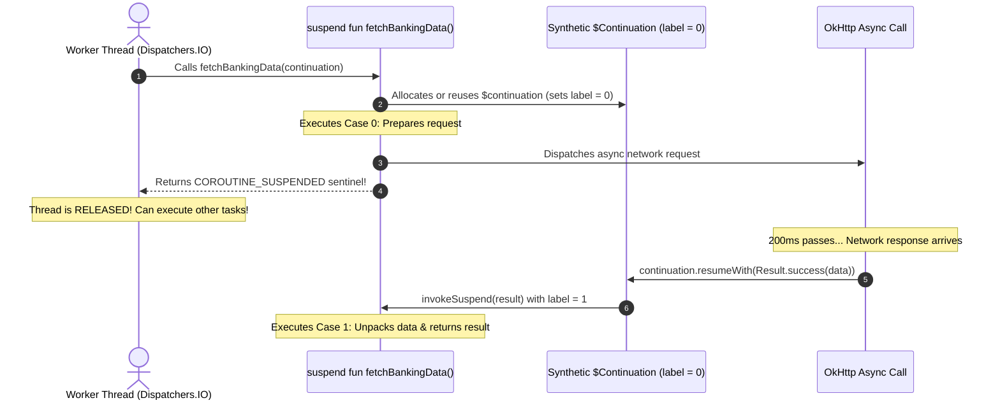
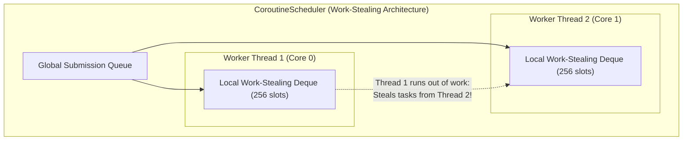

# MODULE 08: COROUTINES DEEP INTERNALS & CONCURRENCY
## CHAPTER 01: SUSPENDING FUNCTIONS, CPS STATE MACHINE BYTECODE & DISPATCHER INTERNALS

---

### A. FUNDAMENTALS

#### 1. What is the Concept?
Kotlin Coroutines are often described as "lightweight threads," but from a compiler and runtime perspective, a coroutine is fundamentally a **cooperative, non-blocking sequential state machine**. 
The two core pillars of coroutine execution are:
1. **Continuation-Passing Style (CPS) Transformation:** The Kotlin compiler rewrites every `suspend` function into an ordinary function accepting a synthetic `Continuation` callback parameter, returning `Any?` (which can be either the actual result or a special sentinel object `COROUTINE_SUSPENDED`).
2. **The Dispatcher System:** An abstraction over thread pools (`CoroutineScheduler`) that schedules continuation execution blocks (`DispatchedTask`) onto underlying OS threads without blocking those threads while waiting for asynchronous operations.

#### 2. Why Does It Exist?
Traditional asynchronous programming on the JVM required either:
- **Callback Hell:** Deeply nested anonymous listener interfaces (`onSuccess`, `onError`), creating unmaintainable spaghetti code and leaking memory contexts.
- **Reactive Streams (RxJava):** Powerful but steep learning curves, complex operator chains, and heavy stack trace obfuscation during debugging.
- **Direct Thread Allocation:** Threads on Linux/Android are heavy operating system primitives. Each thread allocates a ~1MB stack frame and consumes kernel scheduling resources. Allocating thousands of threads quickly exhausts device RAM and triggers Out-Of-Memory (`pthread_create failed`) crashes.

Coroutines enable developers to write asynchronous, non-blocking code that looks and behaves like simple sequential, synchronous code.

#### 3. What Problem Does It Solve?
- **Thread Blocking Elimination:** When a coroutine calls `delay(1000)` or awaits a network response, the underlying thread is **released immediately** to do other work (like rendering UI frames).
- **Stack Memory Reduction:** Millions of suspended coroutines can reside on the heap simultaneously, consuming only a few hundred bytes each (the size of a `Continuation` object), compared to 1MB per OS thread.
- **Readable Error Handling:** Standard `try/catch/finally` blocks work seamlessly across asynchronous network and database boundaries.

#### 4. Where is It Used?
- Android architectural layers: Repositories, ViewModels (`viewModelScope`), Room database queries, Retrofit network calls, and WorkManager (`CoroutineWorker`).
- Reactive data streaming: Kotlin `Flow`, `StateFlow`, and `SharedFlow`.
- FinTech & Banking: Sequential multi-step cryptographic handshakes and mutual TLS network calls.

#### 5. What Happens If We Do Not Use / Understand It?
- **Thread Starvation:** Blocking coroutine dispatchers with synchronous blocking calls (`Thread.sleep()`, synchronous file IO on `Dispatchers.Default`), freezing all coroutines scheduled on that dispatcher.
- **Context Loss:** Misunderstanding how `CoroutineContext` elements propagate, causing security tokens or cancellation listeners to be dropped.
- **Memory Leaks:** Retaining strong references to Activity or Fragment contexts inside un-scoped coroutine closures.

---

### B. TECHNICAL DEFINITION

> **Continuation-Passing Style (CPS) & CoroutineScheduler:**
> The Kotlin compiler transforms a suspending function `suspend fun <T> op(): T` into:
> `fun op(continuation: Continuation<T>): Any?`.
> The function body is compiled into a synthetic class extending `ContinuationImpl` containing a **state machine** governed by an integer `label`. At each suspension point, local variables are saved to continuation fields, the function returns `COROUTINE_SUSPENDED`, and the executing thread is yielded. 
> Upon completion, the asynchronous worker invokes `continuation.resumeWith()`, which re-enters the function's `invokeSuspend()` method at the corresponding `label` index.

---

### C. INTERNAL WORKING & ARCHITECTURE



#### 1. Bytecode Disassembly: The State Machine Transformation
Consider this sequential suspending function:
```kotlin
suspend fun executePayment(authCode: String): Receipt {
    val token = requestToken(authCode) // Suspension Point 1
    val receipt = submitPayment(token)  // Suspension Point 2
    return receipt
}
```
The Kotlin compiler lowers this into a state machine:
```java
// Decompiled Java equivalent of generated bytecode
public final Object executePayment(String authCode, Continuation $completion) {
    // 1. Create or cast to the synthetic continuation state machine
    ExecutePaymentStateMachine $continuation;
    if ($completion instanceof ExecutePaymentStateMachine) {
        $continuation = (ExecutePaymentStateMachine) $completion;
        if (($continuation.label & Integer.MIN_VALUE) != 0) {
            $continuation.label -= Integer.MIN_VALUE;
        }
    } else {
        $continuation = new ExecutePaymentStateMachine($completion);
    }

    Object $result = $continuation.result;
    Object $suspended = IntrinsicsKt.getCOROUTINE_SUSPENDED();

    // 2. The State Machine Switch Loop
    switch ($continuation.label) {
        case 0: // Initial Entry
            ResultKt.throwOnFailure($result);
            $continuation.authCode = authCode;
            $continuation.label = 1; // Advance state
            $result = requestToken(authCode, $continuation);
            if ($result == $suspended) {
                return $suspended; // YIELD THREAD!
            }
            break;

        case 1: // Resumed after requestToken
            authCode = $continuation.authCode;
            ResultKt.throwOnFailure($result);
            String token = (String) $result;
            $continuation.label = 2; // Advance state
            $result = submitPayment(token, $continuation);
            if ($result == $suspended) {
                return $suspended; // YIELD THREAD!
            }
            break;

        case 2: // Resumed after submitPayment
            ResultKt.throwOnFailure($result);
            return (Receipt) $result; // Final return

        default:
            throw new IllegalStateException("call to 'resume' before 'invoke' with coroutine");
    }
}
```

#### 2. Dispatchers Deep Dive: Architecture of `CoroutineScheduler`
Kotlin Coroutines do not use standard Java `ThreadPoolExecutor` for `Dispatchers.Default` and `Dispatchers.IO`. Instead, they use a high-performance **Work-Stealing Scheduler** (`CoroutineScheduler`).



1. **`Dispatchers.Default`:**
   - Dedicated to CPU-intensive tasks (sorting, JSON parsing, image manipulation).
   - Backed by an array of worker threads equal to the number of CPU cores (minimum 2).
   - Each worker thread maintains its own lock-free local work-stealing deque (256 slots). If a thread's local queue is empty, it steals tasks from other threads' queues, minimizing thread synchronization.
2. **`Dispatchers.IO`:**
   - Dedicated to blocking IO operations (network, disk, database).
   - Elastic thread pool capped at `max(64, CPU_CORES)`.
   - **Shared Thread Pool Architecture:** Crucially, `Dispatchers.Default` and `Dispatchers.IO` **share the exact same underlying thread pool**! Switching between `Default` and `IO` with `withContext()` does not require context-switching to a completely separate pool; the scheduler simply adjusts the thread state from `CORE` to `BLOCKING`.
3. **`Dispatchers.Main`:**
   - Backed by Android's `HandlerDispatcher`.
   - Schedules tasks directly to `Looper.getMainLooper()` via `handler.post()`.
4. **`Dispatchers.Unconfined`:**
   - Executes the coroutine immediately on the calling thread until the first suspension point.
   - Upon resumption, it resumes on **whichever thread resumed the continuation**! (Non-deterministic; only use for specific testing or low-level primitives).

---

### D. PRODUCTION IMPLEMENTATION

#### Production-Grade Resilient Token Pipeline with Thread Isolation
Below is a compilable, production-grade coroutine service demonstrating:
1. CPS state machine execution.
2. Context switching with `withContext(Dispatchers.IO)` for non-blocking disk reads.
3. Thread-safe execution using a custom bounded dispatcher with `limitedParallelism`.

```kotlin
package com.ibm.banking.concurrency.coroutines

import com.ibm.banking.model.AccountId
import com.ibm.banking.model.AmountCents
import com.ibm.banking.model.AtmWithdrawalSession
import kotlinx.coroutines.CoroutineDispatcher
import kotlinx.coroutines.Dispatchers
import kotlinx.coroutines.delay
import kotlinx.coroutines.withContext
import java.io.IOException

// 1. Domain Interface
interface SecureAtmNetworkService {
    suspend fun fetchSession(sessionId: String): AtmWithdrawalSession
    suspend fun verifyTerminalHandshake(sessionId: String, qrCode: String): Boolean
}

// 2. Production Service with Architecture-Enforced Dispatchers
class AtmTransactionPipeline(
    private val networkService: SecureAtmNetworkService,
    // Dependency injection of Dispatchers allows effortless unit testing with StandardTestDispatcher!
    private val ioDispatcher: CoroutineDispatcher = Dispatchers.IO,
    private val defaultDispatcher: CoroutineDispatcher = Dispatchers.Default
) {

    // Limited parallelism: Prevents this specific feature from saturating the shared IO pool
    private val cryptoDispatcher = ioDispatcher.limitedParallelism(4)

    /**
     * Executes sequential multi-step ATM cash withdrawal pipeline.
     * Demonstrates CPS state machine execution across multiple suspension points.
     */
    suspend fun executeAtmVerificationFlow(
        sessionId: String,
        terminalQrCode: String
    ): Result<AtmWithdrawalSession> {
        return try {
            // Suspension Point 1: Network IO
            val session = withContext(ioDispatcher) {
                networkService.fetchSession(sessionId)
            }

            if (session.isExpired) {
                return Result.failure(IllegalStateException("ATM Session has expired"))
            }

            // Suspension Point 2: CPU-Intensive Cryptographic Verification
            val isCryptographicallyValid = withContext(cryptoDispatcher) {
                verifyQrSignatureCpuBound(terminalQrCode, session.qrChallengeCode)
            }

            if (!isCryptographicallyValid) {
                return Result.failure(SecurityException("Invalid Terminal QR signature"))
            }

            // Suspension Point 3: Terminal Handshake Network IO
            val handshakeSuccess = withContext(ioDispatcher) {
                networkService.verifyTerminalHandshake(sessionId, terminalQrCode)
            }

            if (handshakeSuccess) {
                Result.success(session)
            } else {
                Result.failure(IOException("ATM Terminal rejected handshake"))
            }
        } catch (e: Exception) {
            Result.failure(e)
        }
    }

    private suspend fun verifyQrSignatureCpuBound(qrCode: String, challenge: String): Boolean {
        // Simulates CPU-intensive SHA-256 / RSA verification
        delay(10) // Non-blocking suspension
        return qrCode.isNotEmpty() && challenge.isNotEmpty()
    }
}
```

#### Unit Testing Verification with Coroutines Test APIs
```kotlin
package com.ibm.banking.concurrency.coroutines

import com.ibm.banking.model.AccountId
import com.ibm.banking.model.AmountCents
import com.ibm.banking.model.AtmWithdrawalSession
import io.mockk.coEvery
import io.mockk.mockk
import kotlinx.coroutines.ExperimentalCoroutinesApi
import kotlinx.coroutines.test.StandardTestDispatcher
import kotlinx.coroutines.test.runTest
import org.junit.Assert.assertEquals
import org.junit.Assert.assertTrue
import org.junit.Test

@OptIn(ExperimentalCoroutinesApi::class)
class AtmTransactionPipelineTest {

    private val testDispatcher = StandardTestDispatcher()
    private val networkService: SecureAtmNetworkService = mockk()

    private val pipeline = AtmTransactionPipeline(
        networkService = networkService,
        ioDispatcher = testDispatcher,
        defaultDispatcher = testDispatcher
    )

    @Test
    fun executeAtmVerificationFlow_validSession_succeedsSequentially() = runTest(testDispatcher) {
        val mockSession = AtmWithdrawalSession(
            sessionId = "ATM_9988",
            accountId = AccountId("ACC_1122"),
            requestedAmount = AmountCents(100_00L),
            oneTimeOtp = "445566",
            qrChallengeCode = "CHALLENGE_CODE_OK",
            expiryTimestamp = System.currentTimeMillis() + 60_000L
        )

        coEvery { networkService.fetchSession("ATM_9988") } returns mockSession
        coEvery { networkService.verifyTerminalHandshake("ATM_9988", "QR_CODE_OK") } returns true

        val result = pipeline.executeAtmVerificationFlow("ATM_9988", "QR_CODE_OK")

        assertTrue(result.isSuccess)
        assertEquals("ATM_9988", result.getOrNull()?.sessionId)
    }
}
```

---

### E. REAL-WORLD SCENARIOS

1. **FinTech (ATM Card-Free Withdrawal Handshake):**
   A user initiates an ATM cash withdrawal from their phone. The application must:
   1. Fetch an encrypted challenge from the bank server (`suspend`).
   2. Sign the challenge with the device's hardware-backed private key (`suspend` on CPU dispatcher).
   3. Transmit the signature to the ATM terminal via BLE or QR socket (`suspend`).
   4. Await authorization confirmation.
   Writing this with coroutines allows simple sequential code with a single outer `try/catch`, while freeing the Main UI thread to render a fluid animated countdown timer.
2. **E-Commerce (Parallel Price & Stock Aggregation):**
   When rendering a product checkout screen, the app must fetch shipping rates, applied discounts, customer loyalty points, and inventory stock simultaneously. Using `async(Dispatchers.IO)` decomposes these 4 network calls into concurrent parallel tasks that await completion via `awaitAll()`, cutting total screen load time from 800ms (sequential sum) to 200ms (longest single call).
3. **Continuous Background Sync (Health / Telematics):**
   In a connected health or medical records application, syncing thousands of encrypted FHIR records must not starve UI rendering. Offloading batch sync to `Dispatchers.IO.limitedParallelism(2)` ensures that background synchronization never monopolizes device CPU cores or prevents the user from navigating medical charts smoothly.

---

### F. ARCHITECTURE AND TRADE-OFFS

| Concurrency Approach | Thread Allocation | Memory Footprint | Context Switch Overhead | Cancellation Safety |
| :--- | :--- | :--- | :--- | :--- |
| **Kotlin Coroutines** | Shared work-stealing pool (`CoroutineScheduler`) | Very low (~few hundred bytes per continuation) | User-space function call (~nanoseconds) | Cooperative structured concurrency |
| **Java Threads (`Thread {}`)** | 1 OS thread per task | Heavy (~1MB stack per thread) | Kernel context switch (~1–5 microseconds) | Non-cooperative (`Thread.stop()` deprecated) |
| **Java `ExecutorService`** | Fixed or cached pool | Moderate (thread pool stack allocations) | Kernel context switch when threads sleep | Requires manual `Future.cancel()` handling |
| **RxJava (`Single`/`Observable`)** | Schedulers pool | Low to moderate (operator object wrappers) | Low (event-loop dispatching) | Disposable subscription tree |

---

### G. COMMON MISTAKES & ANTI-PATTERNS

#### Anti-Pattern 1: Blocking Inside Coroutine Dispatchers
```kotlin
// CRITICAL BUG: STARVES THE WORKER THREAD POOL!
suspend fun loadUserData() = withContext(Dispatchers.Default) {
    Thread.sleep(5000) // DISASTROUS: Blocks an active CPU worker thread!
}
```
*Why it fails:* `Dispatchers.Default` has only as many threads as CPU cores. If a 4-core device executes 4 coroutines that call `Thread.sleep()`, the entire `Dispatchers.Default` scheduler is 100% frozen. No other CPU-bound coroutine in the entire application can execute!
*Correction:* Use non-blocking `delay(5000)` or offload blocking legacy IO to `Dispatchers.IO`.

#### Anti-Pattern 2: Hardcoding Dispatchers Inside Classes
```kotlin
// BAD FOR TESTABILITY:
class UserRepository {
    suspend fun getUser() = withContext(Dispatchers.IO) { // Hardcoded!
        api.fetch()
    }
}
```
*Why it fails:* In unit tests, `Dispatchers.IO` uses a real background thread pool, making tests asynchronous, non-deterministic, and prone to race conditions.
*Correction:* Inject the dispatcher via constructor (defaulting to `Dispatchers.IO`), allowing tests to inject `StandardTestDispatcher`.

---

### H. INTERVIEW PREPARATION (BASIC TO STAFF LEVEL)

#### Q1 (Basic): What is the difference between `delay()` and `Thread.sleep()`?
**Answer:**
`Thread.sleep()` blocks the currently executing operating system thread, preventing it from performing any other work until the sleep timer expires.
`delay()` is a suspending function. It does not block the thread; it registers a timer with the coroutine scheduler, saves the continuation state machine, returns `COROUTINE_SUSPENDED`, and **yields the thread** immediately back to the pool to execute other coroutines. When the delay completes, the scheduler resumes the continuation on an available thread.

#### Q2 (Intermediate): What is the difference between `Dispatchers.Default` and `Dispatchers.IO` under the hood?
**Answer:**
Both dispatchers share the exact same underlying thread pool implementation (`CoroutineScheduler`).
The difference lies in their thread allocation limits and task types:
- `Dispatchers.Default` is designed for CPU-bound tasks. It caps its thread count at the number of CPU cores (minimum 2), ensuring that CPU cores are not overwhelmed by context-switching thrashing.
- `Dispatchers.IO` is designed for blocking IO tasks (network, disk). Because IO tasks spend most of their time waiting on external hardware rather than using the CPU, `Dispatchers.IO` allows an elastic pool of up to 64 threads (or CPU core count, whichever is larger). When a coroutine on `Default` switches to `IO` via `withContext`, the scheduler transitions the worker thread status from `CORE` to `BLOCKING` without migrating to an entirely different thread pool.

#### Q3 (Advanced): How does the Kotlin compiler implement non-blocking suspension at the bytecode level?
**Answer:**
The compiler uses the Continuation-Passing Style (CPS) transformation:
1. Every `suspend` function has an extra synthetic parameter appended: `continuation: Continuation<T>`.
2. The compiler synthesizes a state machine class with a `label` integer.
3. Each suspension point is assigned an integer label (0, 1, 2...).
4. When a suspension point is reached, the state machine saves its local variables into fields, advances the label, and calls the suspending child function, passing itself (`this`) as the continuation.
5. If the child function cannot return immediately, it returns the sentinel `COROUTINE_SUSPENDED`.
6. The calling function detects this sentinel and immediately returns `COROUTINE_SUSPENDED` up the call stack, allowing the OS thread to return to its event loop.
7. When the asynchronous operation finishes, it invokes `continuation.resumeWith()`, which re-enters the state machine's `invokeSuspend()` method, jumping directly to the corresponding `label` switch case to resume execution.

#### Q4 (Senior Scenario): You are reviewing code where a developer used `runBlocking` inside a Repository method to call a suspending function from a synchronous API. What are the severe production risks?
**Answer:**
1. **Thread Blocking & Deadlock:** `runBlocking` blocks the current thread until the enclosed coroutine completes. If called from the Main UI thread, it completely halts frame rendering and UI interaction, causing an ANR. If the enclosed coroutine attempts to switch back to the Main thread (`Dispatchers.Main`), it deadlocks permanently because the Main thread is blocked waiting for `runBlocking` to exit.
2. **Resource Exhaustion:** If called from an HTTP connection pool or Binder thread pool, blocking those worker threads can cause pool exhaustion, freezing incoming IPC or network requests.
3. **Anti-Pattern:** `runBlocking` is strictly intended for unit test entry points and command-line main functions, **never** for production Android application code.

#### Q5 (Staff Architecture): Explain `limitedParallelism` introduced in Kotlin Coroutines. How does it improve upon custom thread pools?
**Answer:**
Historically, developers created custom thread pools (`Executors.newFixedThreadPool(4).asCoroutineDispatcher()`) to prevent specific tasks (like image decoding or database writes) from overwhelming the system. However, allocating separate thread pools wastes memory and increases OS context-switching overhead.
`Dispatchers.IO.limitedParallelism(N)` creates a view over the **existing** shared `Dispatchers.IO` worker pool that limits concurrent execution of its tasks to at most $N$ threads, without allocating any new operating system threads. It uses a lock-free queue: if $N$ tasks are already running, additional tasks wait in the queue while the shared IO threads remain free to execute other application tasks.

---

### I. CODING PRACTICE

#### Problem: Custom Resilient Retry Operator with Exponential Backoff
**Requirement:** Build a generic, reusable coroutine utility function `retryWithBackoff` that executes a suspending block. It must catch specific exceptions, retry up to $N$ times with exponential backoff and jitter, and respect coroutine cancellation immediately.

```kotlin
package com.ibm.banking.concurrency.coroutines

import kotlinx.coroutines.CancellationException
import kotlinx.coroutines.delay
import kotlin.random.Random

/**
 * Production-grade exponential backoff retry utility for Coroutines.
 * Guarantees that CancellationException is NEVER swallowed!
 */
suspend fun <T> retryWithBackoff(
    times: Int = 3,
    initialDelayMs: Long = 100L,
    maxDelayMs: Long = 2000L,
    factor: Double = 2.0,
    block: suspend () -> T
): Result<T> {
    var currentDelay = initialDelayMs

    repeat(times - 1) { attempt ->
        try {
            return Result.success(block())
        } catch (e: CancellationException) {
            // CRITICAL: CancellationException must ALWAYS be rethrown to support structured concurrency!
            throw e
        } catch (t: Throwable) {
            // Add jitter (+/- 20%) to prevent thundering herd on server
            val jitter = (currentDelay * 0.2 * Random.nextDouble(-1.0, 1.0)).toLong()
            val delayWithJitter = (currentDelay + jitter).coerceIn(initialDelayMs, maxDelayMs)

            delay(delayWithJitter)
            currentDelay = (currentDelay * factor).toLong().coerceAtMost(maxDelayMs)
        }
    }

    // Final attempt
    return try {
        Result.success(block())
    } catch (e: CancellationException) {
        throw e
    } catch (t: Throwable) {
        Result.failure(t)
    }
}
```

*Complexity Analysis:*
- **Time Complexity:** $O(times)$ attempts with non-blocking exponential suspension.
- **Space Complexity:** $O(1)$ memory overhead. Zero thread blocking.

---

### J. SENIOR ENGINEER INTERVIEW SCRIPTS

#### 60-Second Explanation (Executive Summary)
> *"Kotlin Coroutines are cooperative, non-blocking state machines executed across worker thread pools. At compile time, the Kotlin compiler transforms suspending functions using Continuation-Passing Style (CPS), appending a synthetic `Continuation` parameter and compiling the function body into a state machine governed by an integer label. When a coroutine hits a suspension point, it saves its state, returns a `COROUTINE_SUSPENDED` sentinel, and releases the underlying OS thread immediately to do other work. Work is scheduled via `CoroutineScheduler`—a work-stealing thread pool where `Dispatchers.Default` handles CPU tasks and `Dispatchers.IO` handles elastic blocking IO without allocating separate thread pools."*

#### 3-Minute Deep Dive (Staff Architecture Level)
> *"In modern Android architecture, concurrency is fundamentally about maximizing hardware throughput while respecting the mobile platform's strict battery and memory boundaries.
>
> In the JVM, an operating system thread requires approximately 1MB of reserved virtual memory for its stack. If an app attempts to launch 500 threads for concurrent network requests, it triggers an instant Out-Of-Memory crash. Furthermore, switching between OS threads requires a kernel-space context switch costing thousands of CPU cycles.
>
> Kotlin Coroutines solve this through compiler-driven state machines. When the compiler encounters a `suspend` keyword, it generates an internal class implementing `ContinuationImpl`. Local variables are converted into class fields, and code between suspension points is divided into cases inside an integer-driven switch statement.
>
> When a suspending function like `client.fetchSession()` is called, if the data is not immediately available, the function returns the `COROUTINE_SUSPENDED` sentinel. The calling thread does not sleep; it simply exits the function and returns to its work-stealing pool to execute other tasks. When the network response arrives, the network callback invokes `continuation.resumeWith()`. The coroutine scheduler schedules a `DispatchedTask` on an available worker thread, re-entering the state machine at the exact label where it left off.
>
> From a dispatching standpoint, understanding `CoroutineScheduler` is vital. `Dispatchers.Default` and `Dispatchers.IO` are not separate isolated thread pools. They are two views over the same unified work-stealing thread scheduler. `Default` caps worker threads to CPU core counts to prevent CPU instruction cache thrashing during intensive calculations like JSON parsing or image filtering. `IO` allows expanding up to 64 threads for blocking operations. In our banking applications, we leverage `Dispatchers.IO.limitedParallelism(N)` to isolate specific subsystems—such as SQLite disk logging—ensuring that a slow database write never saturates the shared IO pool or delays critical network authorization requests."*

---

### K. KNOWLEDGE VALIDATION & SELF-ASSESSMENT

#### 10 Senior Interview Questions
1. What is the return type of a suspending function in decompiled Java bytecode? *(Answer: `java.lang.Object`)*.
2. What is the `COROUTINE_SUSPENDED` sentinel object, and what does it signal to the caller?
3. Why does `CancellationException` receive special treatment in coroutine exception handling?
4. What happens if a developer swallows `CancellationException` inside a `try/catch` block?
5. How does `yield()` allow a CPU-intensive loop inside a coroutine to remain cooperative?
6. What is the difference between `Dispatchers.Main` and `Dispatchers.Main.immediate`?
7. How does the coroutine work-stealing scheduler determine which worker thread's deque to steal from?
8. Why is `withContext(Dispatchers.IO)` preferred over launching a new coroutine with `launch(Dispatchers.IO)`?
9. Can a suspending function be called from a standard, non-suspending function without a coroutine builder? Why or why not?
10. How does `StandardTestDispatcher` in `kotlinx-coroutines-test` allow deterministic testing of virtual time?

#### Practical Self-Assessment Checklist
- [ ] Decompiled a suspending function and identified the synthesized `invokeSuspend` state machine switch table.
- [ ] Validated that `withContext(Dispatchers.IO)` does not block the calling thread.
- [ ] Implemented a custom retry mechanism with exponential backoff that preserves `CancellationException`.
- [ ] Used `limitedParallelism` to bound concurrency without creating new thread pools.
- [ ] Written unit tests using `runTest` and `advanceUntilIdle()` to test coroutines deterministically.
