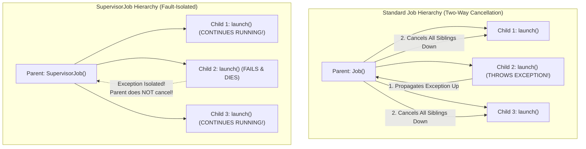

# MODULE 08: COROUTINES DEEP INTERNALS & CONCURRENCY
## CHAPTER 02: STRUCTURED CONCURRENCY, THE JOB HIERARCHY & ADVANCED EXCEPTION PROPAGATION

---

### A. FUNDAMENTALS

#### 1. What is the Concept?
Structured Concurrency is an architectural paradigm ensuring that concurrent operations have a well-defined lifetime, bound to a specific lexical scope. In Kotlin Coroutines:
- A new coroutine can only be launched within a specific **`CoroutineScope`**.
- Coroutines form a strict **Parent-Child Job Hierarchy**: a parent job cannot complete until all its children complete.
- **Cancellation propagates downwards**: Cancelling a parent cancels all its children immediately.
- **Exceptions propagate upwards**: An unhandled failure in a child cancels the parent, which in turn cancels all sibling children, preventing orphaned, runaway tasks (unless isolated by a `SupervisorJob`).

#### 2. Why Does It Exist?
Prior to structured concurrency, concurrent tasks were launched as global, un-scoped entities (e.g., `Thread { ... }.start()`, `GlobalScope.launch { ... }`, or raw RxJava subscriptions without CompositeDisposable tracking).
This caused three critical production failures:
1. **Leaked Work / Battery Drain:** If a user navigated away from a screen, background network downloads and JSON decoders continued executing in the background, wasting CPU and battery.
2. **Memory Leaks:** Long-running background threads retained strong references to destroyed Activity or View instances, causing Out-Of-Memory crashes.
3. **Lost Exceptions:** Exceptions thrown on unmonitored background threads were either silently swallowed or crashed the entire application process without context.

Structured concurrency guarantees that concurrent tasks are bounded, cancellable, and trackable.

#### 3. What Problem Does It Solve?
- **Orphaned Background Tasks:** When a ViewModel or Activity is cleared, cancelling its `CoroutineScope` automatically cancels all ongoing network calls, database queries, and animations in that scope.
- **Cascading Failure Management:** Prevents partial, corrupt state mutations. If 1 of 5 batch operations fails fatally, the parent scope halts the remaining 4 immediately.
- **Fault-Isolated Concurrency:** Using `SupervisorJob` allows independent child tasks to fail without terminating their sibling tasks.

#### 4. Where is It Used?
- Android Lifecycle-aware scopes: `viewModelScope`, `lifecycleScope`, and `rememberCoroutineScope()`.
- Enterprise batch synchronization: Parallel banking transaction syncing, document uploaders, and data ingestion pipelines.
- WorkManager coroutine workers (`CoroutineWorker`).

#### 5. What Happens If We Do Not Use / Understand It?
- **GlobalScope Anti-Pattern:** Using `GlobalScope` creates un-cancellable, dangling coroutines that survive screen destruction and leak memory.
- **Unexpected Mass Cancellation:** Misunderstanding `coroutineScope {}` vs `supervisorScope {}` causes a single minor analytics failure to cancel a critical payment authorization pipeline.
- **Swallowed Cancellation:** Catching raw `Exception` or `Throwable` without rethrowing `CancellationException` breaks cooperative cancellation, keeping dead tasks alive.

---

### B. TECHNICAL DEFINITION

> **Structured Concurrency & Job Hierarchy:**
> Structured concurrency establishes an invariant where the lifetime of concurrent execution is constrained by a hierarchical tree of **`Job`** instances stored inside `CoroutineContext`.
> When a child coroutine is launched via `scope.launch`, a parent-child relationship is established where the child attaches a child handle (`ChildHandle`) to the parent.
> By default, if a child fails with an exception other than `CancellationException`, it cancels its parent with that exception, causing the parent to cancel all other children (**Two-Way Cancellation**). A **`SupervisorJob`** alters this contract by overriding `childCancelled()`, isolating failures and enforcing **One-Way Cancellation** (top-down only).

---

### C. INTERNAL WORKING & ARCHITECTURE



#### 1. Inside `CoroutineContext`: The `CombinedContext` Linked List
What is a `CoroutineContext`?
It is not a `HashMap`. It is a type-safe, persistent heterogeneous collection implemented as a **binary linked tree of `CombinedContext` nodes**:
```kotlin
public class CombinedContext(
    private val left: CoroutineContext,
    private val element: Element
) : CoroutineContext
```
Each element has a unique `Key`:
- `Job.Key`: Controls lifecycle and cancellation.
- `ContinuationInterceptor.Key`: Dictates the `CoroutineDispatcher`.
- `CoroutineExceptionHandler.Key`: Handles uncaught terminal exceptions.
- `CoroutineName.Key`: Debug name tag.

When you write `Dispatchers.IO + Job() + CoroutineName("ATM")`, the `+` operator folds the elements into a linked structure. Looking up `context[Job]` traverses the chain in $O(1)$ to $O(N)$ where $N \le 4$.

#### 2. `coroutineScope {}` vs `supervisorScope {}`
This is a favorite staff-level interview question.

| Feature | `coroutineScope {}` | `supervisorScope {}` |
| :--- | :--- | :--- |
| **Backing Job** | Standard `Job` | `SupervisorJob` |
| **Child Failure Behavior** | If **any** child fails, the scope fails immediately and cancels all other children. | If a child fails, other children continue executing unaffected. |
| **Exception Propagation** | Rethrows the child's exception to the caller. | Children must catch their own exceptions, or handle them via `CoroutineExceptionHandler`. |
| **When to Use** | All-or-nothing operations (e.g., parallel calculations where all parts are required). | Independent parallel operations (e.g., batch downloading 10 images or syncing multiple accounts). |

#### 3. Cooperative Cancellation Mechanics
Cancellation in Kotlin Coroutines is **strictly cooperative**. Calling `job.cancel()` does **not** forcefully terminate the thread (like the deprecated `Thread.stop()`).
Instead:
1. `job.cancel()` transitions the Job state to `Cancelling`.
2. All subsequent suspension points (`delay()`, `yield()`, network calls) check `isActive`.
3. If cancelled, the suspension point throws a **`CancellationException`**.
4. The exception unwinds the state machine stack cleanly, executing `finally` blocks to release resources.
5. *The CPU Loop Trap:* If a coroutine is executing a tight CPU calculation loop without suspension points:
```kotlin
while (true) { // NON-COOPERATIVE: IGNORES CANCELLATION!
    computeHashes()
}
```
It will **never cancel**! To make it cooperative, you must check `isActive` or call `ensureActive()`:
```kotlin
while (isActive) { // COOPERATIVE!
    computeHashes()
}
```

#### 4. The `NonCancellable` Context for Cleanup
When a coroutine is cancelled, its `Job` is already in the `Cancelled` state.
If you attempt to call a suspending function inside a `finally` block:
```kotlin
finally {
    // FAILS: Immediately throws CancellationException because scope is cancelled!
    networkService.notifySessionTerminated() 
}
```
*The Fix:* Switch to the `NonCancellable` singleton context:
```kotlin
finally {
    withContext(NonCancellable) {
        // Safe: Executes to completion even if outer coroutine was cancelled!
        networkService.notifySessionTerminated()
    }
}
```

---

### D. PRODUCTION IMPLEMENTATION

#### Production-Grade Fault-Isolated Batch Account Synchronizer
Below is a compilable, production-grade enterprise batch sync engine demonstrating:
1. `supervisorScope` fault isolation: Individual account sync failures do not cancel sibling syncs.
2. Cooperative cancellation checking via `ensureActive()`.
3. Safe resource cleanup with `withContext(NonCancellable)`.
4. Global `CoroutineExceptionHandler` integration.

```kotlin
package com.ibm.banking.concurrency.coroutines

import com.ibm.banking.model.AccountId
import kotlinx.coroutines.CancellationException
import kotlinx.coroutines.CoroutineExceptionHandler
import kotlinx.coroutines.CoroutineScope
import kotlinx.coroutines.Dispatchers
import kotlinx.coroutines.NonCancellable
import kotlinx.coroutines.ensureActive
import kotlinx.coroutines.launch
import kotlinx.coroutines.supervisorScope
import kotlinx.coroutines.withContext
import java.io.IOException

// 1. Result Data Models
sealed interface AccountSyncResult {
    data class Success(val accountId: AccountId, val balanceCents: Long) : AccountSyncResult
    data class Failure(val accountId: AccountId, val error: String) : AccountSyncResult
}

// 2. Production Batch Engine
class EnterpriseAccountSynchronizer(
    private val api: AccountSyncApi
) {

    /**
     * Synchronizes multiple banking accounts concurrently.
     * Demonstrates:
     * - supervisorScope: One failing account sync DOES NOT cancel sibling accounts!
     * - NonCancellable: Guarantees audit log flushes even if job is cancelled.
     */
    suspend fun syncAllAccountsIsolated(
        accounts: List<AccountId>
    ): List<AccountSyncResult> = supervisorScope {
        val results = mutableListOf<AccountSyncResult>()

        val jobs = accounts.map { accountId ->
            launch(Dispatchers.IO) {
                try {
                    // Check cooperative cancellation before initiating heavy IO
                    ensureActive()

                    val balance = api.fetchAccountBalance(accountId)
                    synchronized(results) {
                        results.add(AccountSyncResult.Success(accountId, balance))
                    }
                } catch (e: CancellationException) {
                    // CRITICAL: CancellationException must NEVER be swallowed!
                    throw e
                } catch (e: Exception) {
                    // Handled locally: Sibling coroutines continue uninterrupted!
                    synchronized(results) {
                        results.add(AccountSyncResult.Failure(accountId, e.message ?: "Unknown error"))
                    }
                } finally {
                    // Guarantee telemetry flush using NonCancellable
                    withContext(NonCancellable) {
                        api.logSyncAttempt(accountId)
                    }
                }
            }
        }

        // Await all child jobs without throwing on individual child failures
        jobs.forEach { it.join() }
        results
    }
}

interface AccountSyncApi {
    suspend fun fetchAccountBalance(accountId: AccountId): Long
    suspend fun logSyncAttempt(accountId: AccountId)
}
```

#### Unit Test Verifying Fault Isolation
```kotlin
package com.ibm.banking.concurrency.coroutines

import com.ibm.banking.model.AccountId
import io.mockk.coEvery
import io.mockk.mockk
import kotlinx.coroutines.ExperimentalCoroutinesApi
import kotlinx.coroutines.test.runTest
import org.junit.Assert.assertEquals
import org.junit.Assert.assertTrue
import org.junit.Test
import java.io.IOException

@OptIn(ExperimentalCoroutinesApi::class)
class EnterpriseAccountSynchronizerTest {

    private val api: AccountSyncApi = mockk(relaxed = true)
    private val synchronizer = EnterpriseAccountSynchronizer(api)

    @Test
    fun syncAllAccountsIsolated_oneAccountFails_siblingAccountsSucceed() = runTest {
        val acc1 = AccountId("ACC_1")
        val acc2 = AccountId("ACC_2_FAIL")
        val acc3 = AccountId("ACC_3")

        coEvery { api.fetchAccountBalance(acc1) } returns 100_00L
        coEvery { api.fetchAccountBalance(acc2) } throws IOException("Server 500 error")
        coEvery { api.fetchAccountBalance(acc3) } returns 300_00L

        val results = synchronizer.syncAllAccountsIsolated(listOf(acc1, acc2, acc3))

        // Verify acc1 and acc3 succeeded despite acc2 failing!
        assertEquals(3, results.size)
        assertTrue(results.any { it is AccountSyncResult.Success && it.accountId == acc1 })
        assertTrue(results.any { it is AccountSyncResult.Failure && it.accountId == acc2 })
        assertTrue(results.any { it is AccountSyncResult.Success && it.accountId == acc3 })
    }
}
```

---

### E. REAL-WORLD SCENARIOS

1. **FinTech (ATM Card-Free Session Lifecycle):**
   When an ATM withdrawal screen is opened, a `SupervisorJob` manages parallel background jobs:
   - Job 1: A 120-second session timeout countdown timer.
   - Job 2: A WebSocket listener for ATM terminal QR scans.
   - Job 3: An NFC proximity poller.
   If the NFC poller fails (e.g., NFC disabled on device), we do **not** want Job 1 and Job 2 to cancel! Using a `SupervisorJob` isolates the NFC failure while allowing the user to complete the withdrawal via QR code.
2. **Healthcare (German ePA Encrypted Document Upload):**
   A patient uploads 10 encrypted medical records simultaneously. If document 4 fails validation due to an expired digital signature, the remaining 9 documents must finish uploading successfully. A `supervisorScope` handles this fault tolerance, collecting individual errors for user review without aborting the entire batch.
3. **Android Lifecycle Navigation (Zero Memory Leaks):**
   A user starts a heavy 10-second image processing task in a ViewModel. While processing, the user presses the device back button. The `ViewModel.onCleared()` callback cancels `viewModelScope`. Because all child tasks were launched under that scope, the image processing coroutine detects `ensureActive()`, cancels immediately, and releases the bitmap buffers from memory.

---

### F. ARCHITECTURE AND TRADE-OFFS

| Scope Builder | Scope Type | Cancellation Direction | Exception Handling | Architectural Purpose |
| :--- | :--- | :--- | :--- | :--- |
| **`coroutineScope {}`** | Standard `Job` | Two-Way (Child $\leftrightarrow$ Parent) | Fails on first child error; rethrows exception | Atomic all-or-nothing operations |
| **`supervisorScope {}`** | `SupervisorJob` | One-Way (Parent $\to$ Child only) | Children handle their own errors; parent survives | Independent parallel workflows |
| **`GlobalScope.launch`** | No Parent (Root) | None (Un-scoped) | Uncaught errors crash app process via uncaught handler | **ANTI-PATTERN** in enterprise apps |
| **`viewModelScope`** | `SupervisorJob` + `Main.immediate` | Bound to ViewModel lifecycle | Handled per launch block | Default UI/Presentation coroutine scope |

---

### G. COMMON MISTAKES & ANTI-PATTERNS

#### Anti-Pattern 1: Passing `SupervisorJob` to `launch` Instead of `supervisorScope`
```kotlin
// WRONG: DOES NOT ISOLATE EXCEPTIONS!
suspend fun doWork() = coroutineScope {
    // DANGEROUS MISTAKE: Passing SupervisorJob() as a context parameter here does NOT make it a supervisor scope!
    launch(SupervisorJob()) { 
        throw RuntimeException("Crash!") // STILL CRASHES THE PARENT coroutineScope!
    }
}
```
*Why it fails:* Passing `SupervisorJob()` as a parameter to `launch` creates an orphaned job that is not attached to the parent in the structured concurrency tree, breaking structured cancellation.
*Correction:* Always use the `supervisorScope {}` builder function:
```kotlin
suspend fun doWork() = supervisorScope {
    launch { throw RuntimeException("Isolated!") }
}
```

#### Anti-Pattern 2: Catching `Exception` Without Rethrowing `CancellationException`
```kotlin
// CRITICAL BUG: BREAKS CANCELLATION!
try {
    delay(1000)
    processPayment()
} catch (e: Exception) { // Catches CancellationException!
    log("Payment failed") // WRONG: Swallows cancellation, keeping task alive!
}
```
*Why it fails:* `CancellationException` is a subclass of `IllegalStateException` / `Exception`. If swallowed, the coroutine ignores the cancellation signal and continues executing subsequent statements.
*Correction:*
```kotlin
try {
    delay(1000)
    processPayment()
} catch (e: CancellationException) {
    throw e // ALWAYS RETHROW CANCELLATION!
} catch (e: Exception) {
    log("Payment failed: ${e.message}")
}
```

---

### H. INTERVIEW PREPARATION (BASIC TO STAFF LEVEL)

#### Q1 (Basic): What is Structured Concurrency in Kotlin?
**Answer:**
Structured Concurrency is an architectural paradigm where concurrent operations are strictly bound to a hierarchical tree of scopes. Children inherit context from their parent, parents wait for all children to finish before completing, and cancellation or unhandled failures propagate cleanly through the hierarchy without leaking orphaned tasks or background memory references.

#### Q2 (Intermediate): What is the difference between `Job` and `SupervisorJob`?
**Answer:**
A standard **`Job`** enforces two-way cancellation: if any child job fails with an unhandled exception, it immediately cancels its parent job, which in turn cancels all other sibling jobs in that scope.
A **`SupervisorJob`** enforces one-way cancellation: cancellation propagates downwards from parent to children, but child failures do **not** propagate upwards to cancel the parent or other sibling children.

#### Q3 (Advanced): What happens if an unhandled exception is thrown inside `async {}` vs `launch {}`?
**Answer:**
- In **`launch`**, the coroutine is considered "fire-and-forget". An unhandled exception is treated as a terminal failure: it immediately propagates up the Job hierarchy, cancels the parent, and is dispatched to the thread's `CoroutineExceptionHandler` (or crashes the app).
- In **`async`**, the exception is encapsulated inside the returned `Deferred<T>`. It is re-thrown when the caller invokes `.await()`.
- *Critical Caveat:* If `async` is launched inside a standard `coroutineScope {}` (with a regular `Job`), the exception **still cancels the parent scope immediately**, even if the caller has not called `.await()` yet!

#### Q4 (Senior Scenario): You are architecting a checkout screen where three API calls run in parallel: fetching payment methods, tax calculations, and shipping options. If the tax calculation fails, the entire checkout cannot proceed. How do you structure this with coroutines?
**Answer:**
Use **`coroutineScope {}`** with three `async` calls:
```kotlin
suspend fun loadCheckoutData() = coroutineScope {
    val paymentMethods = async { api.getPaymentMethods() }
    val tax = async { api.calculateTax() }
    val shipping = async { api.getShippingOptions() }

    CheckoutData(paymentMethods.await(), tax.await(), shipping.await())
}
```
*Why this is the correct architecture:* Because `coroutineScope` uses a standard `Job`, if `calculateTax()` throws an exception, the scope catches it, cancels the pending `paymentMethods` and `shipping` jobs immediately (saving network bandwidth), and rethrows the exception to the caller for error handling.

#### Q5 (Staff Architecture): How does `CoroutineExceptionHandler` work, and why does placing it on a child coroutine inside a `coroutineScope` fail to catch exceptions?
**Answer:**
`CoroutineExceptionHandler` is a last-resort global exception handler for uncaught exceptions in `launch` builders.
- Under structured concurrency rules, a child coroutine **delegates exception handling to its parent**.
- The parent delegates to its parent, until the root job is reached.
- Therefore, the runtime **only looks for a `CoroutineExceptionHandler` in the ROOT context** of the hierarchy (e.g., at the `CoroutineScope` definition level).
- Installing a `CoroutineExceptionHandler` on a child coroutine (`launch(handler) { ... }`) inside an existing `coroutineScope` is completely ignored by the runtime because the child is not a root job; the exception bubbles past it to the parent.

---

### I. CODING PRACTICE

#### Problem: Parallel Fan-Out, Bounded-Time Aggregator
**Requirement:** Build a utility `fetchFastestResponse` that executes $N$ redundant network sources in parallel. It must return the result of the first source to successfully respond, cancel all remaining slower sources immediately, and fail only if *all* sources fail or a global timeout is exceeded.

```kotlin
package com.ibm.banking.concurrency.coroutines

import kotlinx.coroutines.async
import kotlinx.coroutines.cancelChildren
import kotlinx.coroutines.channels.Channel
import kotlinx.coroutines.coroutineScope
import kotlinx.coroutines.launch
import kotlinx.coroutines.withTimeoutOrNull

/**
 * Executes redundant data fetches in parallel, returning the fastest success
 * and immediately cancelling slower child tasks.
 */
suspend fun <T> fetchFastestSuccessfulResponse(
    sources: List<suspend () -> T>,
    timeoutMs: Long = 3000L
): Result<T> = coroutineScope {
    val resultChannel = Channel<T>(Channel.BUFFERED)
    var failureCount = 0
    val totalSources = sources.size

    val parentJob = launch {
        sources.forEach { source ->
            launch(Dispatchers.IO) {
                try {
                    val data = source()
                    resultChannel.send(data)
                } catch (e: Exception) {
                    // Suppress individual failures; increment counter
                    failureCount++
                    if (failureCount == totalSources) {
                        resultChannel.close()
                    }
                }
            }
        }
    }

    val fastestResult = withTimeoutOrNull(timeoutMs) {
        try {
            resultChannel.receiveCatching().getOrNull()
        } catch (e: Exception) {
            null
        }
    }

    // Cancel all remaining child tasks immediately to save battery and network bandwidth!
    parentJob.cancelChildren()
    parentJob.cancel()
    resultChannel.close()

    if (fastestResult != null) {
        Result.success(fastestResult)
    } else {
        Result.failure(NoSuchElementException("All sources failed or timed out"))
    }
}
```

*Complexity Analysis:*
- **Time Complexity:** $O(min(latency))$ bounded by `timeoutMs`.
- **Space Complexity:** $O(N)$ child coroutine allocations. Zero leaked network calls thanks to `cancelChildren()`.

---

### J. SENIOR ENGINEER INTERVIEW SCRIPTS

#### 60-Second Explanation (Executive Summary)
> *"Structured Concurrency guarantees that concurrent coroutines have bounded lifetimes bound to an explicit `CoroutineScope`. Coroutines form a parent-child tree where parents cannot complete until all children finish. By default, cancellation propagates downwards, while unhandled child exceptions bubble upwards, cancelling the parent and all sibling tasks to prevent orphaned work. We use `SupervisorJob` or `supervisorScope` to enforce one-way cancellation, isolating individual task failures so that a failing child does not bring down sibling operations."*

#### 3-Minute Deep Dive (Staff Architecture Level)
> *"In enterprise mobile engineering, uncontrolled concurrency is the leading cause of memory leaks, battery drain, and non-deterministic state corruption. Prior to structured concurrency, background tasks were launched as disconnected threads or unmonitored reactive streams. If a user abandoned a screen, those tasks continued running in the background, wasting CPU cycles and leaking destroyed Activity contexts.
>
> Kotlin Coroutines solved this by formalizing the Parent-Child Job Hierarchy. When a coroutine is launched, its `Job` is attached as a child to the enclosing scope's `Job`. This structure guarantees three fundamental architectural invariants:
>
> 1. **No Leaked Coroutines:** A parent scope cannot transition to the `Completed` state until every one of its child jobs has finished executing.
> 2. **Cascading Cancellation:** If an enclosing scope—such as an Android `viewModelScope`—is cancelled when the user navigates away, the cancellation signal propagates down the entire hierarchy, cooperatively cancelling all active network calls and database queries.
> 3. **Deterministic Failure Boundaries:** By default, if one child throws an uncaught exception, it cancels its parent, which in turn cancels all sibling children. This 'all-or-nothing' contract is essential for atomic operations like multi-step payment authorization.
>
> However, an architect must know when to isolate failures. In our banking applications at IBM, when syncing multiple independent accounts or uploading crash logs, we use `supervisorScope`. A `SupervisorJob` modifies the failure contract: child exceptions do not cancel the parent, allowing healthy sibling tasks to complete successfully.
>
> Finally, we strictly enforce cooperative cancellation hygiene. Developers must never swallow `CancellationException` inside generic catch blocks, and long-running CPU loops must invoke `ensureActive()`. For non-deferrable cleanup tasks that must execute after cancellation—such as releasing hardware cryptographic locks—we wrap the cleanup in `withContext(NonCancellable)`."*

---

### K. KNOWLEDGE VALIDATION & SELF-ASSESSMENT

#### 10 Senior Interview Questions
1. Why does `GlobalScope` violate the principles of structured concurrency?
2. What is the difference between `job.cancel()` and `job.cancelAndJoin()`?
3. What is the purpose of `CoroutineStart.LAZY` vs `CoroutineStart.DEFAULT`?
4. How does `withTimeout` cancel a coroutine, and why does it throw `TimeoutCancellationException`?
5. What is the difference between `withTimeout` and `withTimeoutOrNull` in terms of exception handling?
6. Can a `SupervisorJob` be passed into a top-level `CoroutineScope(SupervisorJob())`? How does that differ from using `coroutineScope {}`?
7. What happens if an exception is thrown inside a `finally` block of a cancelled coroutine?
8. How does `Job.join()` interact with child jobs?
9. Why does `Thread.currentThread().interrupt()` not cancel a Kotlin coroutine automatically?
10. How does `TestScope` in `kotlinx-coroutines-test` handle uncaught exceptions during unit testing?

#### Practical Self-Assessment Checklist
- [ ] Built an isolated batch sync engine using `supervisorScope`.
- [ ] Verified that swallowing `CancellationException` breaks `job.cancel()`.
- [ ] Used `withContext(NonCancellable)` to execute a critical cleanup network call inside a `finally` block.
- [ ] Verified that a child `launch` failure in a standard `coroutineScope` cancels all sibling coroutines.
- [ ] Installed a `CoroutineExceptionHandler` at the root scope level and validated exception capture.
