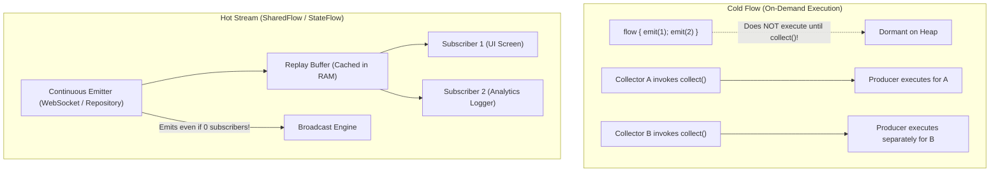
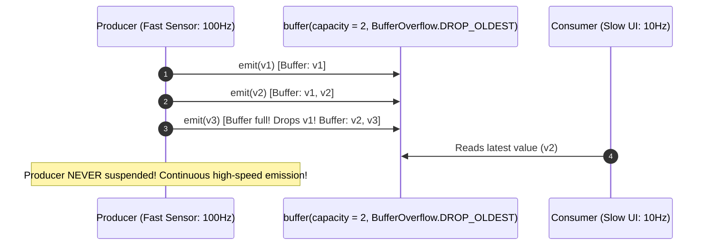
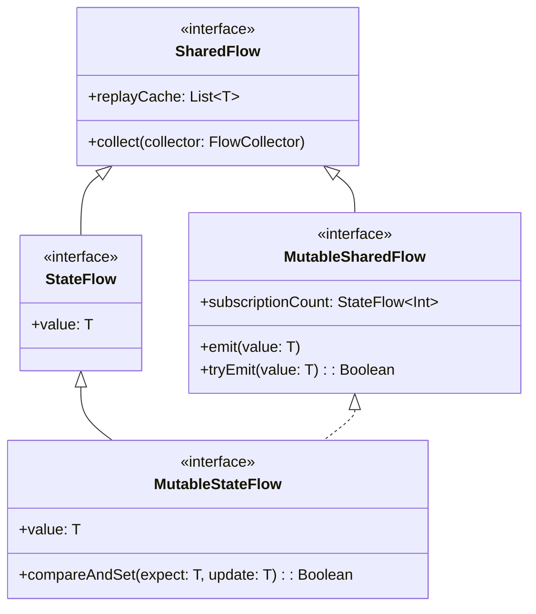

# MODULE 08: COROUTINES DEEP INTERNALS & CONCURRENCY
## CHAPTER 03: KOTLIN FLOW, HOT STREAMS (STATEFLOW VS SHAREDFLOW) & BACKPRESSURE

---

### A. FUNDAMENTALS

#### 1. What is the Concept?
Kotlin `Flow` is a reactive stream processing pipeline built on top of Kotlin Coroutines. Unlike traditional reactive frameworks (like RxJava), Flow does not require separate synchronization abstractions or heavy scheduler threads; it leverages coroutines' non-blocking suspension to achieve natural **Backpressure**.
Key constructs include:
- **Cold Flow:** A declarative pipeline where the producer code does **not** execute until a terminal operator (like `collect`) is invoked. Every collector receives its own fresh stream of values.
- **Hot Streams (`SharedFlow` & `StateFlow`):** Active broadcast streams that emit values regardless of whether subscribers are currently listening. Multiple collectors share the same stream of emissions.
- **Backpressure:** The mechanism that handles the mismatch in speed when a producer emits data faster than a consumer can process it.

#### 2. Why Does It Exist?
In mobile applications, data arrives asynchronously from multiple sources: WebSocket price ticks, location GPS updates, database changes, and UI user clicks. 
- Using standard collections (`List<T>`) forces buffering all data in memory before returning, causing Out-Of-Memory crashes for large datasets.
- Suspending functions (`suspend fun getData(): T`) can only return a single value.
- Flow provides an asynchronous data stream that emits multiple values sequentially over time, without blocking threads or consuming unbounded memory.

#### 3. What Problem Does It Solve?
- **Consumer Slowdown (Backpressure):** When a WebSocket pushes 200 items/second but the database can only write 50 items/second, Flow's non-blocking suspension naturally suspends the producer without dropping data or crashing the app.
- **Background Resource Wastage:** In Android, collecting data when an app is in the background wastes battery and network bandwidth. Combining Flow with `repeatOnLifecycle` automatically stops collection when the UI is stopped and restarts when the UI becomes visible.
- **State vs Event Confusion:** Providing strict architectural separation between state retention (`StateFlow` for UI state) and single-time event emissions (`Channel` or `SharedFlow` for navigation/snackbars).

#### 4. Where is It Used?
- Architecture layer boundaries: Room database reactive queries (`@Query fun getTransactions(): Flow<List<Transaction>>`), Retrofit SSE / WebSockets, and MVI ViewModels exposing `StateFlow<UiState>`.
- UI Collection: Jetpack Compose (`collectAsStateWithLifecycle()`).

#### 5. What Happens If We Do Not Use / Understand It?
- **Lifecycle Leaks & Crashes:** Collecting Flows directly in `lifecycleScope.launch` continues collecting data while the app is in the background, updating views on stopped activities and wasting cellular data.
- **Lost Events:** Using `SharedFlow` with `replay = 0` for one-time events causes events emitted while the screen is rotating (or transitioning) to be permanently lost.
- **Memory Thrashing:** Omitting buffer operators on high-frequency streams causes producer coroutines to suspend continuously, dropping throughput.

---

### B. TECHNICAL DEFINITION

> **Kotlin Flow & Reactive Backpressure:**
> A `Flow<T>` is an interface with a single method: `suspend fun collect(collector: FlowCollector<T>)`.
> Because `collect` and `emit` are suspending functions, **Backpressure is inherent**: when a consumer's processing logic inside `collect { ... }` suspends, the producer's `emit()` call is suspended at the exact same suspension point without requiring complex reactive thread-signaling buffers.
> **`StateFlow`** is a state-holding, confluent hot stream that always stores and immediately replays its latest value to new collectors, evaluating equality via `Any.equals()`. **`SharedFlow`** is a broadcast hot stream configurable with replay cache size, buffer capacity, and custom `BufferOverflow` policies.

---

### C. INTERNAL WORKING & ARCHITECTURE



#### 1. Inherent Backpressure: How `emit` Suspends
In traditional reactive libraries (RxJava 1/2), backpressure required reactive pull requests (`request(n)`), and failing to configure backpressure resulted in `MissingBackpressureException`.
In Kotlin Flow, look at the signature of `FlowCollector`:
```kotlin
fun interface FlowCollector<in T> {
    suspend fun emit(value: T)
}
```
Because `emit` is a **suspending function**, when a producer calls `emit(x)`, the thread executes the collector's block:
```kotlin
flow {
    emit(1) // Calls collector.emit(1)
    println("Emitted 1")
    emit(2) // Calls collector.emit(2)
}.collect { value ->
    delay(1000) // Collector suspends for 1000ms!
}
```
*Execution Trace:*
1. Producer calls `emit(1)`.
2. Collector enters block and hits `delay(1000)`.
3. Because `delay` suspends, the collector's `emit(1)` invocation **does not complete**.
4. The producer is **suspended** right at line 2! Line 3 (`println("Emitted 1")`) is **blocked from executing** until the collector finishes its 1000ms delay.
*Zero buffer overruns. Zero extra memory allocated.*

#### 2. Buffer Operators & Conflation
When the producer is fast (e.g., sensor at 100Hz) and the consumer is slow (UI render at 60Hz), you decouple their execution using buffer operators:



- **`buffer(capacity)`:** Runs producer and consumer in **two separate concurrent coroutines** connected by a channel buffer.
- **`conflate()`:** Equivalent to `buffer(capacity = 1, onBufferOverflow = BufferOverflow.DROP_OLDEST)`. If consumer is busy, intermediate values are dropped; consumer always receives the freshest value.
- **`collectLatest()`:** When a new value is emitted, if the consumer is still processing the previous value, the consumer's previous block is **cancelled immediately**, and restarted with the new value.

#### 3. `StateFlow` vs `SharedFlow` Internal Architecture



##### Deep Comparison:
1. **Initial Value:**
   - `StateFlow` **requires** an initial value (`MutableStateFlow(initial)`). It always has a current `.value`.
   - `SharedFlow` has **no initial value** by default.
2. **Replay Cache:**
   - `StateFlow` has a fixed replay cache of size **1**. New subscribers immediately receive the latest state.
   - `SharedFlow` has a configurable replay cache (`replay = 0, 1, 2...`).
3. **Equality Filtering (Conflation):**
   - `StateFlow` uses **`Any.equals()`** internally. If you set `stateFlow.value = currentVal`, it evaluates `old == new` and **suppresses emission**. It never emits identical consecutive values.
   - `SharedFlow` does **not** filter by equality. It emits every single call to `emit()`, even if the value is identical.

#### 4. Lifecycle-Aware Collection: `repeatOnLifecycle`
Why is collecting flows inside `lifecycleScope.launch` dangerous?
```kotlin
// DANGEROUS IN ANDROID:
lifecycleScope.launch {
    viewModel.uiState.collect { updateUi(it) } // KEEPS RUNNING IN BACKGROUND!
}
```
When the user presses the Home button, the Activity transitions to `STOPPED`. However, a standard `launch` job is cancelled only when the Activity transitions to `DESTROYED`.
While in the background, the Flow continues collecting, executing business logic, and consuming CPU/network.
*The Solution:* **`repeatOnLifecycle(Lifecycle.State.STARTED)`**:
```kotlin
lifecycleScope.launch {
    repeatOnLifecycle(Lifecycle.State.STARTED) {
        // Automatically cancels collection when lifecycle drops below STARTED (onStop).
        // Automatically restarts collection when lifecycle returns to STARTED (onStart).
        viewModel.uiState.collect { updateUi(it) }
    }
}
```

---

### D. PRODUCTION IMPLEMENTATION

#### Production-Grade Reactive Ticker & Transaction Search Pipeline
Below is a compilable, production-grade search and ticker engine demonstrating:
1. `StateFlow` and `SharedFlow` architecture.
2. High-frequency debouncing and cancellation with `flatMapLatest`.
3. Safe one-time event handling using buffered `Channel`.

```kotlin
package com.ibm.banking.feature.atm.flow

import com.ibm.banking.model.AccountId
import com.ibm.banking.model.BankingTransaction
import kotlinx.coroutines.CoroutineDispatcher
import kotlinx.coroutines.Dispatchers
import kotlinx.coroutines.ExperimentalCoroutinesApi
import kotlinx.coroutines.channels.BufferOverflow
import kotlinx.coroutines.channels.Channel
import kotlinx.coroutines.flow.Flow
import kotlinx.coroutines.flow.MutableSharedFlow
import kotlinx.coroutines.flow.MutableStateFlow
import kotlinx.coroutines.flow.SharedFlow
import kotlinx.coroutines.flow.StateFlow
import kotlinx.coroutines.flow.asSharedFlow
import kotlinx.coroutines.flow.asStateFlow
import kotlinx.coroutines.flow.debounce
import kotlinx.coroutines.flow.distinctUntilChanged
import kotlinx.coroutines.flow.flatMapLatest
import kotlinx.coroutines.flow.flow
import kotlinx.coroutines.flow.flowOn
import kotlinx.coroutines.flow.receiveAsFlow

// 1. Contracts
interface TransactionDatabaseDao {
    fun searchTransactions(query: String): Flow<List<BankingTransaction>>
}

sealed interface TransactionNavEvent {
    data class NavigateToDetails(val transactionId: String) : TransactionNavEvent
    data class ShowSecurityAlert(val reason: String) : TransactionNavEvent
}

// 2. Production Reactive Search Engine
@OptIn(ExperimentalCoroutinesApi::class)
class TransactionSearchEngine(
    private val dao: TransactionDatabaseDao,
    private val ioDispatcher: CoroutineDispatcher = Dispatchers.IO
) {

    // Hot StateFlow: Holds current search query state
    private val _searchQuery = MutableStateFlow("")
    val searchQuery: StateFlow<String> = _searchQuery.asStateFlow()

    // Single-time Event Channel: Zero event loss across configuration changes!
    private val _navEvents = Channel<TransactionNavEvent>(
        capacity = Channel.BUFFERED,
        onBufferOverflow = BufferOverflow.SUSPEND
    )
    val navEvents: Flow<TransactionNavEvent> = _navEvents.receiveAsFlow()

    // Hot SharedFlow for broadcast telemetry updates
    private val _telemetryStream = MutableSharedFlow<String>(
        replay = 0,
        extraBufferCapacity = 64,
        onBufferOverflow = BufferOverflow.DROP_OLDEST
    )
    val telemetryStream: SharedFlow<String> = _telemetryStream.asSharedFlow()

    /**
     * Search Pipeline:
     * - Debounces input to 300ms.
     * - Filters redundant consecutive strings.
     * - flatMapLatest cancels previous ongoing database queries when a new query arrives.
     * - flowOn(Dispatchers.IO) switches upstream execution to background thread pool.
     */
    val searchResults: Flow<List<BankingTransaction>> = _searchQuery
        .debounce(300L)
        .distinctUntilChanged()
        .flatMapLatest { query ->
            if (query.isBlank()) {
                flow { emit(emptyList()) }
            } else {
                dao.searchTransactions(query)
            }
        }
        .flowOn(ioDispatcher)

    fun onQueryChanged(newQuery: String) {
        _searchQuery.value = newQuery
    }

    suspend fun onTransactionClicked(transactionId: String) {
        _telemetryStream.tryEmit("CLICKED_$transactionId")
        _navEvents.send(TransactionNavEvent.NavigateToDetails(transactionId))
    }
}
```

#### Unit Testing Verification with Turbine
```kotlin
package com.ibm.banking.feature.atm.flow

import app.cash.turbine.test
import com.ibm.banking.model.AccountId
import com.ibm.banking.model.AmountCents
import com.ibm.banking.model.BankingTransaction
import com.ibm.banking.model.TransactionId
import com.ibm.banking.model.TransactionStatus
import io.mockk.every
import io.mockk.mockk
import kotlinx.coroutines.ExperimentalCoroutinesApi
import kotlinx.coroutines.flow.flowOf
import kotlinx.coroutines.test.StandardTestDispatcher
import kotlinx.coroutines.test.runTest
import org.junit.Assert.assertEquals
import org.junit.Test

@OptIn(ExperimentalCoroutinesApi::class)
class TransactionSearchEngineTest {

    private val testDispatcher = StandardTestDispatcher()
    private val dao: TransactionDatabaseDao = mockk()
    private val engine = TransactionSearchEngine(dao, testDispatcher)

    @Test
    fun searchResults_debouncesAndEmitsMatchingTransactions() = runTest(testDispatcher) {
        val mockTransactions = listOf(
            BankingTransaction(
                id = TransactionId("TX_1"),
                sourceAccount = AccountId("ACC_1"),
                amount = AmountCents(50_00L),
                status = TransactionStatus.COMPLETED,
                description = "Coffee Shop",
                timestamp = 1000L
            )
        )

        every { dao.searchTransactions("Coffee") } returns flowOf(mockTransactions)

        engine.searchResults.test {
            // Initial empty emission for blank query
            assertEquals(emptyList<BankingTransaction>(), awaitItem())

            // Type "Coffee"
            engine.onQueryChanged("Coffee")

            // Advance virtual time past the 300ms debounce threshold
            testDispatcher.scheduler.advanceTimeBy(301L)

            val results = awaitItem()
            assertEquals(1, results.size)
            assertEquals("Coffee Shop", results.first().description)
        }
    }
}
```

---

### E. REAL-WORLD SCENARIOS

1. **FinTech (ATM Card-Free Countdown Timer & Status Poller):**
   When an ATM withdrawal session begins, a cold `flow { ... }` generates a 1-second countdown tick from 120 down to 0. Simultaneously, a hot `StateFlow` listens for ATM terminal scan events. Using `combine(countdownFlow, terminalStateFlow) { time, state -> ... }` merges the two reactive streams into a single immutable UI state model, updating the screen cleanly with zero thread locks.
2. **Connected Vehicles (High-Frequency Speedometer & GPS):**
   In Android Automotive, vehicle speed sensors emit at 100Hz. Collecting this directly freezes the UI. Using `.sample(16.ms)` or `.conflate()` throttles the flow to match the display's 60Hz frame rate, dropping intermediate telemetry packets without lagging behind real-time vehicle speed.
3. **Offline-First Synchronization (Room Database Continuous Observation):**
   When a user makes a payment, the payment is written to the local SQLite database. Room DAOs return `Flow<List<Transaction>>`. Room automatically observes SQLite table updates; the moment the transaction row is inserted, the Flow emits the fresh list, automatically updating the Compose UI without manual refresh calls.

---

### F. ARCHITECTURE AND TRADE-OFFS

| Reactive Primitive | Stream Type | Replay / Memory | Conflation | Ideal Architectural Use Case |
| :--- | :--- | :--- | :--- | :--- |
| **`Flow<T>`** | Cold | None (On-demand execution) | None (Natural suspension) | Network requests, database queries, file reads |
| **`StateFlow<T>`** | Hot | Fixed at 1 | **Yes** (Filters by `Any.equals()`) | UI State, Form validation state, Settings |
| **`SharedFlow<T>`** | Hot | Configurable (0 to $N$) | Optional (`DROP_OLDEST`) | Broadcast events, Analytics, Push notifications |
| **`Channel<T>`** | Hot (Unicast/Queue) | Internal buffer capacity | Optional | Single-time UI effects (Navigation, Snackbars) |

---

### G. COMMON MISTAKES & ANTI-PATTERNS

#### Anti-Pattern 1: Using `SharedFlow` with `replay = 0` for Navigation Events
```kotlin
// BUG: EVENT LOSS DURING CONFIGURATION CHANGE!
val navEvents = MutableSharedFlow<NavRoute>(replay = 0)
```
*Why it fails:* When the user rotates the device, the Activity is destroyed and recreated. Between the time the old Activity unbinds and the new Activity resubscribes, if the ViewModel emits a `NavRoute`, the event is dropped into the void! The user never navigates.
*Correction:* Use a buffered `Channel` with `receiveAsFlow()`, which buffers the event until a collector arrives.

#### Anti-Pattern 2: Using `flatMapMerge` for Sequential Search
```kotlin
// BUG: RACE CONDITIONS IN SEARCH RESULTS!
queryFlow.flatMapMerge { query -> api.search(query) }
```
*Why it fails:* `flatMapMerge` runs multiple search queries concurrently. If query "A" takes 500ms and query "AB" takes 100ms, the results for "A" arrive *after* "AB", overwriting the newer results with stale data!
*Correction:* Use **`flatMapLatest`**, which automatically cancels the previous network search coroutine the moment a new query character is typed.

---

### H. INTERVIEW PREPARATION (BASIC TO STAFF LEVEL)

#### Q1 (Basic): What is the difference between a Cold Flow and a Hot Stream?
**Answer:**
A **Cold Flow** is lazy: its producer code does not run until a terminal operator (like `collect`) is invoked. Each collector triggers an independent execution of the flow builder.
A **Hot Stream** (like `StateFlow` or `SharedFlow`) is active immediately: it exists in memory and can emit values even if no collectors are currently subscribed. All collectors share the exact same stream emissions.

#### Q2 (Intermediate): Why should you collect Flows using `repeatOnLifecycle` instead of `lifecycleScope.launch` in Android?
**Answer:**
`lifecycleScope.launch` stays active as long as the Activity/Fragment is in any state above `DESTROYED`. When an app goes into the background (`STOPPED`), the flow continues collecting, consuming CPU, network, and battery.
`repeatOnLifecycle(Lifecycle.State.STARTED)` automatically suspends and cancels the collecting coroutine when the lifecycle drops below `STARTED` (e.g., when the app goes into the background), and automatically restarts collection when the lifecycle re-enters `STARTED`.

#### Q3 (Advanced): How does `StateFlow` handle conflation internally compared to `Flow.conflate()`?
**Answer:**
`StateFlow` has built-in conflation based on **equality**:
1. When `stateFlow.value = newValue` is called, it checks `if (oldValue == newValue) return`. If the values are structurally equal according to `Any.equals()`, no emission occurs.
2. If multiple values are assigned before a collector can process them, the collector only receives the latest value.
In contrast, `Flow.conflate()` does not check equality; it simply uses a buffer of capacity 1 with `BufferOverflow.DROP_OLDEST`, dropping older unconsumed values regardless of whether they were identical.

#### Q4 (Senior Scenario): You have an analytics flow that emits 50 events per second. The server reporting API is slow and can only accept 5 batches per second. How do you design this with Flow operators to prevent dropping critical events?
**Answer:**
Use **`chunked`** (or buffer with `windowed`):
```kotlin
analyticsFlow
    .buffer(capacity = 500, onBufferOverflow = BufferOverflow.SUSPEND)
    .chunked(batchSize = 10, timeoutMs = 200L) // Collects into List<Event>
    .collect { batch ->
        api.uploadBatch(batch)
    }
```
*Explanation:* Instead of dropping events with `conflate`, we use `buffer` with `SUSPEND` to absorb spikes, and batch items into chunks of 10. Uploading 10 events per HTTP request reduces network round-trips from 50/s to 5/s, perfectly matching the server's throughput without losing any telemetry.

#### Q5 (Staff Architecture): Explain how `shareIn` and `stateIn` convert a cold flow into a hot stream. What are the three `SharingStarted` strategies?
**Answer:**
`shareIn` converts a cold Flow into a `SharedFlow`, while `stateIn` converts it into a `StateFlow`.
They take a `CoroutineScope`, a replay size, and a **`SharingStarted`** strategy:
1. **`SharingStarted.Eagerly`:** Starts the upstream cold flow immediately and keeps it running forever, even when there are zero subscribers.
2. **`SharingStarted.Lazily`:** Starts the upstream flow when the first subscriber arrives, and keeps it running forever after that.
3. **`SharingStarted.WhileSubscribed(stopTimeoutMillis = 5000L)`:**
   - Starts upstream when the first subscriber arrives.
   - When the last subscriber unsubscribes (e.g., screen rotation or backgrounding), it waits for `stopTimeoutMillis` (5 seconds).
   - If a new subscriber arrives within 5 seconds (device finished rotating), the upstream flow is **never stopped**, avoiding an expensive network reload!
   - If 5 seconds elapse with zero subscribers, the upstream flow is cancelled to save battery and memory.

---

### I. CODING PRACTICE

#### Problem: Custom `chunked` Windowing Flow Operator
**Requirement:** Build a custom Flow operator `fun <T> Flow<T>.chunked(size: Int, timeoutMs: Long): Flow<List<T>>` that emits batches of items when either $size$ items are collected OR $timeoutMs$ has passed since the first item in the batch arrived.

```kotlin
package com.ibm.banking.feature.atm.flow

import kotlinx.coroutines.channels.produce
import kotlinx.coroutines.coroutineScope
import kotlinx.coroutines.delay
import kotlinx.coroutines.flow.Flow
import kotlinx.coroutines.flow.flow
import kotlinx.coroutines.selects.select

/**
 * Production-grade batching operator for high-frequency telemetry streams.
 */
fun <T> Flow<T>.chunked(size: Int, timeoutMs: Long): Flow<List<T>> = flow {
    require(size > 0) { "Batch size must be greater than 0" }
    require(timeoutMs > 0) { "Timeout must be greater than 0" }

    coroutineScope {
        val channel = produce {
            collect { send(it) }
        }

        val batch = mutableListOf<T>()
        var deadline = System.currentTimeMillis() + timeoutMs

        while (!channel.isClosedForReceive) {
            val remainingTime = (deadline - System.currentTimeMillis()).coerceAtLeast(0L)

            // If timeout has arrived and batch has items, emit immediately
            if (remainingTime == 0L && batch.isNotEmpty()) {
                emit(batch.toList())
                batch.clear()
                deadline = System.currentTimeMillis() + timeoutMs
                continue
            }

            // Receive item or timeout
            val item = channel.receiveCatching().getOrNull()
            if (item != null) {
                if (batch.isEmpty()) {
                    deadline = System.currentTimeMillis() + timeoutMs
                }
                batch.add(item)
                if (batch.size >= size) {
                    emit(batch.toList())
                    batch.clear()
                }
            } else {
                // Channel closed: Flush remaining items
                break
            }
        }

        if (batch.isNotEmpty()) {
            emit(batch.toList())
        }
    }
}
```

*Complexity Analysis:*
- **Time Complexity:** $O(N)$ linear pass over stream items.
- **Space Complexity:** $O(size)$ memory bounded by batch size.

---

### J. SENIOR ENGINEER INTERVIEW SCRIPTS

#### 60-Second Explanation (Executive Summary)
> *"Kotlin Flow is a reactive stream pipeline built on Coroutines that handles asynchronous data streams with natural backpressure. Because `collect` and `emit` are suspending functions, slow consumers naturally suspend fast producers without dropping data or requiring complex thread buffers. We architecturally divide streams into Cold Flows for on-demand operations like database queries, and Hot Streams like `StateFlow` for state retention and `SharedFlow` for event broadcasts. In Android UI layers, we collect Flows exclusively with `repeatOnLifecycle` alongside `SharingStarted.WhileSubscribed(5000)` to ensure background processes are cleanly halted while surviving configuration changes without redundant network reloads."*

#### 3-Minute Deep Dive (Staff Architecture Level)
> *"When designing enterprise mobile architectures, reactive streaming governs how data flows from backend WebSockets and SQLite databases to the presentation layer.
>
> In earlier reactive paradigms like RxJava, backpressure was handled through complex pull-request signaling (`request(n)`), and missing a backpressure strategy triggered fatal exceptions. In Kotlin Flow, backpressure is an inherent property of coroutine suspension. When a consumer's `collect` block suspends, the producer's `emit` call is suspended at the exact same suspension point, eliminating memory buffers and thread blocking.
>
> When designing ViewModels, the critical architectural decision is choosing between `StateFlow`, `SharedFlow`, and `Channel`:
>
> 1. **`StateFlow` for UI State:** `StateFlow` represents a state machine. It mandates an initial state, caches exactly the latest value, and enforces equality conflation. If the new state equals the old state according to `equals()`, it suppresses recomposition, preventing UI churn.
> 2. **`Channel` for Single-Time UI Effects:** A common anti-pattern is using `SharedFlow(replay = 0)` for navigation or snackbars. If the user rotates their phone, the Activity is torn down; any event emitted during rotation is permanently lost. By using a buffered `Channel` exposed via `receiveAsFlow()`, the event remains safely in the buffer until the newly created Activity resubscribes.
> 3. **`SharingStarted.WhileSubscribed(5000)`:** When converting cold database flows into hot StateFlows using `stateIn`, using `WhileSubscribed(5000)` is our production standard. When the user rotates their phone, the subscriber count drops to zero. The 5-second grace period keeps the upstream database connection open across the rotation. If the user leaves the app entirely, the 5-second timer expires, and the upstream flow cancels, saving battery and memory."*

---

### K. KNOWLEDGE VALIDATION & SELF-ASSESSMENT

#### 10 Senior Interview Questions
1. Why does `flowOf(1, 2, 3).flowOn(Dispatchers.IO)` only change the dispatcher of the *upstream* flow, not the downstream collector?
2. What happens if you call `emit()` inside a `withContext(Dispatchers.IO)` block within a `flow { ... }` builder? *(Answer: Throws `IllegalStateException: Flow invariant is violated`)*.
3. How does `callbackFlow` differ from `channelFlow`, and why is `awaitClose { ... }` mandatory in `callbackFlow`?
4. What is the difference between `flatMapConcat`, `flatMapMerge`, and `flatMapLatest`?
5. How does `StateFlow` enforce thread safety when updating state via `_state.update { it.copy(...) }`? *(Answer: Uses an atomic CAS loop internally)*.
6. What happens if a `SharedFlow` with `BufferOverflow.SUSPEND` has one very slow collector and two fast collectors?
7. What is the difference between `collect()` and `collectLatest()`?
8. How does `zip` combine two flows compared to `combine`?
9. Why does `distinctUntilChanged()` require objects to have a proper `equals()` and `hashCode()` implementation?
10. How does `Turbine` test Kotlin Flows without adding race conditions to unit tests?

#### Practical Self-Assessment Checklist
- [ ] Built a debounced search flow using `flatMapLatest` and `distinctUntilChanged`.
- [ ] Handled single-time navigation events using a buffered `Channel`.
- [ ] Verified that `repeatOnLifecycle` cancels collection when an Activity is in the background.
- [ ] Converted a cold Flow to a hot StateFlow using `stateIn(scope, SharingStarted.WhileSubscribed(5000), initial)`.
- [ ] Written unit tests verifying Flow emissions using Turbine's `test {}` block.
