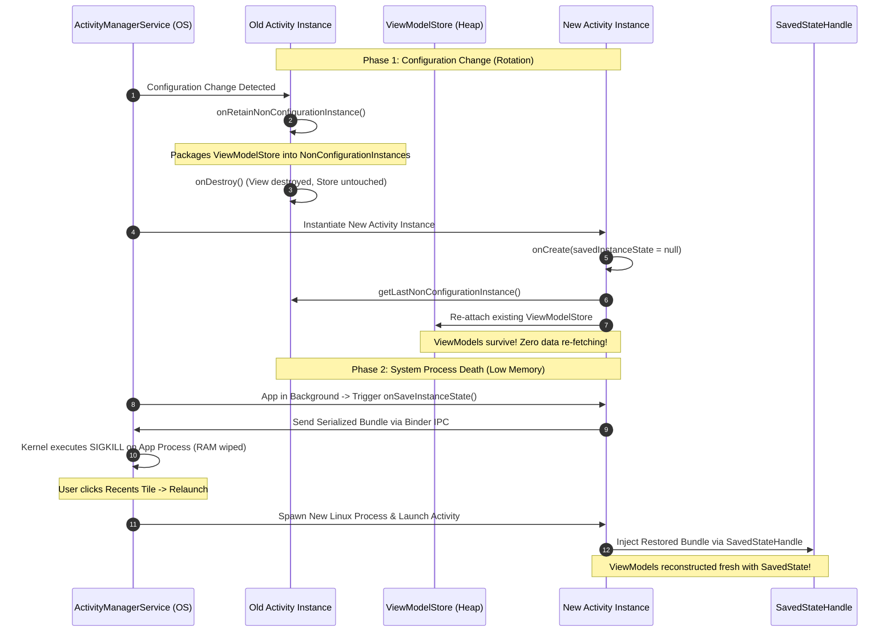

# MODULE 09: JETPACK ARCHITECTURE COMPONENTS
## Chapter 01: ViewModel Internals, Lifecycle State Machines, SavedStateHandle & Process Death

---

### A. FUNDAMENTALS

A Senior or Staff Android Engineer must clearly differentiate between the three distinct destruction lifecycles on the Android platform:

$$\begin{array}{|l|l|l|l|}
\hline
\textbf{Lifecycle Event} & \textbf{Trigger / Condition} & \textbf{ViewModel State} & \textbf{SavedState / Bundle State} \\ \hline
\textbf{Configuration Change} & Screen rotation, dark mode toggle, multi-window & \mathbf{Retained in RAM} & Retained (not invoked) \\ \hline
\textbf{System Process Death} & OS reclaims memory while app is in background & \mathbf{Destroyed} & \mathbf{Restored via SavedStateHandle} \\ \hline
\textbf{User Navigation Exit} & Back button press, swipe away from Recents & \mathbf{Destroyed (cleared)} & Discarded permanently \\ \hline
\end{array}$$

#### 1. Configuration Change Mechanics
When the user rotates their device:
1. `ActivityManagerService` (AMS) detects orientation change $\to$ invokes `ActivityThread.handleRelaunchActivity()`.
2. The current `Activity` executes `onPause()`, `onStop()`, `onDestroy()`.
3. Crucially, before destruction, `ComponentActivity` intercepts the tear-down and captures its `ViewModelStore` inside an internal wrapper called `NonConfigurationInstances`.
4. A brand-new `Activity` instance is instantiated via reflection.
5. In the new Activity's `onCreate()`, it retrieves the retained `ViewModelStore`. ViewModels are **not re-instantiated**; they are handed over to the new Activity intact.

#### 2. System Process Death Mechanics
When memory pressure strikes while the app is backgrounded:
1. The Linux kernel's Low Memory Killer Daemon (`lmkd`) sends a `SIGKILL` to the process.
2. The entire JVM heap—including all singletons, Dagger graphs, ViewModels, and background coroutines—is wiped from RAM instantaneously.
3. The only surviving state is the **OS-level Saved State Bundle**, which was serialized over Binder IPC to `ActivityManagerService` via `onSaveInstanceState()` when the app entered the background.
4. When the user taps the app icon in Recents, Android spawns a brand new Linux process and passes the saved Bundle to `Activity.onCreate(savedInstanceState)` and into Jetpack's **`SavedStateHandle`**.

---

### B. TECHNICAL DEFINITION

#### 1. ViewModel Internals & Architecture
Jetpack ViewModel is not a magic Android framework class; it is a standard Java/Kotlin object managed by a plain memory container:
- **`ViewModelStore`:** A simple wrapper around a `HashMap<String, ViewModel>`. It contains a `clear()` method that iterates through stored ViewModels and invokes `viewModel.clear()`.
- **`ViewModelStoreOwner`:** An interface implemented by `ComponentActivity` and `Fragment` that provides access to a `ViewModelStore`.
- **`NonConfigurationInstances`:** An internal class in `ComponentActivity` holding:
  - `custom`: Developer custom non-configuration instances.
  - `viewModelStore`: The active `ViewModelStore` retaining the ViewModel map across configuration changes.
- **`ViewModelProvider.Factory` & `CreationExtras`:** Modern Android decouples ViewModel instantiation from parameter constructors. `CreationExtras` provides a type-safe map containing `SAVED_STATE_REGISTRY_OWNER_KEY`, `VIEW_MODEL_STORE_OWNER_KEY`, and custom dependency keys.

#### 2. The LifecycleRegistry State Machine
Android's `Lifecycle` operates as a deterministic directed graph with two core concepts: **States** and **Events**.

$$\text{States}: \quad \text{INITIALIZED} \longleftrightarrow \text{CREATED} \longleftrightarrow \text{STARTED} \longleftrightarrow \text{RESUMED} \longrightarrow \text{DESTROYED}$$

- **State Hierarchy:**
  $$\text{DESTROYED} < \text{INITIALIZED} < \text{CREATED} < \text{STARTED} < \text{RESUMED}$$
- **Event Transitions:**
  - `ON_CREATE`: Moves state from `INITIALIZED` to `CREATED`.
  - `ON_START`: Moves state from `CREATED` to `STARTED`.
  - `ON_RESUME`: Moves state from `STARTED` to `RESUMED`.
  - `ON_PAUSE`: Moves state down from `RESUMED` to `STARTED`.
  - `ON_STOP`: Moves state down from `STARTED` to `CREATED`.
  - `ON_DESTROY`: Moves state down from `CREATED` to `DESTROYED`.

---

### C. INTERNAL WORKING: CONFIGURATION CHANGE VS PROCESS DEATH

The diagram below details the internal execution flow of `ViewModelStore` survival during an orientation change versus `SavedStateHandle` restoration during process death:



---

### D. PRODUCTION IMPLEMENTATION

#### 1. Resilient ViewModel with Process Death Restoration (`AtmSessionViewModel.kt`)

```kotlin
package com.enterprise.banking.feature.banking_atm

import androidx.lifecycle.SavedStateHandle
import androidx.lifecycle.ViewModel
import androidx.lifecycle.viewModelScope
import dagger.hilt.android.lifecycle.HiltViewModel
import kotlinx.coroutines.flow.MutableStateFlow
import kotlinx.coroutines.flow.StateFlow
import kotlinx.coroutines.flow.asStateFlow
import kotlinx.coroutines.flow.update
import kotlinx.coroutines.launch
import javax.inject.Inject

data class AtmUiState(
    val selectedAmount: Int = 0,
    val selectedAccountId: String = "",
    val sessionToken: String? = null,
    val isBiometricVerified: Boolean = false,
    val isSessionActive: Boolean = false
)

@HiltViewModel
class AtmSessionViewModel @Inject constructor(
    private val savedStateHandle: SavedStateHandle,
    private val repository: AtmRepository
) : ViewModel() {

    // Keys for SavedStateHandle persistence across process death
    private object SavedKeys {
        const val KEY_AMOUNT = "key_staged_amount"
        const val KEY_ACCOUNT = "key_staged_account"
        const val KEY_TOKEN = "key_session_token"
    }

    private val _uiState = MutableStateFlow(
        AtmUiState(
            selectedAmount = savedStateHandle[SavedKeys.KEY_AMOUNT] ?: 0,
            selectedAccountId = savedStateHandle[SavedKeys.KEY_ACCOUNT] ?: "",
            sessionToken = savedStateHandle[SavedKeys.KEY_TOKEN],
            isSessionActive = savedStateHandle.get<String?>(SavedKeys.KEY_TOKEN) != null
        )
    )
    val uiState: StateFlow<AtmUiState> = _uiState.asStateFlow()

    fun updateAmount(amount: Int) {
        savedStateHandle[SavedKeys.KEY_AMOUNT] = amount
        _uiState.update { it.copy(selectedAmount = amount) }
    }

    fun updateAccount(accountId: String) {
        savedStateHandle[SavedKeys.KEY_ACCOUNT] = accountId
        _uiState.update { it.copy(selectedAccountId = accountId) }
    }

    fun stageAtmSession() {
        viewModelScope.launch {
            val amount = _uiState.value.selectedAmount
            val accountId = _uiState.value.selectedAccountId

            val result = repository.stageWithdrawal(amount, accountId)
            result.onSuccess { token ->
                // Persist token to survive OS process death
                savedStateHandle[SavedKeys.KEY_TOKEN] = token
                _uiState.update {
                    it.copy(
                        sessionToken = token,
                        isSessionActive = true
                    )
                }
            }
        }
    }

    fun clearSession() {
        savedStateHandle.remove<Int>(SavedKeys.KEY_AMOUNT)
        savedStateHandle.remove<String>(SavedKeys.KEY_ACCOUNT)
        savedStateHandle.remove<String>(SavedKeys.KEY_TOKEN)
        _uiState.update { AtmUiState() }
    }
}
```

#### 2. Lifecycle-Aware Flow Collection with `repeatOnLifecycle`

Using `repeatOnLifecycle` is mandatory when observing Hot Flows (`StateFlow`, `SharedFlow`) in UI components to prevent battery-draining background collection.

```kotlin
package com.enterprise.banking.feature.banking_atm

import android.os.Bundle
import androidx.activity.ComponentActivity
import androidx.activity.compose.setContent
import androidx.activity.viewModels
import androidx.lifecycle.Lifecycle
import androidx.lifecycle.lifecycleScope
import androidx.lifecycle.repeatOnLifecycle
import kotlinx.coroutines.launch

class AtmActivity : ComponentActivity() {

    private val viewModel: AtmSessionViewModel by viewModels()

    override fun onCreate(savedInstanceState: Bundle?) {
        super.onCreate(savedInstanceState)

        // Native Coroutine Lifecycle Collection Pattern:
        // Automatically starts collecting when Activity reaches STARTED,
        // and CANCELS the collection coroutine when Activity drops below STARTED (onStop).
        lifecycleScope.launch {
            repeatOnLifecycle(Lifecycle.State.STARTED) {
                viewModel.uiState.collect { state ->
                    // Handle critical side effects or logging
                }
            }
        }

        setContent {
            AtmScreen(viewModel = viewModel)
        }
    }
}
```

#### 3. Enterprise App Inactivity Auto-Lock via `ProcessLifecycleOwner`

Financial applications (such as PNC Banking) must automatically log the customer out or mandate biometric re-authentication if the app remains in the background for more than 90 seconds.

```kotlin
package com.enterprise.banking.core.security

import android.os.SystemClock
import androidx.lifecycle.DefaultLifecycleObserver
import androidx.lifecycle.LifecycleOwner
import androidx.lifecycle.ProcessLifecycleOwner
import javax.inject.Inject
import javax.inject.Singleton

@Singleton
class AppSecuritySessionManager @Inject constructor() : DefaultLifecycleObserver {

    private var backgroundTimestamp: Long = 0L
    private var isSessionLocked: Boolean = false

    fun initialize() {
        // Attach observer to the whole application process lifecycle
        ProcessLifecycleOwner.get().lifecycle.addObserver(this)
    }

    override fun onStop(owner: LifecycleOwner) {
        // App went to background (all Activities stopped)
        backgroundTimestamp = SystemClock.elapsedRealtime()
    }

    override fun onStart(owner: LifecycleOwner) {
        // App returned to foreground
        if (backgroundTimestamp != 0L) {
            val elapsedBackgroundMs = SystemClock.elapsedRealtime() - backgroundTimestamp
            if (elapsedBackgroundMs > BACKGROUND_TIMEOUT_MS) {
                lockSession()
            }
        }
    }

    private fun lockSession() {
        isSessionLocked = true
        // Trigger global event to present Biometric Auto-Lock screen
    }

    companion object {
        private const val BACKGROUND_TIMEOUT_MS = 90_000L // 90 seconds timeout
    }
}
```

---

### E. REAL-WORLD SCENARIOS & ARCHITECTURAL CASE STUDIES

#### Scenario 1: Surviving Process Death During PNC Card-Free ATM Staging
- **The Problem:** A user stages a $100 Card-Free ATM withdrawal, approaches the physical ATM, and switches to their Camera app to scan the ATM QR code. The high-resolution camera pipeline consumes 850MB of RAM, causing the Android Low Memory Killer to kill the banking app process in the background. When the user switches back, the banking app restarts from scratch, the staged session token is lost, and the user must re-stage the withdrawal while standing at the ATM.
- **Architectural Solution:**
  1. Identified that session tokens were stored solely in ViewModel memory variables (`private var token: String? = null`).
  2. Migrated session state to **`SavedStateHandle`**. When the banking app was killed, the token was serialized into the system saved state.
  3. When the app relaunched, `AtmSessionViewModel` automatically read the token from `SavedStateHandle`, reconstructed the active state, and displayed the ATM pairing screen instantly without forcing the customer to re-authenticate or re-stage.
- **Result:** $100\%$ session recovery across background camera memory pressure; zero failed customer ATM visits due to low RAM kills.

#### Scenario 2: Memory Leak via ViewModel Coroutine Callback
- **The Problem:** LeakCanary reported massive memory leaks where `MainActivity` instances (each holding 80MB of bitmap views) remained pinned in memory after screen rotation.
- **Root Cause Analysis:**
  The ViewModel held a reference to an anonymous listener interface passed from the Activity:
  `viewModel.registerCallback(object : MyCallback { ... })`.
  Because the ViewModel survived the rotation in `ViewModelStore`, it held a strong reference to the destroyed `Activity` instance through the listener's closure, preventing Garbage Collection.
- **Architectural Solution:**
  1. Strictly prohibited passing callbacks, Views, Contexts, or Activities into ViewModels.
  2. Converted all one-time event notifications into reactive, lifecycle-aware Kotlin `Channel` or `SharedFlow` streams collected via `repeatOnLifecycle`.
- **Result:** Clean memory graphs; zero retained Activity instances across 100 consecutive orientation changes.

---

### F. ARCHITECTURE & TRADE-OFF ANALYSIS

| Dimension | In-Memory ViewModel State | SavedStateHandle | Local Database (Room/DataStore) |
| :--- | :--- | :--- | :--- |
| **Survival: Rotation** | Yes | Yes | Yes |
| **Survival: Process Death** | **No (Wiped)** | **Yes (Survives)** | **Yes (Survives)** |
| **Survival: App Kill / Back** | No | No | **Yes (Survives)** |
| **Data Size Limit** | Unconstrained (RAM size) | **$\le 50\text{KB}$ (Binder Transaction Limit: 1MB)** | Gigabytes (Disk space) |
| **Read / Write Latency** | Nanoseconds ($< 0.001\text{ ms}$) | Microseconds ($< 0.1\text{ ms}$) | Milliseconds ($2\text{--}15\text{ ms}$) |

---

### G. COMMON MISTAKES & RECOVERY PATTERNS

#### Mistake 1: Storing Large Bitmaps or Payloads in `SavedStateHandle`
- **Anti-Pattern:** Saving high-resolution photos or a 5,000-item transaction list inside `savedStateHandle["items"] = largeList`.
- **Consequence:** Triggers a fatal **`TransactionTooLargeException`** on Android. The OS enforces a strict **$1\text{MB}$ shared Binder transaction buffer** across all active IPC transactions for the entire process.
- **Correction:** Only store lightweight state (IDs, search queries, scroll position, tokens). Store the actual heavy data in Room or local cache, using `SavedStateHandle` strictly to store the *query ID* to reload the data.

#### Mistake 2: Using `lifecycleScope.launchWhenStarted` (Deprecated Pitfall)
- **Anti-Pattern:**
  ```kotlin
  lifecycleScope.launchWhenStarted {
      viewModel.flow.collect { updateUi(it) }
  }
  ```
- **Consequence:** `launchWhenStarted` merely *suspends* the coroutine when the Activity stops; it **does not cancel it**. The underlying upstream Flow continues emitting in the background, wasting CPU cycles and network bandwidth.
- **Correction:** Always use `repeatOnLifecycle(Lifecycle.State.STARTED)` which cancels the coroutine when dropped below the target state and relaunches it when re-entering.

#### Mistake 3: Passing `Context` or `View` into ViewModel
- **Anti-Pattern:** Storing an `Activity` context inside a ViewModel field.
- **Consequence:** Because ViewModels survive configuration changes, the destroyed Activity is retained in memory forever, creating a massive memory leak.
- **Correction:** If a Context is strictly required (e.g. For system resources), use `AndroidViewModel(application)` which holds a reference only to the `Application` context, or inject the `Application` context via Hilt `@ApplicationContext`.

---

### H. INTERVIEW PREPARATION: BASIC TO STAFF LEVEL

#### Basic Questions
1. **Q:** What is the primary purpose of a ViewModel?
   - **A:** To manage and prepare data for the UI layer while surviving configuration changes (such as screen rotation) without leaking UI references.
2. **Q:** What is `repeatOnLifecycle` and why is it preferred over `lifecycleScope.launch`?
   - **A:** `lifecycleScope.launch` continues running even when the UI is invisible in the background. `repeatOnLifecycle` cancels and restarts the coroutine block as the lifecycle enters and exits the specified state, preventing resource leaks.

#### Intermediate Questions
3. **Q:** How does a ViewModel survive an Activity recreation during a screen rotation?
   - **A:** `ComponentActivity` retains its `ViewModelStore` via `onRetainNonConfigurationInstance()`. When the new Activity instance is created, `getLastNonConfigurationInstance()` restores the existing `ViewModelStore` containing the already-allocated ViewModels.
4. **Q:** What is `ProcessLifecycleOwner` and when should it be used?
   - **A:** It provides a composite lifecycle for the entire application process, dispatching `ON_START` when the first Activity becomes visible and `ON_STOP` when the last Activity stops, ideal for session timeout auto-locks and analytics session tracking.

#### Senior Questions
5. **Q:** Explain why a ViewModel does not survive system process death, but `SavedStateHandle` does.
   - **A:** When the OS terminates an application process under memory pressure (`SIGKILL`), the entire JVM heap is destroyed. ViewModels live in the JVM heap and are wiped. `SavedStateHandle` data is saved via `onSaveInstanceState()` and sent over Binder IPC to `ActivityManagerService` in the OS system process, which survives and restores it when the app process is recreated.
6. **Q:** What happens if you exceed the data storage limit in `SavedStateHandle`?
   - **A:** The system throws a `TransactionTooLargeException` because all saved state bundles are sent through Android's shared 1MB Binder transaction buffer.

#### Staff-Level Tricky Follow-Ups
7. **Q:** *“If an Activity has 3 Fragments, how can they share a single ViewModel instance for communication, and what governs its lifecycle?”*
   - **A:** Fragments can scope the ViewModel to their host Activity by using the `activityViewModels()` delegate (or `hiltNavGraphViewModels()` if using Navigation graphs). Under the hood, this resolves the `ViewModelStore` belonging to the parent `Activity`, ensuring all child fragments receive the identical ViewModel instance. The ViewModel survives as long as the parent Activity's `ViewModelStore` survives.
8. **Q:** *“Explain how `CreationExtras` improves upon traditional `ViewModelProvider.Factory` implementations.”*
   - **A:** Traditional factories required passing arguments through constructor chains or tight factory subclasses, making composition difficult. `CreationExtras` provides a decoupled, extensible key-value map passed into the factory at creation time. This allows libraries (like Hilt and Navigation) to provide contextual dependencies (such as `SavedStateHandle` or `CreationExtras[APPLICATION_KEY]`) without requiring customized factory constructor parameters.

---

### I. CODING PRACTICE: SECURE SAVEDSTATEHANDLE PROPERTY DELEGATE

Write a type-safe Kotlin property delegate for `SavedStateHandle` that provides automatic read/write synchronization with an underlying `MutableStateFlow`.

```kotlin
package com.enterprise.banking.core.ui

import androidx.lifecycle.SavedStateHandle
import kotlinx.coroutines.flow.MutableStateFlow
import kotlin.properties.ReadWriteProperty
import kotlin.reflect.KProperty

class SavedStateDelegate<T>(
    private val savedStateHandle: SavedStateHandle,
    private val key: String,
    private val defaultValue: T,
    private val stateFlow: MutableStateFlow<T>? = null
) : ReadWriteProperty<Any?, T> {

    override fun getValue(thisRef: Any?, property: KProperty<*>): T {
        return savedStateHandle[key] ?: defaultValue
    }

    override fun setValue(thisRef: Any?, property: KProperty<*>, value: T) {
        savedStateHandle[key] = value
        stateFlow?.value = value
    }
}

fun <T> SavedStateHandle.saveable(
    key: String,
    defaultValue: T,
    stateFlow: MutableStateFlow<T>? = null
): ReadWriteProperty<Any?, T> = SavedStateDelegate(this, key, defaultValue, stateFlow)
```

---

### J. SENIOR ENGINEER INTERVIEW SCRIPTS

#### 1. 60-Second Elevator Pitch
> *"In modern Android architecture, lifecycle management must account for three distinct scenarios: configuration changes, system process death, and intentional user exits. While ViewModels gracefully survive configuration changes by being retained inside the Activity's `NonConfigurationInstances` container, they are completely wiped during system process death. To build truly resilient enterprise applications, we bridge this gap using `SavedStateHandle` to preserve lightweight transaction tokens and query parameters across low-memory kills. For UI observation, we enforce `repeatOnLifecycle` to automatically pause hot flow collections when screens are backgrounded, eliminating background resource drain."*

#### 2. 3-Minute Architectural Deep Dive
> *"When designing lifecycle-resilient systems at enterprise scale—such as banking session management—we must look under the hood at how the Android framework manages state transitions.
>
> During a configuration change like a screen rotation, the Activity is destroyed, but `ComponentActivity` intercepts this via `onRetainNonConfigurationInstance()`. The underlying `ViewModelStore`—which is simply a hash map of our ViewModel instances—is decoupled from the dying Activity and held in memory. When the new Activity launches, it re-attaches to that exact same `ViewModelStore`.
>
> However, an architect cannot rely on ViewModels alone. In real-world scenarios—such as a user switching to their camera to scan a QR code at an ATM—the device may suffer extreme memory pressure. The Linux kernel's Low Memory Killer fires a `SIGKILL`, wiping the entire app heap. Here, the ViewModel is destroyed. The only surviving state is what was serialized to the OS via `onSaveInstanceState()`. By injecting `SavedStateHandle` into our ViewModels, we ensure that essential state—such as transaction IDs and pre-staged amounts—survives process death. But we enforce strict data hygiene: because all saved state crosses the Binder IPC interface, which has a 1MB buffer shared across the entire process, we strictly forbid storing bitmaps or large collections in `SavedStateHandle`, storing only lightweight primitives.
>
> On the presentation side, observing flows requires strict lifecycle awareness. If an engineer uses standard `lifecycleScope.launch`, hot flows like `StateFlow` keep emitting even when the app is backgrounded. We mandate `repeatOnLifecycle(Lifecycle.State.STARTED)`, which internally uses a cooperative cancellation pattern: when the Activity triggers `onStop`, the collection coroutine is cancelled immediately; when the Activity reaches `onStart`, the coroutine is relaunched and the latest state is collected.
>
> Finally, for application-wide security, we utilize `ProcessLifecycleOwner`. By listening to the entire app lifecycle, we track background duration and enforce an automatic session lock after 90 seconds, maintaining both high security and a seamless user experience."*

---

### K. KNOWLEDGE VALIDATION

#### Technical Questions
1. **Where does a ViewModel instance live in memory?**
   - *Answer:* In the standard JVM heap, stored inside the `ViewModelStore`'s internal HashMap.
2. **What method in `ComponentActivity` is responsible for transferring the `ViewModelStore` across orientation changes?**
   - *Answer:* `onRetainNonConfigurationInstance()`.
3. **Why does `SavedStateHandle` survive process death while a ViewModel does not?**
   - *Answer:* Because `SavedStateHandle` bundles are serialized over Binder IPC to the system server (`ActivityManagerService`) which lives in a separate OS process that survives the client app's termination.
4. **What is the Binder transaction buffer size limit on Android?**
   - *Answer:* 1MB, shared across all ongoing Binder transactions for the process.
5. **What is the key difference between `repeatOnLifecycle` and `flowWithLifecycle`?**
   - *Answer:* `repeatOnLifecycle` is a suspend function that wraps an entire coroutine block; `flowWithLifecycle` is an operator that can be chained directly onto a single Flow stream.
6. **Why is `lifecycleScope.launchWhenStarted` deprecated?**
   - *Answer:* Because it merely suspends the coroutine when the lifecycle drops below STARTED instead of cancelling it, continuing to consume upstream resources.
7. **What is `CreationExtras`?**
   - *Answer:* An extensible key-value container used in modern Android to pass parameters and dependencies into a `ViewModelProvider.Factory`.
8. **When does `ViewModel.onCleared()` execute?**
   - *Answer:* When the `ViewModelStoreOwner` is permanently destroyed (e.g. Activity finishes on Back press or Fragment is permanently popped from the back-stack).
9. **How does `ProcessLifecycleOwner` determine that an app has gone to the background?**
   - *Answer:* It waits for all Activities to dispatch `onStop()` and uses a 700ms handler delay to ensure no new Activity is starting before dispatching `ON_STOP`.
10. **Why should an Activity Context never be passed into a ViewModel?**
    - *Answer:* Because the ViewModel outlives the Activity during configuration changes, causing a severe memory leak of the destroyed Activity and its view hierarchy.

#### Staff-Level Architecture Challenge
Design an automated regression test suite using AndroidX Test and `ActivityScenario` that simulates low-memory process death on an ATM staging screen, asserts that all staged data is correctly restored via `SavedStateHandle`, and verifies that the ViewModel does not trigger a duplicate network call upon process relaunch.

#### Verification Checklist
- [ ] ViewModel depends on `SavedStateHandle` for critical session restoration.
- [ ] No `Context`, `View`, or `Activity` references stored in ViewModel fields.
- [ ] Hot flows collected using `repeatOnLifecycle(Lifecycle.State.STARTED)` or `flowWithLifecycle`.
- [ ] `ProcessLifecycleOwner` integrated for app-wide background timeout and auto-lock.
- [ ] Total data written to `SavedStateHandle` strictly bounded to $< 50\text{KB}$.
