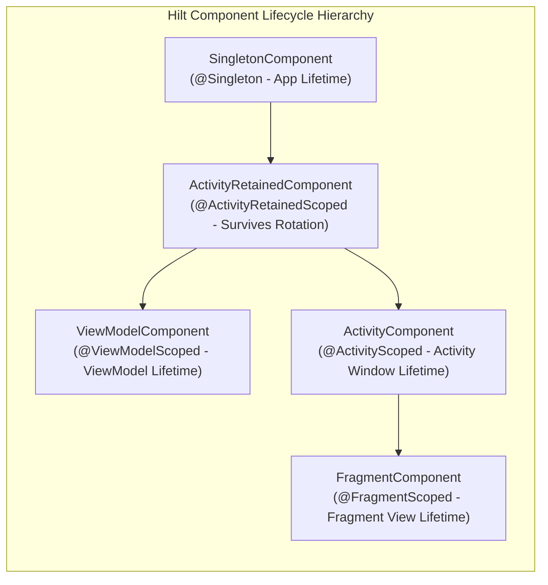

# MODULE 10: DEPENDENCY INJECTION AT SCALE
## CHAPTER 01: DAGGER 2, HILT INTERNALS & MULTI-MODULE COMPONENT ARCHITECTURES

---

### A. FUNDAMENTALS

#### 1. What is the Concept?
Dependency Injection (DI) is a software design pattern implementing Inversion of Control (IoC). Instead of an object constructing its own dependencies (e.g., calling `Retrofit.Builder().build()` or `Room.databaseBuilder()`), dependencies are provided to the object from the outside.
In the Android ecosystem:
- **Dagger 2** is a compile-time, zero-reflection dependency injection framework. It analyzes the dependency graph using annotation processing (or KSP) and synthesizes standard Java/Kotlin factory and provider classes.
- **Hilt** is an opinionated architectural layer built on top of Dagger 2, standardizing component lifecycles, Android component injection (Activities, Fragments, ViewModels, Services), and multi-module graph integration.

#### 2. Why Does It Exist?
Manual dependency injection in large enterprise Android applications leads to:
1. **Boilerplate Explosion:** Passing 15 constructor parameters through multiple layers of intermediate classes simply to deliver a dependency to a leaf class.
2. **Scoping Bugs:** Accidentally instantiating multiple instances of heavy resources (like OkHttp connection pools, SQLite database connections, or cryptographic keys) that should have been singletons.
3. **Runtime Crashes in Reflection-Based DI:** Frameworks that use runtime reflection (like early versions of Spring or Guice) cause slow application cold startup and crash at runtime if a dependency is missing.

Dagger eliminates runtime failure by validating the **entire dependency graph at compile time**.

#### 3. What Problem Does It Solve?
- **Zero Runtime Reflection:** Maximum startup performance. Dagger generates standard code identical to hand-written factory patterns.
- **Compile-Time Graph Verification:** If a dependency is missing or if there is a circular dependency ($A \to B \to A$), compilation fails immediately with an exact stack trace.
- **Lifecycle Scoping Alignment:** Hilt aligns dependency lifetimes directly with Android lifecycle milestones (`SingletonComponent` for application lifetime, `ViewModelComponent` surviving configuration changes, `ActivityComponent` tied to window lifetime).

#### 4. Where is It Used?
- Enterprise multi-module Android architectures: Decoupling feature modules from core network and database implementations.
- Testing: Swapping production network and database bindings with mock or fake implementations using Hilt's `@TestInstallIn`.

#### 5. What Happens If We Do Not Use / Understand It?
- **Graph Compilation Bloat:** Misusing `@Provides` instead of `@Binds` forces Dagger to generate unnecessary factory classes, expanding APK method counts and slowing build times.
- **Memory Leaks from Improper Scoping:** Annotating an Activity-scoped dependency as `@Singleton` prevents the Activity context from being garbage collected, causing catastrophic memory leaks.
- **Service Locator Anti-Pattern:** Treating Hilt as a Service Locator by scattering `@EntryPoint` lookups throughout the codebase defeats compile-time safety and muddles dependency ownership.

---

### B. TECHNICAL DEFINITION

> **Compile-Time DI & Hilt Component Hierarchy:**
> Dagger 2 is a static code generation engine that creates a Directed Acyclic Graph (DAG) of dependencies during compilation. 
> For every `@Inject` constructor, Dagger generates a `_Factory` class implementing `Provider<T>`. Scoped instances (`@Singleton`) are wrapped in `DoubleCheck.provider()` implementing thread-safe double-checked locking.
> **Hilt** defines a standardized tree of monolithic and subcomponent scopes (`SingletonComponent` $\to$ `ActivityRetainedComponent` $\to$ `ViewModelComponent` $\to$ `ActivityComponent` $\to$ `FragmentComponent`), injecting dependencies without manual Dagger component boilerplate.

---

### C. INTERNAL WORKING & ARCHITECTURE



#### 1. Dagger Generated Code Disassembly
What actually happens when you write `@Inject constructor`:
```kotlin
class PaymentRepository @Inject constructor(
    private val api: BankingApi,
    private val dao: TransactionDao
)
```
During compilation, Dagger's annotation processor generates `PaymentRepository_Factory.java`:
```java
public final class PaymentRepository_Factory implements Provider<PaymentRepository> {
    private final Provider<BankingApi> apiProvider;
    private final Provider<TransactionDao> daoProvider;

    public PaymentRepository_Factory(Provider<BankingApi> apiProvider, Provider<TransactionDao> daoProvider) {
        this.apiProvider = apiProvider;
        this.daoProvider = daoProvider;
    }

    @Override
    public PaymentRepository get() {
        return newInstance(apiProvider.get(), daoProvider.get());
    }

    public static PaymentRepository newInstance(BankingApi api, TransactionDao dao) {
        return new PaymentRepository(api, dao);
    }
}
```
*Zero reflection.* It is simply a generated factory that calls the constructor directly!

#### 2. The `DoubleCheck` Provider (Scoped Singletons)
When a dependency is annotated with `@Singleton`:
Dagger wraps the generated factory in `dagger.internal.DoubleCheck`:
```java
// Dagger's internal DoubleCheck implementation
public final class DoubleCheck<T> implements Provider<T> {
    private static final Object UNINITIALIZED = new Object();
    private volatile Provider<T> provider;
    private volatile Object instance = UNINITIALIZED;

    public T get() {
        Object result = instance;
        if (result == UNINITIALIZED) {
            synchronized (this) {
                result = instance;
                if (result == UNINITIALIZED) {
                    result = provider.get();
                    instance = result;
                    provider = null; // Releases provider lambda to save memory!
                }
            }
        }
        return (T) result;
    }
}
```
*Architecture Insight:* Notice that Dagger's generated code uses the exact Java Memory Model **Double-Checked Locking** pattern with `@Volatile` we mastered in Module 03, nulling out the provider reference after initialization to reduce heap retention!

#### 3. `@Binds` vs `@Provides`: The Performance Difference
- **`@Provides`:** Used when you must execute construction logic or configure third-party classes (e.g., creating an `OkHttpClient` using a builder).
  - *Bytecode Cost:* Dagger **must generate an extra class** (`NetworkModule_ProvideOkHttpClientFactory.class`).
- **`@Binds`:** Used when binding an interface to an implementation class that already has an `@Inject` constructor:
```kotlin
@Module
@InstallIn(SingletonComponent::class)
abstract class RepositoryModule {
    @Binds
    @Singleton
    abstract fun bindPaymentRepo(impl: PaymentRepositoryImpl): PaymentRepository
}
```
  - *Bytecode Cost:* **Zero generated factory classes!** Because `@Binds` is an abstract method in an abstract class, Dagger generates zero bytecode; it simply rewrites its internal graph pointer directly to `PaymentRepositoryImpl_Factory`.
  - *Staff Rule:* **Always prefer `@Binds` over `@Provides` when mapping interfaces to implementations to minimize DEX size and build time.**

#### 4. Multibindings (`@IntoMap` and `@IntoSet`)
Multibindings allow multiple independent feature modules to contribute dependencies into a single collection (`Set<Plugin>` or `Map<Class<?>, Factory>`) without the core module knowing about the feature modules. This is the cornerstone of **Plugin Architecture** and dynamic feature delivery.

---

### D. PRODUCTION IMPLEMENTATION

#### Production-Grade Multibinding Plugin Architecture & Assisted Injection
Below is a compilable, production-grade DI setup demonstrating:
1. Hilt module with `@Binds` optimization.
2. Dagger Multibindings (`@IntoSet`) for a dynamic security validator pipeline.
3. Assisted Injection (`@AssistedInject` and `@AssistedFactory`) for combining injected dependencies with runtime session parameters.

```kotlin
package com.ibm.banking.di

import com.ibm.banking.model.AccountId
import com.ibm.banking.model.AmountCents
import dagger.Binds
import dagger.Module
import dagger.Provides
import dagger.assisted.Assisted
import dagger.assisted.AssistedFactory
import dagger.assisted.AssistedInject
import dagger.hilt.InstallIn
import dagger.hilt.components.SingletonComponent
import dagger.multibindings.IntoSet
import javax.inject.Inject
import javax.inject.Singleton

// 1. Dynamic Security Plugin Interface
interface TransactionSecurityValidator {
    fun validate(account: AccountId, amount: AmountCents): Result<Unit>
}

// 2. Concrete Validators (Can live in separate feature modules!)
class RegulatoryLimitValidator @Inject constructor() : TransactionSecurityValidator {
    override fun validate(account: AccountId, amount: AmountCents): Result<Unit> {
        return if (amount.cents <= 10_000_00L) { // $10,000 ceiling
            Result.success(Unit)
        } else {
            Result.failure(SecurityException("Exceeds regulatory daily limit"))
        }
    }
}

class AccountSanctionsValidator @Inject constructor() : TransactionSecurityValidator {
    override fun validate(account: AccountId, amount: AmountCents): Result<Unit> {
        return if (!account.value.startsWith("BLOCKED_")) {
            Result.success(Unit)
        } else {
            Result.failure(SecurityException("Account is flagged for compliance review"))
        }
    }
}

// 3. Assisted Injection: Combines Dagger Singletons with Runtime Intent Extras
class CardFreeAtmSessionCoordinator @AssistedInject constructor(
    private val securityValidators: Set<@JvmSuppressWildcards TransactionSecurityValidator>, // Injected Multibindings Set!
    @Assisted val terminalId: String, // Runtime parameter passed at instantiation!
    @Assisted val sessionTimeoutSeconds: Int
) {
    fun verifyTransaction(account: AccountId, amount: AmountCents): Result<Unit> {
        for (validator in securityValidators) {
            val result = validator.validate(account, amount)
            if (result.isFailure) return result
        }
        return Result.success(Unit)
    }

    // Assisted Factory interface implemented automatically by Dagger!
    @AssistedFactory
    interface Factory {
        fun create(
            terminalId: String,
            sessionTimeoutSeconds: Int
        ): CardFreeAtmSessionCoordinator
    }
}

// 4. Hilt Configuration Module
@Module
@InstallIn(SingletonComponent::class)
abstract class BankingSecurityModule {

    // Multibinding: Contributes RegulatoryLimitValidator into Set<TransactionSecurityValidator>
    @Binds
    @IntoSet
    abstract fun bindRegulatoryValidator(impl: RegulatoryLimitValidator): TransactionSecurityValidator

    // Multibinding: Contributes AccountSanctionsValidator into Set<TransactionSecurityValidator>
    @Binds
    @IntoSet
    abstract fun bindSanctionsValidator(impl: AccountSanctionsValidator): TransactionSecurityValidator
}
```

#### Unit Testing Verification with Dagger Test Doubles
```kotlin
package com.ibm.banking.di

import com.ibm.banking.model.AccountId
import com.ibm.banking.model.AmountCents
import org.junit.Assert.assertFalse
import org.junit.Assert.assertTrue
import org.junit.Test

class CardFreeAtmSessionCoordinatorTest {

    @Test
    fun verifyTransaction_allValidatorsPass_returnsSuccess() {
        val validators = setOf(
            RegulatoryLimitValidator(),
            AccountSanctionsValidator()
        )

        val coordinator = CardFreeAtmSessionCoordinator(
            securityValidators = validators,
            terminalId = "TERM_101",
            sessionTimeoutSeconds = 60
        )

        val result = coordinator.verifyTransaction(AccountId("ACC_CLEAN"), AmountCents(500_00L))
        assertTrue(result.isSuccess)
    }

    @Test
    fun verifyTransaction_regulatoryLimitExceeded_returnsFailure() {
        val validators = setOf(
            RegulatoryLimitValidator(),
            AccountSanctionsValidator()
        )

        val coordinator = CardFreeAtmSessionCoordinator(
            securityValidators = validators,
            terminalId = "TERM_101",
            sessionTimeoutSeconds = 60
        )

        val result = coordinator.verifyTransaction(AccountId("ACC_CLEAN"), AmountCents(50_000_00L)) // $50,000
        assertFalse(result.isSuccess)
    }
}
```

---

### E. REAL-WORLD SCENARIOS

1. **FinTech (Dynamic ATM Terminal Plugin Pipeline):**
   In enterprise banking, different physical ATM terminals support different hardware protocols (NFC, QR Code, BLE, Biometric palm scan). Using Dagger Multibindings (`@IntoMap`), feature modules provide their own terminal protocol handlers into a `Map<TerminalProtocol, Provider<TerminalHandler>>`. The core app resolves the appropriate handler dynamically based on the terminal's handshake payload without holding static dependencies on all hardware SDKs.
2. **Assisted Injection in Deep Linking (Card-Free ATM Withdrawal):**
   When a user clicks a deep link containing an ATM terminal ID (`banking://atm/withdraw?terminalId=NYC_004`), the ViewModel needs both compile-time dependencies (AuthManager, CryptoEngine) and the runtime `terminalId`. Using `@AssistedInject` allows Hilt to inject the compile-time singletons while the ViewModel factory passes the dynamic `terminalId` cleanly without mutable `lateinit` variables.
3. **Multi-Module Testing with `@TestInstallIn`:**
   In an automated CI pipeline running 2,000 UI tests, making real network calls is impossible. Hilt's `@TestInstallIn(components = [SingletonComponent::class], replaces = [NetworkModule::class])` allows the test module to substitute the production Retrofit client with an in-memory `MockWebServer` module globally across all feature modules with zero production code changes.

---

### F. ARCHITECTURE AND TRADE-OFFS

| DI Approach | Verification Timing | Cold Startup Overhead | DEX / Binary Size Impact | Boilerplate |
| :--- | :--- | :--- | :--- | :--- |
| **Dagger 2 / Hilt** | **Compile Time** (Guaranteed fail-fast) | **Zero** (Standard direct instantiation) | Generates `_Factory` classes | Low with Hilt; Moderate with Dagger |
| **Koin** | **Runtime** (Crashes if binding missing) | High (Resolves graph at startup via reflection/service-locator) | Minimal (No code generation) | Very Low |
| **Manual DI** | Compile Time | Zero | Zero (No libraries) | **Extreme** (Requires manual passing of all parameters) |

---

### G. COMMON MISTAKES & ANTI-PATTERNS

#### Anti-Pattern 1: Using `@Provides` When `@Binds` is Applicable
```kotlin
// BAD: Generates an unnecessary Factory class in bytecode
@Module
@InstallIn(SingletonComponent::class)
object BadModule {
    @Provides
    fun provideRepo(impl: PaymentRepositoryImpl): PaymentRepository {
        return impl // Unnecessary delegation!
    }
}
```
*Why it fails:* Dagger generates `BadModule_ProvideRepoFactory.class`. In an app with 500 interface bindings, this generates 500 unnecessary `.class` files, bloating DEX size, expanding multidex counts, and slowing incremental builds.
*Correction:* Use an abstract class with `@Binds`.

#### Anti-Pattern 2: Scoping Everything as `@Singleton`
```kotlin
// BAD: MEMORY LEAK AND STALE STATE!
@Singleton
class AtmSessionStateHolder @Inject constructor() {
    var activePin: String? = null // Stays in memory FOREVER!
}
```
*Why it fails:* `@Singleton` dependencies are retained by `SingletonComponent` for the entire life of the application process. Storing user-session credentials or UI state in `@Singleton` leaks sensitive cryptographic tokens long after the user has logged out.
*Correction:* Scope to `@ActivityRetainedScoped` or pass state through MVI ViewModels.

---

### H. INTERVIEW PREPARATION (BASIC TO STAFF LEVEL)

#### Q1 (Basic): What is the difference between `@Provides` and `@Binds` in Dagger?
**Answer:**
`@Provides` is used in a concrete class or object to define construction logic for classes you do not own (like configuring OkHttp or Retrofit) or when conditional logic is required. Dagger generates a factory class to execute this method.
`@Binds` is used in an abstract module on an abstract method to bind an interface to its concrete implementation. Dagger generates zero bytecode for `@Binds`; it simply redirects the dependency graph to the implementation's factory, reducing APK size and build times.

#### Q2 (Intermediate): What is the difference between `SingletonComponent` and `ActivityRetainedComponent` in Hilt?
**Answer:**
- `SingletonComponent` is scoped to the **entire lifetime of the Application process**. It is destroyed only when the OS terminates the app process.
- `ActivityRetainedComponent` is scoped to an **Activity's logical lifecycle**, meaning it **survives configuration changes** (screen rotation, theme changes) but is destroyed when the Activity is finished permanently (user presses back or finishes). `ViewModelComponent` is a subcomponent of `ActivityRetainedComponent`.

#### Q3 (Advanced): How does Dagger guarantee thread safety for `@Singleton` dependencies?
**Answer:**
Dagger wraps scoped provider factories inside `dagger.internal.DoubleCheck`. 
`DoubleCheck` implements the classic Double-Checked Locking pattern: it holds a `@Volatile` instance reference. On first access, if the instance is uninitialized, it enters a `synchronized(this)` block, checks the volatile reference a second time, executes the underlying factory to instantiate the object, and caches the result. Subsequent reads execute the fast-path volatile read with zero lock contention.

#### Q4 (Senior Scenario): You are modularizing a monolithic app into 30 feature modules. Feature `:feature:atm` needs access to `:core:network`, but you want to prevent circular dependencies and prevent `:feature:atm` from seeing internal network implementation details. How do you design the DI graph?
**Answer:**
We implement the **API / Implementation Module Separation** pattern:
1. Create `:feature:atm:api` (contains public interfaces like `AtmFeatureNavigator`) and `:feature:atm:impl` (contains internal ViewModels, Compose screens, and repositories).
2. `:core:network` exposes its public interfaces (e.g., `TokenProvider`, `BankingNetworkClient`) in `:core:network:api`.
3. `:feature:atm:impl` depends only on `:core:network:api`.
4. The concrete Hilt bindings for `:core:network:impl` are installed into `SingletonComponent` inside `:core:network:impl` or the root `:app` module.
5. *Result:* Feature modules depend purely on abstract interfaces. Hilt links the graph at compile time in the root `:app` module without circular dependencies or classpath leakage.

#### Q5 (Staff Architecture): What is the performance impact of Dagger / Hilt on application cold startup compared to runtime reflection frameworks like Koin or Spring?
**Answer:**
- **Dagger/Hilt has ZERO reflection overhead at startup.** Because Dagger generates standard Java classes during compilation (`_Factory` and `DaggerAppComponent`), resolving a dependency at runtime is a direct method call (`new PaymentRepository(...)`), identical to hand-written code.
- **Koin / Reflection frameworks resolve dependencies at runtime.** Upon app launch, they must traverse reflection metadata, populate internal hash maps of definitions, and resolve parameters dynamically. In an enterprise application with 1,000+ dependency definitions, runtime DI can add 200ms–500ms of pure latency to `Application.onCreate()`, directly degrading Time To Initial Display (TTID) and harming Google Play vitals.

---

### I. CODING PRACTICE

#### Problem: Type-Safe Dynamic Plugin Registry using Dagger Multibindings
**Requirement:** Build a dynamic `PluginRegistry` system using Dagger Multibindings where feature modules contribute instances of `MobileFeaturePlugin` into a `Map<String, Provider<MobileFeaturePlugin>>`. The registry must support lazy loading via `Provider<T>` so plugins are only instantiated when their feature tab is opened by the user.

```kotlin
package com.ibm.banking.di

import dagger.Binds
import dagger.MapKey
import dagger.Module
import dagger.hilt.InstallIn
import dagger.hilt.components.SingletonComponent
import dagger.multibindings.IntoMap
import javax.inject.Inject
import javax.inject.Provider
import javax.inject.Singleton

@MapKey
@Retention(AnnotationRetention.RUNTIME)
annotation class PluginKey(val value: String)

interface MobileFeaturePlugin {
    val featureId: String
    fun initialize()
}

class AtmFeaturePlugin @Inject constructor() : MobileFeaturePlugin {
    override val featureId = "ATM_CARD_FREE"
    override fun initialize() {
        // Heavy ATM hardware setup
    }
}

class ProfileFeaturePlugin @Inject constructor() : MobileFeaturePlugin {
    override val featureId = "USER_PROFILE"
    override fun initialize() {
        // User profile setup
    }
}

@Singleton
class DynamicPluginManager @Inject constructor(
    // Injected Map of Providers: Enables LAZY instantiation on demand!
    private val plugins: Map<String, @JvmSuppressWildcards Provider<MobileFeaturePlugin>>
) {
    fun launchFeature(featureId: String): Boolean {
        val provider = plugins[featureId] ?: return false
        val plugin = provider.get() // Instantiated ONLY when requested!
        plugin.initialize()
        return true
    }
}

@Module
@InstallIn(SingletonComponent::class)
abstract class FeaturePluginModule {

    @Binds
    @IntoMap
    @PluginKey("ATM_CARD_FREE")
    abstract fun bindAtmPlugin(impl: AtmFeaturePlugin): MobileFeaturePlugin

    @Binds
    @IntoMap
    @PluginKey("USER_PROFILE")
    abstract fun bindProfilePlugin(impl: ProfileFeaturePlugin): MobileFeaturePlugin
}
```

*Complexity Analysis:*
- **Time Complexity:** $O(1)$ hash map lookup to resolve feature provider.
- **Space Complexity:** Lazy allocation: features consume heap memory only when invoked by the user.

---

### J. SENIOR ENGINEER INTERVIEW SCRIPTS

#### 60-Second Explanation (Executive Summary)
> *"Dagger 2 and Hilt provide compile-time dependency injection with zero runtime reflection. Dagger operates during compilation, generating explicit factory and provider classes that mirror hand-written object creation. Scoped singletons are managed via double-checked locking inside generated `DoubleCheck` providers. Hilt standardizes Dagger for Android by defining a monolithic component hierarchy aligned with Android lifecycle milestones, from `SingletonComponent` down to `ViewModelComponent`. In multi-module enterprise codebases, we maximize build efficiency by favoring `@Binds` over `@Provides` to eliminate redundant factory classes and leverage Multibindings to build decoupled plugin architectures."*

#### 3-Minute Deep Dive (Staff Architecture Level)
> *"In large-scale Android applications with dozens of modularized features, dependency injection is the architectural backbone that enforces clean boundaries.
>
> The fundamental architectural reason we use Dagger and Hilt over runtime frameworks like Koin is startup latency and fail-fast reliability. Reflection-based DI frameworks resolve dependencies dynamically at runtime, traversing metadata and populating hash tables during `Application.onCreate()`. In an app with 1,500 injection points, this adds hundreds of milliseconds of Main Thread lag, directly degrading cold start metrics. Furthermore, missing dependencies in runtime DI only crash when a user navigates to that specific screen in production. Dagger verifies the Directed Acyclic Graph (DAG) during compilation, guaranteeing that if code compiles, the dependency graph is 100% complete and free of circular references.
>
> When designing multi-module architectures, our core strategy is API-Implementation module separation. A feature module like `:feature:atm:impl` never exposes its internal implementation classes to other modules. It depends only on `:core:network:api`. The concrete network implementation is injected at compile time in the root `:app` module.
>
> From a build performance and APK size perspective, we enforce strict architectural lint rules:
> 1. **`@Binds` over `@Provides`:** If we are mapping an interface to a concrete class that has an `@Inject` constructor, we mandate abstract `@Binds` methods. Dagger generates zero bytecode for `@Binds`, eliminating hundreds of unnecessary factory classes from our DEX files.
> 2. **Lazy Multibindings:** For optional feature plugins or security validators, we inject `Map<String, Provider<FeaturePlugin>>`. Injecting `Provider<T>` instead of raw `T` defers instantiation until the user actually interacts with that feature, keeping our cold memory footprint minimal.
> 3. **Scoped Hygiene:** We strictly prevent the over-use of `@Singleton`. Ephemeral state belongs in ViewModels or `ActivityRetainedComponent`, ensuring sensitive financial data and session tokens are garbage collected as soon as the user completes their transaction."*

---

### K. KNOWLEDGE VALIDATION & SELF-ASSESSMENT

#### 10 Senior Interview Questions
1. Why does Dagger require `@Binds` methods to be `abstract` and declared inside an `abstract class` or `interface`?
2. What is an `@EntryPoint` in Hilt, and under what exact circumstances must you use one?
3. How does Hilt inject dependencies into an Android `ViewModel` without requiring custom `ViewModelProvider.Factory` boilerplate?
4. What is the difference between `Provider<T>` and `Lazy<T>` in Dagger?
5. How does Dagger detect circular dependencies at compile time?
6. What is the difference between Subcomponents and Component Dependencies in pure Dagger 2?
7. How does `@TestInstallIn` simplify automated integration testing in Hilt?
8. What bytecode is generated when you use `@AssistedInject` on a class constructor?
9. Can a dependency scoped to `@ActivityScoped` be injected into a `@Singleton` dependency? Why or why not? *(Answer: No, graph validation fails because a longer-lived scope cannot depend on a shorter-lived scope)*.
10. How does Hilt handle dependency injection in multi-process applications?

#### Practical Self-Assessment Checklist
- [ ] Replaced concrete `@Provides` methods with abstract `@Binds` methods in a repository module.
- [ ] Built an Assisted Injection factory for a class taking runtime Intent parameters.
- [ ] Configured Dagger Multibindings (`@IntoSet`) to create an extensible validation pipeline.
- [ ] Created a Hilt `@EntryPoint` to inject a dependency into a custom View or BroadcastReceiver.
- [ ] Verified that a circular dependency ($A \to B \to A$) is caught at compile time by Dagger.
