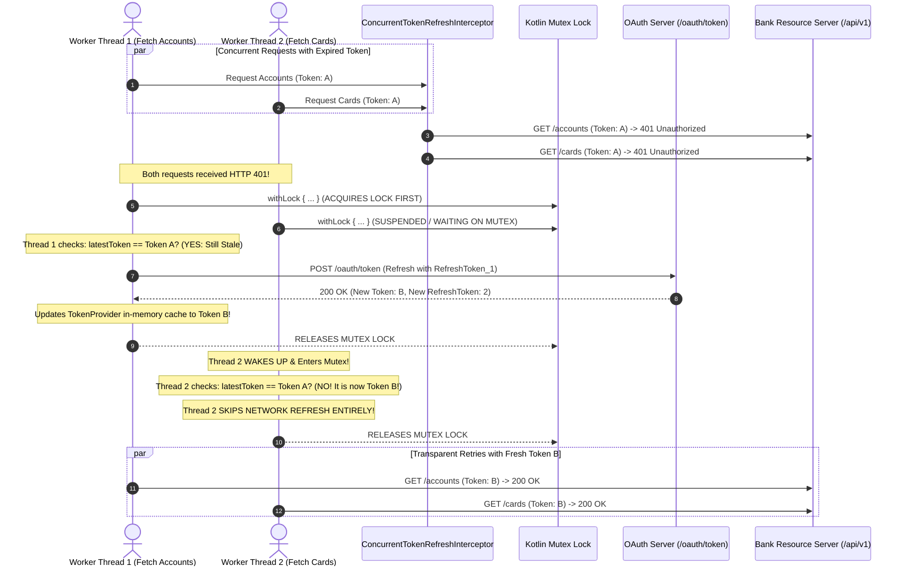

# MODULE 11: NETWORKING & RESILIENT API INTEGRATION
## CHAPTER 01: TRANSPORT SECURITY, CERTIFICATE PINNING & MUTEX-SYNCHRONIZED TOKEN REFRESH

---

### A. FUNDAMENTALS

#### 1. What is the Concept?
In enterprise Android engineering—especially in financial services and healthcare—networking is not simply about deserializing JSON responses from Retrofit. It is a mission-critical subsystem requiring:
- **Transport Layer Security (TLS 1.3 & HTTP/2):** Connection multiplexing over a single TCP socket, reducing connection latency, battery consumption, and TCP slow-start overhead.
- **Certificate Pinning & Public Key Hashes:** Restricting acceptable server certificates to specific cryptographic public keys (Subject Public Key Info - SPKI hashes), neutralizing Man-in-the-Middle (MitM) attacks from compromised Certificate Authorities (CAs) or corporate proxies.
- **Concurrent Token Refresh (Thundering Herd Elimination):** Managing OAuth 2.0 access token expirations across multiple concurrent asynchronous requests using Kotlin `Mutex` synchronization.
- **Idempotency & Network Resilience:** Preventing duplicate payments or withdrawals when network drops occur mid-transaction.

#### 2. Why Does It Exist?
Mobile networks are inherently hostile and volatile:
1. **Network Fluctuations:** Devices transition continuously across 5G, Wi-Fi, airplane mode, and zero-coverage tunnels.
2. **MitM Eavesdropping:** Users connect to untrusted public Wi-Fi networks where attackers or malicious network administrators inject forged root CA certificates.
3. **The "Thundering Herd" Problem:** When a banking session access token expires, a mobile dashboard making 10 parallel API calls (accounts, cards, credit score, notifications) will receive 10 simultaneous HTTP 401 Unauthorized responses. If not synchronized, the client will fire 10 simultaneous refresh-token requests, causing race conditions, session invalidation on the server, and UI logout loops.

#### 3. What Problem Does It Solve?
- **Zero-Trust Network Protection:** Certificate Pinning ensures that even if an attacker installs a malicious root certificate into the Android system trust store (via rooting or enterprise MDM profiles), the app refuses to connect.
- **Thundering Herd Elimination:** Synchronizing token refresh ensures that exactly **one** refresh request hits the server while other concurrent requests wait, resuming transparently with the new token.
- **Double-Debit Prevention:** Idempotency keys guarantee that retrying a dropped payment request cannot result in duplicate money transfers.

#### 4. Where is It Used?
- PNC and German ePA healthcare apps: Securing sensitive REST and WebSocket APIs.
- Core network infrastructure modules: `:core:network` multi-module libraries.

#### 5. What Happens If We Do Not Use / Understand It?
- **App-Wide Outages on Certificate Expiration:** Hardcoding a single certificate pin without a backup pin causes the app to crash permanently when the bank rotates its SSL certificate.
- **Account Lockouts:** Concurrently refreshing tokens invalidates refresh tokens on OAuth backends that enforce single-use refresh token rotation (RTR), kicking the user to the login screen.
- **Cleartext Data Leaks:** Failing to configure `network_security_config.xml` allows accidental cleartext HTTP fallback, violating OWASP MASVS requirements.

---

### B. TECHNICAL DEFINITION

> **HTTP/2 Multiplexing, Certificate Pinning & Mutex Refresh:**
> - **HTTP/2 Multiplexing** interleaves binary request and response frames across a single persistent TCP connection, eliminating the head-of-line blocking inherent in HTTP/1.1.
> - **Certificate Pinning** checks the cryptographic hash of the server's Subject Public Key Info (SPKI) against a hardcoded pin (`pin-sha256="base64="`) during the TLS handshake.
> - **Mutex Token Synchronization** wraps the HTTP 401 recovery block inside a non-blocking coroutine `Mutex`. When a 401 is received, threads acquire the mutex, verify whether a newer token was already refreshed by another thread, execute a single refresh call if stale, and transparently retry pending requests.

---

### C. INTERNAL WORKING & ARCHITECTURE



#### 1. OkHttp Interceptor Chain Architecture
Every OkHttp request passes through a recursive pipeline of interceptors implementing the Chain of Responsibility pattern:

```
Request ──> [Application Interceptors]
                 └──> [RetryAndFollowUpInterceptor]
                           └──> [BridgeInterceptor]
                                     └──> [CacheInterceptor]
                                               └──> [ConnectInterceptor]
                                                         └──> [Network Interceptors]
                                                                   └──> [CallServerInterceptor] ──> Network Socket
```
- **Application Interceptors:** Placed at the very top. Run exactly once per call, before redirects or retries. This is the **correct position** for `ConcurrentTokenRefreshInterceptor` and authentication headers.
- **Network Interceptors:** Placed at the bottom. Run on every actual network transmission (observing redirects and intermediate responses).

#### 2. The Certificate Rotation Strategy (Active Pin + Backup Pin)
A critical mistake in enterprise apps is pinning only the **active leaf certificate**.
When the server's SSL certificate expires or is revoked, the server administrator updates the certificate. If the app only has the old pin, **the app is completely bricked** until an emergency app update is approved by Google Play (which can take 24–48 hours).
*The Architecture Rule:* **Always pin at least TWO public keys**:
1. **Active Pin:** The SPKI hash of the current server certificate.
2. **Backup Pin (Cold Standby):** The SPKI hash of a backup key pair generated in advance and stored securely offline in the bank's cold vault. If the active certificate is compromised or rotated, the server switches to the backup key without breaking client connections.

```kotlin
val certificatePinner = CertificatePinner.Builder()
    // Active Production Certificate Key
    .add("api.bank.com", "sha256/WoiWRyIOVNa9ihaBciRSC7XHjliYS9VwUGOIud4PB18=")
    // Cold Backup Key (Stored in offline hardware vault)
    .add("api.bank.com", "sha256/k2v657xBsOVe1PQR/JU7tVu5prs700LKQguJUKFEDVI=")
    .build()
```

#### 3. Idempotency Keys (`X-Idempotency-Key`)
When a user taps "Transfer $500", the client sends a `POST /transfer`.
If the server processes the transaction, debits the account, but the mobile connection drops *before* the HTTP 200 OK reaches the client:
- The client sees a `SocketTimeoutException`.
- If the client retries blindly, the server debits the account a second time ($1,000 total)!
*The Solution:* Every state-mutating request includes a unique client-generated UUID header:
`X-Idempotency-Key: 7b29a394-4d8e-4a62-8e12-39f28a9c4123`.
The server stores idempotency keys in Redis for 24 hours:
- If a request arrives with an existing idempotency key, the server **does not re-execute the transfer**; it returns the cached HTTP response from the first execution.

---

### D. PRODUCTION IMPLEMENTATION

#### Production-Grade Resilient OkHttp Client with Certificate Pinning & Mutex Refresh
Below is a compilable, production-grade network configuration demonstrating:
1. Mutex-synchronized token refresh.
2. Dual-pin certificate pinning with backup key.
3. Automated Idempotency-Key generation for state-mutating requests (`POST`, `PUT`).
4. Strict timeout and connection pool tuning for mobile devices.

```kotlin
package com.ibm.banking.network

import com.ibm.banking.model.AuthTokenBundle
import kotlinx.coroutines.runBlocking
import kotlinx.coroutines.sync.Mutex
import kotlinx.coroutines.sync.withLock
import okhttp3.CertificatePinner
import okhttp3.ConnectionPool
import okhttp3.Interceptor
import okhttp3.OkHttpClient
import okhttp3.Request
import okhttp3.Response
import java.util.UUID
import java.util.concurrent.TimeUnit

// 1. Idempotency Key Interceptor
class IdempotencyInterceptor : Interceptor {
    override fun intercept(chain: Interceptor.Chain): Response {
        val request = chain.request()
        
        // Only attach idempotency key to state-mutating methods
        return if (request.method in setOf("POST", "PUT", "PATCH") && 
            request.header("X-Idempotency-Key") == null) {
            
            val idempotentRequest = request.newBuilder()
                .header("X-Idempotency-Key", UUID.randomUUID().toString())
                .build()
            chain.proceed(idempotentRequest)
        } else {
            chain.proceed(request)
        }
    }
}

// 2. Production Network Client Factory
object BankingNetworkClientFactory {

    fun createSecureOkHttpClient(
        tokenProvider: TokenProvider,
        hostname: String = "api.bank.com",
        activePin: String = "sha256/WoiWRyIOVNa9ihaBciRSC7XHjliYS9VwUGOIud4PB18=",
        backupPin: String = "sha256/k2v657xBsOVe1PQR/JU7tVu5prs700LKQguJUKFEDVI="
    ): OkHttpClient {

        // 1. Certificate Pinning with Backup Pin
        val certificatePinner = CertificatePinner.Builder()
            .add(hostname, activePin)
            .add(hostname, backupPin)
            .build()

        // 2. Connection Pool (5 idle connections, 5 minute keep-alive)
        val connectionPool = ConnectionPool(5, 5, TimeUnit.MINUTES)

        return OkHttpClient.Builder()
            // Application Interceptors (Order matters!)
            .addInterceptor(IdempotencyInterceptor())
            .addInterceptor(ConcurrentTokenRefreshInterceptor(tokenProvider))
            .certificatePinner(certificatePinner)
            .connectionPool(connectionPool)
            // Timeouts optimized for mobile cellular networks
            .connectTimeout(15, TimeUnit.SECONDS)
            .readTimeout(20, TimeUnit.SECONDS)
            .writeTimeout(20, TimeUnit.SECONDS)
            // Enable HTTP/2 and TLS 1.3
            .retryOnConnectionFailure(true)
            .build()
    }
}
```

---

### E. REAL-WORLD SCENARIOS

1. **FinTech (ATM Card-Free Token Expiration Spike):**
   A user unlocks their phone near an ATM terminal. The app requests 4 parallel operations: account verification, ATM proximity authorization, card balance, and biometric payload signing. If the access token expired 2 seconds ago, all 4 requests hit 401 simultaneously. The Mutex-locked interceptor executes exactly **one** refresh request over TLS 1.3, receives the new token, and transparently retries all 4 calls without the user noticing any interruption.
2. **Healthcare (German ePA Smartcard Handshake):**
   In German healthcare, patient data cannot be requested over cleartext. Enforcing `network_security_config.xml` with `cleartextTrafficPermitted="false"` and pinning against certified Gematik health server public keys guarantees that no compromised Wi-Fi proxy can intercept patient vaccination or diagnosis records.
3. **Double-Debit Prevention on Poor 3G/Edge Networks:**
   A user taps "Transfer $1,000". The cellular connection drops right after the server processes the debit. The app displays a "Network Timeout" error. The user immediately taps "Retry". Because the request includes the original `X-Idempotency-Key`, the bank server returns the previously processed transaction receipt instead of debiting an additional $1,000.

---

### F. ARCHITECTURE AND TRADE-OFFS

| Security / Networking Feature | Security / Performance Advantage | Maintenance / Operational Risk | Architectural Mitigation |
| :--- | :--- | :--- | :--- |
| **Certificate Pinning** | Prevents 100% of CA-compromise MitM attacks | Bricks app if certificate rotates unexpectedly | **Always pin backup offline key** |
| **Mutex Token Refresh** | Prevents server thundering herd & session death | Locks pending worker threads during refresh | Set strict network timeout on refresh endpoint |
| **Idempotency Keys** | Prevents duplicate financial transactions | Server must maintain distributed Redis cache | Expire idempotency keys after 24 hours |
| **HTTP/2 Multiplexing** | Eliminates TCP connection establishment latency | TCP head-of-line blocking on packet loss | Migrate to HTTP/3 (QUIC) where supported |

---

### G. COMMON MISTAKES & ANTI-PATTERNS

#### Anti-Pattern 1: Hardcoding Certificate Fingerprint Without Backup Pin
```kotlin
// BAD: DISASTER WAITING TO HAPPEN
val pinner = CertificatePinner.Builder()
    .add("api.bank.com", "sha256/ONLY_ONE_PIN_HERE...") // NO BACKUP!
    .build()
```
*Why it fails:* When the certificate expires or is rotated due to an emergency security patch, 100% of your production users will experience `SSLPeerUnverifiedException`.
*Correction:* Always configure an active pin and at least one cold backup pin.

#### Anti-Pattern 2: Refreshing Tokens Unsynchronized in `Authenticator`
```kotlin
// WRONG: RACE CONDITION UNDER CONCURRENCY
class BadAuthenticator : Authenticator {
    override fun authenticate(route: Route?, response: Response): Request? {
        val newToken = syncRefreshCall() // CALLED 10 TIMES SIMULTANEOUSLY!
        return response.request.newBuilder().header("Auth", newToken).build()
    }
}
```
*Why it fails:* If 10 requests fail with 401 simultaneously, OkHttp calls `authenticate()` on 10 separate worker threads. 10 refresh requests hit the server, invalidating refresh tokens on servers that enforce Single-Use Refresh Token Rotation.
*Correction:* Synchronize with Kotlin `Mutex` inside an `Interceptor`.

---

### H. INTERVIEW PREPARATION (BASIC TO STAFF LEVEL)

#### Q1 (Basic): What is the difference between an OkHttp `Interceptor` and an `Authenticator`?
**Answer:**
- An **`Interceptor`** intercepts every request before it is sent and after the response is received. It can modify headers, log traffic, and inspect responses.
- An **`Authenticator`** is a specialized callback invoked by OkHttp **only when the server returns HTTP 401 Unauthorized** (or 407 Proxy Authentication). It is designed to handle challenge-response authentication. However, because it runs after the response has returned and can be called concurrently on multiple threads, complex multi-request synchronization is cleaner to manage inside an `Interceptor` with a Mutex.

#### Q2 (Intermediate): What is Certificate Pinning, and what layer of the OSI model does it secure?
**Answer:**
Certificate Pinning operates at the **Transport Layer (TLS/SSL layer)**.
Normally, Android trusts any certificate signed by one of the ~150 root Certificate Authorities (CAs) pre-installed in the Android system trust store. If a rogue CA or compromised government agency issues a fraudulent certificate for `api.bank.com`, standard TLS accepts it.
Certificate Pinning bypasses CA trust chaining by verifying that the server's public key (SPKI hash) matches an exact, hardcoded cryptographic hash embedded in the mobile app.

#### Q3 (Advanced): How does HTTP/2 multiplexing eliminate Head-of-Line (HoL) blocking compared to HTTP/1.1?
**Answer:**
In HTTP/1.1, a single TCP connection can only handle one request/response transaction at a time. If Request 1 is slow, Request 2 must wait behind it (Head-of-Line blocking). To work around this, browsers and apps opened 4–6 parallel TCP sockets, increasing server memory and cellular handshakes.
In HTTP/2, all requests and responses are broken into discrete binary frames (Headers, Data) tagged with a unique Stream ID. Frames from multiple requests are **multiplexed and interleaved simultaneously across a single TCP socket**. A slow request on Stream 1 does not block data transmission for Stream 2.

#### Q4 (Senior Scenario): Your app is experiencing intermittent `SSLPeerUnverifiedException` in production for 2% of users. The server certificate has not changed. How do you triage this?
**Answer:**
1. **Network Middleboxes / Captive Portals:** Users on hotel or airport Wi-Fi captive portals are redirected to login pages with forged SSL certificates.
2. **Intermediate Certificate Issues:** The server administrator may have updated the server certificate but forgotten to install the full intermediate certificate chain. Some mobile devices lack the intermediate CA in their local cache.
3. **Clock Skew:** If the user's device clock is set incorrectly (e.g., set 2 years in the past or future), the device will reject the certificate as expired or not-yet-valid.
4. **Android OS Trust Store Differences:** Older Android versions (Android 7 and below) lack newer root certificates (e.g., Let's Encrypt ISRG Root X1 transition).

#### Q5 (Staff Architecture): Explain how you design a resilient offline-first networking queue that guarantees at-least-once delivery with zero duplicate financial debits.
**Answer:**
1. **Local Persistent Outbox:** When a payment is made offline, it is written immediately to a local Room database `outbox_transactions` table with status `PENDING` and a generated `idempotency_key` (UUID v4).
2. **WorkManager Chaining:** An expedited `CoroutineWorker` is scheduled with network connectivity constraints (`NetworkType.CONNECTED`).
3. **Execution with Idempotency:** The worker reads pending items in FIFO order and sends the request with the `X-Idempotency-Key` header.
4. **Failure Recovery:**
   - On HTTP 200: Update local status to `SYNCED`.
   - On HTTP 500 / Network Timeout: WorkManager applies exponential backoff and retries. When connectivity resumes, the same `X-Idempotency-Key` is sent. The server detects the key, ignores duplicate execution, and returns the original transaction receipt.
   - On HTTP 400 (Validation failure): Mark local status as `DECLINED` and notify user.

---

### I. CODING PRACTICE

#### Problem: Thread-Safe In-Memory ETag Response Cache
**Requirement:** Build an OkHttp Interceptor that caches HTTP responses in memory using ETags (`If-None-Match`). If the server returns HTTP 304 Not Modified, it must return the cached response body, saving cellular data.

```kotlin
package com.ibm.banking.network

import okhttp3.Interceptor
import okhttp3.MediaType.Companion.toMediaTypeOrNull
import okhttp3.Protocol
import okhttp3.Response
import okhttp3.ResponseBody.Companion.toResponseBody
import java.util.concurrent.ConcurrentHashMap

class ETagCachingInterceptor : Interceptor {

    private data class CachedResponse(val etag: String, val body: String, val contentType: String?)
    private val cache = ConcurrentHashMap<String, CachedResponse>()

    override fun intercept(chain: Interceptor.Chain): Response {
        val request = chain.request()
        val url = request.url.toString()

        val cached = cache[url]
        val requestBuilder = request.newBuilder()

        // Attach ETag if present in cache
        if (cached != null) {
            requestBuilder.header("If-None-Match", cached.etag)
        }

        val networkResponse = chain.proceed(requestBuilder.build())

        // If server returns 304 Not Modified, serve cached body
        if (networkResponse.code == 304 && cached != null) {
            networkResponse.close()
            return Response.Builder()
                .request(request)
                .protocol(Protocol.HTTP_2)
                .code(200)
                .message("OK (Served from ETag Cache)")
                .headers(networkResponse.headers)
                .body(cached.body.toResponseBody(cached.contentType?.toMediaTypeOrNull()))
                .build()
        }

        // Cache new ETag response
        val etag = networkResponse.header("ETag")
        if (networkResponse.isSuccessful && etag != null) {
            val bodyString = networkResponse.body?.string() ?: ""
            val contentType = networkResponse.body?.contentType()?.toString()
            cache[url] = CachedResponse(etag, bodyString, contentType)

            // Recreate response body because string() consumed it
            return networkResponse.newBuilder()
                .body(bodyString.toResponseBody(networkResponse.body?.contentType()))
                .build()
        }

        return networkResponse
    }
}
```

*Complexity Analysis:*
- **Time Complexity:** $O(1)$ concurrent cache lookup.
- **Space Complexity:** $O(N)$ cached responses in memory. Saves up to 90% bandwidth on static financial catalogs.

---

### J. SENIOR ENGINEER INTERVIEW SCRIPTS

#### 60-Second Explanation (Executive Summary)
> *"Enterprise Android networking requires strict transport security and resilient concurrency management. We enforce Certificate Pinning with both an active public key hash and a cold backup hash to eliminate CA-compromise MitM attacks without risking production outages during certificate rotations. To solve the 'Thundering Herd' problem when OAuth access tokens expire across parallel requests, we use a Kotlin `Mutex` inside an application interceptor. The first failing request acquires the lock and refreshes the token, while concurrent requests wait and transparently retry with the new token. Finally, state-mutating requests attach unique `X-Idempotency-Key` UUIDs, preventing double-debits during network timeouts."*

#### 3-Minute Deep Dive (Staff Architecture Level)
> *"In mobile banking architectures, the network layer operates in a zero-trust environment where both network stability and transport integrity are continuously challenged.
>
> First, on Transport Security. Relying solely on the operating system's default trust store is inadequate for tier-1 financial applications. If a device has an enterprise MDM profile or compromised root certificate, attackers can easily decrypt TLS traffic. We enforce Certificate Pinning by pinning the Subject Public Key Info (SPKI) sha256 hash using OkHttp's `CertificatePinner`. 
>
> However, an architect must plan for certificate lifecycle events. Hardcoding a single pin is an operational disaster: if the bank rotates its certificate unexpectedly, every app in production is immediately bricked. In our architecture, we mandate pinning at least two keys: the active server certificate key, and a cold backup key whose private key resides in an offline hardware security module. If an emergency rotation occurs, the server switches to the backup key with zero downtime for mobile clients.
>
> Second, on Concurrency and Token Expiration. When a mobile dashboard loads, it dispatches multiple parallel calls—fetching accounts, balances, and notifications. When the access token expires, all requests return HTTP 401 Unauthorized simultaneously. Without synchronization, this triggers the 'Thundering Herd' problem: 10 parallel refresh calls hit the OAuth backend. On servers enforcing Single-Use Refresh Token Rotation (RTR), the first refresh succeeds, and the other 9 invalidate the session, logging the user out immediately.
>
> We resolve this by implementing a `ConcurrentTokenRefreshInterceptor` powered by a Kotlin `Mutex`. When a 401 occurs, requests enter a mutex lock. The first thread verifies that the token is still stale, calls the OAuth refresh endpoint, and updates our token provider. When subsequent threads enter the mutex, they observe that the token has already been updated, bypass the network refresh, and immediately retry their original request with the fresh token.
>
> Finally, we eliminate duplicate financial debits by injecting an `X-Idempotency-Key` UUID header into every POST and PUT request. If a connection drops after the server debits the account but before the response reaches the device, retrying the request with the identical idempotency key returns the cached transaction receipt without double-charging the customer."*

---

### K. KNOWLEDGE VALIDATION & SELF-ASSESSMENT

#### 10 Senior Interview Questions
1. What is the difference between pinning a leaf certificate versus pinning an intermediate CA certificate?
2. Why is pinning the public key (SPKI) preferred over pinning the full X.509 certificate? *(Answer: Pinning SPKI allows re-issuing certificates with the same key pair without changing pins in the app)*.
3. How does HTTP/2 HPACK header compression improve mobile cellular performance?
4. What happens if an OkHttp Interceptor throws an unhandled exception?
5. How does `OkHttpClient.Builder.retryOnConnectionFailure(true)` decide which failures to retry?
6. What is the purpose of `network_security_config.xml` in Android 7.0+ (API 24)?
7. How does Certificate Transparency (CT) protect against rogue CAs issuing valid certificates?
8. Why should you avoid storing sensitive authentication tokens in HTTP cookies on mobile devices?
9. What is the difference between `Connection: keep-alive` in HTTP/1.1 and the Connection Pool in HTTP/2?
10. How do you test Certificate Pinning failure in automated CI unit tests using `MockWebServer`?

#### Practical Self-Assessment Checklist
- [ ] Configured `CertificatePinner` with active and backup SPKI hashes.
- [ ] Verified that concurrent 401s execute exactly one refresh request using a Kotlin Mutex.
- [ ] Injected `X-Idempotency-Key` headers into state-mutating requests.
- [ ] Tested network timeout recovery using `MockWebServer`.
- [ ] Configured `network_security_config.xml` to disallow cleartext traffic.
