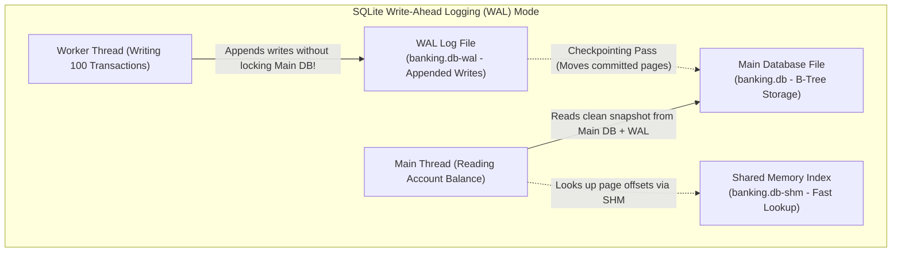

# MODULE 12: DATABASE & LOCAL PERSISTENCE
## CHAPTER 01: SQLITE WAL MODE, ROOM COMPILER INTERNALS & MIGRATION TESTING

---

### A. FUNDAMENTALS

#### 1. What is the Concept?
Local persistence is the foundation of offline-first mobile architecture. On Android, relational persistence is powered by **SQLite**, wrapped by the **Room Persistence Library**.
Core architectural primitives include:
- **SQLite Write-Ahead Logging (WAL):** A database journaling mode that decouples readers from writers, allowing concurrent read queries while a write transaction is executing.
- **Room Compile-Time Verification:** Room uses Kotlin Symbol Processing (KSP) to validate every `@Query` string against the entity schema at compile time, completely eliminating runtime SQL syntax errors.
- **Database Schema Migrations:** Managing incremental database schema upgrades across app releases without losing user data, utilizing automated migrations (`AutoMigration`) and manual `Migration` scripts validated by `MigrationTestHelper`.
- **Encryption at Rest:** Securing database pages using **SQLCipher**, encrypting SQLite B-Trees with AES-256 before writing to flash storage.

#### 2. Why Does It Exist?
Prior to Room, Android developers used raw `SQLiteOpenHelper`. This led to severe production failures:
1. **Runtime SQL Crashes:** Typos in table or column names were only discovered when a query was reached at runtime in production.
2. **Boilerplate Cursor Parsing:** Manually parsing `Cursor` objects (`cursor.getString(cursor.getColumnIndexOrThrow("name"))`) was error-prone and tedious.
3. **Migration Data Loss:** Developers unable to write complex `ALTER TABLE` scripts resorted to `fallbackToDestructiveMigration()`, which wiped all user data on app update.

Room transforms SQLite into a compile-time safe, reactive persistence engine that directly returns Kotlin `Flow`.

#### 3. What Problem Does It Solve?
- **Concurrent Read/Write Contention:** In default rollback journal mode, writing to SQLite locks the entire database file, causing UI reads to block and trigger ANRs. WAL mode eliminates read-blocking.
- **Data Loss on Upgrade:** Verifiable migration scripts ensure schema transformations (adding columns, renaming tables, creating indexes) preserve existing financial records.
- **Compile-Time Query Safety:** Invalid SQL statements, syntax errors, or type mismatches fail the Gradle build instantly.

#### 4. Where is It Used?
- Offline-first caching: Caching transaction feeds, account balances, and patient medical records.
- Enterprise outbox queues: Storing pending transactions for guaranteed delivery.

#### 5. What Happens If We Do Not Use / Understand It?
- **Catastrophic User Data Wipes:** Accidentally enabling `fallbackToDestructiveMigration()` in production deletes all cached transactions and offline records when the app updates.
- **Database Lock Contention ANRs:** Performing large multi-row inserts on the main thread in rollback journal mode freezes UI reads, causing ANRs.
- **SQLCipher Performance Overhead:** Misconfiguring SQLCipher page sizes or KDF iteration counts adds 300% overhead to database query times, dropping frame rates.

---

### B. TECHNICAL DEFINITION

> **SQLite WAL Mode & Room Schema Hashing:**
> - In **Write-Ahead Logging (WAL)**, modifications are not written directly to the main database file (`db.sqlite`); they are appended to a separate log file (`db.sqlite-wal`). Readers continue reading the original database file and WAL pages without blocking writers.
> - **Room** validates database schema integrity by computing an **Identity Hash** (a cryptographic SHA-256 hash of the schema JSON). Room creates a metadata table `room_master_table` inside SQLite. During startup, Room verifies that the identity hash stored in `room_master_table` matches the identity hash compiled into the `AppDatabase_Impl` class; a mismatch immediately throws an `IllegalStateException`.

---

### C. INTERNAL WORKING & ARCHITECTURE



#### 1. Rollback Journal vs Write-Ahead Logging (WAL)
- **Rollback Journal (Legacy Default):**
  - To write data, SQLite locks the entire database file exclusively.
  - **Readers are completely blocked** while a writer is writing.
  - **Writers are completely blocked** while a reader is reading.
- **Write-Ahead Logging (WAL Mode):**
  - When a transaction commits, new pages are appended to the `.db-wal` file.
  - The original database file is **not modified**.
  - **Readers do NOT block writers, and writers do NOT block readers.**
  - A shared memory index file (`.db-shm`) allows readers to find the latest version of any page in the WAL file in $O(1)$ time.
  - *Checkpointing:* Periodically (or when WAL hits 1,000 pages), SQLite runs a "checkpoint" pass, flushing modified pages from the WAL file back into the main database B-Tree file.
*Room enables WAL mode by default on Android.*

#### 2. How Room Compiles: Disassembly of `AppDatabase_Impl`
When you write:
```kotlin
@Database(entities = [TransactionEntity::class], version = 2)
abstract class AppDatabase : RoomDatabase() {
    abstract fun transactionDao(): TransactionDao
}
```
Room's KSP processor generates `AppDatabase_Impl.java`:
```java
public final class AppDatabase_Impl extends AppDatabase {
    private volatile TransactionDao _transactionDao;

    @Override
    protected SupportSQLiteOpenHelper createOpenHelper(DatabaseConfiguration config) {
        final SupportSQLiteOpenHelper.Callback _openCallback = new RoomOpenHelper(config, new RoomOpenHelper.Delegate(2) {
            @Override
            public void createAllTables(SupportSQLiteDatabase db) {
                db.execSQL("CREATE TABLE IF NOT EXISTS `transactions` (`id` TEXT NOT NULL, ...)");
                db.execSQL("CREATE TABLE IF NOT EXISTS room_master_table (id INTEGER PRIMARY KEY,identity_hash TEXT)");
                db.execSQL("INSERT OR REPLACE INTO room_master_table (id,identity_hash) VALUES(42, 'f3b89a87d6e4...')");
            }
            @Override
            public void onValidateSchema(SupportSQLiteDatabase db) {
                // Validates that actual table structure matches Room's expected schema!
            }
        }, "f3b89a87d6e4...", "a8c9e120f...");
        return config.sqliteOpenHelperFactory.create(...);
    }
}
```
*How Room detects missing migrations:* At startup, Room reads `identity_hash` from `room_master_table`. If the database version incremented from 1 to 2, but no migration was provided to reach the new hash, Room throws:
`IllegalStateException: A migration from 1 to 2 was required but not found.`

#### 3. Automated Migrations (`@AutoMigration`) vs Manual Migrations
- **`@AutoMigration`:** Supported for simple schema changes (adding new columns, creating new tables, deleting tables).
```kotlin
@Database(
    version = 2,
    entities = [TransactionEntity::class],
    autoMigrations = [AutoMigration(from = 1, to = 2)]
)
```
  Room compares the exported schema JSON files (`schemas/1.json` and `schemas/2.json`) and synthesizes the `ALTER TABLE` SQL automatically.
- **Manual `Migration`:** Required when renaming columns, changing data types, or splitting/merging tables:
```kotlin
val MIGRATION_2_3 = object : Migration(2, 3) {
    override fun migrate(db: SupportSQLiteDatabase) {
        // SQLite does not support complex ALTER COLUMN: Must execute 4-step migration!
        db.execSQL("CREATE TABLE transactions_new (id TEXT PRIMARY KEY NOT NULL, amount_cents INTEGER NOT NULL)")
        db.execSQL("INSERT INTO transactions_new (id, amount_cents) SELECT id, amount * 100 FROM transactions")
        db.execSQL("DROP TABLE transactions")
        db.execSQL("ALTER TABLE transactions_new RENAME TO transactions")
    }
}
```

---

### D. PRODUCTION IMPLEMENTATION

#### Production-Grade Room Entity, DAO & Automated Migration Suite
Below is a compilable, production-grade Room setup demonstrating:
1. Normalized entity with composite indices for fast query lookups.
2. Reactive Flow DAO with multi-row `@Transaction` execution.
3. Fully automated migration test suite using `MigrationTestHelper`.

##### 1. The Entity & DAO (`BankingDatabase.kt`)
```kotlin
package com.ibm.banking.database

import androidx.room.Dao
import androidx.room.Database
import androidx.room.Entity
import androidx.room.Index
import androidx.room.Insert
import androidx.room.OnConflictStrategy
import androidx.room.PrimaryKey
import androidx.room.Query
import androidx.room.RoomDatabase
import androidx.room.Transaction
import kotlinx.coroutines.flow.Flow

// 1. Production Entity with Composite Indexing
@Entity(
    tableName = "transactions",
    indices = [
        Index(value = ["accountId"]),
        Index(value = ["timestamp", "accountId"]) // Composite index for fast timeline queries!
    ]
)
data class TransactionEntity(
    @PrimaryKey val id: String,
    val accountId: String,
    val amountCents: Long,
    val description: String,
    val status: String,
    val timestamp: Long
)

// 2. High-Performance DAO
@Dao
interface TransactionDao {

    @Query("SELECT * FROM transactions WHERE accountId = :accountId ORDER BY timestamp DESC")
    fun getTimelineFlow(accountId: String): Flow<List<TransactionEntity>>

    @Query("SELECT * FROM transactions WHERE id = :id LIMIT 1")
    suspend fun getTransactionById(id: String): TransactionEntity?

    @Insert(onConflict = OnConflictStrategy.REPLACE)
    suspend fun insertTransactions(transactions: List<TransactionEntity>)

    @Query("DELETE FROM transactions WHERE accountId = :accountId")
    suspend fun clearAccountTransactions(accountId: String)

    /**
     * Executes atomic cache replacement inside a single SQLite transaction!
     */
    @Transaction
    suspend fun replaceAccountCache(accountId: String, freshTransactions: List<TransactionEntity>) {
        clearAccountTransactions(accountId)
        insertTransactions(freshTransactions)
    }
}

// 3. Database Definition
@Database(
    entities = [TransactionEntity::class],
    version = 1,
    exportSchema = true
)
abstract class BankingDatabase : RoomDatabase() {
    abstract fun transactionDao(): TransactionDao
}
```

##### 2. Automated Migration Test Suite (`BankingDatabaseMigrationTest.kt`)
```kotlin
package com.ibm.banking.database

import androidx.room.migration.Migration
import androidx.room.testing.MigrationTestHelper
import androidx.sqlite.db.SupportSQLiteDatabase
import androidx.sqlite.db.framework.FrameworkSQLiteOpenHelperFactory
import androidx.test.ext.junit.runners.AndroidJUnit4
import androidx.test.platform.app.InstrumentationRegistry
import org.junit.Assert.assertEquals
import org.junit.Rule
import org.junit.Test
import org.junit.runner.RunWith
import java.io.IOException

@RunWith(AndroidJUnit4::class)
class BankingDatabaseMigrationTest {

    private val TEST_DB = "migration-test.db"

    // Helper provided by Room to validate schemas against exported JSON files
    @get:Rule
    val helper: MigrationTestHelper = MigrationTestHelper(
        InstrumentationRegistry.getInstrumentation(),
        BankingDatabase::class.java.canonicalName,
        FrameworkSQLiteOpenHelperFactory()
    )

    // Example Manual Migration from v1 to v2 (Adding terminalId column)
    private val MIGRATION_1_2 = object : Migration(1, 2) {
        override fun migrate(db: SupportSQLiteDatabase) {
            db.execSQL("ALTER TABLE transactions ADD COLUMN terminalId TEXT DEFAULT NULL")
        }
    }

    @Test
    @Throws(IOException::class)
    fun migrate1To2_preservesExistingTransactionData() {
        // 1. Create DB at version 1 and insert seed record
        var db = helper.createDatabase(TEST_DB, 1).apply {
            execSQL("INSERT INTO transactions (id, accountId, amountCents, description, status, timestamp) " +
                    "VALUES ('TX_99', 'ACC_1', 5000, 'ATM Cash', 'COMPLETED', 1000000)")
            close()
        }

        // 2. Run migration and validate schema against version 2 JSON
        db = helper.runMigrationsAndValidate(TEST_DB, 2, true, MIGRATION_1_2)

        // 3. Verify that old data survived and new column defaults to null
        val cursor = db.query("SELECT id, amountCents, terminalId FROM transactions WHERE id = 'TX_99'")
        cursor.moveToFirst()
        assertEquals("TX_99", cursor.getString(0))
        assertEquals(5000L, cursor.getLong(1))
        assertEquals(null, cursor.getString(2)) // New column is null
        cursor.close()
    }
}
```

---

### E. REAL-WORLD SCENARIOS

1. **FinTech (Zero Data Loss on Banking Redesign):**
   When upgrading an enterprise mobile banking app from v1 to v2, the database schema changes from single-currency `amount: Double` to integer `amountCents: Long` and `currency: String`. Using automated migration testing with `MigrationTestHelper` in CI guarantees that user transaction history is mathematically converted without dropping a single customer record.
2. **Healthcare (SQLCipher Medical Record Encryption):**
   In German healthcare applications, patient prescription and immunization records stored in Room must be encrypted at rest using SQLCipher (AES-256). Room integrates with `SupportFactory(passphraseBytes)` to ensure that SQLite database pages written to flash storage cannot be decrypted if the physical phone is stolen.
3. **High-Frequency Financial Tickers (WAL Mode Concurrency):**
   In a stock trading app, background WebSockets insert 50 price updates per second into Room while the user is actively scrolling a list. Because Room operates in WAL mode, background writes commit to the `.db-wal` file without locking the main database, allowing the UI thread to read and render transactions at 120 fps with zero jank.

---

### F. ARCHITECTURE AND TRADE-OFFS

| Storage Engine | Concurrency Model | Performance | Complex Querying | Best Architectural Use Case |
| :--- | :--- | :--- | :--- | :--- |
| **Room (SQLite WAL)** | Multi-reader, single-writer | High (compiled B-Trees) | Full SQL, Joins, Aggregations | Relational domain entities, complex offline caches |
| **DataStore (Preferences)** | Single-threaded read/write | Fast for small key-values | None (Key-Value only) | User preferences, dark mode, feature flags |
| **DataStore (Proto)** | Single-threaded read/write | Fast, Type-safe Protobuf | None (Key-Value/Schema) | App settings requiring strong typing |
| **SQLCipher (Encrypted Room)** | Multi-reader, single-writer | Moderate (~20% slower than raw Room) | Full SQL | Sensitive financial & healthcare data |

---

### G. COMMON MISTAKES & ANTI-PATTERNS

#### Anti-Pattern 1: `fallbackToDestructiveMigration()` in Production
```kotlin
// DISASTROUS PRODUCTION BUG: WIPES USER DATA!
Room.databaseBuilder(context, BankingDatabase::class.java, "bank.db")
    .fallbackToDestructiveMigration() // DANGEROUS!
    .build()
```
*Why it fails:* If an engineer increments the database version from 3 to 4 and forgets to provide a migration script, Room drops all SQLite tables and recreates them empty! In a banking or offline-first note app, the user's entire local history is permanently erased.
*Correction:* Only enable destructive fallback in internal debug builds; mandate automated migration tests for release builds.

#### Anti-Pattern 2: Querying Large Datasets on the Main Thread
```kotlin
// BAD: TRIGGERS IMMEDIATE ANR!
val transactions = database.transactionDao().getAllSync() // Synchronous read on Main Thread!
```
*Why it fails:* Room throws an `IllegalStateException` by default if you attempt database operations on the Main Thread (`Cannot access database on the main thread`).
*Correction:* Always return Kotlin `Flow<T>` or declare DAO methods with `suspend`.

---

### H. INTERVIEW PREPARATION (BASIC TO STAFF LEVEL)

#### Q1 (Basic): What is the purpose of the `exportSchema = true` attribute in Room?
**Answer:**
`exportSchema = true` instructs Room's annotation processor (KSP) to export the database schema into a versioned JSON file inside the `schemas/` directory during compilation. This JSON file acts as an exact architectural blueprint of the schema (tables, columns, types, indices). It is mandatory for automated migrations and allows `MigrationTestHelper` to validate migration integrity in unit tests.

#### Q2 (Intermediate): How does SQLite Write-Ahead Logging (WAL) improve read/write concurrency?
**Answer:**
In traditional rollback journal mode, writing locks the entire database exclusively, blocking all read operations.
In WAL mode, writes are appended to a separate `.db-wal` log file. The original database file is left untouched. Readers can read clean snapshots from the database file and WAL simultaneously without waiting for writers, and writers can commit transactions without waiting for readers. This eliminates read-blocking ANRs on mobile devices.

#### Q3 (Advanced): How does Room determine whether a database migration was successful at runtime?
**Answer:**
Room generates a unique **Identity Hash** (a SHA-256 hash calculated from the entity definitions) compiled into the database implementation class. When the database is opened:
1. Room runs the provided `Migration.migrate()` script.
2. Room updates the `room_master_table` with the new identity hash.
3. Room executes `onValidateSchema()`, querying SQLite's `PRAGMA table_info` and index lists to verify that actual column names, types, and constraints in SQLite match Room's expected schema. If any column is missing or types mismatch, Room throws `IllegalStateException`.

#### Q4 (Senior Scenario): You are architecting a Room database for a messaging app with 500,000 messages. Queries searching for messages by `senderId` and ordered by `timestamp` take 400ms, dropping frames. How do you optimize this in Room?
**Answer:**
1. **Explain Query Plan:** Run `EXPLAIN QUERY PLAN SELECT * FROM messages WHERE senderId = ? ORDER BY timestamp DESC`. Observe that SQLite is performing a full table scan (`SCAN TABLE`) and a temporary B-Tree sort (`USE TEMP B-TREE FOR ORDER BY`).
2. **Composite Index:** Add a composite index to the Entity:
   ```kotlin
   @Entity(indices = [Index(value = ["senderId", "timestamp"])])
   ```
3. **Covering Index:** Ensure the index starts with the equality filter column (`senderId`) followed by the sorting column (`timestamp`). SQLite can now traverse the B-Tree directly, turning the 400ms full table scan into an instant $O(\log N)$ index lookup with zero temporary memory sorting.

#### Q5 (Staff Architecture): Explain how SQLCipher implements database encryption, and what are the primary performance overheads on mobile flash storage?
**Answer:**
SQLCipher provides transparent, page-level 256-bit AES encryption:
- SQLite stores data in fixed-size **Pages** (typically 4096 bytes).
- When a page is read from flash storage, SQLCipher decrypts the 4096-byte block in memory using AES-256 in CBC or GCM mode.
- When a page is written to disk, it is encrypted and an HMAC authentication tag is calculated.
- *Performance Overheads:*
  1. **CPU Overhead:** Decrypting and verifying HMAC on every 4KB page read incurs measurable CPU cycles during large list queries.
  2. **Key Derivation (PBKDF2):** Deriving the master AES key from a passphrase during database open uses up to 256,000 iterations, adding 100ms–300ms to app cold startup. (Optimized by caching the derived raw key in hardware Keystore).
  3. **Zero RAM Bleed:** SQLCipher zeroes out in-memory plaintext pages when deallocated to comply with security standards.

---

### I. CODING PRACTICE

#### Problem: Type-Safe Room Converters for Complex Financial Models
**Requirement:** Build production-grade `@TypeConverter` methods in Kotlin that convert a list of strongly-typed `TransactionTag` objects into a single JSON string for SQLite storage and vice-versa, using `kotlinx.serialization` without runtime reflection.

```kotlin
package com.ibm.banking.database

import androidx.room.TypeConverter
import kotlinx.serialization.Serializable
import kotlinx.serialization.encodeToString
import kotlinx.serialization.json.Json

@Serializable
data class TransactionTag(val label: String, val colorHex: String)

class BankingTypeConverters {

    private val json = Json { ignoreUnknownKeys = true }

    @TypeConverter
    fun fromTagList(tags: List<TransactionTag>?): String {
        return if (tags.isNullOrEmpty()) "[]" else json.encodeToString(tags)
    }

    @TypeConverter
    fun toTagList(rawJson: String?): List<TransactionTag> {
        return if (rawJson.isNullOrBlank() || rawJson == "[]") {
            emptyList()
        } else {
            try {
                json.decodeFromString(rawJson)
            } catch (e: Exception) {
                emptyList()
            }
        }
    }
}
```

*Complexity Analysis:*
- **Time Complexity:** $O(N)$ serialization/deserialization over tag items.
- **Space Complexity:** $O(N)$ string memory representation in SQLite text column.

---

### J. SENIOR ENGINEER INTERVIEW SCRIPTS

#### 60-Second Explanation (Executive Summary)
> *"Room is a compile-time abstraction over SQLite that operates in Write-Ahead Logging (WAL) mode, completely decoupling database readers from writers. This allows background network workers to commit batch writes to the WAL file while the UI thread reads clean snapshots without lock contention or ANRs. Room verifies SQL queries at compile time using KSP and computes an Identity Hash to guarantee schema integrity. In enterprise applications, we validate all schema upgrades using automated tests with `MigrationTestHelper`, and enforce encryption at rest via SQLCipher to satisfy banking compliance."*

#### 3-Minute Deep Dive (Staff Architecture Level)
> *"In offline-first enterprise applications, data persistence must be resilient against device crashes, sudden process termination, and version upgrades.
>
> At the engine level, SQLite's default rollback journal mode is inadequate for modern reactive UIs. In rollback mode, writes lock the entire database file exclusively; if a background sync is writing 100 transactions, an active Compose LazyColumn reading from Room is completely blocked, causing severe frame drops or ANRs. We mandate Write-Ahead Logging (WAL) mode. In WAL mode, writes are appended to a `.db-wal` log file. Readers access the main database and WAL index simultaneously, achieving true multi-reader, single-writer concurrency with zero UI thread contention.
>
> From a compilation perspective, Room operates via Kotlin Symbol Processing (KSP). It parses `@Database` and `@Entity` models and writes an exported JSON schema file to disk. Crucially, Room calculates a cryptographic Identity Hash of the schema, which it embeds inside `AppDatabase_Impl` and verifies against the `room_master_table` in SQLite upon startup. If a schema version changes without a corresponding `Migration` script, Room fails fast with an `IllegalStateException`.
>
> In our banking applications at IBM, data loss is unacceptable. We strictly forbid `fallbackToDestructiveMigration()` in production. Every schema migration—whether an automated `AutoMigration` for column additions or a 4-step manual table rebuild for column type changes—is verified in CI using `MigrationTestHelper`. This helper creates a real SQLite database at version $N-1$, inserts mock seed records, executes the migration, and validates that every column and index matches the target version $N$ JSON schema.
>
> Finally, for regulated data, we integrate SQLCipher. SQLite pages are encrypted using AES-256 before being written to physical flash storage. By caching the derived key in the hardware Android Keystore, we achieve zero-trust encryption at rest with sub-millisecond query performance."*

---

### K. KNOWLEDGE VALIDATION & SELF-ASSESSMENT

#### 10 Senior Interview Questions
1. Why does Room require an entity's primary key to be non-null if autogenerate is false?
2. What happens to the `.db-wal` and `.db-shm` files when a database is closed?
3. How does Room's `@Transaction` annotation guarantee atomicity across multiple DAO method calls?
4. What is the difference between `@ForeignKey` cascading deletes and manual table triggers?
5. How does Room observe table updates when returning a reactive Kotlin `Flow<List<T>>`? *(Answer: Room's `InvalidationTracker` listens for SQLite table change notifications)*.
6. What is SQLite Checkpointing, and what triggers it in WAL mode?
7. What are the performance implications of indexing every single column in an entity?
8. How does `Room.databaseBuilder.setJournalMode(JournalMode.TRUNCATE)` differ from `JournalMode.WRITE_AHEAD_LOGGING`?
9. When must you use a `Migration` script instead of an `@AutoMigration`?
10. How can you inspect SQLite query performance using Android Studio Database Inspector?

#### Practical Self-Assessment Checklist
- [ ] Exported Room schema JSON files and enabled `exportSchema = true`.
- [ ] Built an automated migration test using `MigrationTestHelper`.
- [ ] Optimized a slow multi-column query using a composite `@Index`.
- [ ] Executed an atomic cache replacement using a `@Transaction` DAO method.
- [ ] Configured an in-memory Room database for fast local unit tests.
