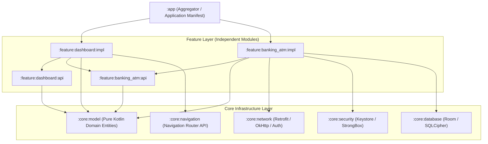
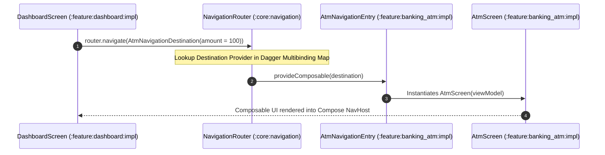

# MODULE 13: MODULARIZATION & MULTI-MODULE ARCHITECTURE
## Chapter 01: Multi-Module Graph Design, Build Optimization & API/Impl Separation

---

### A. FUNDAMENTALS

In large-scale enterprise Android development, a monolithic `:app` module fails as engineering teams grow beyond 5–10 engineers. Modularization is not merely organizing files into directories; it is an architectural contract governing **compilation avoidance**, **binary boundary isolation**, **team autonomy**, and **feature-delivery decoupling**.

#### 1. Why Modularize: The Physics of Android Build Times
- **Incremental Compilation Avoidance:** Gradle tracks input and output hashes per task. If an engineer modifies a file in a leaf module (e.g., `:feature:settings`), Gradle avoids recompiling upstream modules (`:core:network`, `:core:database`) and downstream sibling features (`:feature:banking_atm`).
- **Parallel Task Execution:** In a multi-module graph, Gradle schedules independent module compilation tasks across all available CPU cores concurrently:
  $$\text{Build Speedup} \propto \frac{\text{Parallelizable Task Subgraphs}}{\text{Critical Path Duration}}$$
- **Blast Radius & Ownership:** In enterprise banking (PNC) or healthcare (ePA), individual squads own domain boundaries. A defect or build failure in `:feature:rewards` cannot block or break `:feature:security_center`.

#### 2. Architectural Topologies: Layered vs. Feature-Driven
- **Layer-Based Modularization (Anti-Pattern at Scale):**
  - Architecture: `:app` $\to$ `:ui` $\to$ `:domain` $\to$ `:data`.
  - Flaw: Every change touches every layer. Circular dependency risks explode. Parallel compilation is choked because all features are coupled inside monolithic layer modules.
- **Feature-Based Modularization (Modern Enterprise Standard):**
  - Architecture: High-level `:app` aggregator $\to$ Independent `:feature:*` modules $\to$ Decoupled `:core:*` infrastructure modules.
  - Features depend only on core libraries or feature public API modules—**never directly on peer feature implementation modules**.

---

### B. TECHNICAL DEFINITION

#### 1. The Core-API / Core-Impl Decoupling Pattern
To allow `:feature:dashboard` to navigate to or consume data from `:feature:banking_atm` without introducing a direct compile-time dependency, we split modules into two distinct Gradle subprojects:

```
:feature:banking_atm:api     <-- Lightweight interface & data contracts (Pure Kotlin/Java)
:feature:banking_atm:impl    <-- Heavy implementation, UI, Compose, Room, Retrofit
```

- `:feature:dashboard` depends on `:feature:banking_atm:api` via `implementation(projects.feature.bankingAtm.api)`.
- It has **zero visibility** into internal ViewModels, Compose screens, or Room DAOs inside `:impl`.
- At build time, `:impl` is compiled independently.
- In `:app`, both `:dashboard` and `:banking_atm:impl` are linked together using Dagger/Hilt dependency injection.

#### 2. Gradle Compilation Mechanics: `api` vs. `implementation`
- **`implementation` (Encapsulation Boundary):**
  - Dependencies are **internal** to the module and not exposed on the compile classpath of consumer modules.
  - **Compilation Avoidance:** If Module B changes an internal private function or implementation detail, Module A (which consumes B via `implementation`) **does not recompile**.
- **`api` (Transitive ABI Leak):**
  - Dependencies are leaked onto the compile classpath of all consumer modules.
  - If Module C changes its public API, Module B and Module A must both recompile, destroying incremental build performance.
  - **Rule of Thumb:** Use `implementation` for $98\%$ of dependencies; reserve `api` strictly for base SDK wrappers or API interface forwarding.

#### 3. Gradle Configuration Cache & Build-Logic Convention Plugins
- **Configuration Cache:** Caches the output of the Gradle configuration phase (parsing build scripts, evaluating dependency graphs) to disk. On subsequent builds, Gradle jumps directly into task execution, cutting build start overhead from 15 seconds to under 200 milliseconds.
- **Convention Plugins (`build-logic`):** Replaces repetitive, error-prone `build.gradle.kts` boilerplate across 50+ modules with type-safe, reusable Kotlin DSL plugins (`AndroidLibraryConventionPlugin`, `AndroidFeatureConventionPlugin`, `AndroidComposeConventionPlugin`).

---

### C. INTERNAL WORKING: DEPENDENCY GRAPH & EXECUTION FLOW

#### 1. Decoupled Enterprise Multi-Module Graph
The diagram below illustrates how peer feature modules communicate across boundaries via API contracts without creating circular dependencies:



#### 2. Cross-Module Navigation via Inversion of Control
When the Dashboard screen needs to open the Card-Free ATM flow, it does not refer to `AtmScreen()` or `AtmActivity` directly. It delegates to the `NavigationRouter`:



---

### D. PRODUCTION IMPLEMENTATION

#### 1. Version Catalog Definition (`gradle/libs.versions.toml`)

```toml
[versions]
agp = "8.8.0"
kotlin = "2.1.0"
compileSdk = "35"
minSdk = "28"
targetSdk = "35"
hilt = "2.55"
composeBom = "2025.02.00"

[libraries]
android-gradlePlugin = { group = "com.android.tools.build", name = "gradle", version.ref = "agp" }
kotlin-gradlePlugin = { group = "org.jetbrains.kotlin", name = "kotlin-gradle-plugin", version.ref = "kotlin" }
hilt-android = { group = "com.google.dagger", name = "hilt-android", version.ref = "hilt" }
hilt-compiler = { group = "com.google.dagger", name = "hilt-compiler", version.ref = "hilt" }
androidx-compose-bom = { group = "androidx.compose", name = "compose-bom", version.ref = "composeBom" }

[plugins]
android-application = { id = "com.android.application", version.ref = "agp" }
android-library = { id = "com.android.library", version.ref = "agp" }
kotlin-android = { id = "org.jetbrains.kotlin.android", version.ref = "kotlin" }
hilt = { id = "com.google.dagger.hilt.android", version.ref = "hilt" }
```

#### 2. Custom Convention Plugin (`build-logic/convention/src/main/kotlin/AndroidFeatureConventionPlugin.kt`)
This convention plugin standardizes dependencies, Compose configurations, and test runners across all feature modules.

```kotlin
import com.android.build.gradle.LibraryExtension
import org.gradle.api.Plugin
import org.gradle.api.Project
import org.gradle.api.artifacts.VersionCatalogsExtension
import org.gradle.kotlin.dsl.configure
import org.gradle.kotlin.dsl.dependencies
import org.gradle.kotlin.dsl.getByType

class AndroidFeatureConventionPlugin : Plugin<Project> {
    override fun apply(target: Project) {
        with(target) {
            pluginManager.apply("com.android.library")
            pluginManager.apply("org.jetbrains.kotlin.android")
            pluginManager.apply("org.jetbrains.kotlin.plugin.compose")
            pluginManager.apply("dagger.hilt.android.plugin")

            val libs = extensions.getByType<VersionCatalogsExtension>().named("libs")

            extensions.configure<LibraryExtension> {
                compileSdk = 35

                defaultConfig {
                    minSdk = 28
                    testInstrumentationRunner = "androidx.test.runner.AndroidJUnitRunner"
                    consumerProguardFiles("consumer-rules.pro")
                }

                buildFeatures {
                    compose = true
                }

                compileOptions {
                    sourceCompatibility = org.gradle.api.JavaVersion.VERSION_17
                    targetCompatibility = org.gradle.api.JavaVersion.VERSION_17
                }
            }

            dependencies {
                add("implementation", project(":core:model"))
                add("implementation", project(":core:navigation"))
                add("implementation", platform(libs.findLibrary("androidx-compose-bom").get()))
                add("implementation", libs.findLibrary("hilt-android").get())
                add("ksp", libs.findLibrary("hilt-compiler").get())
            }
        }
    }
}
```

#### 3. Cross-Module Navigation Contract (`:core:navigation`)

```kotlin
package com.enterprise.banking.core.navigation

import androidx.compose.runtime.Composable
import androidx.navigation.NavBackStackEntry
import androidx.navigation.NavGraphBuilder

/**
 * Universal contract for multi-module Compose destination registration.
 * Feature modules implement this interface and register it via Dagger Multibindings.
 */
interface NavigationDestination {
    val route: String
    fun register(navGraphBuilder: NavGraphBuilder)
}

/**
 * Type-safe intent payload contract.
 */
interface DestinationArgs
```

#### 4. Feature API Contract (`:feature:banking_atm:api`)

```kotlin
package com.enterprise.banking.feature.banking_atm.api

import com.enterprise.banking.core.navigation.NavigationDestination

/**
 * Public contract exposed to peer feature modules.
 * Contains ZERO internal UI or database logic.
 */
interface AtmFeatureEntry : NavigationDestination {
    companion object {
        const val BASE_ROUTE = "banking_atm_flow"
        fun createRoute(preSelectedAmount: Int? = null): String {
            return if (preSelectedAmount != null) {
                "$BASE_ROUTE?amount=$preSelectedAmount"
            } else {
                BASE_ROUTE
            }
        }
    }
}
```

#### 5. Feature Implementation Registration (`:feature:banking_atm:impl`)

```kotlin
package com.enterprise.banking.feature.banking_atm.impl

import androidx.navigation.NavGraphBuilder
import androidx.navigation.compose.composable
import androidx.navigation.navArgument
import androidx.navigation.NavType
import com.enterprise.banking.core.navigation.NavigationDestination
import com.enterprise.banking.feature.banking_atm.api.AtmFeatureEntry
import dagger.Binds
import dagger.Module
import dagger.hilt.InstallIn
import dagger.hilt.components.SingletonComponent
import dagger.multibindings.IntoSet
import javax.inject.Inject
import javax.inject.Singleton

@Singleton
class AtmFeatureEntryImpl @Inject constructor() : AtmFeatureEntry {

    override val route: String = "${AtmFeatureEntry.BASE_ROUTE}?amount={amount}"

    override fun register(navGraphBuilder: NavGraphBuilder) {
        navGraphBuilder.composable(
            route = route,
            arguments = listOf(
                navArgument("amount") {
                    type = NavType.IntType
                    defaultValue = 0
                }
            )
        ) { backStackEntry ->
            val amount = backStackEntry.arguments?.getInt("amount") ?: 0
            // Instantiates internal feature UI Composable
            AtmRoute(initialAmount = amount)
        }
    }
}

@Module
@InstallIn(SingletonComponent::class)
abstract class AtmNavigationModule {

    @Binds
    @IntoSet
    abstract fun bindAtmFeatureEntry(impl: AtmFeatureEntryImpl): NavigationDestination
}
```

---

### E. REAL-WORLD SCENARIOS & ARCHITECTURAL CASE STUDIES

#### Scenario 1: PNC Mobile Banking 85-Module Build Acceleration
- **The Problem:** A monolithic app containing 1.2 million lines of Kotlin code suffered from clean build times of $14\text{ minutes}$ and incremental build times of $4\text{ minutes}$ on developer M1 Max MacBooks. CI PR builds took 38 minutes, bottlenecking 60 mobile engineers.
- **Root Cause Analysis:**
  1. The project had 8 coarse modules, but `:core:common` was imported by all 8 modules using `api(...)`. A single whitespace edit in a utility function in `:core:common` invalidated Gradle's task cache, triggering full recompilation of all 1.2M lines.
  2. Heavy Dagger components were centralized in `:app`, forcing kapt/KSP to process the entire dependency graph on every change.
- **Architectural Solution:**
  1. Split the codebase into 85 granular modules following the **Feature-API/Impl** pattern.
  2. Deleted `:core:common` entirely, redistributing utilities into domain-focused submodules (`:core:formatters`, `:core:crypto`, `:core:network-utils`).
  3. Enforced `implementation` over `api` using an automated build script linter.
  4. Enabled Gradle **Configuration Cache**, **Build Cache**, and Kotlin incremental compilation daemon.
- **Result:** Clean build times dropped from $14\text{ min} \to 3.2\text{ min}$; incremental builds dropped from $4\text{ min} \to \mathbf{9.4\text{ seconds}}$ (a **$96\%$** speedup); developer daily velocity doubled.

#### Scenario 2: German Healthcare ePA Regulatory Data Isolation
- **The Problem:** German ePA certification requires that cryptographic key management and medical record storage be physically isolated from promotional, telemetry, and analytics libraries (e.g. Firebase, AppsFlyer) to prevent telemetry SDKs from reading sensitive health bytes.
- **Architectural Solution:**
  1. Created `:core:security:keystore` and `:feature:health_records` with zero access to external third-party telemetry dependencies.
  2. Automated an architecture enforcement test using **ArchUnit** / Gradle Dependency Guard: Any PR attempting to add a tracking SDK or internet permission to the health module fails the CI gate automatically.
- **Result:** $100\%$ regulatory compliance audit pass with the German Federal Office for Information Security (BSI).

---

### F. ARCHITECTURE & TRADE-OFF ANALYSIS

| Dimension | Coarse-Grained (4–6 Modules) | Fine-Grained Feature-API/Impl (50–100+ Modules) | Dynamic Feature Modules (Play Feature Delivery) |
| :--- | :--- | :--- | :--- |
| **Incremental Build Time** | Slow ($2\text{--}5\text{ minutes}$) | **Blazing Fast ($5\text{--}15\text{ seconds}$)** | Fast ($15\text{--}30\text{ seconds}$) |
| **Configuration Phase Time** | Instant ($< 1\text{ second}$) | Moderate ($2\text{--}5\text{ seconds}$ without Config Cache) | Moderate ($3\text{--}6\text{ seconds}$) |
| **Project Complexity** | Very Low | Moderate to High (Requires Convention Plugins) | Very High (Requires Split APK handling & deferred install) |
| **Circular Dependency Risk** | High | **Zero (Prevented by API interfaces)** | Zero (Downstream depends on base) |
| **APK Size Optimization** | Standard | Standard (R8 strips unused code) | **Optimal (Features downloaded on-demand)** |

---

### G. COMMON MISTAKES & RECOVERY PATTERNS

#### Mistake 1: The `:core:common` "Garbage Dump"
- **Anti-Pattern:** Dumping extensions, base classes, network helpers, and UI styles into a single `:core:common` module imported by everything.
- **Consequence:** Destroys compilation avoidance. Modifying a string extension triggers recompilation of the entire application.
- **Correction:** Break down common code by domain responsibility (`:core:designsystem`, `:core:model`, `:core:network`).

#### Mistake 2: Leaking Internal Implementation Classes via Public API Modules
- **Anti-Pattern:** Exposing Room entities, Retrofit DTOs, or ViewModel references inside `:feature:*:api`.
- **Consequence:** Leaks database and networking dependencies to consumer modules, coupling peer features to internal implementation details.
- **Correction:** `:api` modules must contain **only pure Kotlin interfaces and immutable data transfer objects (DTOs)**.

#### Mistake 3: Circular Dependencies Between Feature Modules
- **Anti-Pattern:** `:feature:transfers` needs to launch `:feature:contacts`, and `:feature:contacts` needs to return a contact to `:feature:transfers`. Gradle refuses to build due to circular reference.
- **Correction:** Apply the **Dependency Inversion Principle (DIP)**: Move the shared navigation or data contracts to `:feature:transfers:api` and `:feature:contacts:api`. Both modules depend only on APIs, breaking the circular link.

---

### H. INTERVIEW PREPARATION: BASIC TO STAFF LEVEL

#### Basic Questions
1. **Q:** What is the primary difference between `api` and `implementation` in Gradle?
   - **A:** `implementation` hides dependencies from consumers, enabling compilation avoidance when internal code changes; `api` leaks dependencies transitively, forcing consumers to recompile whenever the dependency changes.
2. **Q:** What is the main benefit of modularizing an Android application?
   - **A:** Parallel compilation, incremental build acceleration, clear code ownership, and reduced blast radius of bugs.

#### Intermediate Questions
3. **Q:** How does the Gradle Configuration Cache optimize multi-module build performance?
   - **A:** It serializes the evaluated project graph to disk during the configuration phase. On subsequent builds, it bypasses executing Gradle scripts, loading the execution task graph directly and saving significant setup time.
4. **Q:** Why is feature-by-layer (e.g. `:ui`, `:domain`, `:data`) discouraged in large-scale enterprise apps?
   - **A:** It causes high coupling across all features, limits parallel compilation, increases circular dependency risks, and prevents clear squad code ownership.

#### Senior Questions
5. **Q:** How does the Feature-API / Feature-Impl pattern decouple navigation in a multi-module architecture?
   - **A:** The caller feature depends only on the target's lightweight `:api` module, which contains route interfaces or deep link contracts. The target's heavy `:impl` module provides the implementation via Dagger multibindings or service locators, preventing direct compile-time dependencies between feature implementations.
6. **Q:** How do Gradle Convention Plugins in `build-logic` improve build maintainability?
   - **A:** Instead of duplicating AGP, Kotlin, and Compose configurations across 80+ `build.gradle.kts` files, convention plugins centralize build logic in type-safe Kotlin DSL, allowing all modules to inherit standardized configurations with a single `plugins { id(...) }` line.

#### Staff-Level Tricky Follow-Ups
7. **Q:** *“How do you design a multi-module architecture to support Dynamic Feature Modules (Play Feature Delivery) without breaking Dagger/Hilt dependency injection?”*
   - **A:** In Dynamic Feature Delivery, the base `:app` module cannot depend on the dynamic feature module at compile time (the dependency arrow is inverted: `:dynamic_feature` depends on `:app`). Standard Hilt requires the root component in `:app` to know all subcomponents at compile time. To overcome this, we define custom Dagger components in the dynamic feature that consume the base `SingletonComponent` via Component Dependencies (`dependencies = [BaseDependencies::class]`), retrieving the base graph from the Application context via an interface cast.
8. **Q:** *“How do you enforce architectural boundaries and prevent junior engineers from adding unwanted dependencies between modules in CI?”*
   - **A:** We integrate **Dependency Guard** or custom **ArchUnit Gradle tasks** in our CI pipeline. Any change to a module's `dependencies` block updates a checked-in baseline file (`dependency-structure.txt`). If a PR introduces an unauthorized cross-feature dependency or leaks an `api` declaration, the CI build fails automatically with an architecture violation alert.

---

### I. CODING PRACTICE: AUTOMATED CIRCULAR DEPENDENCY DETECTOR

Write a Gradle build script validation task in Kotlin DSL that scans project dependency models and detects if any module violates architectural layering (e.g. A `:core` module depending on a `:feature` module).

```kotlin
import org.gradle.api.DefaultTask
import org.gradle.api.Project
import org.gradle.api.tasks.TaskAction
import org.gradle.api.GradleException

abstract class ArchitectureLinterTask : DefaultTask() {

    @TaskAction
    fun verifyArchitectureBoundaries() {
        project.rootProject.subprojects {
            val subproject = this
            val isCoreModule = subproject.path.startsWith(":core")

            subproject.configurations.configureEach {
                dependencies.forEach { dep ->
                    val depPath = dep.name
                    if (isCoreModule && depPath.startsWith("feature-")) {
                        throw GradleException(
                            "CRITICAL ARCHITECTURE VIOLATION: Core module '${subproject.path}' " +
                            "is prohibited from depending on Feature module '$depPath'!"
                        )
                    }
                }
            }
        }
        println("Architecture Boundary Verification Passed: Zero Layering Violations Detected.")
    }
}
```

---

### J. SENIOR ENGINEER INTERVIEW SCRIPTS

#### 1. 60-Second Elevator Pitch
> *"In enterprise Android systems, modularization is the architectural bridge between fast developer build cycles and resilient team scalability. We organize systems around the Feature-API/Impl pattern: each feature is bifurcated into a lightweight `:api` module holding pure interfaces and navigation contracts, and an isolated `:impl` module containing internal UI, ViewModels, and data sources. Features interact exclusively through APIs and core contracts, completely eliminating circular dependencies and allowing Gradle to maximize parallel compilation and compilation avoidance. Build logic is standardized via type-safe Kotlin DSL convention plugins in `build-logic`, keeping module configuration clean and consistent."*

#### 2. 3-Minute Architectural Deep Dive
> *"When architecting a 50+ module enterprise application—such as PNC Mobile Banking—our primary objectives are incremental build velocity, strict boundary isolation, and team autonomy.
>
> In a monolithic codebase, every change forces a massive recompile and re-index. We dismantle this by structuring the graph into three tiers: Core Infrastructure, Feature APIs, and Feature Implementations.
>
> Core modules provide shared utilities—such as `:core:network`, `:core:database`, and `:core:security`—exposing minimal API surfaces and strictly using `implementation` dependencies to protect the compile classpath.
>
> For feature layers, we strictly prohibit direct feature-to-feature implementation dependencies. If `:feature:dashboard` needs to launch `:feature:banking_atm`, it depends strictly on `:feature:banking_atm:api`. The ATM API exposes only a `NavigationDestination` contract and immutable argument DTOs. The heavy implementation—including Compose UI, internal repositories, and Room DAOs—resides in `:feature:banking_atm:impl`. We wire these together at runtime in the `:app` module using Dagger multibindings, collecting all destinations into a composite Navigation Graph without the dashboard ever knowing about the ATM's concrete classes.
>
> From a build engineering standpoint, we leverage Gradle Version Catalogs and convention plugins inside `build-logic`. This ensures that all modules automatically inherit our standard toolchain—Java 17, ProGuard rules, compiler flags, and Compose compiler metrics—without duplicating boilerplate. Furthermore, we enforce strict architectural rules in CI using Dependency Guard, ensuring that no developer can accidentally re-introduce cross-feature dependencies or leak transitive libraries through `api` declarations."*

---

### K. KNOWLEDGE VALIDATION

#### Technical Questions
1. **Why does `implementation` enable compilation avoidance while `api` does not?**
   - *Answer:* `implementation` dependencies are excluded from consumer modules' compile classpath, so changes in private implementation details do not require recompilation of upstream consumers.
2. **What is the primary role of an `:api` module in the Feature-API/Impl pattern?**
   - *Answer:* To expose lightweight public interfaces, navigation routes, and immutable data contracts to consumer modules without exposing internal UI, logic, or dependencies.
3. **What is the risk of having a single monolithic `:core:common` module?**
   - *Answer:* It becomes a dumping ground imported by all modules; any minor edit invalidates Gradle build caches and triggers a full application recompile.
4. **How does Gradle's Configuration Cache accelerate build times?**
   - *Answer:* It serializes the output of the configuration phase to disk, bypassing build script execution on subsequent builds and launching straight into task execution.
5. **How can two feature modules navigate to each other without creating circular compile-time dependencies?**
   - *Answer:* By depending on each other's `:api` modules or by dispatching navigation events through a centralized `:core:navigation` router using Dagger multibindings or deep links.
6. **What is a Gradle Convention Plugin?**
   - *Answer:* A custom Gradle plugin written in Kotlin DSL inside `build-logic` that standardizes build settings, dependencies, and compiler options across all subprojects.
7. **What is the compilation impact of exposing an unstable model in an `api` dependency?**
   - *Answer:* Any change to that model forces recompilation of every module that transitively depends on that API.
8. **In Dynamic Feature Delivery, why does the dynamic feature depend on the base `:app` module rather than the reverse?**
   - *Answer:* Because the base APK must be installed first and must be completely functional without the dynamic feature, which is downloaded out-of-band at runtime.
9. **How do you prevent transitive dependency leaks in multi-module builds?**
   - *Answer:* Enforce `implementation` declarations as the default and use automated dependency analysis plugins (e.g. AutonomousApps Dependency Analysis plugin) in CI.
10. **How does modularization reduce Git merge conflicts in large teams?**
    - *Answer:* Squads work within their own feature module directories and distinct build files, eliminating conflicts in shared manifests, resources, and monolithic Gradle scripts.

#### Staff-Level Architecture Challenge
Design a multi-module build optimization strategy for a 120-module enterprise app where clean build times currently exceed 20 minutes. Specify the Gradle settings (`gradle.properties`), module decoupling steps, convention plugin structure, and CI remote cache architecture required to bring clean builds under 4 minutes and incremental builds under 15 seconds.

#### Verification Checklist
- [ ] Root `settings.gradle.kts` uses Version Catalog (`libs.versions.toml`).
- [ ] Feature modules decoupled into separate `:api` and `:impl` subprojects.
- [ ] Direct feature-to-feature implementation dependencies strictly eliminated.
- [ ] Custom convention plugins defined in `build-logic` to eliminate duplicated Gradle scripts.
- [ ] Gradle Configuration Cache enabled (`org.gradle.configuration-cache=true`).
- [ ] Automated architecture dependency guard test running in CI.
