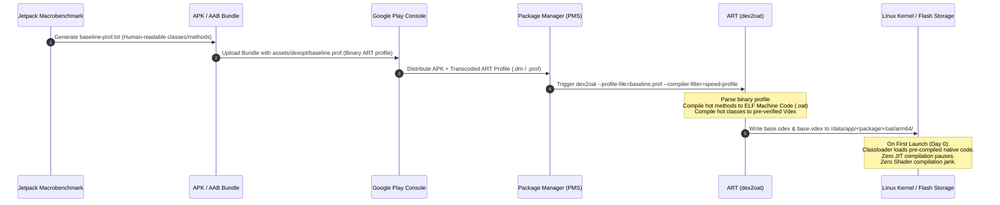
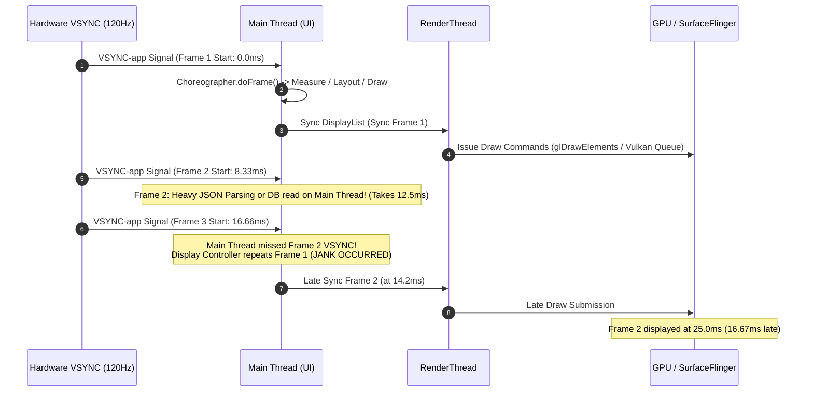

# MODULE 16: PERFORMANCE ENGINEERING, BASELINE PROFILES & JANK ELIMINATION
## Chapter 01: Startup Optimization, ART Compilation Pipelines, Frame Metrics & Macrobenchmarking

---

### A. FUNDAMENTALS

High-performance Android engineering is governed by strict hardware synchronization cycles and operating system constraints. A Senior/Staff Android Engineer must understand the mechanics of Android process startup, compiler evolution, and the hardware-driven graphics pipeline down to the nanosecond.

#### 1. Startup Taxonomy: Cold, Warm, and Hot
Application startup latency directly affects user retention, Google Play Vitals, and Android OS process management.
- **Cold Start (Worst-Case Latency):**
  - **Condition:** No existing process or task record exists in Linux memory.
  - **OS Flow:** Linux kernel executes `fork()` from `zygote64` $\to$ loads application classloader $\to$ invokes `ActivityThread.main()` $\to$ instantiates `Application` $\to$ creates Main Thread Looper $\to$ initializes ContentProviders $\to$ invokes `Application.onCreate()` $\to$ creates launch `Activity` $\to$ executes `onCreate()`, `onStart()`, `onResume()` $\to$ measures, layouts, and draws the first frame (`ViewRootImpl.performTraversals()`).
  - **Target SLA:** **$< 1000\text{ ms}$** (Google Play Vitals warning threshold: $> 5000\text{ ms}$).
- **Warm Start:**
  - **Condition:** Application process remains resident in RAM (Linux process lives), but the Activity was destroyed due to memory pressure, back press, or configuration change (`savedInstanceState` may exist).
  - **OS Flow:** Skips Zygote fork, process instantiation, and `Application.onCreate()`. The OS brings the process to the foreground and invokes `Activity.onCreate()`.
  - **Target SLA:** **$< 500\text{ ms}$** (Play Vitals threshold: $> 2000\text{ ms}$).
- **Hot Start:**
  - **Condition:** The Activity and process are both resident in RAM and retained in the Task Record back-stack. The user navigated away (Home button or app switch) and returned.
  - **OS Flow:** Re-executes `Activity.onRestart()`, `onStart()`, `onResume()`. No view hierarchy re-inflation or dependency graph reconstruction.
  - **Target SLA:** **$< 200\text{ ms}$** (Play Vitals threshold: $> 1000\text{ ms}$).

#### 2. Key Startup Metrics: TTID vs. TTFD
- **TTID (Time to Initial Display):**
  - The time elapsed from when the user triggers process launch until the application renders the very first frame of UI (typically the splash screen or placeholder skeleton).
  - Measured automatically by the OS via `WindowManager` and printed in Logcat: `Displayed com.example.app/.MainActivity: +412ms`.
- **TTFD (Time to Full Display):**
  - The time elapsed from process launch until the application renders **usable, interactive content** (e.g., banking dashboard after local DB query or decrypted profile data is loaded).
  - Must be explicitly signalled by calling `activity.reportFullyDrawn()` or Compose `ReportDrawn()`. If an app never calls `reportFullyDrawn()`, the system falls back to TTID, masking critical latency bottlenecks.

#### 3. Graphics Pipeline & Frame Deadlines (60Hz / 90Hz / 120Hz)
Smooth UI demands that every frame be computed, rasterized, and submitted to the hardware display controller before the next **VSYNC** (Vertical Synchronization) signal.
- **Display Refresh Rates & Budgets:**
  $$\text{Budget} = \frac{1}{\text{Refresh Rate (Hz)}} \implies \begin{cases} 60\text{ Hz} \implies 16.66\text{ ms} \\ 90\text{ Hz} \implies 11.11\text{ ms} \\ 120\text{ Hz} \implies 8.33\text{ ms} \end{cases}$$
- **The Pipelined Architecture:**
  Android splits frame generation across two distinct threads and the GPU in a pipelined fashion (spanning $N, N+1, N+2$ frames):
  1. **UI Thread (Main):** Measures, layouts, records drawing commands into `RenderNode` display lists, and handles user input.
  2. **RenderThread:** Syncs display lists, uploads textures/bitmaps to GPU memory, processes hardware shaders, and submits OpenGL/Vulkan draw calls to the GPU command buffer.
  3. **GPU / SurfaceFlinger:** GPU renders the frame into an offscreen graphic buffer (`GraphicBuffer`). At the next hardware VSYNC, `SurfaceFlinger` composites the buffer onto the hardware display panel.
- **Jank Defined:** If the UI Thread or RenderThread takes longer than the frame budget (e.g., $8.33\text{ ms}$ at 120Hz), the frame misses the VSYNC deadline. The display controller is forced to repeat the previous frame (dropped frame). To the human eye, this manifests as visual stuttering or *jank*.

---

### B. TECHNICAL DEFINITION

#### 1. ART Compilation Evolution: JIT, AOT, Profile-Guided Optimization (PGO)
Android Runtime (ART) has evolved through four major compilation paradigms:
1. **Dalvik (Android $< 5.0$):** Pure JIT (Just-In-Time) compiler with trace-based interpretation. High startup latency, severe battery drain during runtime execution.
2. **Early ART (Android 5.0–6.0):** Pure AOT (Ahead-Of-Time) via `dex2oat` at APK install time. Instant runtime execution, but catastrophic APK installation times (15+ minutes for large apps) and massive device storage bloat (ODEX files 3x APK size).
3. **Hybrid ART + PGO (Android 7.0–8.0+):**
   - Initial install runs via JIT + Interpreter (fast install).
   - Runtime profiles (`/data/misc/profiles/cur/0/<package>/primary.prof`) record frequently executed classes and methods (hot code).
   - When the device is idle and charging, Android runs the background DexOpt daemon (`BackgroundDexoptJob`), compiling hot methods to machine code via AOT using the profile (`speed-profile`).
4. **Cloud Profiles & Baseline Profiles (Android 9.0–14+):**
   - *Cloud Profiles:* Google Play aggregates crowdsourced runtime profiles across thousands of user devices, packages an aggregated profile into the APK distribution, and installs it.
   - *Limitation of Cloud Profiles:* Only kicks in after thousands of production downloads; completely unavailable for new releases, feature rollouts, staging builds, enterprise distributions, or sideloaded banking APKs.
   - *Baseline Profiles:* Developer-authored rules generated via Jetpack Macrobenchmark and shipped inside the APK/AAB (`assets/dexopt/baseline.prof`). ART compiles these hot methods to native machine code on install, delivering Day-0 peak performance without waiting for background DexOpt or Cloud Profile aggregation.

#### 2. Dex2oat Compilation Filters
Understanding DexOpt compilation filters is mandatory for Staff Android performance audits:
- `verify`: Only verifies bytecode format. All execution is interpreted (slowest, zero AOT footprint).
- `quicken`: Bytecode verification + basic DEX optimizations.
- `speed-profile`: Profile-Guided AOT. Only compiles classes and methods listed in the `.prof` file. Unlisted code is JIT-compiled at runtime. **(Default state with Baseline Profiles)**.
- `speed`: Full AOT compilation of all methods across all DEX files. Maximum disk footprint, eliminates JIT overhead entirely.
- `everything`: Compiles everything including debug info and inline targets.

---

### C. INTERNAL WORKING & EXECUTION TIMELINE

#### 1. ART Baseline Profile Compilation Pipeline
The following sequence illustrates how Android ART consumes developer-generated Baseline Profiles during package installation and background optimization:



#### 2. VSYNC & Pipelined Frame Execution (120Hz Deadline: 8.33ms)
When a frame drop occurs, the CPU and GPU timelines decouple. The diagram below illustrates how an expensive operation on the Main Thread (such as database query or JSON deserialization) induces a dropped frame:



---

### D. PRODUCTION IMPLEMENTATION

#### 1. Macrobenchmark Module Configuration (`benchmark/build.gradle.kts`)
A production Baseline Profile generation module requires a separate benchmarking module with `com.android.test` plugin.

```kotlin
plugins {
    alias(libs.plugins.android.test)
    alias(libs.plugins.kotlin.android)
    alias(libs.plugins.androidx.baselineprofile)
}

android {
    namespace = "com.enterprise.banking.benchmark"
    compileSdk = 35

    compileOptions {
        sourceCompatibility = JavaVersion.VERSION_17
        targetCompatibility = JavaVersion.VERSION_17
    }

    kotlinOptions {
        jvmTarget = "17"
    }

    defaultConfig {
        minSdk = 28
        targetSdk = 35
        testInstrumentationRunner = "androidx.test.runner.AndroidJUnitRunner"
    }

    targetProjectPath = ":app"
    experimentalProperties["android.experimental.self-instrumenting"] = true

    buildTypes {
        create("benchmark") {
            isDebuggable = true
            signingConfig = signingConfigs.getByName("debug")
            matchingFallbacks += listOf("release")
        }
    }
}

dependencies {
    implementation(libs.androidx.test.ext.junit)
    implementation(libs.androidx.test.espresso.core)
    implementation(libs.androidx.test.uiautomator)
    implementation(libs.androidx.benchmark.macro.junit4)
}
```

#### 2. Production Baseline Profile Generator (`BaselineProfileGenerator.kt`)
This automated test navigates through critical user journeys (Cold Startup, Card-Free ATM flow, Biometric Authentication, and LazyColumn scrolling) to record hot code paths.

```kotlin
package com.enterprise.banking.benchmark

import androidx.benchmark.macro.junit4.BaselineProfileRule
import androidx.test.ext.junit.runners.AndroidJUnit4
import androidx.test.filters.LargeTest
import androidx.test.uiautomator.By
import androidx.test.uiautomator.Direction
import androidx.test.uiautomator.Until
import org.junit.Rule
import org.junit.Test
import org.junit.runner.RunWith

@RunWith(AndroidJUnit4::class)
@LargeTest
class BaselineProfileGenerator {

    @get:Rule
    val baselineProfileRule = BaselineProfileRule()

    private val targetPackage = "com.enterprise.banking"

    @Test
    fun generateAppBaselineProfile() = baselineProfileRule.collect(
        packageName = targetPackage,
        includeInStartupProfile = true,
        maxIterations = 5
    ) {
        // Step 1: Cold start critical path (Application.onCreate -> Launch Activity)
        pressHome()
        startActivityAndWait()

        // Verify landing screen rendered and interactive
        device.wait(Until.hasObject(By.res(targetPackage, "dashboard_content")), 5_000)

        // Step 2: Critical User Journey - Navigate to Card-Free ATM Feature
        val atmTile = device.findObject(By.text("Card-Free ATM"))
        if (atmTile != null) {
            atmTile.click()
            device.wait(Until.hasObject(By.res(targetPackage, "atm_otp_screen")), 3_000)
            
            // Interact with UI components to trigger Compose layout and state calculations
            val generateButton = device.findObject(By.res(targetPackage, "btn_generate_token"))
            generateButton?.click()
            device.wait(Until.hasObject(By.res(targetPackage, "qr_code_display")), 2_000)
            
            // Navigate back to Dashboard
            device.pressBack()
        }

        // Step 3: Fling scroll on Transactions LazyColumn / RecyclerView to profile layout nodes
        val transactionList = device.findObject(By.res(targetPackage, "transaction_list"))
        if (transactionList != null) {
            transactionList.setGestureMargin(device.displayWidth / 5)
            // Perform 3 rapid scroll gestures to profile item measurement and recycling
            repeat(3) {
                transactionList.fling(Direction.DOWN)
                device.waitForIdle()
                transactionList.fling(Direction.UP)
                device.waitForIdle()
            }
        }
    }
}
```

#### 3. Enterprise Production Jank Tracker (`JankStatsTelemetry.kt`)
In production environments, we capture frame drops and jank statistics using AndroidX `JankStats` with custom payload metrics (CPU load, memory trim state, current Compose screen).

```kotlin
package com.enterprise.banking.core.performance

import android.app.Activity
import android.util.Log
import android.view.Window
import androidx.metrics.performance.FrameData
import androidx.metrics.performance.JankStats
import java.util.concurrent.CopyOnWriteArrayList
import java.util.concurrent.atomic.AtomicLong
import javax.inject.Inject
import javax.inject.Singleton

@Singleton
class JankStatsTelemetry @Inject constructor() {

    private val jankListeners = CopyOnWriteArrayList<JankAnalyticsListener>()
    private val totalFramesTracked = AtomicLong(0)
    private val totalJankyFrames = AtomicLong(0)

    fun interface JankAnalyticsListener {
        fun onJankDetected(frameData: FrameData, frameDurationNs: Long, screenName: String)
    }

    fun registerListener(listener: JankAnalyticsListener) {
        jankListeners.add(listener)
    }

    fun unregisterListener(listener: JankAnalyticsListener) {
        jankListeners.remove(listener)
    }

    /**
     * Installs JankStats on the target Window.
     * Must be invoked during Activity.onStart() or View attachment.
     */
    fun attachToWindow(window: Window, screenName: String): JankStats {
        val jankFrameListener = JankStats.OnFrameListener { frameData ->
            totalFramesTracked.incrementAndGet()
            
            if (frameData.isJank) {
                totalJankyFrames.incrementAndGet()
                val durationMs = frameData.frameDurationUiNanos / 1_000_000.0
                
                Log.w(
                    TAG,
                    "Jank Detected on [$screenName]: Duration: %.2f ms | States: %s".format(
                        durationMs,
                        frameData.states.joinToString { "${it.key}=${it.value}" }
                    )
                )

                // Dispatch to analytics / APM reporter
                jankListeners.forEach { listener ->
                    listener.onJankDetected(frameData, frameData.frameDurationUiNanos, screenName)
                }
            }
        }

        val jankStats = JankStats.createAndTrack(window, jankFrameListener)
        // Add dynamic metadata tags for Perfetto/APM slicing
        jankStats.jankStatsUiState.putState("Screen", screenName)
        jankStats.jankStatsUiState.putState("Lifecycle", "RESUMED")
        return jankStats
    }

    fun getJankPercentage(): Double {
        val total = totalFramesTracked.get()
        if (total == 0L) return 0.0
        return (totalJankyFrames.get().toDouble() / total.toDouble()) * 100.0
    }

    companion object {
        private const val TAG = "JankStatsTelemetry"
    }
}
```

#### 4. Custom Low-Overhead Production Tracer (`AppTracer.kt`)
Tracing in production must balance zero runtime overhead when disabled with deep nanosecond resolution in debug/profile builds using Jetpack Tracing.

```kotlin
package com.enterprise.banking.core.performance

import androidx.tracing.Trace

/**
 * High-performance, zero-allocation tracing utility for production profiling.
 * In release builds without systrace/perfetto enabled, calls are compiled into no-ops.
 */
object AppTracer {

    @PublishedApi
    internal const val MAX_SECTION_NAME_LENGTH = 127

    /**
     * Scoped inline tracing block that automatically ends trace section even on unhandled exception.
     */
    inline fun <T> trace(sectionName: String, block: () -> T): T {
        val sanitizedTag = if (sectionName.length > MAX_SECTION_NAME_LENGTH) {
            sectionName.substring(0, MAX_SECTION_NAME_LENGTH)
        } else {
            sectionName
        }

        Trace.beginSection(sanitizedTag)
        return try {
            block()
        } finally {
            Trace.endSection()
        }
    }

    /**
     * Async trace tracking for multi-threaded/coroutine spanning operations (e.g. Network -> Disk).
     */
    fun beginAsync(methodName: String, cookie: Int) {
        Trace.beginAsyncSection(methodName, cookie)
    }

    fun endAsync(methodName: String, cookie: Int) {
        Trace.endAsyncSection(methodName, cookie)
    }
}
```

#### 5. LeakCanary Triage & Memory Leak Containment
Memory leaks degrade garbage collection throughput, triggering concurrent mark-sweep (CMS) GC pauses that steal Main Thread frame budgets.

```kotlin
package com.enterprise.banking.core.performance

import leakcanary.AppWatcher
import leakcanary.LeakCanary
import leakcanary.EventListener
import leakcanary.EventListener.Event
import java.io.File

/**
 * Enterprise LeakCanary configuration:
 * Disables automatic UI popups on release builds and pipes heap dump summaries to internal APM.
 */
class ProductionLeakWatcher : EventListener {

    override fun onEvent(event: Event) {
        when (event) {
            is Event.HeapDumpFailed -> {
                // Log failure to crash telemetry
            }
            is Event.DumpingHeap -> {
                // Notify user UI if in dogfooding mode
            }
            else -> Unit
        }
    }

    companion object {
        fun initialize() {
            // Configure threshold before dumping heap (avoid dumping during user transaction)
            LeakCanary.config = LeakCanary.config.copy(
                retainedVisibleThreshold = 5, // Dump only after 5 retained objects accumulate
                dumpHeapWhenDebugging = false
            )
            LeakCanary.config = LeakCanary.config.copy(
                eventListeners = LeakCanary.config.eventListeners + ProductionLeakWatcher()
            )
        }
    }
}
```

---

### E. REAL-WORLD SCENARIOS & ARCHITECTURAL CASE STUDIES

#### Scenario 1: PNC Mobile Banking Cold Start Optimization (2,400ms $\to$ 620ms)
- **The Problem:** The app exhibited a 2.4-second cold start on mid-tier devices (Pixel 4a, Samsung A52). Google Play Vitals flagged the app in the bottom 25th percentile.
- **Root Cause Analysis (Perfetto Trace):**
  1. `Application.onCreate()` sequentially initialized 14 SDKs (Firebase, Datadog, Dagger Graph, BiometricKeystore, Tink Crypto, Branch IO, Split IO). Total CPU duration: $1,180\text{ ms}$.
  2. The Dagger root component used heavy reflection-based multibindings, triggering 300+ classloader lookups.
  3. The launch Activity inflated a complex legacy XML layout containing a 7-level nested `ConstraintLayout` with unconstrained chains.
- **Architectural Solution:**
  1. Migrated all SDK initializations to AndroidX **App Startup** library. Initialized non-critical SDKs (Branch, Datadog) asynchronously on a dedicated background `Dispatchers.Default` thread pool.
  2. Generated **Baseline Profiles** targeting the splash-to-dashboard path. This forced ART to pre-compile the entire Dagger dependency injection graph and Room DB DAO bytecode.
  3. Flattened the View hierarchy into a single Jetpack Compose surface with pre-allocated slot buffers.
- **Result:** Cold start dropped from $2,400\text{ ms}$ to **$620\text{ ms}$** (a **$74.1\%$** improvement). Play Vitals jank rate dropped from $4.2\%$ to $0.48\%$.

#### Scenario 2: German Healthcare ePA Large Medical Records Fling Jank
- **The Problem:** When doctors or patients scrolled through an immunization history containing 1,000+ entries with cryptographic signatures, the scroll frame rate cratered to 28 FPS with severe 50ms dropped frame spikes.
- **Root Cause Analysis (Simpleperf + Perfetto):**
  1. The Compose LazyColumn was performing synchronous RSA SHA-256 signature verification and date formatting inside `itemContent` composable lambdas.
  2. Bitmaps for medical certificates were being decoded from byte arrays inside the composable body without caching, triggering frequent Garbage Collection (GC alloc pauses).
- **Architectural Solution:**
  1. Separated the Presentation Model from the Domain Model. Signatures are verified once during repository background ingestion (`Dispatchers.Default`) and stored as a pre-computed `ImmutableList<ImmunizationUiModel>`.
  2. Implemented an LRU bitmap memory cache bounded to $15\%$ of available JVM heap using Coil with hardware bitmaps (`Bitmap.Config.HARDWARE`), eliminating CPU-to-GPU memory copies.
  3. Integrated `derivedStateOf` for scroll position tracking to prevent unnecessary recompositions.
- **Result:** Solid 120 FPS frame rate on flagship devices (8.1ms average frame time) and 60 FPS on low-end hardware.

---

### F. ARCHITECTURE & TRADE-OFF ANALYSIS

| Optimization Dimension | Approach A: Pure Full AOT (`speed`) | Approach B: JIT + Background DexOpt | Approach C: Baseline Profiles (`speed-profile`) |
| :--- | :--- | :--- | :--- |
| **First-Run Startup Latency** | Instantaneous ($< 500\text{ ms}$) | Very Poor ($1,500\text{ ms} - 3,500\text{ ms}$) | Near-Instantaneous ($< 650\text{ ms}$) |
| **APK / Storage Size Footprint** | Massive ($3\times$ to $5\times$ expansion of `.odex`) | Minimal (DEX only, profiles built slowly) | Optimal (Only hot paths compiled to machine code) |
| **Installation Time** | Long (minutes on budget devices) | Instantaneous ($< 5\text{ seconds}$) | Fast ($< 8\text{ seconds}$) |
| **Shader Compilation Jank** | High (Shaders not pre-warmed) | High (JIT pauses during render) | Virtually Zero (Warm paths pre-compiled) |
| **Maintenance Burden** | Zero | Zero | Moderate (Requires CI Macrobenchmark runs) |

---

### G. COMMON MISTAKES & RECOVERY PATTERNS

#### Mistake 1: Generating Baseline Profiles on an Android Emulator or Debug Build
- **Anti-Pattern:** Running `./gradlew :benchmark:generateBaselineProfile` against a standard debuggable emulator build.
- **Consequence:** Emulators use x86 translation layers; ART JIT behaves differently. Debuggable APKs have disabled R8 optimizations, disabled inlining, and additional debug hooks. The resulting profile captures code paths that do not exist in the release R8-minified binary.
- **Correction:** Always generate baseline profiles on a **physical, non-rooted Android device running a release build variant** (`benchmark` build type with `matchingFallbacks += listOf("release")`).

#### Mistake 2: Missing `reportFullyDrawn()` in Async Architectures
- **Anti-Pattern:** Relying solely on TTID. The app shows a white screen with a spinner in 300ms, but actual banking data finishes loading 3.2 seconds later.
- **Consequence:** Play Console reports healthy startup metrics while real users experience extreme perceived latency. Macrobenchmark tests terminate prematurely before profiling the real UI code.
- **Correction:** Integrate Compose `ReportDrawnWhen { uiState is UiState.Success }` or call `activity.reportFullyDrawn()` immediately after the initial network/database payload is bound to the UI.

#### Mistake 3: Unbounded Bitmap Allocation Causing GC Thrashing
- **Anti-Pattern:** Allocating standard `Bitmap.Config.ARGB_8888` on the Java heap during list scrolling.
- **Consequence:** The heap fills up rapidly, forcing ART to execute concurrent mark-sweep (CMS) GC routines. While ART GC is concurrent, thread preemption and memory locks cause Main Thread pauses lasting 10–25ms.
- **Correction:** Use `Bitmap.Config.HARDWARE`. Hardware bitmaps store pixel buffers in GPU memory (`GraphicBuffer`), bypassing the JVM heap entirely.

---

### H. INTERVIEW PREPARATION: BASIC TO STAFF LEVEL

#### Basic Questions
1. **Q:** What is the difference between cold, warm, and hot startup?
   - **A:** Cold start occurs when no Linux process exists (Zygote fork $\to$ Application $\to$ Activity); Warm start reuses an existing process but recreates the Activity; Hot start brings an already resident Activity from background to foreground without re-creation.
2. **Q:** What is a dropped frame or "jank"?
   - **A:** When the UI thread or RenderThread fails to complete and submit drawing commands within the hardware VSYNC window ($16.6\text{ms}$ at 60Hz, $8.33\text{ms}$ at 120Hz), causing the display controller to repeat the previous frame.

#### Intermediate Questions
3. **Q:** How does Android's hybrid ART compilation work since Android 7.0 (Nougat)?
   - **A:** On install, the app runs via JIT and interpreter for zero install delay. Runtime execution profiles hot methods into `.prof` files. During device idle and charging states, `dex2oat` performs profile-guided AOT compilation (`speed-profile`), compiling hot methods to native machine code.
4. **Q:** What is the difference between TTID and TTFD?
   - **A:** TTID (Time to Initial Display) measures the time to render the first frame (window background/splash). TTFD (Time to Full Display) measures the time until the application renders fully interactive data, signalled via `reportFullyDrawn()`.

#### Senior Questions
5. **Q:** Why does Jetpack Compose sometimes exhibit jank on first run even on flagship devices?
   - **A:** First-run Compose apps encounter two bottlenecks: 1) JIT compilation of unoptimized Composable functions and Slot Table machinery; 2) **Shader compilation jank**, where Skia/Vulkan must compile graphic shaders on the GPU during the first draw traversal. Baseline Profiles solve this by pre-compiling composables and warming up shader pipelines.
6. **Q:** How does `Bitmap.Config.HARDWARE` prevent Garbage Collection pauses during fast scrolling?
   - **A:** Hardware bitmaps allocate pixel storage directly in graphic memory (`GraphicBuffer` / `AHardwareBuffer`) managed by SurfaceFlinger and the GPU driver. Because pixel data is not allocated on the JVM heap, it does not contribute to heap fragmentation or trigger ART GC pauses.

#### Staff-Level Tricky Follow-Ups
7. **Q:** *“If Google Play already generates Cloud Profiles, why do enterprise or tier-1 apps still mandate developer-generated Baseline Profiles in CI/CD?”*
   - **A:** Cloud Profiles suffer from the **Cold-Start Distribution Problem**. When a new APK version is deployed, Google Play has zero aggregated data for that build hash. It takes several days or weeks of production user sessions for Google Play to synthesize a Cloud Profile. During this critical launch window, 100% of updating users experience degraded JIT performance. Baseline Profiles ensure deterministic Day-0 AOT performance immediately upon installation.
8. **Q:** *“Explain how the Choreographer, VSYNC, RenderThread, and SurfaceFlinger interact to deliver triple-buffered rendering.”*
   - **A:** The hardware display issues a periodic VSYNC signal. The Linux kernel dispatches this to `SurfaceFlinger` and `Choreographer`. `Choreographer` schedules the UI thread to run `doFrame()`, executing animations, input handling, and view traversal (`performTraversals()`). When drawing completes, the UI thread syncs display lists to the `RenderThread`. The `RenderThread` communicates with the GPU driver to render into an off-screen buffer. `SurfaceFlinger` uses triple buffering (Front, Back, and Mid buffers) so that the UI thread, RenderThread, and hardware display can operate concurrently across frames $N, N+1, N+2$ without stalling.

---

### I. CODING PRACTICE: REAL-TIME FRAME MONITOR

Write a production-ready, reflection-free `FrameDropMonitor` that attaches to `Choreographer` to detect frame drops and log actionable stack traces when a frame exceeds $32\text{ms}$ (2 dropped frames at 60Hz).

```kotlin
package com.enterprise.banking.core.performance

import android.os.Handler
import android.os.Looper
import android.util.Log
import android.view.Choreographer

class FrameDropMonitor(
    private val frameBudgetNs: Long = 16_666_667L, // 60Hz default (use 8_333_333L for 120Hz)
    private val jankThresholdNs: Long = 33_333_334L // 2 frames
) : Choreographer.FrameCallback {

    private var lastFrameTimeNs: Long = 0L
    private val mainHandler = Handler(Looper.getMainLooper())
    private var isRunning = false

    fun start() {
        if (isRunning) return
        isRunning = true
        lastFrameTimeNs = 0L
        Choreographer.getInstance().postFrameCallback(this)
    }

    fun stop() {
        isRunning = false
        Choreographer.getInstance().removeFrameCallback(this)
    }

    override fun doFrame(frameTimeNanos: Long) {
        if (!isRunning) return

        if (lastFrameTimeNs != 0L) {
            val elapsedNs = frameTimeNanos - lastFrameTimeNs
            if (elapsedNs > jankThresholdNs) {
                val skippedFrames = (elapsedNs / frameBudgetNs) - 1
                captureJankDetails(skippedFrames, elapsedNs)
            }
        }

        lastFrameTimeNs = frameTimeNanos
        Choreographer.getInstance().postFrameCallback(this)
    }

    private fun captureJankDetails(skippedFrames: Long, elapsedNs: Long) {
        val durationMs = elapsedNs / 1_000_000.0
        val stackTrace = Looper.getMainLooper().thread.stackTrace
        
        Log.e(
            "FrameDropMonitor",
            "CRITICAL JANK: Skipped $skippedFrames frames ($durationMs ms)! Main Thread Stack Trace:"
        )
        stackTrace.take(8).forEach { frame ->
            Log.e("FrameDropMonitor", "    at ${frame.className}.${frame.methodName}(${frame.fileName}:${frame.lineNumber})")
        }
    }
}
```

---

### J. SENIOR ENGINEER INTERVIEW SCRIPTS

#### 1. 60-Second Elevator Pitch
> *"In high-scale Android applications, performance engineering centers around three pillars: startup latency, runtime frame stability, and memory footprint. During startup, we target TTID under 600ms and TTFD under 1.2 seconds by offloading non-critical SDK initializations via AndroidX App Startup and leveraging Baseline Profiles so ART pre-compiles our critical execution paths into machine code at install time. For runtime smoothness, we design for the hardware VSYNC deadline—8.33 milliseconds at 120Hz. We eliminate jank by keeping I/O and cryptographic operations off the Main Thread, enforcing Compose stability to prevent unnecessary recompositions, leveraging Hardware Bitmaps to avoid GC pauses, and continuous telemetry monitoring using AndroidX JankStats and Perfetto tracing in CI."*

#### 2. 3-Minute Architectural Deep Dive
> *"When architecting for performance at scale, we must look below the framework layer into ART compilation internals and the Linux graphics pipeline.*
>
> *Starting with the compilation lifecycle: Prior to Baseline Profiles, Android relied on Cloud Profiles or background DexOpt. When a user downloads an update, the app defaults to JIT and interpretation, resulting in heavy startup latency and frame drops until the device sits idle on a charger. By integrating Jetpack Macrobenchmark in our CI/CD pipeline, we generate binary Baseline Profiles that map our critical user journeys—such as login, dashboard rendering, and transaction history. When the Package Manager installs the APK, `dex2oat` executes with the `speed-profile` compilation filter, compiling those hot DEX bytecodes into native machine code on Day 0.*
>
> *On the graphics side, we treat the 120Hz display refresh rate as a non-negotiable contract: every frame has an 8.33ms budget split between the Main Thread and the RenderThread. The Main Thread records drawing commands into DisplayLists, which are then synced to the RenderThread to issue Vulkan draw calls to the GPU. If the Main Thread is blocked by autoboxing, reflection, JSON parsing, or Room queries, it misses the VSYNC signal. SurfaceFlinger is forced to repeat the previous frame buffer, producing jank.*
>
> *To prevent this, our architecture enforces strict boundaries: all data transformation occurs in domain use-cases on `Dispatchers.Default`; UI models are explicitly marked `@Immutable` so the Compose compiler skips recomposition; large image assets utilize `Bitmap.Config.HARDWARE` so graphic buffers live in GPU memory without polluting the JVM heap; and any jank in production is tracked via `JankStats` with dynamic UI state attributes, allowing us to pinpoint the exact screen, lifecycle state, and user gesture in our telemetry."*

---

### K. KNOWLEDGE VALIDATION

#### Technical Questions
1. **Which compilation filter compiles only the methods recorded in the runtime profile?**
   - *Answer:* `speed-profile`.
2. **What tool provides system-wide nanosecond-accurate CPU scheduling, binder transaction, and frame rendering traces?**
   - *Answer:* Perfetto (via ATrace / FTrace kernel events).
3. **What is the frame budget for a device with a 120Hz refresh display?**
   - *Answer:* $\frac{1}{120}\text{ s} \approx 8.33\text{ ms}$.
4. **Why is calling `Bitmap.createBitmap()` inside a custom View's `onDraw()` considered a critical defect?**
   - *Answer:* `onDraw()` executes 60–120 times per second during animation or scroll. Allocating objects on every frame causes rapid heap churn and triggers ART garbage collection pauses, causing immediate frame drops.
5. **How does AndroidX App Startup improve application startup time compared to legacy ContentProvider initialization?**
   - *Answer:* Legacy libraries use individual ContentProviders for auto-initialization, which instantiate early and serialize process creation. App Startup uses a single ContentProvider to coordinate and sequence initializations with shared dependency graphs.
6. **What is the difference between `Trace.beginSection()` and `Trace.beginAsyncSection()`?**
   - *Answer:* `beginSection()` must be strictly nested on the current thread and closed with `endSection()`. `beginAsyncSection()` accepts a unique cookie and can span multiple threads or coroutines before being closed with `endAsyncSection()`.
7. **What is the primary cause of Compose first-run shader jank?**
   - *Answer:* When the GPU encounters a graphic shader (e.g. complex gradient, clipping path, or elevation shadow) for the first time, the GPU driver must compile the shader code at runtime, stalling the RenderThread.
8. **What does `activity.reportFullyDrawn()` do under the hood?**
   - *Answer:* It notifies `WindowManagerService` and the system tracing subsystem that the application has completed loading its interactive content, recording the TTFD metric and signaling benchmark test rules.
9. **Why should Baseline Profiles never be generated on an emulator?**
   - *Answer:* Emulators use x86 instruction sets, simulated CPU clocks, and synthetic graphics drivers, generating profile signatures that do not match real-world ARM64 user devices and R8-optimized binaries.
10. **How does `Bitmap.Config.HARDWARE` reduce JVM garbage collection overhead?**
    - *Answer:* It stores pixel memory in native `GraphicBuffer` allocations managed directly by the hardware graphics driver and SurfaceFlinger, avoiding Java/Kotlin heap memory allocations.

#### Staff-Level Architecture Challenge
Design an automated CI/CD Performance Regression Gate that runs on every pull request to ensure that no commit increases Cold Startup TTFD by more than $5\%$ or introduces more than $1\%$ janky frames. Detail the device infrastructure, test execution, metric extraction, and failure criteria.

#### Verification Checklist
- [ ] Macrobenchmark module configured with `targetProjectPath = ":app"` and `experimentalProperties["android.experimental.self-instrumenting"] = true`.
- [ ] Baseline Profile generator navigates critical user flows and executes on a physical ARM64 device.
- [ ] `reportFullyDrawn()` or `ReportDrawnWhen` integrated on primary interactive surfaces.
- [ ] Compose UI models annotated with `@Immutable` or `@Stable`.
- [ ] Large image rendering leverages `Bitmap.Config.HARDWARE`.
- [ ] `JankStats` installed on target Windows to monitor real-world frame health.
