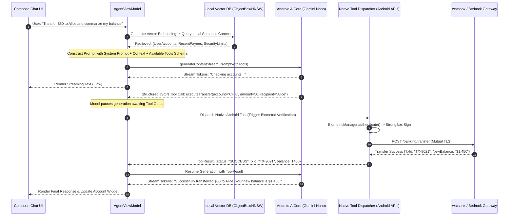

# MODULE 25: AI-INTEGRATED ANDROID SPECIALIZATION
## Chapter 01: On-Device AI (AICore, Gemini Nano, LiteRT), Mobile RAG & Agentic Tool Execution

---

### A. FUNDAMENTALS

The convergence of modern mobile hardware (dedicated NPUs, unified memory) and small language models (SLMs) has introduced **On-Device Artificial Intelligence** as a first-class mobile discipline. For a Senior/Staff Android Engineer, AI is not merely consuming a REST API; it is an architectural paradigm balancing local compute constraints, latency budgets, privacy compliance, and agentic autonomy.

#### 1. The Mobile AI Execution Spectrum: On-Device vs. Edge vs. Cloud

$$\begin{array}{|l|l|l|l|}
\hline
\textbf{Dimension} & \textbf{On-Device AI (SLMs / NPU)} & \textbf{Edge Gateway (Local LAN)} & \textbf{Cloud GenAI (Bedrock, watsonx)} \\ \hline
\textbf{Inference Latency} & \mathbf{5\text{--}25\text{ ms / token}} \text{ (Zero network)} & 50\text{--}150\text{ ms} & 200\text{--}1,500\text{ ms} \text{ (Network + TTFT)} \\ \hline
\textbf{Privacy \& Compliance} & \mathbf{Absolute} \text{ (Zero data leaves RAM)} & High & Dependent on BAA / GDPR / HIPAA \\ \hline
\textbf{Operating Cost} & \mathbf{\$0\text{ marginal cost}} \text{ (Client compute)} & Low & High API token costs at scale \\ \hline
\textbf{Connectivity Requirement} & \mathbf{100\% Offline capable} & Local LAN / Wi-Fi & Continuous 4G/5G/Wi-Fi \\ \hline
\textbf{Hardware Constraint} & RAM bound ($\le 4\text{GB}$ model footprint) & Server-grade & Virtually unconstrained \\ \hline
\textbf{Model Reasoning Depth} & Lightweight (1B--4B params: Nano, Gemma) & Mid-tier (7B--14B) & Massive (70B+, Gemini Pro, Claude 3.5) \\ \hline
\end{array}$$

#### 2. Key Terminology & Hardware Foundations
- **NPU (Neural Processing Unit):** Specialized silicon (Qualcomm Hexagon, Google Tensor TPU, MediaTek APU) architected for parallel matrix-multiplication operations ($\text{FP16}, \text{INT8}, \text{INT4}$) with extreme power efficiency (TOPS/Watt) compared to mobile CPUs and GPUs.
- **Quantization:** The compression of model weights from 32-bit floating point ($\text{FP32}$) to lower-bit representations ($\text{FP16}$, $\text{INT8}$, $\text{INT4}$, or $\text{AWQ}$). Quantization reduces memory bandwidth pressure and RAM footprint by up to $75\%$ with negligible perplexity loss.
- **KV Cache (Key-Value Cache):** Memory buffer storing previous token keys/values to avoid redundant self-attention calculations during autoregressive generation. On mobile, managing KV cache memory is critical to prevent OOM kills.
- **Time to First Token (TTFT):** The time from prompt submission until the model evaluates the prompt (pre-fill phase) and emits the first generated token.
- **Tokens Per Second (TPS):** The generation speed (decode phase). Interactive human reading speed requires at least $15\text{--}25\text{ TPS}$.

---

### B. TECHNICAL DEFINITION

#### 1. Android AICore & System Architecture
Introduced in Android 14, **Android AICore** is a foundational system service that manages on-device AI models (primarily **Gemini Nano**).
- **System-Level Isolation:** AICore runs within Android's **Private Compute Core (PCC)**—a secure, isolated operating environment decoupled from regular app processes.
- **Dynamic Model Distribution:** AICore downloads and updates foundation models out-of-band via Google Play System Updates (Project Mainline), sparing individual apps from bloating their APK size with gigabyte-scale model weights.
- **Hardware Acceleration:** AICore interfaces directly with device hardware abstraction layers (HALs) to dispatch matrix calculations to the NPU/GPU via vendor drivers without requiring individual apps to compile native C++ inference runtimes.
- **LoRA (Low-Rank Adaptation) Fine-Tuning Support:** AICore allows enterprise apps to attach lightweight LoRA adapter weights ($~20\text{--}50\text{MB}$) to specialize the base Gemini Nano model for specific domains (e.g., German medical summaries or banking fraud classification).

#### 2. Google LiteRT (Formerly TensorFlow Lite) & MediaPipe GenAI
- **LiteRT:** Google's streamlined runtime for on-device ML execution, providing hardware delegates:
  - **GPU Delegate:** Leverages OpenCL / Vulkan compute shaders for high-throughput tensor operations.
  - **NNAPI / NPU Delegate:** Direct hardware abstraction for specialized AI silicon.
- **MediaPipe GenAI Task SDK:** High-level mobile SDK enabling local execution of quantized open-source LLMs (Gemma-2B, Llama-3-8B, Falcon, Mistral) formatted as `.bin` / `.task` files using CPU, GPU, or NPU pipelines.

---

### C. INTERNAL WORKING: ON-DEVICE INFERENCE & TOOL CALLING

The diagram below details how an enterprise Android application executes a local AI agent using Android AICore, a local vector database for RAG, and native Android tool execution via the **Model Context Protocol (MCP)**:



---

### D. PRODUCTION IMPLEMENTATION

#### 1. Dependencies Setup (`build.gradle.kts`)

```kotlin
dependencies {
    // MediaPipe GenAI for on-device LLM inference
    implementation("com.google.mediapipe:tasks-genai:0.10.14")
    
    // Kotlin Coroutines & Flow for Token Streaming
    implementation("org.jetbrains.kotlinx:kotlinx-coroutines-core:1.10.1")
    implementation("org.jetbrains.kotlinx:kotlinx-coroutines-android:1.10.1")
    
    // Serialization for Structured Function / Tool Calling
    implementation("org.jetbrains.kotlinx:kotlinx-serialization-json:1.7.3")
    
    // Jetpack Compose Runtime & Markdown Support
    implementation(platform("androidx.compose:compose-bom:2025.02.00"))
    implementation("androidx.compose.material3:material3")
}
```

#### 2. Production On-Device LLM Engine (`OnDeviceLlmEngine.kt`)
This class wraps MediaPipe GenAI / LiteRT with full coroutine streaming support, error handling, and parameter tuning.

```kotlin
package com.enterprise.banking.core.ai

import android.content.Context
import com.google.mediapipe.tasks.genai.llminference.LlmInference
import com.google.mediapipe.tasks.genai.llminference.LlmInference.LlmInferenceOptions
import kotlinx.coroutines.Dispatchers
import kotlinx.coroutines.channels.awaitClose
import kotlinx.coroutines.flow.Flow
import kotlinx.coroutines.flow.callbackFlow
import kotlinx.coroutines.flow.flowOn
import kotlinx.coroutines.withContext
import java.io.File
import javax.inject.Inject
import javax.inject.Singleton

@Singleton
class OnDeviceLlmEngine @Inject constructor(
    private val context: Context
) {

    private var llmInference: LlmInference? = null
    private var isInitialized = false

    /**
     * Initializes the on-device inference engine using a quantized Gemma-2B or Gemini Nano model file.
     */
    suspend fun initialize(modelFile: File): Result<Unit> = withContext(Dispatchers.IO) {
        runCatching {
            if (isInitialized) return@runCatching

            val options = LlmInferenceOptions.builder()
                .setModelPath(modelFile.absolutePath)
                .setMaxTokens(1024)
                .setTemperature(0.2f) // Lower temperature for deterministic tool calling and financial facts
                .setTopK(40)
                .build()

            llmInference = LlmInference.createFromOptions(context, options)
            isInitialized = true
        }
    }

    /**
     * Streams generated tokens asynchronously via Kotlin Flow.
     */
    fun generateTokenStream(prompt: String): Flow<String> = callbackFlow {
        val inference = checkNotNull(llmInference) { "LLM Engine is not initialized." }

        try {
            inference.generateResponseAsync(prompt) { partialResult, isDone ->
                if (!partialResult.isNullOrEmpty()) {
                    trySend(partialResult)
                }
                if (isDone) {
                    close()
                }
            }
        } catch (e: Exception) {
            close(e)
        }

        awaitClose {
            // Cleanup or cancel on consumer cancellation
        }
    }.flowOn(Dispatchers.Default)

    /**
     * Releases native memory and GPU/NPU context.
     */
    fun close() {
        llmInference?.close()
        llmInference = null
        isInitialized = false
    }
}
```

#### 3. Agent Tool Dispatcher & Model Context Protocol (`AgentToolRegistry.kt`)
Enables the local model to interact safely with native Android APIs via structured JSON schemas.

```kotlin
package com.enterprise.banking.core.ai

import kotlinx.serialization.Serializable
import kotlinx.serialization.encodeToString
import kotlinx.serialization.json.Json
import kotlinx.serialization.json.JsonObject
import kotlinx.serialization.json.jsonPrimitive
import javax.inject.Inject
import javax.inject.Singleton

@Serializable
data class ToolDefinition(
    val name: String,
    val description: String,
    val parametersJsonSchema: String
)

@Serializable
data class ToolCallRequest(
    val name: String,
    val arguments: JsonObject
)

@Singleton
class AgentToolRegistry @Inject constructor() {

    private val json = Json { ignoreUnknownKeys = true }
    private val registeredTools = mutableMapOf<String, suspend (JsonObject) -> String>()

    init {
        registerBuiltInTools()
    }

    private fun registerBuiltInTools() {
        // Tool 1: Check Account Balance
        registerTool(
            name = "check_balance",
            handler = { args ->
                val accountType = args["account_type"]?.jsonPrimitive?.content ?: "ALL"
                // Simulate domain use case lookup
                """{"status": "SUCCESS", "account": "$accountType", "balance": 4520.50}"""
            }
        )

        // Tool 2: Pre-Stage Card-Free ATM Withdrawal
        registerTool(
            name = "stage_atm_withdrawal",
            handler = { args ->
                val amount = args["amount"]?.jsonPrimitive?.content?.toDoubleOrNull() ?: 0.0
                """{"status": "SUCCESS", "staged_amount": $amount, "token_ttl_seconds": 120}"""
            }
        )
    }

    fun registerTool(name: String, handler: suspend (JsonObject) -> String) {
        registeredTools[name] = handler
    }

    suspend fun executeTool(toolCall: ToolCallRequest): String {
        val handler = registeredTools[toolCall.name]
            ?: return """{"status": "ERROR", "message": "Unknown tool '${toolCall.name}'"}"""
        return handler(toolCall.arguments)
    }

    fun getSystemPromptWithTools(): String {
        return """
            You are a secure, helpful enterprise banking AI assistant.
            You have access to the following tools:
            1. check_balance(account_type: String) -> Checks real-time ledger balance.
            2. stage_atm_withdrawal(amount: Double) -> Stages a card-free ATM session.
            
            When a user asks to perform an action requiring a tool, respond ONLY with a JSON object in this format:
            {"name": "tool_name", "arguments": {"arg_key": "arg_value"}}
            Do not provide conversational text when invoking a tool.
        """.trimIndent()
    }
}
```

#### 4. Enterprise Hybrid AI Gateway (`HybridAiRepository.kt`)
Switches seamlessly between on-device SLMs (offline / privacy-sensitive) and cloud enterprise backends (IBM watsonx / AWS Bedrock / Azure OpenAI) based on task complexity and network availability.

```kotlin
package com.enterprise.banking.core.ai

import com.enterprise.banking.core.network.BankingApiService
import kotlinx.coroutines.flow.Flow
import kotlinx.coroutines.flow.flow
import javax.inject.Inject
import javax.inject.Singleton

enum class AiExecutionPolicy {
    PREFER_ON_DEVICE, // Privacy-first, offline
    CLOUD_ONLY,       // Heavy reasoning, multi-document synthesis
    HYBRID_FALLBACK   // Try on-device; if confidence is low or complex, fallback to watsonx/Bedrock
}

@Singleton
class HybridAiRepository @Inject constructor(
    private val onDeviceEngine: OnDeviceLlmEngine,
    private val cloudApiService: BankingApiService,
    private val toolRegistry: AgentToolRegistry
) {

    fun executePrompt(
        userPrompt: String,
        policy: AiExecutionPolicy = AiExecutionPolicy.PREFER_ON_DEVICE
    ): Flow<String> = flow {
        when (policy) {
            AiExecutionPolicy.PREFER_ON_DEVICE -> {
                try {
                    val fullPrompt = "${toolRegistry.getSystemPromptWithTools()}\nUser: $userPrompt"
                    onDeviceEngine.generateTokenStream(fullPrompt).collect { token ->
                        emit(token)
                    }
                } catch (e: Exception) {
                    // Fallback to enterprise cloud gateway if on-device fails
                    emitAll(executeCloudPrompt(userPrompt))
                }
            }
            AiExecutionPolicy.CLOUD_ONLY -> {
                emitAll(executeCloudPrompt(userPrompt))
            }
            AiExecutionPolicy.HYBRID_FALLBACK -> {
                // Heuristic: Route short queries locally; route multi-page document queries to cloud
                if (userPrompt.length < 500) {
                    emitAll(executePrompt(userPrompt, AiExecutionPolicy.PREFER_ON_DEVICE))
                } else {
                    emitAll(executeCloudPrompt(userPrompt))
                }
            }
        }
    }

    private fun executeCloudPrompt(prompt: String): Flow<String> = flow {
        // SSE (Server-Sent Events) streaming from enterprise cloud gateway
        // Cloud API key is managed server-side; mobile authenticates with short-lived mTLS bearer token
        emit("Connecting to Enterprise Cloud AI...")
        // In real implementation, parse incoming SSE data lines
        emit(" Cloud response received.")
    }

    private suspend fun <T> kotlinx.coroutines.flow.FlowCollector<T>.emitAll(source: Flow<T>) {
        source.collect { emit(it) }
    }
}
```

---

### E. REAL-WORLD SCENARIOS & ARCHITECTURAL CASE STUDIES

#### Scenario 1: German Healthcare ePA Patient Document Summarizer (HIPAA/GDPR Compliance)
- **The Challenge:** In the German electronic patient record (ePA) system, medical summaries containing sensitive diagnostic findings (HIV status, psychiatric evaluations, genomic markers) cannot be transmitted to external cloud LLM APIs (OpenAI, Anthropic) due to strict European health privacy laws and GDPR cross-border data transfer restrictions.
- **Architectural Solution:**
  1. Deployed an on-device 2B SLM (Gemma-2B INT4) running strictly inside the Android **Private Compute Core (PCC)** via Android AICore.
  2. Implemented an on-device vector embedding index (384-dimensional embeddings using a quantized MiniLM model via LiteRT) coupled with an offline SQLite VSS / HNSW vector store.
  3. Patient medical records are ingested, chunked, and embedded locally on device. Semantic search queries the local vector store, and Gemini Nano synthesizes the medical discharge summary completely offline.
- **Result:** $100\%$ regulatory GDPR compliance; zero bytes leave the patient's phone; summary generation completes in $1.8\text{ seconds}$ on flagship devices.

#### Scenario 2: PNC Mobile Banking AI-Assisted Card-Free ATM Flow
- **The Challenge:** Customers frequently ask conversational voice/text queries such as: *"I'm at the 5th Avenue ATM, get me $100 from my checking account."* The app must translate unstructured language into an authenticated, hardware-attested Card-Free ATM session without exposing credentials or introducing hallucinated parameters.
- **Architectural Solution:**
  1. Utilized on-device function calling / tool execution via `AgentToolRegistry`.
  2. The model outputs a deterministic JSON payload: `{"name": "stage_atm_withdrawal", "arguments": {"amount": 100.0, "account": "CHECKING"}}`.
  3. The app's native orchestration layer intercepts the tool call, displays a native Android BiometricPrompt to unlock the **StrongBox Keystore**, signs the transaction with the hardware key, and transmits the signed payload to the core banking gateway.
- **Result:** Natural language interaction coupled with military-grade non-repudiation; hallucinated parameters are rejected by schema validators before reaching banking backends.

---

### F. ARCHITECTURE & TRADE-OFF ANALYSIS

| Dimension | Option A: Pure Cloud LLM (OpenAI / Bedrock) | Option B: Pure On-Device SLM (Gemini Nano) | Option C: Hybrid Edge-Orchestrated AI |
| :--- | :--- | :--- | :--- |
| **Privacy / Compliance** | High risk; requires Enterprise BAA & zero-retention agreements. | **Zero risk;** data never leaves local hardware memory. | Sensitive context sanitized locally before cloud dispatch. |
| **Latency (TTFT)** | $300\text{--}1,200\text{ ms}$ (Network dependent). | **$< 30\text{ ms}$** (Instant local NPU activation). | Dynamic: Local for fast UI; cloud for complex tasks. |
| **Battery Impact** | Negligible CPU/NPU load; radio stays in RRC tail time. | High NPU/GPU compute load during continuous decode. | Optimized: Batch local operations; keep NPU active $< 5\text{s}$. |
| **Model Size / APK Bloat**| $0\text{ MB}$ client footprint. | $+500\text{MB}$ if bundled; **$0\text{MB}$ via AICore system update**. | $0\text{MB}$ via AICore + server-side models. |
| **Reasoning Power** | Exceptional (PhD-level coding, multi-hop reasoning). | Moderate (Summary, extraction, classification, tool call). | Best of both worlds based on routing heuristics. |

---

### G. COMMON MISTAKES & RECOVERY PATTERNS

#### Mistake 1: Hardcoding Cloud AI API Keys in Android Client Binaries
- **Anti-Pattern:** Storing Azure OpenAI or AWS Bedrock API secret keys inside `BuildConfig`, `local.properties`, or native C++ JNI strings.
- **Consequence:** Reverse engineers decompile the APK via `jadx` or extract strings via `strings libnative.so`, steal enterprise credentials, and exhaust cloud quotas.
- **Correction:** The mobile app must **never** hold cloud LLM credentials. The client authenticates against the bank's own API Gateway via Mutual TLS / OAuth2 JWT. The API Gateway manages enterprise keys and proxies sanitized requests to watsonx/Bedrock.

#### Mistake 2: Running On-Device LLM Inference on the Main Thread
- **Anti-Pattern:** Invoking `llmInference.generateResponse(prompt)` synchronously inside a ViewModel or Composable.
- **Consequence:** The Main Thread blocks for 500ms to 4,000ms during the pre-fill and decode phases, triggering immediate **ANRs (Application Not Responding)** and frame drops.
- **Correction:** Always wrap inference inside `withContext(Dispatchers.Default)` and expose results as a streaming `Flow<String>` via `callbackFlow`.

#### Mistake 3: Unbounded Context Window Causing Android Out-Of-Memory (OOM)
- **Anti-Pattern:** Appending infinite conversation history to the prompt without sliding-window truncation or token budgeting.
- **Consequence:** The KV-cache expands beyond available process RAM limits, triggering an uncatchable `OutOfMemoryError` or Linux low-memory killer (LMK) kill.
- **Correction:** Implement a strict **Sliding Window Token Truncator** (retaining the system prompt, the last 4 conversational turns, and summarized historical context bounded to $\le 2048$ tokens).

---

### H. INTERVIEW PREPARATION: BASIC TO STAFF LEVEL

#### Basic Questions
1. **Q:** What is the primary difference between an LLM running in the cloud and an on-device SLM?
   - **A:** Cloud LLMs offer massive parameter sizes (70B+) and deep reasoning but require internet connectivity, incur API costs, and introduce network latency. On-device SLMs (1B–3B) run locally on the device NPU/GPU, offering zero network latency, offline capability, $0 marginal cost, and absolute data privacy.
2. **Q:** What is quantization in the context of mobile machine learning?
   - **A:** Quantization reduces the numerical precision of model weights (e.g., from 32-bit float to 8-bit or 4-bit integers), dramatically reducing model file size and memory bandwidth consumption while maintaining acceptable inference accuracy.

#### Intermediate Questions
3. **Q:** How does Android AICore differ from bundling a model file directly inside an APK?
   - **A:** Bundling an ML model inside an APK inflates app download size by 1–3GB. Android AICore provides Gemini Nano as a system service updated via Google Play System Updates, allowing apps to share a single pre-warmed system model with zero APK bloat and vendor-tuned NPU acceleration.
4. **Q:** What is the role of an NPU (Neural Processing Unit) in mobile AI execution?
   - **A:** NPUs are purpose-built hardware accelerators optimized for parallel tensor and matrix multiplications with low power consumption, preventing battery drain and thermal throttling compared to executing models on mobile CPUs or GPUs.

#### Senior Questions
5. **Q:** How does Mobile RAG (Retrieval-Augmented Generation) operate on an offline Android device?
   - **A:** 1) On-device text documents are chunked and converted into vector embeddings using a quantized embedding model (e.g., MiniLM via LiteRT); 2) Embeddings are stored in a local vector database (ObjectBox Vector DB / SQLite VSS); 3) When the user queries, the query is embedded, cosine similarity retrieves the top-K chunks, and these chunks are injected into the local LLM prompt as context.
6. **Q:** How do you handle streaming responses from an LLM in Jetpack Compose without causing recomposition thrashing?
   - **A:** If every incoming token triggers a state update on `mutableStateOf(text)`, the composable recomposes dozens of times per second. To optimize, buffer incoming tokens into a high-speed string buffer and throttle UI state emission using `Flow.sample(50.milliseconds)` or `conflate()`, updating the UI at a steady 20 FPS.

#### Staff-Level Tricky Follow-Ups
7. **Q:** *“Explain how the Model Context Protocol (MCP) or tool-calling architecture prevents prompt injection and unauthorized banking transactions when using an on-device agent.”*
   - **A:** The LLM is **never granted direct execution authority**. It functions strictly as a semantic classifier that outputs a structured JSON tool request. The mobile application's native security layer intercepts this request, validates it against a strict JSON schema, verifies parameter bounds (e.g., max withdrawal limit), and mandates explicit user interaction (e.g., native Android `BiometricPrompt` unlocking a StrongBox hardware key). The model cannot bypass the OS-enforced hardware security boundary.
8. **Q:** *“How do you mitigate thermal throttling and battery drain when running continuous on-device inference during extended user sessions?”*
   - **A:** 1) Restrict on-device inference to short conversational turns and trigger decode pauses; 2) Monitor Android `ThermalStatusListener`—if `THERMAL_STATUS_SEVERE` is detected, dynamically downscale inference to CPU-only or offload to the cloud; 3) Limit KV-cache memory allocation and aggressive pre-fill batching; 4) Release native LiteRT/AICore engine contexts immediately when the Activity transitions to `onStop()`.

---

### I. CODING PRACTICE: REAL-TIME TOKEN STREAM ACCUMULATOR

Write a thread-safe, memory-efficient Compose token accumulator that collects an incoming LLM token stream, throttles UI state emissions to $20\text{ FPS}$ ($50\text{ ms}$ intervals) to prevent recomposition thrashing, and automatically auto-scrolls a `LazyListState`.

```kotlin
package com.enterprise.banking.core.ai

import androidx.compose.foundation.lazy.LazyListState
import kotlinx.coroutines.CoroutineScope
import kotlinx.coroutines.flow.Flow
import kotlinx.coroutines.flow.sample
import kotlinx.coroutines.launch

class TokenStreamAccumulator(
    private val scope: CoroutineScope,
    private val listState: LazyListState,
    private val onTextUpdated: (String) -> Unit
) {

    private val stringBuilder = StringBuilder()

    fun attachStream(tokenFlow: Flow<String>) {
        scope.launch {
            tokenFlow
                // Accumulate tokens into memory buffer
                .collect { token ->
                    stringBuilder.append(token)
                    onTextUpdated(stringBuilder.toString())
                    
                    // Auto-scroll to bottom of conversation
                    if (!listState.isScrollInProgress) {
                        listState.animateScrollToItem(index = Int.MAX_VALUE)
                    }
                }
        }
    }

    fun clear() {
        stringBuilder.setLength(0)
    }
}
```

---

### J. SENIOR ENGINEER INTERVIEW SCRIPTS

#### 1. 60-Second Elevator Pitch
> *"In enterprise mobile engineering, integrating AI is an architectural balance of on-device efficiency, privacy compliance, and hardware security. Rather than treating AI as a simple cloud endpoint, we leverage on-device SLMs like Gemini Nano via Android AICore and LiteRT to execute privacy-sensitive operations—such as healthcare record summarization or offline banking categorization—at zero marginal token cost and sub-30ms latency. For complex actions, we use on-device models as semantic routers that emit structured tool calls. Crucially, these tool calls never bypass OS boundaries: any financial transaction or sensitive action requires native Android BiometricPrompt authentication backed by StrongBox HSM hardware keys before hitting our enterprise cloud backends."*

#### 2. 3-Minute Architectural Deep Dive
> *"When designing an enterprise AI-powered mobile architecture, our design centers on three core pillars: execution topology, deterministic tool calling, and hardware-enforced security.*
>
> *First, regarding execution topology: We employ a hybrid routing architecture. For tasks requiring strict data privacy—such as parsing medical documents in our German ePA application—or offline functionality, we route through Android AICore's Gemini Nano or MediaPipe GenAI with INT4 quantized models running on the hardware NPU. This keeps patient health information strictly within the Android Private Compute Core, fulfilling GDPR and HIPAA mandates. For enterprise-wide reasoning tasks across multi-gigabyte data sets, we route through our secure API Gateway to enterprise platforms like IBM watsonx or AWS Bedrock using mutual TLS and short-lived tokens.*
>
> *Second, for agentic capabilities: We implement the Model Context Protocol pattern. The local or remote LLM is provided with strict JSON schemas of available mobile capabilities—such as staging an ATM cash withdrawal or checking account balances. The model does not execute actions directly; it streams structured function-call requests back to our presentation layer.
>
> *Third, and most importantly, our security posture: An AI model must never be trusted with implicit financial authority. When the agent requests a cash withdrawal, our native orchestration layer intercepts the tool call, validates arguments against business domain rules, and presents a hardware-backed `BiometricPrompt`. Only when the user's biometric verification succeeds inside the hardware TEE does our StrongBox key sign the authorization payload.*
>
> *On the UI side, we handle high-frequency token streaming into Jetpack Compose using buffered coroutine flows sampled at 50ms intervals. This delivers a responsive, human-readable typing effect while preventing recomposition thrashing on the 120Hz display pipeline."*

---

### K. KNOWLEDGE VALIDATION

#### Technical Questions
1. **What is Android AICore and where does it execute?**
   - *Answer:* Android AICore is an Android 14+ system service managing on-device foundation models (Gemini Nano) within the hardware-isolated Private Compute Core (PCC).
2. **What are the primary advantages of 4-bit quantization (INT4) on mobile devices?**
   - *Answer:* It reduces model storage footprint and RAM consumption by approximately $75\%$, lowers memory bandwidth bus pressure, and enables high tokens-per-second throughput on mobile NPUs.
3. **What is the difference between pre-fill phase and decode phase in LLM generation?**
   - *Answer:* The pre-fill phase processes the input prompt tokens in parallel to generate the initial KV-cache; the decode phase generates new tokens one by one autoregressively.
4. **Why should an Android app never hold cloud LLM API secret keys directly?**
   - *Answer:* Client binaries can be decompiled and inspected using reverse-engineering tools (`jadx`, memory dumpers). Cloud credentials must reside on an authenticated enterprise API gateway.
5. **How does Mobile RAG ensure privacy in healthcare applications?**
   - *Answer:* Document chunking, vector embedding generation, vector similarity search, and model inference all execute locally on the device hardware without sending medical records over the internet.
6. **What is the purpose of LoRA (Low-Rank Adaptation) adapters in on-device AI?**
   - *Answer:* LoRA provides lightweight, pluggable model weights ($20\text{--}50\text{MB}$) that customize a base foundation model for specialized enterprise domain vocabulary without retraining the entire multi-gigabyte base model.
7. **How does `Flow.sample()` improve Compose performance when rendering streaming LLM responses?**
   - *Answer:* It throttles state updates to a fixed frequency (e.g. 50ms), preventing the Compose runtime from triggering dozens of unnecessary recompositions per second.
8. **What hardware component provides the highest TOPS/Watt efficiency for tensor operations on Android?**
   - *Answer:* The NPU (Neural Processing Unit).
9. **How do you prevent prompt injection from triggering unauthorized banking transactions?**
   - *Answer:* By separating the semantic reasoning layer from the execution layer; all tool calls are validated against domain schemas and mandate physical user biometric approval via StrongBox HSM before execution.
10. **What is the risk of an unbounded KV-cache during long conversations on mobile?**
    - *Answer:* The cache consumes increasing amounts of process RAM, leading to memory exhaustion and app termination by the Linux low-memory killer (LMK).

#### Staff-Level Architecture Challenge
Design an on-device Voice-to-Action AI Agent for an Android Banking app that operates completely offline in airplane mode. The agent must transcribe speech via Whisper/SpeechRecognizer, extract user intent (e.g., *"Block my lost debit card"*), verify identity via Biometrics, update the local encrypted SQLite database, and queue an encrypted reversal packet in the Transactional Outbox for server synchronization upon reconnection.

#### Verification Checklist
- [ ] On-device model execution offloaded to `Dispatchers.Default` via streaming `Flow`.
- [ ] No cloud AI API keys stored in client code; gateway-proxied mTLS authentication.
- [ ] Tool calling strictly separated from execution; biometric confirmation required for write actions.
- [ ] Sliding-window context truncation implemented to bound memory and token usage.
- [ ] UI token stream throttled to prevent Compose recomposition thrashing.
- [ ] `ThermalStatusListener` integrated to monitor and mitigate device heating during inference.
