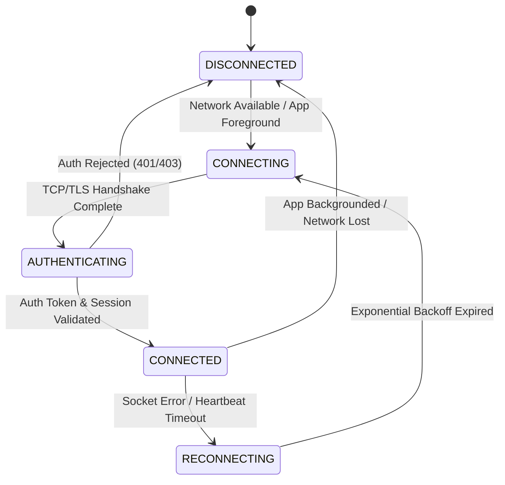
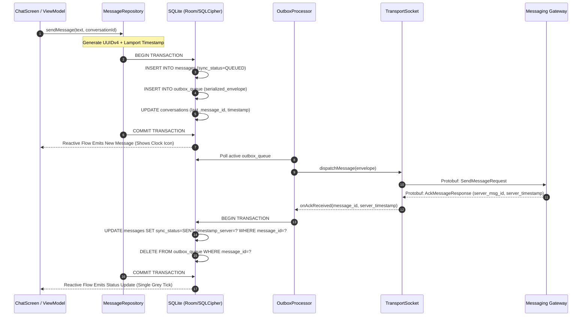
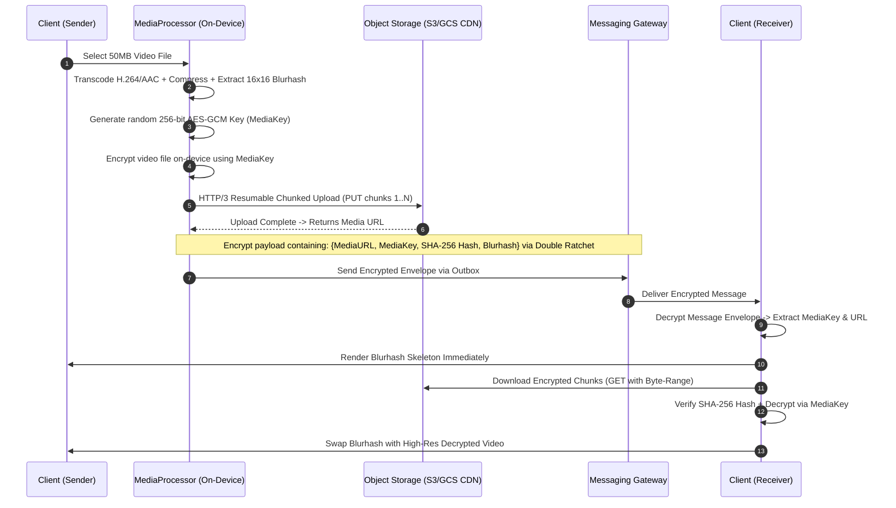

# SYSTEM DESIGN BLUEPRINT 01: REAL-TIME MESSAGING CLIENT
## Architectural Case Study: WhatsApp / Signal Scale Offline-First Architecture

---

### 1. PROBLEM STATEMENT & REQUIREMENTS

Design the client-side architecture for a global, production-scale real-time messaging application (e.g., WhatsApp, Signal, Telegram) capable of supporting hundreds of millions of daily active users across diverse global network conditions (from unstable 2G/3G in emerging markets to high-speed 5G/Wi-Fi).

#### Functional Requirements
1. **One-on-One & Group Messaging:** Real-time text messaging with support for rich text, reactions, replies, and mentions. Group conversations support up to 1,024 participants.
2. **Offline-First Resilience:** Users must be able to compose, view, search, and queue messages when completely offline. Queued messages must automatically sync and deliver upon network recovery without user intervention.
3. **End-to-End Encryption (E2EE):** All text and media payloads must be encrypted on-device before transmission and decrypted only on recipient devices. Zero server knowledge of plaintext.
4. **Rich Media Transfer:** Asynchronous, chunked, and resumable upload/download of images, voice notes, documents, and videos. Progressive image loading with low-bandwidth blurhashes.
5. **Delivery & Read Acknowledgments:** Strict real-time state tracking:
   - Clock icon: Queued locally.
   - Single grey tick: Transmitted to server.
   - Double grey tick: Delivered to recipient device.
   - Double blue tick: Read by recipient.
6. **Presence & Ephemeral State:** Real-time online status, "typing..." indicators, and disappearing message timers.

#### Non-Functional & Engineering Constraints
- **Sub-Second Delivery Latency:** End-to-end latency $< 500\text{ ms}$ under stable network conditions.
- **Strict Ordering & Idempotency:** Guaranteed causal ordering of messages per conversation without duplication during network reconnections.
- **Battery & Data Conservation:** Client radio state management (avoiding cellular Radio Resource Control (RRC) tail-time energy drain). Minimal keep-alive overhead.
- **Zero Data Loss & Crash Recovery:** Atomic local persistence. If the Android OS terminates the process mid-transmission or during a power cut, data integrity must remain uncorrupted.
- **Security & Sandboxing:** Cryptographic keys stored in Android Hardware Keystore / StrongBox HSM; database encrypted at rest via SQLCipher (256-bit AES-GCM).

---

### 2. HIGH-LEVEL CLIENT ARCHITECTURE

The client is structured according to **Unidirectional Data Flow (UDF)** and **Pragmatic Clean Architecture** with strict layer isolation:

```mermaid
graph TD
    subgraph UI_Layer["UI & Presentation Layer (Jetpack Compose)"]
        ChatScreen["ChatScreen / MessageList"]
        InputBar["MessageInputBar / MediaPicker"]
        ChatViewModel["ChatViewModel (MVI State / Event Hub)"]
    end

    subgraph Domain_Layer["Domain Layer (Pure Kotlin)"]
        SendMessageUseCase["SendMessageUseCase"]
        SyncMessagesUseCase["SyncMessagesUseCase"]
        MessageRepository["MessageRepository (Interface)"]
    end

    subgraph Data_Layer["Data & Persistence Layer"]
        RepoImpl["MessageRepositoryImpl"]
        OutboxQueue["Transactional Outbox Engine"]
        SQLiteDB[("Encrypted Room / SQLCipher Database")]
        MediaStorage["Encrypted Local Media Cache"]
    end

    subgraph Crypto_Layer["Cryptographic Subsystem (Signal Protocol)"]
        RatchetEngine["Double Ratchet / X3DH Engine"]
        KeystoreManager["Android Keystore / StrongBox"]
    end

    subgraph Network_Layer["Network & Transport Subsystem"]
        ConnectionManager["Connection & Socket State Machine"]
        TransportChannel["Persistent Transport (WebSocket / gRPC / QUIC)"]
        FCMService["Firebase Cloud Messaging (Silent Push Receiver)"]
        MediaTransferEngine["Resumable HTTP/3 Media Pipeline"]
    end

    ChatScreen -->|User Actions| ChatViewModel
    ChatViewModel -->|UI State (Flow)| ChatScreen
    ChatViewModel -->|Execute| SendMessageUseCase
    SendMessageUseCase --> RepoImpl
    RepoImpl --> OutboxQueue
    OutboxQueue --> SQLiteDB
    OutboxQueue --> RatchetEngine
    RatchetEngine --> KeystoreManager
    OutboxQueue --> ConnectionManager
    ConnectionManager --> TransportChannel
    TransportChannel -->|Incoming Packets| RepoImpl
    FCMService -->|Wakeup Ping| ConnectionManager
    MediaTransferEngine --> MediaStorage
```

---

### 3. NETWORK TRANSPORT & CONNECTION MANAGEMENT

#### 1. Transport Protocol Selection
- **WebSocket (WSS) vs. gRPC / HTTP/2 vs. MQTT:**
  - *MQTT:* Lightweight packet headers (2 bytes), designed for IoT. However, lacks flexible binary multiplexing, has limited mobile client library ecosystem, and struggles with massive binary media framing.
  - *gRPC (HTTP/2):* Strong contract typing (Protobuf), multiplexing on a single TCP connection. However, HTTP/2 multiplexing suffers from **TCP Head-of-Line (HoL) Blocking** on lossy mobile cellular networks—a single dropped packet stalls all streams.
  - *Modern Industry Standard:* **Custom Framed Protocol over WebSocket (or QUIC/HTTP/3)** using Protocol Buffers (Protobuf). WebSocket provides full-duplex, low-overhead communication with custom binary framing, while HTTP/3 (QUIC over UDP) eliminates Head-of-Line blocking entirely.

#### 2. Connection State Machine
The client manages connectivity via a deterministic finite state machine (FSM):



#### 3. Heartbeat, RRC Radio Optimization & Cellular Tail-Time
- **The Cellular Radio Problem (RRC States):**
  LTE/5G modems cycle through three primary Radio Resource Control states:
  1. **RRC Connected (High Power):** Full transmission power ($~200\text{--}400\text{ mA}$).
  2. **Short Discontinuous Reception (DRX) / Tail Time:** Modem remains active for $10\text{--}15\text{ seconds}$ after packet transmission awaiting more data before dropping down to low power.
  3. **RRC Idle (Paging / Deep Sleep):** Minimal power consumption ($~2\text{--}5\text{ mA}$).
- **The Battery Pitfall:** Sending periodic ping packets every 10 seconds prevents the modem from ever entering RRC Idle, draining the device battery in under 6 hours.
- **Architectural Solution: Adaptive Ping-Pong:**
  - **Wi-Fi Mode:** 60-second ping interval.
  - **Cellular Active (Foreground):** 120-second ping interval.
  - **Background Mode:** Terminate the long-lived socket immediately upon app backgrounding after a 10-second drain window. Rely exclusively on **High-Priority Silent FCM (Firebase Cloud Messaging) / Push Kit** to wake up the client for background synchronization via `WorkManager`.

#### 4. Reconnection with Exponential Backoff and Full Jitter
To prevent a "thundering herd" problem when a cellular tower or Wi-Fi router recovers:
$$\text{Delay}(n) = \text{random}(0, \; \min(M, \; B \times 2^n))$$
Where $B = 1\text{ second}$ (base delay), $M = 30\text{ seconds}$ (maximum backoff ceiling), and $n$ is the retry attempt index.

---

### 4. OFFLINE-FIRST PERSISTENCE & THE OUTBOX PATTERN

#### 1. SQLite Relational Schema (SQLCipher)

```sql
-- Conversations / Threads Table
CREATE TABLE conversations (
    conversation_id TEXT PRIMARY KEY NOT NULL,
    is_group INTEGER NOT NULL DEFAULT 0,
    title TEXT,
    last_message_id TEXT,
    last_message_timestamp INTEGER NOT NULL,
    unread_count INTEGER NOT NULL DEFAULT 0,
    created_at INTEGER NOT NULL
);

-- Core Messages Table
CREATE TABLE messages (
    message_id TEXT PRIMARY KEY NOT NULL, -- Client-generated UUIDv4
    conversation_id TEXT NOT NULL,
    sender_id TEXT NOT NULL,
    recipient_id TEXT, -- NULL for group chats
    encrypted_payload BLOB NOT NULL,
    plaintext_cached TEXT, -- Populated only in active memory / decrypted view
    message_type TEXT NOT NULL, -- 'TEXT', 'IMAGE', 'AUDIO', 'VIDEO', 'SYSTEM'
    sync_status INTEGER NOT NULL, -- 0: Queued, 1: Sent, 2: Delivered, 3: Read, 4: Failed
    timestamp_client INTEGER NOT NULL,
    timestamp_server INTEGER,
    media_url TEXT,
    media_local_path TEXT,
    media_encryption_key BLOB,
    FOREIGN KEY(conversation_id) REFERENCES conversations(conversation_id) ON DELETE CASCADE
);

CREATE INDEX idx_messages_conv_timestamp ON messages(conversation_id, timestamp_client DESC);

-- Transactional Outbox Queue Table
CREATE TABLE outbox_queue (
    queue_id INTEGER PRIMARY KEY AUTOINCREMENT,
    message_id TEXT UNIQUE NOT NULL,
    conversation_id TEXT NOT NULL,
    serialized_envelope BLOB NOT NULL,
    retry_count INTEGER NOT NULL DEFAULT 0,
    created_at INTEGER NOT NULL,
    FOREIGN KEY(message_id) REFERENCES messages(message_id) ON DELETE CASCADE
);
```

#### 2. The Transactional Outbox Sync Flow
Every user interaction writes to the database **first** inside an atomic SQLite transaction before attempting network dispatch.



---

### 5. END-TO-END ENCRYPTION (E2EE) ARCHITECTURE

#### 1. Signal Protocol: Extended Triple Diffie-Hellman (X3DH) & Double Ratchet
Real-time messaging security relies on two cryptographic primitives:
1. **X3DH (Initial Key Exchange):** Establishes a shared secret key between two parties when one party may be completely offline.
   - Pre-keys generated on device:
     - Identity Key ($IK$) — Long-term Curve25519 pair.
     - Signed Pre-Key ($SPK$) — Medium-term pair, signed by $IK$.
     - One-Time Pre-Keys ($OPK$) — Pool of single-use pairs uploaded to the server.
2. **Double Ratchet Algorithm (Ongoing Session):**
   - **KDF Chain Ratchet (Symmetric):** Derives new message encryption keys ($MK$) for every single message from the sending/receiving chain.
   - **Diffie-Hellman (DH) Ratchet (Asymmetric):** Each party generates a new DH key pair with every reply turn, guaranteeing:
     - **Forward Secrecy:** Compromising current keys cannot decrypt previously recorded traffic.
     - **Break-in Recovery (Post-Compromise Security):** Once an attacker loses access, new DH ratchets re-establish unbreakable privacy.

#### 2. Key Storage in Android Hardware Keystore & StrongBox
- Private identity keys must **never reside in plain memory or regular flash storage**.
- The Master Key is generated inside the Android Keystore backed by **StrongBox Keymaster (Dedicated Hardware Security Module / HSM)** or **ARM TrustZone TEE**:
  - Key Alias: `alias_signal_master_key`
  - Purpose: `KeyProperties.PURPOSE_ENCRYPT or KeyProperties.PURPOSE_DECRYPT`
  - Block Mode: `GCM`, Padding: `NoPadding`
- This Master Key encrypts the SQLite database passphrase (for SQLCipher) and the Signal Protocol identity store.

---

### 6. RESILIENT MEDIA PIPELINE (CHUNKED & RESUMABLE)

Large media files (photos, 4K videos, audio notes) must never be sent inline over the WebSocket channel. Doing so blocks control packets (ACKs, typing indicators) and exhausts memory.

#### 1. End-to-End Media Transfer Protocol



#### 2. Client-Side Video & Image Compression
- Images are downscaled to max $2048 \times 2048$ resolution, compressed to WebP/JPEG ($80\%$ quality).
- Videos are transcoded to $720p$ or $1080p$ at $30\text{ fps}$ H.264 using Android `MediaCodec` hardware accelerators.
- Low-bandwidth placeholder: Client generates a 32-character **Blurhash string** transmitted inline with the text metadata, allowing the receiver to render a smooth blurred preview instantly before downloading bytes.

---

### 7. GROUP MESSAGING SCALABILITY (SENDER KEYS PROTOCOL)

Sending a message to a group of 1,024 members using pure 1-on-1 Double Ratchet requires the client to encrypt and upload 1,024 distinct ciphertexts over the cellular connection—consuming extreme uplink bandwidth and battery.

#### The Sender Keys Optimization
1. **Initial Setup:** The group sender generates a single symmetric **Sender Key** (32-byte secret + 32-byte chain key).
2. **Key Distribution:** The sender encrypts this Sender Key individually for each group member once using standard 1-on-1 pairwise sessions and uploads them to the server.
3. **Subsequent Messages:** The sender ratchets the local Sender Key forward, encrypts the message payload **once**, and uploads the single ciphertext to the server.
4. **Server Fanout:** The server duplicates and distributes the single ciphertext to all 1,024 members. Each recipient uses their stored copy of the sender's Sender Key to decrypt the message.
5. **Key Ratchet & Rotation:** The Sender Key is rotated whenever a member joins or leaves the group to preserve backward and forward group secrecy.

---

### 8. SYSTEM FAILURE MODES & MITIGATION MATRIX

| Failure Scenario | Impact | Architectural Mitigation |
| :--- | :--- | :--- |
| **Sudden OS Process Kill during Send** | Message loss or duplicate transmission on reboot. | **Transactional Outbox:** Database insert committed before network dispatch. On reboot, `OutboxProcessor` queries un-acked records and resumes delivery. |
| **Out-of-Order Message Delivery** | Recipient sees answers before questions. | **Causal Sequence & Lamport Timestamps:** Messages carry client sequence IDs. UI sorts by `(conversation_id, server_timestamp, client_sequence_id)`. |
| **Split-Brain / Duplicated Client Send** | Duplicate messages rendered on server and receiver. | **Idempotency Key:** Server deduplicates messages based on `(sender_id, client_message_uuid)`. Retried packets return the existing server ACK. |
| **Database Lock Contention (SQLite)** | Main thread jank when 100 group messages arrive during user typing. | **WAL Mode (Write-Ahead Logging) + Background Dispatchers:** All DB writes executed on `Dispatchers.IO` with serialized single-threaded transaction executor. Reads never block writes. |
| **Extreme Network Flakiness (Subway / Tunnel)** | Constant socket disconnects causing battery drain. | **Exponential Backoff with Full Jitter + Network Capabilities Callback:** Suppress reconnection attempts when `NetworkCapabilities.NET_CAPABILITY_INTERNET` is absent. |

---

### 9. STAFF INTERVIEW EVALUATION & SCENARIO DRILLS

#### Drill 1: SQLite Lock Contention Under Heavy Group Bursts
- **Interviewer:** *"Imagine a user belongs to five 1,000-person group chats. When the phone reconnects after 2 hours offline, 5,000 messages arrive in a 10-second burst while the user is actively typing a message in another chat. How do you prevent the UI from freezing?"*
- **Model Answer:**
  1. **Enable SQLite WAL Mode:** Write-Ahead Logging allows concurrent readers and a single writer without blocking UI reads.
  2. **Batch Ingestion & Transaction Chunking:** Never execute individual `INSERT` statements. Accumulate incoming network frames in a high-speed memory buffer (Kotlin `Channel`) and flush to SQLite in batches of 100–250 records per transaction (`db.withTransaction { }`).
  3. **Decouple Ingestion from Decryption:** Decrypt messages in parallel using `Dispatchers.Default` thread pool utilizing all CPU cores before queuing them to the single DB writer.
  4. **Throttled Reactive Notifications:** In Room, throttle UI query notifications using `Flow.sample(100.milliseconds)` or `Flow.conflate()` so the UI only triggers recomposition 10 times per second rather than 5,000 times.

#### Drill 2: Handling Out-of-Order Delivery Across Cellular Tower Handover
- **Interviewer:** *"User A sends Message 1 over Cellular LTE. As they enter an elevator, the network drops and reconnects to 3G. Message 2 is sent and arrives at the server before Message 1. How does your client ensure consistent conversation rendering for both Sender and Recipient?"*
- **Model Answer:**
  - The client maintains a monotonic **Lamport Timestamp** or **Causal Dependency Vector** per conversation.
  - Message 2 embeds metadata: `previous_message_id = Message 1.uuid`.
  - The recipient client inspects `previous_message_id`. If Message 1 is missing locally, Message 2 is stored in a `PENDING_DEPENDENCY` buffer in SQLite.
  - The client sends a targeted sync request to the server: `fetchMessage(Message 1.uuid)`. Once Message 1 arrives and is inserted, the dependency graph resolves, and both messages are emitted to the UI in strict causal order.
