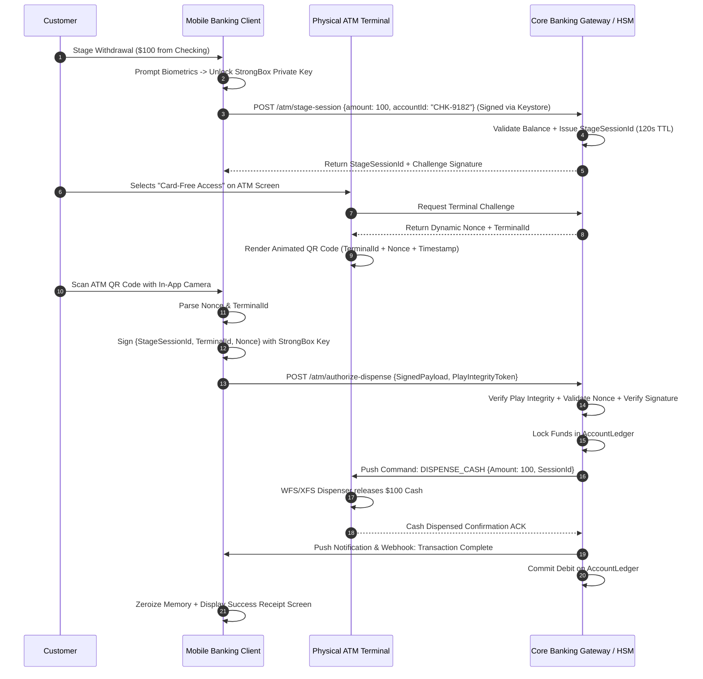
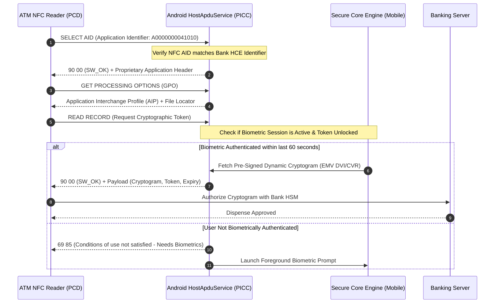
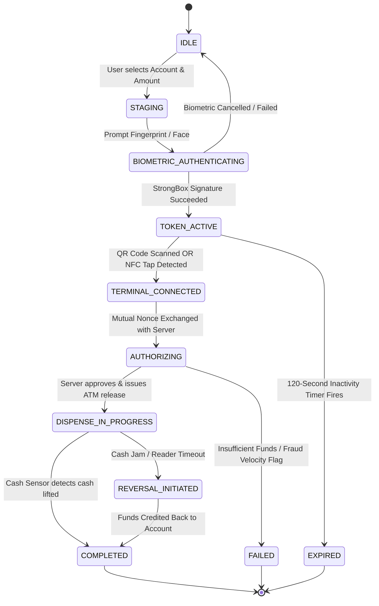

# SYSTEM DESIGN BLUEPRINT 02: FINTECH CARD-FREE ATM ARCHITECTURE
## Architectural Case Study: PNC Mobile Banking Card-Free ATM & Security Center

---

### 1. PROBLEM STATEMENT & REQUIREMENTS

Design the mobile client and edge-security architecture for an enterprise financial services mobile application (e.g., PNC Mobile Banking, Chase QuickDraft) that enables customers to withdraw cash and conduct transactions at physical ATM terminals without a plastic debit card, utilizing dynamic tokenization, cryptographic hardware attestation, and secure terminal handshakes (QR Code & NFC Host Card Emulation).

#### Functional Requirements
1. **Pre-Staging Cash Withdrawal:** Customer selects checking/savings account, withdrawal amount ($20–$500), and optional receipt preference on their mobile device before reaching the ATM.
2. **Dual-Modal Terminal Handshake:**
   - **Mode A (QR Dynamic Handshake):** ATM terminal displays an encrypted, short-lived animated QR code containing terminal telemetry and a cryptographic nonce. The mobile camera scans the code to authorize cash dispense.
   - **Mode B (NFC Host Card Emulation - HCE):** Customer taps their Android phone against the ATM NFC contactless reader using ISO/IEC 7816-4 APDU commands.
   - **Mode C (Dynamic One-Time Access Code):** App generates an offline/online 6-digit TOTP token valid for 60 seconds with on-screen visual countdown.
3. **Hardware Biometric Authorization:** Every transaction requires cryptographic biometric authentication (Fingerprint / 3D Face Unlock) backed by Android StrongBox HSM or TEE.
4. **Instant Receipt & Push Notification:** Real-time push notification and transaction ledger update upon cash dispense completion.
5. **Session Auto-Cancellation:** If the user fails to tap or scan within 120 seconds of staging, the token is automatically revoked, funds remain uncommitted, and the session self-destructs.

#### Non-Functional & Regulatory Constraints
- **PCI-DSS Level 1 & FIPS 140-2/3 Compliance:** Zero plain storage of Primary Account Numbers (PAN), PINs, or card verification data on device flash or persistent memory.
- **StrongBox Hardware Security:** Asymmetric signing keys stored in hardware-isolated Secure Elements (StrongBox / TEE) with mandatory user authentication gating (`setUserAuthenticationRequired(true)`).
- **Zero-Trust Device Integrity (Anti-Tamper):** Continuous detection of root, Magisk, KernelSU, Zygisk, Frida instrumentation, Xposed framework, and emulator execution. Google Play Integrity API token validation with `MEETS_STRONG_INTEGRITY`.
- **RAM Zeroization:** All sensitive buffers (`CharArray`, `ByteArray`) holding tokens, PIN fragments, or keys must be explicitly wiped from RAM using zeroization immediately after use to prevent memory-dump extraction.
- **Screenshot & Screen Recording Prevention:** Enforcement of `WindowManager.LayoutParams.FLAG_SECURE` and background app snapshot masking.
- **Sub-Second NFC Response:** NFC HCE transactions must complete APDU command-response round-trips in under $300\text{ ms}$ to avoid physical reader timeouts.

---

### 2. HIGH-LEVEL ARCHITECTURE & ECOSYSTEM TOPOLOGY

The end-to-end Card-Free ATM architecture connects five decoupled entities:

```mermaid
graph TD
    subgraph Mobile_Device["Android Mobile Client (PNC Banking App)"]
        UI["Banking UI (Jetpack Compose + FLAG_SECURE)"]
        HCE["Host Card Emulation Service (HostApduService)"]
        BiometricEngine["BiometricManager + CryptoObject"]
        KeystoreModule["StrongBox Keymaster (Hardware HSM)"]
        AttestationClient["Play Integrity Client & Native Tamper Check"]
        SecurityRAM["Zeroized Sensitive Memory Buffer"]
    end

    subgraph Edge_Infrastructure["Financial Cloud Edge & Gateways"]
        APIGateway["PCI-DSS Compliant Mutual-TLS API Gateway"]
        AttestationServer["Google Play Integrity Verification Server"]
        TokenVault["Core Tokenization & Session Vault (Redis Cluster)"]
    end

    subgraph Core_Banking["Core Banking & Mainframe Backend"]
        AccountLedger["Core Ledger & Balance Engine"]
        FraudEngine["Real-Time AI Fraud & Velocity Detection"]
        HardwareHSM["Enterprise Bank HSM (Thales / SafeNet)"]
    end

    subgraph Physical_ATM["Physical ATM Terminal Unit"]
        ATMScanner["NFC Contactless Reader / QR Display Screen"]
        ATMController["ATM Local Embedded Controller (WFS/XFS)"]
        CashDispenser["Physical Cash Dispenser Mechanism"]
    end

    UI -->|Biometric Prompt| BiometricEngine
    BiometricEngine -->|Authorize Key| KeystoreModule
    KeystoreModule -->|Sign Payload| SecurityRAM
    AttestationClient -->|Fetch Token| AttestationServer
    UI -->|mTLS HTTPS (Pinned)| APIGateway
    HCE -->|ISO 7816-4 APDUs| ATMScanner
    ATMScanner --> ATMController
    ATMController -->|Secure Bank Wire| APIGateway
    APIGateway --> TokenVault
    APIGateway --> FraudEngine
    APIGateway --> AccountLedger
    ATMController -->|Trigger Release| CashDispenser
```

---

### 3. THE DUAL-MODAL TERMINAL HANDSHAKE WORKFLOWS

#### Workflow 1: QR Dynamic Challenge-Response Handshake
This workflow eliminates physical contact and works across all Android devices regardless of NFC chip availability.



#### Workflow 2: NFC Host Card Emulation (HCE) Protocol Flow
In this mode, the phone acts as an ISO/IEC 14443 Type A contactless smart card, responding to APDU commands issued by the ATM contactless reader.



---

### 4. CRYPTOGRAPHIC TOKENIZATION & KEY MANAGEMENT

#### 1. Hardware Keystore / StrongBox Key Specification
The asymmetric key pair used to authorize ATM sessions is generated strictly inside the Hardware Security Module (StrongBox Keymaster) with biometric enforcement:

```kotlin
package com.enterprise.banking.core.security

import android.security.keystore.KeyGenParameterSpec
import android.security.keystore.KeyProperties
import java.security.KeyPairGenerator
import java.security.KeyStore
import javax.inject.Inject
import javax.inject.Singleton

@Singleton
class AtmCryptoManager @Inject constructor() {

    private val keyStore = KeyStore.getInstance(ANDROID_KEYSTORE).apply { load(null) }

    fun generateStrongBoxAtmKey(): Boolean {
        return try {
            val kpg = KeyPairGenerator.getInstance(
                KeyProperties.KEY_ALGORITHM_EC,
                ANDROID_KEYSTORE
            )

            val spec = KeyGenParameterSpec.Builder(
                ATM_KEY_ALIAS,
                KeyProperties.PURPOSE_SIGN or KeyProperties.PURPOSE_VERIFY
            )
                .setDigests(KeyProperties.DIGEST_SHA256)
                .setUserAuthenticationRequired(true) // Requires Biometric/PIN unlock
                .setUserAuthenticationParameters(
                    AUTHENTICATION_TIMEOUT_SECONDS,
                    KeyProperties.AUTH_BIOMETRIC_STRONG
                )
                .setIsStrongBoxBacked(true) // Force physical hardware HSM execution
                .setInvalidatedByBiometricEnrollment(true) // Invalidate if attacker adds a new fingerprint
                .build()

            kpg.initialize(spec)
            kpg.generateKeyPair()
            true
        } catch (e: Exception) {
            // StrongBox hardware might not be present on older devices; fallback to Standard TEE
            fallbackToStandardTeeKey()
        }
    }

    private fun fallbackToStandardTeeKey(): Boolean {
        val kpg = KeyPairGenerator.getInstance(
            KeyProperties.KEY_ALGORITHM_EC,
            ANDROID_KEYSTORE
        )
        val spec = KeyGenParameterSpec.Builder(
            ATM_KEY_ALIAS,
            KeyProperties.PURPOSE_SIGN or KeyProperties.PURPOSE_VERIFY
        )
            .setDigests(KeyProperties.DIGEST_SHA256)
            .setUserAuthenticationRequired(true)
            .setUserAuthenticationParameters(
                AUTHENTICATION_TIMEOUT_SECONDS,
                KeyProperties.AUTH_BIOMETRIC_STRONG
            )
            .setIsStrongBoxBacked(false) // Standard ARM TrustZone TEE
            .setInvalidatedByBiometricEnrollment(true)
            .build()

        kpg.initialize(spec)
        kpg.generateKeyPair()
        return true
    }

    companion object {
        const val ANDROID_KEYSTORE = "AndroidKeyStore"
        const val ATM_KEY_ALIAS = "pnc_atm_authorization_key"
        const val AUTHENTICATION_TIMEOUT_SECONDS = 30 // Valid for 30s after biometric prompt
    }
}
```

---

### 5. MEMORY SAFETY & SENSITIVE DATA ZEROIZATION

#### Why `String` is Strictly Prohibited for Financial Secrets
1. **Immutability & String Pool:** Java/Kotlin `String` objects are immutable. When you execute `val pin = "1234"`, the characters are allocated in JVM heap memory and often interned in the String Pool.
2. **Garbage Collection Unpredictability:** Strings cannot be overwritten programmatically. They remain resident in process RAM until the garbage collector runs a compaction cycle. If an attacker attaches a memory dumper (`fridump`) or extracts a heap dump before GC, the plaintext PIN/token is exposed in cleartext.

#### Production Zeroization Implementation (`SecureCharArray.kt`)

```kotlin
package com.enterprise.banking.core.security

import java.util.Arrays

/**
 * Encapsulates sensitive character sequences (PINs, TOTP tokens, Auth Keys)
 * with mandatory auto-zeroization lifecycle guarantees.
 */
class SecureCharArray(private val chars: CharArray) : AutoCloseable {

    private var isZeroized = false

    val length: Int
        get() {
            checkNotZeroized()
            return chars.size
        }

    fun read(consumer: (CharArray) -> Unit) {
        checkNotZeroized()
        consumer(chars)
    }

    private fun checkNotZeroized() {
        if (isZeroized) {
            throw IllegalStateException("SecureCharArray has already been zeroized and destroyed.")
        }
    }

    /**
     * Overwrites every character in the underlying memory buffer with '\u0000'.
     */
    override fun close() {
        if (!isZeroized) {
            Arrays.fill(chars, '\u0000')
            isZeroized = true
        }
    }

    companion object {
        inline fun <R> use(chars: CharArray, block: (SecureCharArray) -> R): R {
            val secureBuffer = SecureCharArray(chars)
            return try {
                block(secureBuffer)
            } finally {
                secureBuffer.close()
            }
        }
    }
}
```

---

### 6. ZERO-TRUST DEVICE ATTESTATION & ANTI-TAMPER PIPELINE

Financial banking transactions mandate multi-layered client integrity verification before any tokenization payload is dispatched to the core banking mainframe.

#### 1. Multi-Layer Attestation Architecture
1. **Play Integrity API (Server-Side Decryption):**
   - Mobile app requests an attestation integrity token binding a server-generated nonce:
     `IntegrityManager.requestIntegrityToken(requestHash)`.
   - The token is transmitted to the Core Banking Gateway.
   - The Gateway decrypts the token via Google Cloud APIs and asserts:
     - `appLicensingVerdict == "LICENSED"`
     - `deviceRecognitionVerdict` contains `"MEETS_STRONG_INTEGRITY"` (Hardware-backed TEE/StrongBox attestation).
     - `appRecognitionVerdict == "PLAY_RECOGNIZED"`.
2. **Native C++ Anti-Tamper & Memory Integrity Checks:**
   - Detects dynamic instrumentation tools (Frida, Xposed, Substrate).
   - Scans `/proc/self/maps` and `/proc/self/status` for injected dynamic libraries (`frida-gadget.so`, `substrate.so`, `xposed.so`).
   - Checks `TracerPid` in `/proc/self/status`. If `TracerPid != 0`, an external debugger is actively intercepting the process.
   - Invokes `ptrace(PTRACE_TRACEME, 0, 1, 0)` in native code. If `ptrace` fails, another debugger is attached; the app terminates immediately via `_exit(0)`.

---

### 7. SESSION LIFECYCLE & FAILURE MITIGATION MATRIX



#### Failure Modes & Edge-Case Defenses

| Failure Scenario | Risk | Architectural Mitigation |
| :--- | :--- | :--- |
| **Physical Cash Jam in Dispenser** | Customer charged, cash not dispensed. | **Idempotent Two-Phase Commit with Automatic Reversal:** The core ledger creates a `PENDING_RESERVATION` lock. Only when the physical ATM optic sensors confirm bills exited the slot does the ATM send `DISPENSE_CONFIRMED`. If a jam occurs, the ATM sends `DISPENSE_FAILED` and the backend auto-reverses the reservation instantly. |
| **Replay Attack of Scanned QR Code** | Fraudster captures photo of QR code and attempts reuse. | **Single-Use Ephemeral Nonce with 10-Second Expiry:** Every ATM QR code contains a dynamic cryptographically random 256-bit nonce generated by the ATM controller and cached in Redis with a 10-second TTL. Once consumed, the nonce is burned. |
| **Man-in-the-Middle on Public Wi-Fi** | Attacker intercepts StageSessionId. | **TLS 1.3 Certificate Pinning with Dual Pins:** Custom `CertificatePinner` with SHA-256 SPKI hashes of the primary and backup certificate authorities. Mutual TLS (mTLS) with client certificate authentication. |
| **Device Compromise via Magisk/Zygisk** | Attacker hooks `CryptoObject` to bypass biometrics. | **Hardware StrongBox Keystore:** The private key physically refuses to sign data unless the hardware biometric sensor asserts an authenticated biometric match signal inside the TrustZone bus. Software hooks cannot simulate hardware TEE biometric signals. |

---

### 8. STAFF INTERVIEW SCENARIOS & ARCHITECTURAL DRILLS

#### Drill 1: Protecting Against Compromised Kernels / Root Exploits
- **Interviewer:** *"If a sophisticated attacker has a rooted Android device with a modified Linux kernel that hides Magisk and returns false values for all `/proc` file checks, how does your Card-Free ATM architecture prevent them from minting fake cash withdrawal authorizations?"*
- **Model Answer:**
  1. **Hardware-Backed Cryptographic Separation:** The client app never decides whether an authorization is valid. The authorization signature is produced by a key generated with `.setIsStrongBoxBacked(true)` and `.setUserAuthenticationRequired(true)`. The private key never leaves the physical tamper-resistant chip (Titan M / Secure Element).
  2. **Attestation Server Validation:** The server rejects any transaction that lacks a valid Google Play Integrity attestation payload. Because Google Play Integrity validates hardware key attestations signed by Google's root hardware certs, a modified kernel cannot forge the `MEETS_STRONG_INTEGRITY` verdict.
  3. **Zero Trust Server-Side Orchestration:** The server matches the terminal-generated nonce, client-signed payload, and physical ATM geolocation. If the phone's GPS is 5 miles away from the physical ATM location, the transaction is rejected by the fraud velocity engine.

#### Drill 2: Minimizing NFC APDU Latency to Prevent ATM Reader Timeouts
- **Interviewer:** *"Physical ATM NFC readers enforce a strict 300ms timeout for contactless card communication. How do you guarantee your Android `HostApduService` meets this latency deadline given ART garbage collection, process scheduling, and biometric verification?"*
- **Model Answer:**
  1. **Pre-Staging & Pre-Computing the Cryptogram:** We never trigger biometric authentication or cryptographic generation *during* the NFC tap. The user completes biometrics in the app *before* tapping the phone. The resulting session token and signed APDU responses are pre-calculated and cached in high-speed native memory.
  2. **Dedicated HCE Service Priority:** The `HostApduService` runs with elevated process priority. `processCommandApdu` executes in under $10\text{ ms}$ because it performs zero disk I/O, zero network calls, and zero object allocations—it simply slices the pre-generated byte buffer and returns the ISO 7816-4 response array.
  3. **Object Pooling for APDU Buffers:** We reuse static byte arrays for APDU responses (`SW_OK = byteArrayOf(0x90.toByte(), 0x00.toByte())`) to prevent memory allocations that could trigger concurrent GC pauses during the millisecond-critical NFC transmission window.
