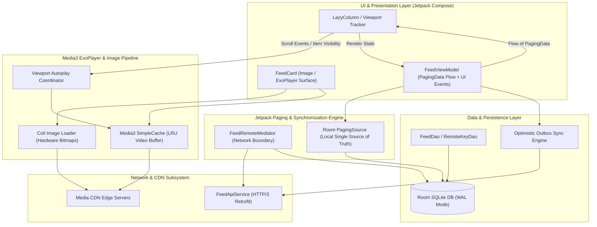
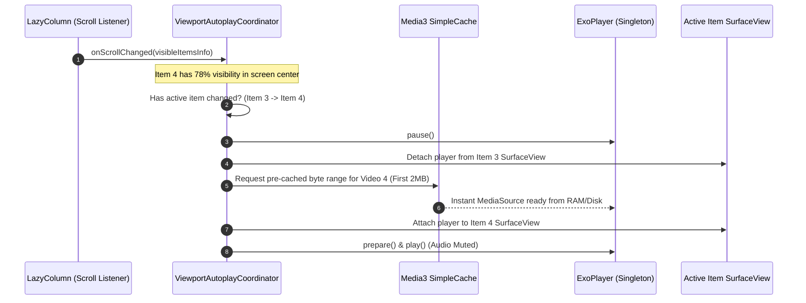

# SYSTEM DESIGN BLUEPRINT 03: OFFLINE-FIRST FEED & INFINITE SCROLL ENGINE
## Architectural Case Study: Instagram / Twitter (X) Scale Media Feed

---

### 1. PROBLEM STATEMENT & REQUIREMENTS

Design the mobile client architecture for a global-scale media feed (e.g., Instagram Feed, Twitter/X Timeline, TikTok Video Feed) that supports smooth infinite scrolling, mixed heterogeneous media (images, auto-playing video clips, text, and sponsored ads), offline-first reading, optimistic social interactions (likes, bookmarks), and strict memory budgeting across low-end to flagship Android devices.

#### Functional Requirements
1. **Infinite Scroll Pagination:** Seamless bidirectional pagination. New pages pre-fetched before the user reaches the bottom of the list.
2. **Offline-First Persistence:** Cache the top 200–500 feed items and their visual media in local storage. The feed must render instantly upon launch in airplane mode.
3. **Viewport Video Autoplay:** Automatically play video audio-muted when the item achieves $> 60\%$ visibility in the screen viewport. Only one video plays at a time.
4. **Optimistic Interactions:** Tapping "Like" or "Bookmark" updates the UI state instantly (0ms latency). The client commits an offline outbox write and syncs with the server in the background, with automatic rollback if the server rejects.
5. **Ad Injection & Viewability Tracking:** Dynamically inject sponsored ad units every $N$ organic posts. Fire verified impression telemetry when an ad is $\ge 50\%$ visible on screen for $\ge 1.0\text{ second}$ (MRC standard).

#### Non-Functional & Performance Constraints
- **Constant 120 FPS Rendering ($8.33\text{ ms}$ Frame Deadline):** Zero jank or frame drops during fast fling gestures.
- **Strict RAM Bounding ($\le 180\text{MB}$ Media Heap):** Prevent `OutOfMemoryError` (OOM) when users scroll through 5,000+ high-resolution photos and videos in a single continuous session.
- **Bandwidth & Battery Awareness:** Adaptive pre-fetching based on network type (Wi-Fi vs Cellular 4G/5G) and scroll velocity. Halt pre-fetching when the user flings rapidly.
- **P95 Cold Start to Feed:** Render cached feed in $< 600\text{ ms}$ (TTFD).

---

### 2. HIGH-LEVEL CLIENT ARCHITECTURE

The architecture decouples the presentation viewport from persistent storage and the network pipeline using **Jetpack Paging 3**, **Room with SQLite WAL**, and an **Adaptive Media Pipeline**:



---

### 3. PERSISTENCE & PAGING 3 ARCHITECTURE

#### 1. Why Offset-Based Pagination Fails at Scale
- **The Offset/Limit Flaw:** Querying `SELECT * FROM posts ORDER BY created_at DESC LIMIT 20 OFFSET 40` suffers from **Data Drift / Duplication**. If 5 new posts are published while the user is reading page 1, querying page 2 returns items already seen on page 1.
- **Performance Degradation:** In SQLite, `OFFSET 1000` forces the B-Tree engine to scan and discard 1,000 index rows, causing $O(N)$ query times that trigger UI jank.
- **The Production Solution: Keyset / Cursor Pagination:**
  Query by cursor: `SELECT * FROM posts WHERE cursor_id < :lastSeenCursor ORDER BY cursor_id DESC LIMIT 20`. This runs in $O(\log N)$ using indexed B-Trees and is completely immune to newly inserted upstream items.

#### 2. Room SQLite Schema with RemoteKeys

```sql
-- Feed Items Table
CREATE TABLE feed_items (
    id TEXT PRIMARY KEY NOT NULL,
    author_id TEXT NOT NULL,
    author_name TEXT NOT NULL,
    author_avatar_url TEXT NOT NULL,
    content_text TEXT,
    media_url TEXT NOT NULL,
    media_type TEXT NOT NULL, -- 'IMAGE' or 'VIDEO'
    aspect_ratio REAL NOT NULL DEFAULT 1.0,
    blurhash TEXT,
    like_count INTEGER NOT NULL DEFAULT 0,
    is_liked INTEGER NOT NULL DEFAULT 0,
    comment_count INTEGER NOT NULL DEFAULT 0,
    created_at INTEGER NOT NULL
);

CREATE INDEX idx_feed_created_at ON feed_items(created_at DESC);

-- Remote Keys Table for Paging 3 Boundary Tracking
CREATE TABLE feed_remote_keys (
    item_id TEXT PRIMARY KEY NOT NULL,
    prev_key TEXT,
    next_key TEXT,
    created_at INTEGER NOT NULL,
    FOREIGN KEY(item_id) REFERENCES feed_items(id) ON DELETE CASCADE
);
```

#### 3. Production `FeedRemoteMediator.kt`
Coordinates between network pagination and SQLite storage, ensuring the local database remains the **single source of truth**.

```kotlin
package com.enterprise.feed.data

import androidx.paging.ExperimentalPagingApi
import androidx.paging.LoadType
import androidx.paging.PagingState
import androidx.paging.RemoteMediator
import androidx.room.withTransaction
import com.enterprise.feed.data.local.FeedDatabase
import com.enterprise.feed.data.local.FeedItemEntity
import com.enterprise.feed.data.local.FeedRemoteKeyEntity
import com.enterprise.feed.data.remote.FeedApiService
import java.io.IOException

@OptIn(ExperimentalPagingApi::class)
class FeedRemoteMediator(
    private val apiService: FeedApiService,
    private val database: FeedDatabase
) : RemoteMediator<Int, FeedItemEntity>() {

    override suspend fun load(
        loadType: LoadType,
        state: PagingState<Int, FeedItemEntity>
    ): MediatorResult {
        return try {
            val cursorKey: String? = when (loadType) {
                LoadType.REFRESH -> null // Refresh fetches the latest top of the feed
                LoadType.PREPEND -> return MediatorResult.Success(endOfPaginationReached = true)
                LoadType.APPEND -> {
                    val remoteKeys = getRemoteKeyForLastItem(state)
                    val nextKey = remoteKeys?.next_key
                        ?: return MediatorResult.Success(endOfPaginationReached = remoteKeys != null)
                    nextKey
                }
            }

            // Fetch next page from API
            val response = apiService.fetchFeed(
                cursor = cursorKey,
                pageSize = state.config.pageSize
            )

            val feedItems = response.items.map { it.toEntity() }
            val endOfPagination = response.nextCursor == null

            database.withTransaction {
                if (loadType == LoadType.REFRESH) {
                    database.remoteKeysDao().clearRemoteKeys()
                    database.feedDao().clearAllFeedItems()
                }

                val keys = feedItems.map { item ->
                    FeedRemoteKeyEntity(
                        item_id = item.id,
                        prev_key = cursorKey,
                        next_key = response.nextCursor,
                        created_at = System.currentTimeMillis()
                    )
                }

                database.remoteKeysDao().insertAll(keys)
                database.feedDao().insertAll(feedItems)
            }

            MediatorResult.Success(endOfPaginationReached = endOfPagination)
        } catch (e: IOException) {
            MediatorResult.Error(e)
        } catch (e: Exception) {
            MediatorResult.Error(e)
        }
    }

    private suspend fun getRemoteKeyForLastItem(
        state: PagingState<Int, FeedItemEntity>
    ): FeedRemoteKeyEntity? {
        return state.pages.lastOrNull { it.data.isNotEmpty() }?.data?.lastOrNull()?.let { item ->
            database.remoteKeysDao().remoteKeyByItemId(item.id)
        }
    }
}
```

---

### 4. MEMORY & IMAGE PIPELINE OPTIMIZATION

Scrolling through hundreds of high-resolution images can crash an Android app within minutes if bitmap allocation is mismanaged.

#### 1. Hardware Bitmaps (`Bitmap.Config.HARDWARE`)
- Standard bitmaps allocate pixel arrays on the Java heap or native C++ heap.
- `Bitmap.Config.HARDWARE` allocates pixel memory directly in GPU-addressable memory (`AHardwareBuffer`).
- **Benefits:**
  1. Pixel data is **immutable and unreadable by CPU**, allowing zero-copy rendering to the GPU.
  2. The Java heap is spared entirely, eliminating Garbage Collection (GC) pauses that cause scroll stutter.

#### 2. Strict Downsampling with Coil
Images must never be loaded at their raw server resolution ($4032 \times 3024$). They must be downsampled to exact viewport bounds:

```kotlin
package com.enterprise.feed.ui

import androidx.compose.foundation.layout.aspectRatio
import androidx.compose.foundation.layout.fillMaxWidth
import androidx.compose.runtime.Composable
import androidx.compose.ui.Modifier
import androidx.compose.ui.layout.ContentScale
import androidx.compose.ui.platform.LocalContext
import coil.compose.AsyncImage
import coil.request.ImageRequest

@Composable
fun FeedImage(
    imageUrl: String,
    aspectRatio: Float,
    modifier: Modifier = Modifier
) {
    AsyncImage(
        model = ImageRequest.Builder(LocalContext.current)
            .data(imageUrl)
            .crossfade(true)
            .bitmapConfig(android.graphics.Bitmap.Config.HARDWARE)
            .allowRgb565(true) // Uses 2 bytes per pixel instead of 4 where supported
            .memoryCachePolicy(coil.request.CachePolicy.ENABLED)
            .diskCachePolicy(coil.request.CachePolicy.ENABLED)
            .build(),
        contentDescription = null,
        contentScale = ContentScale.Crop,
        modifier = modifier
            .fillMaxWidth()
            .aspectRatio(aspectRatio)
    )
}
```

---

### 5. VIDEO AUTOPLAY & MEDIA3 PRE-CACHE ENGINE

Managing multiple video players in a scrolling list is one of the most complex engineering challenges on mobile.

#### 1. Viewport Visibility Coordinator
Instead of creating an `ExoPlayer` instance for every list item, we maintain a **Single Active Player Architecture**:
- Only **one** `ExoPlayer` instance is attached to the view hierarchy at any given moment.
- The `LazyListState` layout info calculates which video card occupies the greatest percentage of the viewport center ($> 60\%$).
- The player's `SurfaceView` is dynamically attached to the active card.



#### 2. Media3 LRU Disk Pre-Cache Engine
To prevent buffering spinners when videos become visible, the client pre-fetches the first $2\text{MB}$ of the next 2 videos in the scroll direction into a bounded disk cache (`SimpleCache`):

```kotlin
package com.enterprise.feed.media

import android.content.Context
import androidx.media3.common.util.UnstableApi
import androidx.media3.database.StandaloneDatabaseProvider
import androidx.media3.datasource.DefaultHttpDataSource
import androidx.media3.datasource.cache.CacheDataSource
import androidx.media3.datasource.cache.LeastRecentlyUsedCacheEvictor
import androidx.media3.datasource.cache.SimpleCache
import java.io.File
import javax.inject.Inject
import javax.inject.Singleton

@UnstableApi
@Singleton
class VideoCacheManager @Inject constructor(
    private val context: Context
) {

    private val cacheSize = 250L * 1024L * 1024L // 250MB bounded cache
    private val evictor = LeastRecentlyUsedCacheEvictor(cacheSize)
    private val databaseProvider = StandaloneDatabaseProvider(context)
    
    val simpleCache: SimpleCache by lazy {
        val cacheDir = File(context.cacheDir, "exoplayer_feed_cache")
        SimpleCache(cacheDir, evictor, databaseProvider)
    }

    fun buildCacheDataSourceFactory(): CacheDataSource.Factory {
        val upstreamFactory = DefaultHttpDataSource.Factory()
            .setConnectTimeoutMs(8_000)
            .setReadTimeoutMs(8_000)

        return CacheDataSource.Factory()
            .setCache(simpleCache)
            .setUpstreamDataSourceFactory(upstreamFactory)
            .setFlags(CacheDataSource.FLAG_IGNORE_CACHE_ON_ERROR)
    }
}
```

---

### 6. OPTIMISTIC UPDATES & TRANSACTIONAL SYNC

When a user taps "Like", waiting for the network call to finish before updating the heart icon creates a sluggish user experience.

#### 1. The Optimistic State Machine
1. **Instant UI Mutation:** Update the local Room database immediately (`UPDATE feed_items SET is_liked = 1, like_count = like_count + 1 WHERE id = :id`).
2. **Enqueue Outbox Task:** Insert a task into `optimistic_outbox` table (`action = 'LIKE', itemId = '...'`).
3. **Dispatch Network Request:** The `OutboxSyncWorker` attempts to POST to `/api/feed/{id}/like`.
4. **Resolution:**
   - *Success:* Remove task from outbox.
   - *Failure (4xx / Permanent):* Automatically revert the local Room database mutation and notify the user with a subtle Snackbar.

---

### 7. AD INJECTION & VIEWABILITY TELEMETRY (MRC COMPLIANT)

In monetization architectures, advertisers pay per impression. The Media Rating Council (MRC) defines an ad impression as:
> *A display ad unit is considered viewable if at least $50\%$ of its pixels are in view on an active viewport for a minimum of $1.0\text{ consecutive second}$.*

#### Viewability Tracker Implementation

```kotlin
package com.enterprise.feed.analytics

import android.os.SystemClock
import androidx.compose.foundation.lazy.LazyListState
import kotlinx.coroutines.CoroutineScope
import kotlinx.coroutines.Job
import kotlinx.coroutines.delay
import kotlinx.coroutines.launch

class AdViewabilityTracker(
    private val scope: CoroutineScope,
    private val onImpressionQualified: (adId: String) -> Unit
) {

    private val activeVisibleTimers = mutableMapOf<String, Job>()
    private val trackedImpressions = mutableSetOf<String>()

    fun onAdVisibilityChanged(adId: String, visibleFraction: Float) {
        if (trackedImpressions.contains(adId)) return

        if (visibleFraction >= 0.50f) {
            // Start 1.0 second countdown if not already active
            if (activeVisibleTimers[adId] == null) {
                activeVisibleTimers[adId] = scope.launch {
                    delay(1_000L) // Must remain >= 50% visible for 1 continuous second
                    trackedImpressions.add(adId)
                    activeVisibleTimers.remove(adId)
                    onImpressionQualified(adId)
                }
            }
        } else {
            // Cancel timer if ad dropped below 50% visibility
            activeVisibleTimers[adId]?.cancel()
            activeVisibleTimers.remove(adId)
        }
    }
}
```

---

### 8. SYSTEM FAILURE MODES & MITIGATION MATRIX

| Failure Scenario | Impact | Architectural Mitigation |
| :--- | :--- | :--- |
| **Rapid Fling Scrolling** | Memory thrashing, network bandwidth exhausted by discarded items. | **Velocity-Aware Pre-Fetching:** Monitor scroll velocity via `NestedScrollConnection`. When velocity exceeds $2,500\text{ dp/s}$, pause all image pre-fetching and video pre-caching until scroll slows. |
| **SQLite DB Growth Over Time** | App data bloats to gigabytes, slowing down B-Tree queries. | **Automatic Pruning Policy:** During app backgrounding via `WorkManager`, execute an eviction query keeping only the top 300 newest records: `DELETE FROM feed_items WHERE id NOT IN (SELECT id FROM feed_items ORDER BY created_at DESC LIMIT 300)`. |
| **Network Loss Mid-Stream** | User sees broken image icons and blank cards. | **Blurhash Placeholders:** Every feed item metadata embeds a 32-character Blurhash string. Render the low-bandwidth blurred placeholder canvas immediately; do not show empty white boxes. |
| **Video Decoding Crash (ExoPlayer)** | Fatal app crash on corrupted MP4 container. | **Surface Error Fallback:** Catch `ExoPlayer.PlaybackException`, hide video surface, fall back to displaying the static thumbnail image, and log the corrupt media ID to telemetry. |

---

### 9. STAFF INTERVIEW EVALUATION & SCENARIO DRILLS

#### Drill 1: Preventing LazyColumn Memory Leaks Across 1,000 Scrolled Items
- **Interviewer:** *"If a user scrolls through 1,000 feed items containing high-res images and video players, how do you prevent the Android OS from terminating the app with an OutOfMemoryError?"*
- **Model Answer:**
  1. **Lazy Recycling:** Jetpack Compose `LazyColumn` recycles composable slots and only maintains composition for nodes currently on-screen or within the prefetch distance.
  2. **Coil Memory Pool & Hardware Bitmaps:** Coil maintains a strictly bounded memory cache (e.g. $20\%$ of available application RAM). As items scroll off screen, their image bitmap references are evicted from RAM. Using `Bitmap.Config.HARDWARE` stores pixel memory in GPU memory rather than the Java heap.
  3. **ExoPlayer Pooling:** We never instantiate 1,000 ExoPlayers. We maintain a single active `ExoPlayer` instance that attaches to the active visible surface, detaching and releasing video decoding hardware resources from offscreen surfaces.

#### Drill 2: Handling Out-of-Order Paging Responses Under Spotty Networks
- **Interviewer:** *"The user scrolls down rapidly. Page 2 request is delayed on 3G. Page 3 request is fired and returns before Page 2. How does your architecture ensure feed consistency and prevent duplicate items?"*
- **Model Answer:**
  1. **Keyset / Cursor Anchoring:** Each request passes the exact cursor of the last item in that page chunk (`cursor = item_40`).
  2. **Room Upsertion with Primary Keys:** Feed items use unique server IDs as SQLite primary keys (`@PrimaryKey val id: String`). When Page 3 arrives first, Room inserts items 41–60. When Page 2 arrives later, Room upserts items 21–40 without throwing primary key conflicts.
  3. **Paging 3 RemoteMediator Serialization:** Jetpack Paging 3's `RemoteMediator` inherently serializes calls to `load(LoadType.APPEND)`. It will not dispatch a Page 3 request until the Page 2 mediator job completes or times out, preventing out-of-order race conditions at the architecture level.
