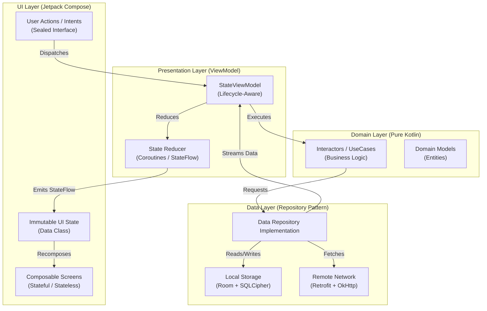

# 🚀 Android Interview Study Hub & Architecture Reference

[](https://kotlinlang.org)
[](https://developer.android.com/jetpack/compose)
[](https://developer.android.com/topic/architecture)
[](LICENSE)
[](.github/workflows)

A production-grade Android engineering reference and comprehensive study platform authored by **Satdev Kumar** (Senior Android Developer, IBM India). 

Designed to demonstrate elite architectural patterns, modern Kotlin idioms, performance profiling, and mobile system design principles expected at tier-1 product companies.

---

## 🏛️ System Architecture: Unidirectional Data Flow (MVI)

The project enforces strict separation of concerns across multi-module boundaries:



---

## 🌟 Core Technical Modules

- **`01-kotlin-advanced`:** Coroutines internals, Structured Concurrency, Flow (SharedFlow vs StateFlow), Custom Dispatchers, Memory Management, and Bytecode Inlining.
- **`02-jetpack-compose-internals`:** Snapshot State system, Recomposition optimization, SubcomposeLayout, Custom Layouts, and Compose Modifier chains.
- **`03-clean-architecture-mvi`:** Production multi-module structure (`:core:designsystem`, `:core:database`, `:core:network`, `:feature:dashboard`).
- **`04-mobile-security`:** Hardware-backed Android Keystore, AES-GCM encryption, BiometricPrompt (FIDO), and Google Play Integrity attestation.
- **`05-performance-profiling`:** Baseline Profiles generation, Macrobenchmark tracing, LeakCanary memory leak triage, and ANR elimination.
- **`06-mobile-system-design`:** Offline-first synchronization, high-frequency stock tickers, live location tracking, and resilient caching architectures.

---

## 🛠️ Quick Start & Running Tests

### Prerequisites:
- Android Studio Ladybug | 2024.2+ or Meerkat
- JDK 17 or 21
- Android SDK 35 (Target SDK 35)

### Build & Run Unit Tests:
```bash
# Clone the repository
git clone https://github.com/satdevkumar021-glitch/android-interview-study-hub.git
cd android-interview-study-hub

# Build debug APK
./gradlew assembleDebug

# Run unit tests across all modules with MockK and Turbine
./gradlew testDebugUnitTest
```

---

## 👨‍💻 Author
**Satdev Kumar**  
Senior Android Developer | IBM India  
- [LinkedIn Profile](https://linkedin.com/in/satdevsokhal)  
- [GitHub Profile](https://github.com/satdevkumar021-glitch)
